# UPA单极化双流400位置完整实验报告

2026年10月24日。本文面向需要了解实现方法与正式验证结果的项目参与者。双流已扩展至全部400个冻结位置，分别完成纯LOS和混合信道的观测SNR、UPA阵元数、AP数量与莱斯因子扫描。CPU三种几何方法和UE六种方法分别运行和汇总，未筛除低秩或负收益位置。

完整扫描包含16组不同参数配置、19个曲线标签和281,600条实际明细；重复默认配置展开后为334,400条曲线记录。所有已测方法与配置的400位置平均增量均为正，最小为537.75 Mbps。115,200组可实施方法配对中，114,976组双流速率高于单流，224组不高于单流。最差增量为-1581.569 Mbps。双流是否值得使用需要结合位置、方法和信道条件，不能将32位置最小验证的全部正收益结论推广到整个范围。

## 实验安排和统一口径

| 项目 | 设置 |
|---|---|
| 阵列和极化 | UPA 单极化 UE四接收阵元 |
| 位置和信道 | 位置1至400 原冻结部署 纯LOS及MIX分别测试 |
| 默认配置 | 每AP32×32阵元 B=8 观测SNR=30 dB K=10 dB |
| 观测SNR扫描 | 20 25 30 35 40 dB 仅改变CSI观测质量 |
| UPA规模扫描 | 8×8 16×16 32×32 即64 256 1024阵元 |
| AP数量扫描 | 5至10个 使用固定公开AP顺序 |
| 莱斯因子扫描 | 0 5 10 15 20 dB |
| 功率和带宽 | 总功率1 每AP总功率1/B 两流各1/2 400 MHz直接换算 |
| 主评价 | 真实信道上线性MMSE两流速率和 同时保存联合logdet速率 |
| 理想参考 | 真实CSI直接SVD 单流最优和等功率双流参考 |
| 反馈消息 | 实际整数比特串 由CPU独立解码得到发送矩阵 |

观测SNR扫描不改变评价端的数据SNR；数据SNR及参考功率沿用冻结仿真设置。因此理想SVD参考随观测SNR保持不变。MIX仍包含LOS与散射，K=0 dB表示两者功率相等。纯LOS信道不使用K，保留LOS的K扫描作为一致性对照，不能将这条平线解释为LOS对K变化的物理响应。

19个标签中的默认配置出现四次，直接复用同一份逐位置结果。16组参数配置也共享位置、散射和噪声种子，不将这些条目当作独立随机重复试验。单流与双流始终使用同一个位置、信道、观测和空间消息。

## 从单流扩展到双流的实现

首先完整执行各方法原有单流流程，得到每AP一条单位范数波束f_b和第一流跨AP相位。将空间波束放入BN×B的块对角矩阵F；单极化系数矩阵由B×1变为B×2，发送矩阵为

$$
W=FC
$$

单流系数为

$$
C_{b,1}=\frac{e^{j\theta_{b,1}}}{\sqrt{B}}
$$

双流复用同一个f_b，两个系数变为

$$
C_{b,s}=\frac{e^{j\theta_{b,s}}}{\sqrt{2B}},\quad s=1,2
$$

第一列仅缩放到原单流的1/√2，第一相位和波束均保留。第二流增加每AP不同的相位；若仅给整列乘一个全局相位，两列仍共线，不能形成第二接收模式。每AP两流共同使用原波束，未额外寻找第二条空间波束。

第二相位通过低维有效信道E设计，每列为H_b f_b。先比较残余主模式相位与跨AP相位斜坡两个固定初始化，再进行三轮坐标更新，以两流线性MMSE速率和为目标。UE搜索16个离散相位，CPU采用64点粗搜索和24次固定连续细化。初始化、轮数和容差与最小验证一致，本次未根据完整扫描结果调参；此搜索不保证全局最优。

Type-II保留原来的复合空间波束，两流共用它。Docomo保留已验证的单流结构适配及第一相位，第二流也采用上述统一扩展；它不是论文原始多列AP二维DFT子集的完整复现，图例统一使用Docomo，实现范围在正文说明。

位置反馈仍先用连续空间频率定位，再按13/14/9 bit量化一次坐标。普通UE第一相位仍为联合主模式投影后的4 bit相对相位，Docomo保留自身QPSK共相位。第二流不改变定位和第一流的算法。

## CPU端完整实验

本轮同步加入Docomo(UE)共享参考，复用相同参数和位置下的UE消息解码结果，涵盖吞吐量、单双流增量、第二模式、CDF和反馈量。它不作为第四种CPU几何算法，不新增仿真记录或计入原CPU样本数量。全反馈Type-I(UE)、全反馈Type-II(UE)是图例名称，仍采用本文给出的码本和相位反馈字段，并非逐元素上传完整CSI。

CPU分别接收空间频率整数、DFT方向索引或位置坐标整数，只用这些消息和公共几何重建模型、恢复共享波束，计算两流相位。CPU接口不接收观测信道、真实信道或UE连续位置；真实信道仅在仿真评价时使用。第二流相位由CPU在模型上直接计算，空间消息只发送一次，第二流无需新增反馈。

### CPU纯LOS默认配置

| 方法 | 单流 Mbps | 双流 Mbps | 增量 Mbps | 正收益比例 | 最小增量 Mbps |
|---|---|---|---|---|---|
| Docomo(UE) | 3399.96 | 5981.91 | 2581.95 | 100.00% | 2495.91 |
| 空间频率 | 3348.95 | 5877.47 | 2528.52 | 100.00% | 2315.37 |
| DFT索引 | 2966.44 | 4956.44 | 1990.00 | 100.00% | 368.66 |
| 位置反馈 | 3358.40 | 5896.02 | 2537.62 | 100.00% | 2321.82 |

### CPU混合信道默认配置

| 方法 | 单流 Mbps | 双流 Mbps | 增量 Mbps | 正收益比例 | 最小增量 Mbps |
|---|---|---|---|---|---|
| Docomo(UE) | 3347.72 | 5873.32 | 2525.60 | 100.00% | 2359.58 |
| 空间频率 | 3177.40 | 5499.84 | 2322.45 | 100.00% | 550.69 |
| DFT索引 | 2909.63 | 4838.70 | 1929.08 | 100.00% | 242.23 |
| 位置反馈 | 3184.00 | 5498.79 | 2314.79 | 100.00% | 9.14 |

默认混合信道下，位置反馈平均速率由3184.00提升至5498.79 Mbps；相较空间频率双流均值相差-1.06 Mbps。该比较使用全部400个相同位置，表中最小增量和正收益比例保留位置差异。

默认混合信道位置反馈的接收第二模式与第一模式功率比均值为0.6579，最小值为0.0352。这组指标与速率一起用于判断第二流是否形成有用接收模式。

### CPU纯LOS观测SNR完整扫描

本实验只扫描观测SNR，横轴单位为dB。除横轴外采用32×32、B=8、观测30 dB、K=10 dB默认值。每个参数点、每种方法都使用全部400个相同位置，以下逐点数值和三幅图来自同一组消息重放结果。

| 方法 | 横轴 | 双流 Mbps | 增量 Mbps | 正收益 % | 第二模式比 |
|---|---|---|---|---|---|
| Docomo(UE) | 20 | 5981.64 | 2581.65 | 100.00 | 0.8734 |
| Docomo(UE) | 25 | 5982.01 | 2581.99 | 100.00 | 0.8738 |
| Docomo(UE) | 30 | 5981.91 | 2581.95 | 100.00 | 0.8727 |
| Docomo(UE) | 35 | 5982.08 | 2582.04 | 100.00 | 0.8722 |
| Docomo(UE) | 40 | 5981.63 | 2581.66 | 100.00 | 0.8720 |
| 空间频率 | 20 | 5839.96 | 2508.85 | 100.00 | 0.7478 |
| 空间频率 | 25 | 5872.53 | 2526.27 | 100.00 | 0.7607 |
| 空间频率 | 30 | 5877.47 | 2528.52 | 100.00 | 0.7652 |
| 空间频率 | 35 | 5876.71 | 2528.43 | 100.00 | 0.7645 |
| 空间频率 | 40 | 5877.39 | 2529.20 | 100.00 | 0.7637 |
| DFT索引 | 20 | 4951.90 | 1986.66 | 100.00 | 0.4623 |
| DFT索引 | 25 | 4952.20 | 1987.48 | 100.00 | 0.4622 |
| DFT索引 | 30 | 4956.44 | 1990.00 | 100.00 | 0.4638 |
| DFT索引 | 35 | 4956.44 | 1990.00 | 100.00 | 0.4638 |
| DFT索引 | 40 | 4952.32 | 1987.05 | 100.00 | 0.4629 |
| 位置反馈 | 20 | 5858.46 | 2517.62 | 100.00 | 0.7554 |
| 位置反馈 | 25 | 5887.76 | 2533.31 | 100.00 | 0.7689 |
| 位置反馈 | 30 | 5896.02 | 2537.62 | 100.00 | 0.7724 |
| 位置反馈 | 35 | 5898.56 | 2538.96 | 100.00 | 0.7735 |
| 位置反馈 | 40 | 5899.68 | 2539.54 | 100.00 | 0.7744 |
| SVD参考 | 20 | 6212.32 | 2681.06 | 100.00 | 0.9132 |
| SVD参考 | 25 | 6212.32 | 2681.06 | 100.00 | 0.9132 |
| SVD参考 | 30 | 6212.32 | 2681.06 | 100.00 | 0.9132 |
| SVD参考 | 35 | 6212.32 | 2681.06 | 100.00 | 0.9132 |
| SVD参考 | 40 | 6212.32 | 2681.06 | 100.00 | 0.9132 |


吞吐量结果：位置反馈从横轴20时的5858.46 Mbps变为40时的5899.68 Mbps。终点CPU几何方法中，位置反馈均值最高，为5899.68 Mbps；Docomo(UE)在CPU图中为共享参考，SVD单列为理想参考。


增量结果：本组所有方法和参数点的最小400位置平均增量为1986.66 Mbps，最低正收益比例为100.00%。平均增量为正与每个位置都受益是不同结论，逐位置最差值及非正收益单独保留。


模式结果：位置反馈各参数点的第二与第一接收模式功率比均值范围为0.7554至0.7744；全部参数与位置中最小值为0.2342。该值由真实接收矩阵HW的奇异值平方计算，模式较弱时，即使发送两列也不保证速率增加。

### CPU纯LOSUPA阵元数完整扫描

本实验只扫描UPA阵元数，横轴单位为阵元。除横轴外采用32×32、B=8、观测30 dB、K=10 dB默认值。每个参数点、每种方法都使用全部400个相同位置，以下逐点数值和三幅图来自同一组消息重放结果。

| 方法 | 横轴 | 双流 Mbps | 增量 Mbps | 正收益 % | 第二模式比 |
|---|---|---|---|---|---|
| Docomo(UE) | 64 | 2887.90 | 1057.60 | 100.00 | 0.8611 |
| Docomo(UE) | 256 | 4412.96 | 1802.48 | 100.00 | 0.8659 |
| Docomo(UE) | 1024 | 5981.91 | 2581.95 | 100.00 | 0.8727 |
| 空间频率 | 64 | 2396.70 | 815.61 | 98.25 | 0.5740 |
| 空间频率 | 256 | 4271.11 | 1730.26 | 100.00 | 0.7400 |
| 空间频率 | 1024 | 5877.47 | 2528.52 | 100.00 | 0.7652 |
| DFT索引 | 64 | 1983.18 | 576.92 | 98.00 | 0.4377 |
| DFT索引 | 256 | 3378.56 | 1199.97 | 98.50 | 0.4536 |
| DFT索引 | 1024 | 4956.44 | 1990.00 | 100.00 | 0.4638 |
| 位置反馈 | 64 | 2410.81 | 825.82 | 98.75 | 0.5776 |
| 位置反馈 | 256 | 4288.49 | 1739.08 | 100.00 | 0.7499 |
| 位置反馈 | 1024 | 5896.02 | 2537.62 | 100.00 | 0.7724 |
| SVD参考 | 64 | 3089.63 | 1139.50 | 100.00 | 0.9132 |
| SVD参考 | 256 | 4628.25 | 1893.13 | 100.00 | 0.9132 |
| SVD参考 | 1024 | 6212.32 | 2681.06 | 100.00 | 0.9132 |


吞吐量结果：位置反馈从横轴64时的2410.81 Mbps变为1024时的5896.02 Mbps。终点CPU几何方法中，位置反馈均值最高，为5896.02 Mbps；Docomo(UE)在CPU图中为共享参考，SVD单列为理想参考。


增量结果：本组所有方法和参数点的最小400位置平均增量为576.92 Mbps，最低正收益比例为98.00%。平均增量为正与每个位置都受益是不同结论，逐位置最差值及非正收益单独保留。


模式结果：位置反馈各参数点的第二与第一接收模式功率比均值范围为0.5776至0.7724；全部参数与位置中最小值为0.041507。该值由真实接收矩阵HW的奇异值平方计算，模式较弱时，即使发送两列也不保证速率增加。

### CPU纯LOS协作AP数完整扫描

本实验只扫描协作AP数，横轴单位为个。除横轴外采用32×32、B=8、观测30 dB、K=10 dB默认值。每个参数点、每种方法都使用全部400个相同位置，以下逐点数值和三幅图来自同一组消息重放结果。

| 方法 | 横轴 | 双流 Mbps | 增量 Mbps | 正收益 % | 第二模式比 |
|---|---|---|---|---|---|
| Docomo(UE) | 5 | 5722.48 | 2443.29 | 100.00 | 0.8234 |
| Docomo(UE) | 6 | 5828.07 | 2482.03 | 100.00 | 0.7882 |
| Docomo(UE) | 7 | 5897.10 | 2524.45 | 100.00 | 0.8159 |
| Docomo(UE) | 8 | 5981.91 | 2581.95 | 100.00 | 0.8727 |
| Docomo(UE) | 9 | 6158.97 | 2658.24 | 100.00 | 0.7865 |
| Docomo(UE) | 10 | 6253.41 | 2705.25 | 100.00 | 0.8032 |
| 空间频率 | 5 | 5566.23 | 2332.72 | 100.00 | 0.6601 |
| 空间频率 | 6 | 5713.59 | 2403.17 | 100.00 | 0.6854 |
| 空间频率 | 7 | 5752.12 | 2441.19 | 100.00 | 0.6419 |
| 空间频率 | 8 | 5877.47 | 2528.52 | 100.00 | 0.7652 |
| 空间频率 | 9 | 6029.75 | 2536.46 | 100.00 | 0.6252 |
| 空间频率 | 10 | 6133.89 | 2601.09 | 100.00 | 0.6910 |
| DFT索引 | 5 | 4992.88 | 2013.55 | 100.00 | 0.4625 |
| DFT索引 | 6 | 5022.95 | 2027.95 | 100.00 | 0.4568 |
| DFT索引 | 7 | 4986.05 | 1995.65 | 100.00 | 0.4637 |
| DFT索引 | 8 | 4956.44 | 1990.00 | 100.00 | 0.4638 |
| DFT索引 | 9 | 4967.10 | 1970.83 | 100.00 | 0.4332 |
| DFT索引 | 10 | 4851.46 | 1878.37 | 99.75 | 0.3926 |
| 位置反馈 | 5 | 5582.26 | 2340.65 | 100.00 | 0.6670 |
| 位置反馈 | 6 | 5728.42 | 2410.36 | 100.00 | 0.6981 |
| 位置反馈 | 7 | 5773.85 | 2454.07 | 100.00 | 0.6503 |
| 位置反馈 | 8 | 5896.02 | 2537.62 | 100.00 | 0.7724 |
| 位置反馈 | 9 | 6054.18 | 2551.78 | 100.00 | 0.6353 |
| 位置反馈 | 10 | 6155.33 | 2611.52 | 100.00 | 0.6933 |
| SVD参考 | 5 | 5971.46 | 2507.14 | 100.00 | 0.7599 |
| SVD参考 | 6 | 6088.19 | 2586.22 | 100.00 | 0.8180 |
| SVD参考 | 7 | 6167.77 | 2654.61 | 100.00 | 0.9005 |
| SVD参考 | 8 | 6212.32 | 2681.06 | 100.00 | 0.9132 |
| SVD参考 | 9 | 6412.47 | 2708.48 | 100.00 | 0.7135 |
| SVD参考 | 10 | 6515.66 | 2772.80 | 100.00 | 0.7454 |

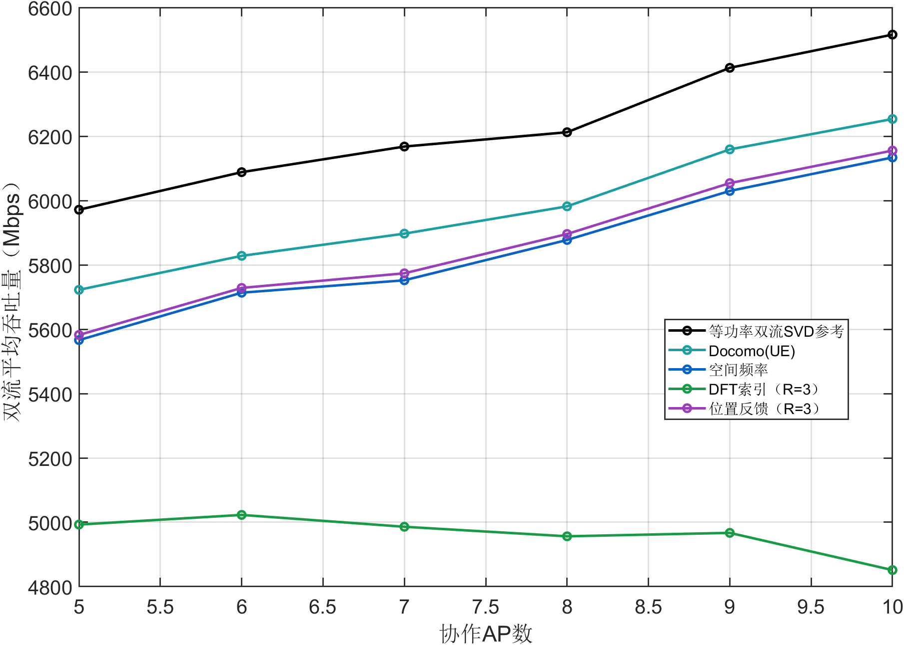

吞吐量结果：位置反馈从横轴5时的5582.26 Mbps变为10时的6155.33 Mbps。终点CPU几何方法中，位置反馈均值最高，为6155.33 Mbps；Docomo(UE)在CPU图中为共享参考，SVD单列为理想参考。

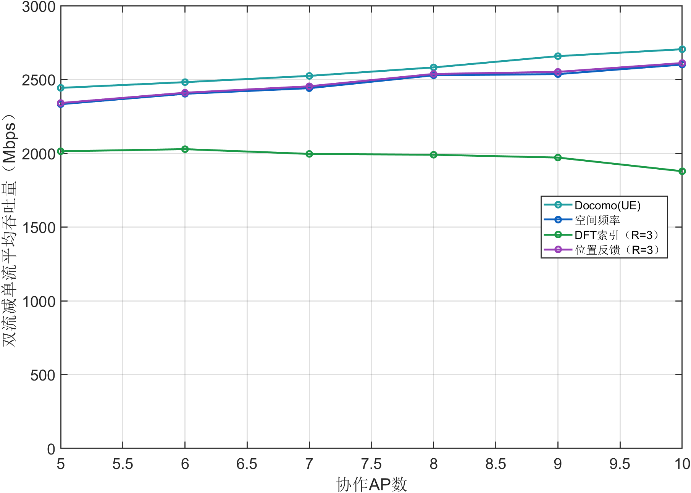

增量结果：本组所有方法和参数点的最小400位置平均增量为1878.37 Mbps，最低正收益比例为99.75%。平均增量为正与每个位置都受益是不同结论，逐位置最差值及非正收益单独保留。

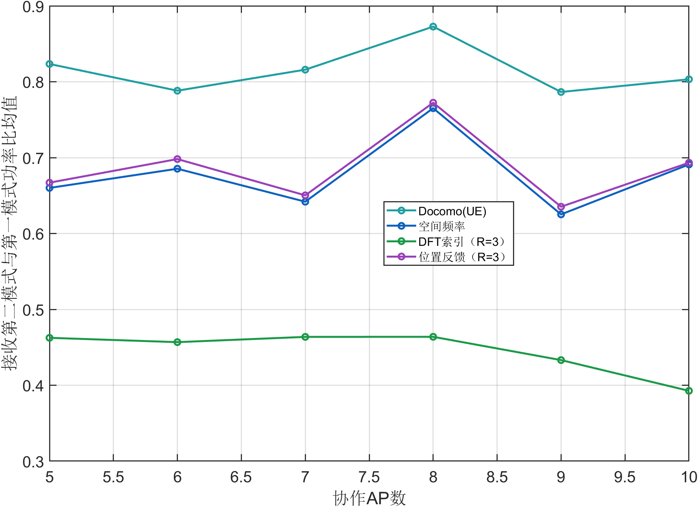

模式结果：位置反馈各参数点的第二与第一接收模式功率比均值范围为0.6353至0.7724；全部参数与位置中最小值为0.3176。该值由真实接收矩阵HW的奇异值平方计算，模式较弱时，即使发送两列也不保证速率增加。

### CPU纯LOS莱斯因子K完整扫描

本实验只扫描莱斯因子K，横轴单位为dB。除横轴外采用32×32、B=8、观测30 dB、K=10 dB默认值。每个参数点、每种方法都使用全部400个相同位置，以下逐点数值和三幅图来自同一组消息重放结果。

本组为一致性对照：纯LOS生成式不含K，所有K点必须逐位置相同。该检查已通过，不解释为信道随K变化。

| 方法 | 横轴 | 双流 Mbps | 增量 Mbps | 正收益 % | 第二模式比 |
|---|---|---|---|---|---|
| Docomo(UE) | 0 | 5981.91 | 2581.95 | 100.00 | 0.8727 |
| Docomo(UE) | 5 | 5981.91 | 2581.95 | 100.00 | 0.8727 |
| Docomo(UE) | 10 | 5981.91 | 2581.95 | 100.00 | 0.8727 |
| Docomo(UE) | 15 | 5981.91 | 2581.95 | 100.00 | 0.8727 |
| Docomo(UE) | 20 | 5981.91 | 2581.95 | 100.00 | 0.8727 |
| 空间频率 | 0 | 5877.47 | 2528.52 | 100.00 | 0.7652 |
| 空间频率 | 5 | 5877.47 | 2528.52 | 100.00 | 0.7652 |
| 空间频率 | 10 | 5877.47 | 2528.52 | 100.00 | 0.7652 |
| 空间频率 | 15 | 5877.47 | 2528.52 | 100.00 | 0.7652 |
| 空间频率 | 20 | 5877.47 | 2528.52 | 100.00 | 0.7652 |
| DFT索引 | 0 | 4956.44 | 1990.00 | 100.00 | 0.4638 |
| DFT索引 | 5 | 4956.44 | 1990.00 | 100.00 | 0.4638 |
| DFT索引 | 10 | 4956.44 | 1990.00 | 100.00 | 0.4638 |
| DFT索引 | 15 | 4956.44 | 1990.00 | 100.00 | 0.4638 |
| DFT索引 | 20 | 4956.44 | 1990.00 | 100.00 | 0.4638 |
| 位置反馈 | 0 | 5896.02 | 2537.62 | 100.00 | 0.7724 |
| 位置反馈 | 5 | 5896.02 | 2537.62 | 100.00 | 0.7724 |
| 位置反馈 | 10 | 5896.02 | 2537.62 | 100.00 | 0.7724 |
| 位置反馈 | 15 | 5896.02 | 2537.62 | 100.00 | 0.7724 |
| 位置反馈 | 20 | 5896.02 | 2537.62 | 100.00 | 0.7724 |
| SVD参考 | 0 | 6212.32 | 2681.06 | 100.00 | 0.9132 |
| SVD参考 | 5 | 6212.32 | 2681.06 | 100.00 | 0.9132 |
| SVD参考 | 10 | 6212.32 | 2681.06 | 100.00 | 0.9132 |
| SVD参考 | 15 | 6212.32 | 2681.06 | 100.00 | 0.9132 |
| SVD参考 | 20 | 6212.32 | 2681.06 | 100.00 | 0.9132 |


吞吐量结果：位置反馈从横轴0时的5896.02 Mbps变为20时的5896.02 Mbps。终点CPU几何方法中，位置反馈均值最高，为5896.02 Mbps；Docomo(UE)在CPU图中为共享参考，SVD单列为理想参考。


增量结果：本组所有方法和参数点的最小400位置平均增量为1990.00 Mbps，最低正收益比例为100.00%。平均增量为正与每个位置都受益是不同结论，逐位置最差值及非正收益单独保留。


模式结果：位置反馈各参数点的第二与第一接收模式功率比均值范围为0.7724至0.7724；全部参数与位置中最小值为0.38742。该值由真实接收矩阵HW的奇异值平方计算，模式较弱时，即使发送两列也不保证速率增加。

### CPU纯LOS默认配置的均值与分布


该柱状图将同一400位置下的单流和双流均值并列，数值见本端默认配置表；两者总功率均为1。SVD两流采用等功率，不能据此表示一般最优功率分配容量。


| 方法 | 最小 Mbps | 5%分位 | 中位 Mbps | 95%分位 | 最大 Mbps |
|---|---|---|---|---|---|
| Docomo(UE) | 2495.91 | 2532.58 | 2581.66 | 2630.72 | 2731.27 |
| 空间频率 | 2315.37 | 2394.15 | 2548.40 | 2602.63 | 2658.40 |
| DFT索引 | 368.66 | 1276.81 | 2083.37 | 2457.28 | 2554.00 |
| 位置反馈 | 2321.82 | 2402.97 | 2555.08 | 2615.21 | 2679.10 |

分布结果：CDF和分位数均按400个配对增量计算，表中5%分位表示约5%的位置收益不超过该值，不能将中位数或均值当作最差用户保证。

### CPU混合信道观测SNR完整扫描

本实验只扫描观测SNR，横轴单位为dB。除横轴外采用32×32、B=8、观测30 dB、K=10 dB默认值。每个参数点、每种方法都使用全部400个相同位置，以下逐点数值和三幅图来自同一组消息重放结果。

| 方法 | 横轴 | 双流 Mbps | 增量 Mbps | 正收益 % | 第二模式比 |
|---|---|---|---|---|---|
| Docomo(UE) | 20 | 5874.39 | 2526.40 | 100.00 | 0.8662 |
| Docomo(UE) | 25 | 5874.09 | 2526.20 | 100.00 | 0.8669 |
| Docomo(UE) | 30 | 5873.32 | 2525.60 | 100.00 | 0.8664 |
| Docomo(UE) | 35 | 5873.37 | 2525.64 | 100.00 | 0.8661 |
| Docomo(UE) | 40 | 5873.32 | 2525.56 | 100.00 | 0.8656 |
| 空间频率 | 20 | 5482.16 | 2310.89 | 100.00 | 0.6478 |
| 空间频率 | 25 | 5489.63 | 2314.93 | 100.00 | 0.6491 |
| 空间频率 | 30 | 5499.84 | 2322.45 | 100.00 | 0.6551 |
| 空间频率 | 35 | 5493.83 | 2315.65 | 100.00 | 0.6543 |
| 空间频率 | 40 | 5491.59 | 2313.64 | 100.00 | 0.6538 |
| DFT索引 | 20 | 4843.57 | 1931.24 | 100.00 | 0.4636 |
| DFT索引 | 25 | 4837.22 | 1928.03 | 100.00 | 0.4623 |
| DFT索引 | 30 | 4838.70 | 1929.08 | 100.00 | 0.4627 |
| DFT索引 | 35 | 4838.70 | 1929.08 | 100.00 | 0.4627 |
| DFT索引 | 40 | 4838.70 | 1929.08 | 100.00 | 0.4627 |
| 位置反馈 | 20 | 5491.64 | 2313.49 | 99.75 | 0.6555 |
| 位置反馈 | 25 | 5499.17 | 2315.82 | 100.00 | 0.6584 |
| 位置反馈 | 30 | 5498.79 | 2314.79 | 100.00 | 0.6579 |
| 位置反馈 | 35 | 5502.32 | 2316.61 | 100.00 | 0.6589 |
| 位置反馈 | 40 | 5501.10 | 2315.98 | 100.00 | 0.6582 |
| SVD参考 | 20 | 6216.37 | 2672.83 | 100.00 | 0.8821 |
| SVD参考 | 25 | 6216.37 | 2672.83 | 100.00 | 0.8821 |
| SVD参考 | 30 | 6216.37 | 2672.83 | 100.00 | 0.8821 |
| SVD参考 | 35 | 6216.37 | 2672.83 | 100.00 | 0.8821 |
| SVD参考 | 40 | 6216.37 | 2672.83 | 100.00 | 0.8821 |


吞吐量结果：位置反馈从横轴20时的5491.64 Mbps变为40时的5501.10 Mbps。终点CPU几何方法中，位置反馈均值最高，为5501.10 Mbps；Docomo(UE)在CPU图中为共享参考，SVD单列为理想参考。


增量结果：本组所有方法和参数点的最小400位置平均增量为1928.03 Mbps，最低正收益比例为99.75%。平均增量为正与每个位置都受益是不同结论，逐位置最差值及非正收益单独保留。


模式结果：位置反馈各参数点的第二与第一接收模式功率比均值范围为0.6555至0.6589；全部参数与位置中最小值为0.034118。该值由真实接收矩阵HW的奇异值平方计算，模式较弱时，即使发送两列也不保证速率增加。

### CPU混合信道UPA阵元数完整扫描

本实验只扫描UPA阵元数，横轴单位为阵元。除横轴外采用32×32、B=8、观测30 dB、K=10 dB默认值。每个参数点、每种方法都使用全部400个相同位置，以下逐点数值和三幅图来自同一组消息重放结果。

| 方法 | 横轴 | 双流 Mbps | 增量 Mbps | 正收益 % | 第二模式比 |
|---|---|---|---|---|---|
| Docomo(UE) | 64 | 2811.37 | 1016.20 | 100.00 | 0.8408 |
| Docomo(UE) | 256 | 4313.57 | 1749.60 | 100.00 | 0.8506 |
| Docomo(UE) | 1024 | 5873.32 | 2525.60 | 100.00 | 0.8664 |
| 空间频率 | 64 | 2030.62 | 596.96 | 97.50 | 0.4696 |
| 空间频率 | 256 | 3597.56 | 1345.62 | 99.75 | 0.5038 |
| 空间频率 | 1024 | 5499.84 | 2322.45 | 100.00 | 0.6551 |
| DFT索引 | 64 | 1898.37 | 537.75 | 97.25 | 0.4297 |
| DFT索引 | 256 | 3286.83 | 1155.67 | 98.50 | 0.4503 |
| DFT索引 | 1024 | 4838.70 | 1929.08 | 100.00 | 0.4627 |
| 位置反馈 | 64 | 2031.65 | 594.91 | 97.75 | 0.4734 |
| 位置反馈 | 256 | 3595.46 | 1343.21 | 99.50 | 0.5029 |
| 位置反馈 | 1024 | 5498.79 | 2314.79 | 100.00 | 0.6579 |
| SVD参考 | 64 | 3102.80 | 1128.88 | 100.00 | 0.8603 |
| SVD参考 | 256 | 4634.31 | 1884.13 | 100.00 | 0.8767 |
| SVD参考 | 1024 | 6216.37 | 2672.83 | 100.00 | 0.8821 |


吞吐量结果：位置反馈从横轴64时的2031.65 Mbps变为1024时的5498.79 Mbps。终点CPU几何方法中，空间频率均值最高，为5499.84 Mbps；Docomo(UE)在CPU图中为共享参考，SVD单列为理想参考。


增量结果：本组所有方法和参数点的最小400位置平均增量为537.75 Mbps，最低正收益比例为97.25%。平均增量为正与每个位置都受益是不同结论，逐位置最差值及非正收益单独保留。


模式结果：位置反馈各参数点的第二与第一接收模式功率比均值范围为0.4734至0.6579；全部参数与位置中最小值为0.015866。该值由真实接收矩阵HW的奇异值平方计算，模式较弱时，即使发送两列也不保证速率增加。

### CPU混合信道协作AP数完整扫描

本实验只扫描协作AP数，横轴单位为个。除横轴外采用32×32、B=8、观测30 dB、K=10 dB默认值。每个参数点、每种方法都使用全部400个相同位置，以下逐点数值和三幅图来自同一组消息重放结果。

| 方法 | 横轴 | 双流 Mbps | 增量 Mbps | 正收益 % | 第二模式比 |
|---|---|---|---|---|---|
| Docomo(UE) | 5 | 5614.94 | 2388.16 | 100.00 | 0.8224 |
| Docomo(UE) | 6 | 5722.07 | 2427.34 | 100.00 | 0.7830 |
| Docomo(UE) | 7 | 5791.76 | 2470.94 | 100.00 | 0.8127 |
| Docomo(UE) | 8 | 5873.32 | 2525.60 | 100.00 | 0.8664 |
| Docomo(UE) | 9 | 6052.39 | 2604.56 | 100.00 | 0.7905 |
| Docomo(UE) | 10 | 6142.36 | 2647.58 | 100.00 | 0.7986 |
| 空间频率 | 5 | 5312.97 | 2185.38 | 100.00 | 0.6114 |
| 空间频率 | 6 | 5467.81 | 2266.48 | 100.00 | 0.6169 |
| 空间频率 | 7 | 5384.36 | 2215.05 | 100.00 | 0.5592 |
| 空间频率 | 8 | 5499.84 | 2322.45 | 100.00 | 0.6551 |
| 空间频率 | 9 | 5467.02 | 2231.07 | 100.00 | 0.5175 |
| 空间频率 | 10 | 5591.55 | 2331.90 | 100.00 | 0.5982 |
| DFT索引 | 5 | 4901.42 | 1973.12 | 100.00 | 0.4693 |
| DFT索引 | 6 | 4918.54 | 1977.54 | 100.00 | 0.4595 |
| DFT索引 | 7 | 4871.23 | 1936.05 | 99.50 | 0.4626 |
| DFT索引 | 8 | 4838.70 | 1929.08 | 100.00 | 0.4627 |
| DFT索引 | 9 | 4849.32 | 1912.63 | 100.00 | 0.4311 |
| DFT索引 | 10 | 4747.71 | 1833.90 | 99.75 | 0.3942 |
| 位置反馈 | 5 | 5325.36 | 2193.22 | 100.00 | 0.6177 |
| 位置反馈 | 6 | 5480.25 | 2273.82 | 100.00 | 0.6230 |
| 位置反馈 | 7 | 5396.42 | 2219.21 | 100.00 | 0.5656 |
| 位置反馈 | 8 | 5498.79 | 2314.79 | 100.00 | 0.6579 |
| 位置反馈 | 9 | 5493.54 | 2251.44 | 100.00 | 0.5220 |
| 位置反馈 | 10 | 5610.89 | 2343.19 | 100.00 | 0.6010 |
| SVD参考 | 5 | 5947.26 | 2498.41 | 100.00 | 0.7711 |
| SVD参考 | 6 | 6075.71 | 2578.01 | 100.00 | 0.8124 |
| SVD参考 | 7 | 6144.97 | 2626.89 | 100.00 | 0.8518 |
| SVD参考 | 8 | 6216.37 | 2672.83 | 100.00 | 0.8821 |
| SVD参考 | 9 | 6417.83 | 2732.30 | 100.00 | 0.7684 |
| SVD参考 | 10 | 6518.19 | 2787.81 | 100.00 | 0.7829 |

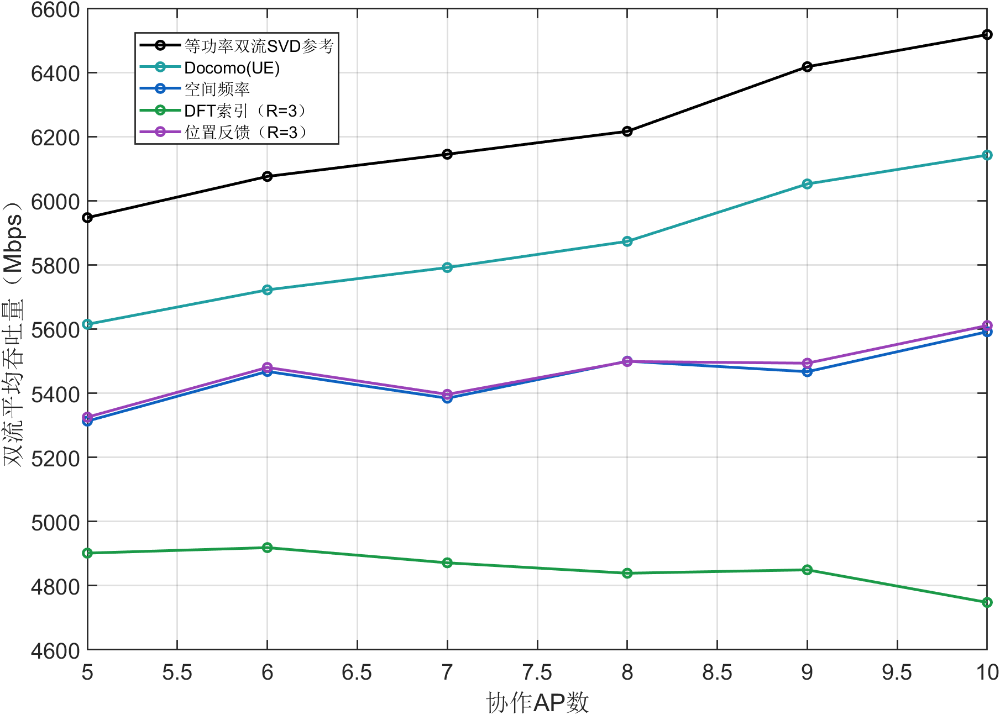

吞吐量结果：位置反馈从横轴5时的5325.36 Mbps变为10时的5610.89 Mbps。终点CPU几何方法中，位置反馈均值最高，为5610.89 Mbps；Docomo(UE)在CPU图中为共享参考，SVD单列为理想参考。

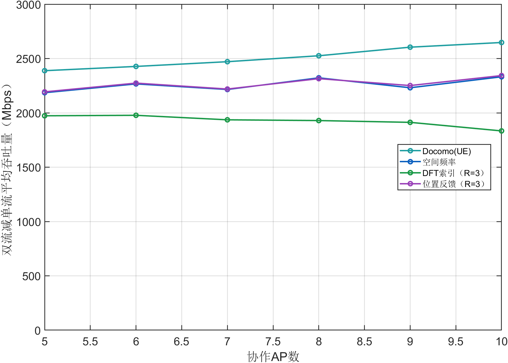

增量结果：本组所有方法和参数点的最小400位置平均增量为1833.90 Mbps，最低正收益比例为99.50%。平均增量为正与每个位置都受益是不同结论，逐位置最差值及非正收益单独保留。

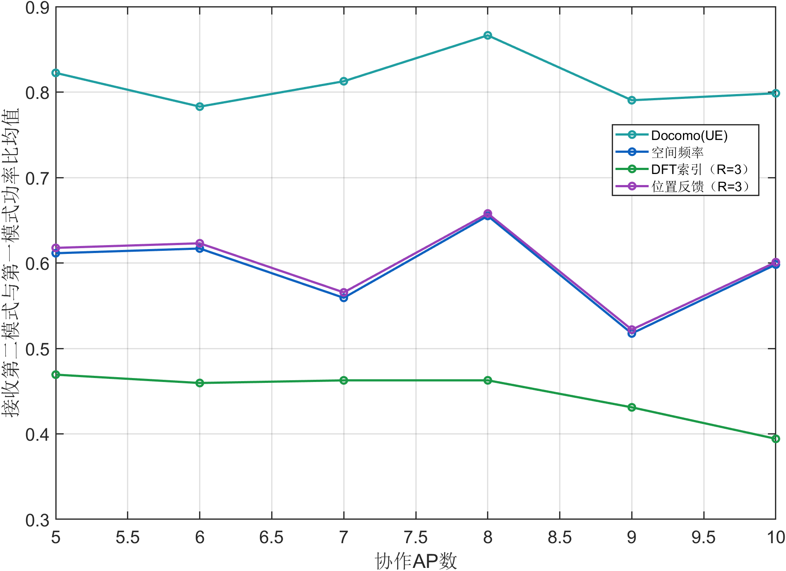

模式结果：位置反馈各参数点的第二与第一接收模式功率比均值范围为0.5220至0.6579；全部参数与位置中最小值为0.035221。该值由真实接收矩阵HW的奇异值平方计算，模式较弱时，即使发送两列也不保证速率增加。

### CPU混合信道莱斯因子K完整扫描

本实验只扫描莱斯因子K，横轴单位为dB。除横轴外采用32×32、B=8、观测30 dB、K=10 dB默认值。每个参数点、每种方法都使用全部400个相同位置，以下逐点数值和三幅图来自同一组消息重放结果。

| 方法 | 横轴 | 双流 Mbps | 增量 Mbps | 正收益 % | 第二模式比 |
|---|---|---|---|---|---|
| Docomo(UE) | 0 | 4785.06 | 1641.76 | 98.25 | 0.4484 |
| Docomo(UE) | 5 | 5663.21 | 2410.60 | 100.00 | 0.8352 |
| Docomo(UE) | 10 | 5873.32 | 2525.60 | 100.00 | 0.8664 |
| Docomo(UE) | 15 | 5946.50 | 2563.62 | 100.00 | 0.8727 |
| Docomo(UE) | 20 | 5970.77 | 2575.99 | 100.00 | 0.8744 |
| 空间频率 | 0 | 4087.75 | 1503.46 | 92.00 | 0.4603 |
| 空间频率 | 5 | 5130.82 | 2121.71 | 99.75 | 0.5897 |
| 空间频率 | 10 | 5499.84 | 2322.45 | 100.00 | 0.6551 |
| 空间频率 | 15 | 5715.59 | 2438.22 | 100.00 | 0.7094 |
| 空间频率 | 20 | 5817.53 | 2497.82 | 100.00 | 0.7435 |
| DFT索引 | 0 | 4180.73 | 1596.92 | 99.50 | 0.4598 |
| DFT索引 | 5 | 4637.19 | 1822.92 | 100.00 | 0.4584 |
| DFT索引 | 10 | 4838.70 | 1929.08 | 100.00 | 0.4627 |
| DFT索引 | 15 | 4910.99 | 1965.28 | 100.00 | 0.4624 |
| DFT索引 | 20 | 4935.67 | 1977.99 | 100.00 | 0.4624 |
| 位置反馈 | 0 | 3896.35 | 1503.08 | 90.50 | 0.4565 |
| 位置反馈 | 5 | 5145.03 | 2131.57 | 99.50 | 0.5971 |
| 位置反馈 | 10 | 5498.79 | 2314.79 | 100.00 | 0.6579 |
| 位置反馈 | 15 | 5728.32 | 2443.87 | 100.00 | 0.7151 |
| 位置反馈 | 20 | 5831.57 | 2504.89 | 100.00 | 0.7505 |
| SVD参考 | 0 | 6367.15 | 2660.63 | 100.00 | 0.6625 |
| SVD参考 | 5 | 6259.33 | 2662.05 | 100.00 | 0.7922 |
| SVD参考 | 10 | 6216.37 | 2672.83 | 100.00 | 0.8821 |
| SVD参考 | 15 | 6211.09 | 2678.43 | 100.00 | 0.9069 |
| SVD参考 | 20 | 6211.64 | 2680.22 | 100.00 | 0.9116 |


吞吐量结果：位置反馈从横轴0时的3896.35 Mbps变为20时的5831.57 Mbps。终点CPU几何方法中，位置反馈均值最高，为5831.57 Mbps；Docomo(UE)在CPU图中为共享参考，SVD单列为理想参考。


增量结果：本组所有方法和参数点的最小400位置平均增量为1503.08 Mbps，最低正收益比例为90.50%。平均增量为正与每个位置都受益是不同结论，逐位置最差值及非正收益单独保留。


模式结果：位置反馈各参数点的第二与第一接收模式功率比均值范围为0.4565至0.7505；全部参数与位置中最小值为0.00033076。该值由真实接收矩阵HW的奇异值平方计算，模式较弱时，即使发送两列也不保证速率增加。

### CPU混合信道默认配置的均值与分布


该柱状图将同一400位置下的单流和双流均值并列，数值见本端默认配置表；两者总功率均为1。SVD两流采用等功率，不能据此表示一般最优功率分配容量。


| 方法 | 最小 Mbps | 5%分位 | 中位 Mbps | 95%分位 | 最大 Mbps |
|---|---|---|---|---|---|
| Docomo(UE) | 2359.58 | 2473.20 | 2524.88 | 2577.44 | 2630.96 |
| 空间频率 | 550.69 | 1831.41 | 2403.74 | 2535.61 | 2614.28 |
| DFT索引 | 242.23 | 1244.34 | 2008.33 | 2401.71 | 2497.10 |
| 位置反馈 | 9.14 | 1747.65 | 2410.76 | 2532.96 | 2609.08 |

分布结果：CDF和分位数均按400个配对增量计算，表中5%分位表示约5%的位置收益不超过该值，不能将中位数或均值当作最差用户保证。

### CPU双流有效载荷随AP数量变化

| 方法 | 5 | 6 | 7 | 8 | 9 | 10 |
|---|---|---|---|---|---|---|
| Docomo(UE) | 97 | 117 | 137 | 157 | 178 | 198 |
| 空间频率 | 84 | 84 | 84 | 84 | 84 | 84 |
| DFT索引 | 42 | 42 | 42 | 42 | 42 | 42 |
| 位置反馈 | 36 | 36 | 36 | 36 | 36 | 36 |


开销结果：CPU三种几何方法不因新增第二流而增加反馈，固定三个参考AP。UE每增加一个协作AP，第二流额外多4 bit；表中为两流总有效载荷，已经包括原空间消息及第一流所需字段。CPU图与UE图采用各自实际消息长度，不把编码后的比特数替换为JSON字符数。

强散射的K=0 dB配置中，位置反馈双流均值为3896.35 Mbps，正收益比例为90.50%；DFT索引双流均值为4180.73 Mbps。位置反馈的低开销优势不代表它在所有信道条件下速率领先。第二相位只能在既定共享波束内调整，不能修复先前定位或空间波束失配。

本端纯LOS与MIX的逐实验图表、数值和解释已分别列出，不合并两种信道均值。

### CPU反馈量和模型限制

默认32×32、8 AP时，空间频率为84 bit、DFT为42 bit、位置反馈为36 bit，单双流完全相同。阵元数变化时DFT索引位宽随码本规模变化；空间频率仍为固定6个14 bit频率，位置反馈仍为36 bit。AP数量变化也不增加这三种CPU空间消息的参考AP数量。

CPU在几何模型上优化第二相位，实际信道中的散射、定位误差和波束约束会影响双流性能。不能以模型目标逐轮不下降推断真实信道性能必然提高；目标不下降是相对于双流初值，单流与双流还存在功率平分和接收干扰的差别。

## UE端完整实验

UE使用全部活动AP的带噪观测和消息解码后的波束形成有效信道，设计第二相位，再发送B−1个4 bit相对相位，参考AP固定为0。CPU只依靠原有整数消息与新增相位整数恢复两列预编码，不直接使用UE浮点发送矩阵。

### UE纯LOS默认配置

| 方法 | 单流 Mbps | 双流 Mbps | 增量 Mbps | 正收益比例 | 最小增量 Mbps |
|---|---|---|---|---|---|
| 全反馈Type-I(UE) | 3359.60 | 5920.80 | 2561.20 | 100.00% | 2397.10 |
| 全反馈Type-II(UE) | 3362.89 | 5924.54 | 2561.65 | 100.00% | 2330.07 |
| Docomo | 3399.96 | 5981.91 | 2581.95 | 100.00% | 2495.91 |
| 空间频率 | 3361.83 | 5926.83 | 2565.00 | 100.00% | 2413.04 |
| DFT索引 | 3354.76 | 5913.34 | 2558.58 | 100.00% | 2380.98 |
| 位置反馈 | 3361.81 | 5926.83 | 2565.02 | 100.00% | 2413.04 |

### UE混合信道默认配置

| 方法 | 单流 Mbps | 双流 Mbps | 增量 Mbps | 正收益比例 | 最小增量 Mbps |
|---|---|---|---|---|---|
| 全反馈Type-I(UE) | 3298.51 | 5689.39 | 2390.88 | 100.00% | 1423.56 |
| 全反馈Type-II(UE) | 3324.28 | 5670.72 | 2346.44 | 100.00% | 1685.00 |
| Docomo | 3347.72 | 5873.32 | 2525.60 | 100.00% | 2359.58 |
| 空间频率 | 3307.27 | 5836.42 | 2529.16 | 100.00% | 2338.72 |
| DFT索引 | 3300.25 | 5823.92 | 2523.67 | 100.00% | 2337.18 |
| 位置反馈 | 3307.26 | 5836.57 | 2529.31 | 100.00% | 2338.72 |

默认混合信道下，位置反馈平均速率由3307.26提升至5836.57 Mbps；相较空间频率双流均值相差+0.15 Mbps。该比较使用全部400个相同位置，表中最小增量和正收益比例保留位置差异。

默认混合信道位置反馈的接收第二模式与第一模式功率比均值为0.8144，最小值为0.5741。这组指标与速率一起用于判断第二流是否形成有用接收模式。

### UE纯LOS观测SNR完整扫描

本实验只扫描观测SNR，横轴单位为dB。除横轴外采用32×32、B=8、观测30 dB、K=10 dB默认值。每个参数点、每种方法都使用全部400个相同位置，以下逐点数值和三幅图来自同一组消息重放结果。

| 方法 | 横轴 | 双流 Mbps | 增量 Mbps | 正收益 % | 第二模式比 |
|---|---|---|---|---|---|
| 全反馈Type-I(UE) | 20 | 5924.82 | 2564.33 | 100.00 | 0.7944 |
| 全反馈Type-I(UE) | 25 | 5921.18 | 2561.55 | 100.00 | 0.7922 |
| 全反馈Type-I(UE) | 30 | 5920.80 | 2561.20 | 100.00 | 0.7921 |
| 全反馈Type-I(UE) | 35 | 5920.75 | 2561.44 | 100.00 | 0.7921 |
| 全反馈Type-I(UE) | 40 | 5921.07 | 2561.73 | 100.00 | 0.7921 |
| 全反馈Type-II(UE) | 20 | 5928.82 | 2565.16 | 100.00 | 0.7931 |
| 全反馈Type-II(UE) | 25 | 5925.93 | 2562.83 | 100.00 | 0.7915 |
| 全反馈Type-II(UE) | 30 | 5924.54 | 2561.65 | 100.00 | 0.7906 |
| 全反馈Type-II(UE) | 35 | 5924.58 | 2561.88 | 100.00 | 0.7897 |
| 全反馈Type-II(UE) | 40 | 5924.72 | 2562.07 | 100.00 | 0.7888 |
| Docomo | 20 | 5981.64 | 2581.65 | 100.00 | 0.8734 |
| Docomo | 25 | 5982.01 | 2581.99 | 100.00 | 0.8738 |
| Docomo | 30 | 5981.91 | 2581.95 | 100.00 | 0.8727 |
| Docomo | 35 | 5982.08 | 2582.04 | 100.00 | 0.8722 |
| Docomo | 40 | 5981.63 | 2581.66 | 100.00 | 0.8720 |
| 空间频率 | 20 | 5928.82 | 2566.77 | 100.00 | 0.7949 |
| 空间频率 | 25 | 5927.27 | 2565.44 | 100.00 | 0.7935 |
| 空间频率 | 30 | 5926.83 | 2565.00 | 100.00 | 0.7941 |
| 空间频率 | 35 | 5926.47 | 2565.06 | 100.00 | 0.7947 |
| 空间频率 | 40 | 5926.08 | 2565.06 | 100.00 | 0.7946 |
| DFT索引 | 20 | 5915.85 | 2560.79 | 100.00 | 0.7926 |
| DFT索引 | 25 | 5915.07 | 2559.96 | 100.00 | 0.7929 |
| DFT索引 | 30 | 5913.34 | 2558.58 | 100.00 | 0.7930 |
| DFT索引 | 35 | 5912.86 | 2558.59 | 100.00 | 0.7935 |
| DFT索引 | 40 | 5912.53 | 2558.63 | 100.00 | 0.7936 |
| 位置反馈 | 20 | 5928.98 | 2566.95 | 100.00 | 0.7952 |
| 位置反馈 | 25 | 5927.19 | 2565.36 | 100.00 | 0.7934 |
| 位置反馈 | 30 | 5926.83 | 2565.02 | 100.00 | 0.7938 |
| 位置反馈 | 35 | 5926.28 | 2564.90 | 100.00 | 0.7943 |
| 位置反馈 | 40 | 5925.94 | 2564.93 | 100.00 | 0.7947 |
| SVD参考 | 20 | 6212.32 | 2681.06 | 100.00 | 0.9132 |
| SVD参考 | 25 | 6212.32 | 2681.06 | 100.00 | 0.9132 |
| SVD参考 | 30 | 6212.32 | 2681.06 | 100.00 | 0.9132 |
| SVD参考 | 35 | 6212.32 | 2681.06 | 100.00 | 0.9132 |
| SVD参考 | 40 | 6212.32 | 2681.06 | 100.00 | 0.9132 |


吞吐量结果：位置反馈从横轴20时的5928.98 Mbps变为40时的5925.94 Mbps。终点UE方法中，Docomo均值最高，为5981.63 Mbps；Docomo(UE)在CPU图中为共享参考，SVD单列为理想参考。


增量结果：本组所有方法和参数点的最小400位置平均增量为2558.58 Mbps，最低正收益比例为100.00%。平均增量为正与每个位置都受益是不同结论，逐位置最差值及非正收益单独保留。


模式结果：位置反馈各参数点的第二与第一接收模式功率比均值范围为0.7934至0.7952；全部参数与位置中最小值为0.57952。该值由真实接收矩阵HW的奇异值平方计算，模式较弱时，即使发送两列也不保证速率增加。

### UE纯LOSUPA阵元数完整扫描

本实验只扫描UPA阵元数，横轴单位为阵元。除横轴外采用32×32、B=8、观测30 dB、K=10 dB默认值。每个参数点、每种方法都使用全部400个相同位置，以下逐点数值和三幅图来自同一组消息重放结果。

| 方法 | 横轴 | 双流 Mbps | 增量 Mbps | 正收益 % | 第二模式比 |
|---|---|---|---|---|---|
| 全反馈Type-I(UE) | 64 | 2841.50 | 1046.40 | 100.00 | 0.7923 |
| 全反馈Type-I(UE) | 256 | 4355.57 | 1784.22 | 100.00 | 0.7900 |
| 全反馈Type-I(UE) | 1024 | 5920.80 | 2561.20 | 100.00 | 0.7921 |
| 全反馈Type-II(UE) | 64 | 2845.39 | 1047.73 | 100.00 | 0.7897 |
| 全反馈Type-II(UE) | 256 | 4361.88 | 1787.02 | 100.00 | 0.7876 |
| 全反馈Type-II(UE) | 1024 | 5924.54 | 2561.65 | 100.00 | 0.7906 |
| Docomo | 64 | 2887.90 | 1057.60 | 100.00 | 0.8611 |
| Docomo | 256 | 4412.96 | 1802.48 | 100.00 | 0.8659 |
| Docomo | 1024 | 5981.91 | 2581.95 | 100.00 | 0.8727 |
| 空间频率 | 64 | 2844.71 | 1048.50 | 100.00 | 0.7918 |
| 空间频率 | 256 | 4358.07 | 1786.01 | 100.00 | 0.7892 |
| 空间频率 | 1024 | 5926.83 | 2565.00 | 100.00 | 0.7941 |
| DFT索引 | 64 | 2832.69 | 1043.07 | 100.00 | 0.7911 |
| DFT索引 | 256 | 4346.25 | 1781.04 | 100.00 | 0.7892 |
| DFT索引 | 1024 | 5913.34 | 2558.58 | 100.00 | 0.7930 |
| 位置反馈 | 64 | 2844.91 | 1048.70 | 100.00 | 0.7920 |
| 位置反馈 | 256 | 4358.08 | 1786.01 | 100.00 | 0.7890 |
| 位置反馈 | 1024 | 5926.83 | 2565.02 | 100.00 | 0.7938 |
| SVD参考 | 64 | 3089.63 | 1139.50 | 100.00 | 0.9132 |
| SVD参考 | 256 | 4628.25 | 1893.13 | 100.00 | 0.9132 |
| SVD参考 | 1024 | 6212.32 | 2681.06 | 100.00 | 0.9132 |


吞吐量结果：位置反馈从横轴64时的2844.91 Mbps变为1024时的5926.83 Mbps。终点UE方法中，Docomo均值最高，为5981.91 Mbps；Docomo(UE)在CPU图中为共享参考，SVD单列为理想参考。


增量结果：本组所有方法和参数点的最小400位置平均增量为1043.07 Mbps，最低正收益比例为100.00%。平均增量为正与每个位置都受益是不同结论，逐位置最差值及非正收益单独保留。


模式结果：位置反馈各参数点的第二与第一接收模式功率比均值范围为0.7890至0.7938；全部参数与位置中最小值为0.46472。该值由真实接收矩阵HW的奇异值平方计算，模式较弱时，即使发送两列也不保证速率增加。

### UE纯LOS协作AP数完整扫描

本实验只扫描协作AP数，横轴单位为个。除横轴外采用32×32、B=8、观测30 dB、K=10 dB默认值。每个参数点、每种方法都使用全部400个相同位置，以下逐点数值和三幅图来自同一组消息重放结果。

| 方法 | 横轴 | 双流 Mbps | 增量 Mbps | 正收益 % | 第二模式比 |
|---|---|---|---|---|---|
| 全反馈Type-I(UE) | 5 | 5596.94 | 2353.27 | 100.00 | 0.6868 |
| 全反馈Type-I(UE) | 6 | 5733.84 | 2414.84 | 100.00 | 0.7165 |
| 全反馈Type-I(UE) | 7 | 5814.78 | 2493.05 | 100.00 | 0.7261 |
| 全反馈Type-I(UE) | 8 | 5920.80 | 2561.20 | 100.00 | 0.7921 |
| 全反馈Type-I(UE) | 9 | 6085.30 | 2583.08 | 100.00 | 0.6952 |
| 全反馈Type-I(UE) | 10 | 6183.78 | 2638.47 | 100.00 | 0.7451 |
| 全反馈Type-II(UE) | 5 | 5600.36 | 2353.43 | 100.00 | 0.6830 |
| 全反馈Type-II(UE) | 6 | 5735.37 | 2412.99 | 100.00 | 0.7107 |
| 全反馈Type-II(UE) | 7 | 5817.41 | 2492.02 | 100.00 | 0.7256 |
| 全反馈Type-II(UE) | 8 | 5924.54 | 2561.65 | 100.00 | 0.7906 |
| 全反馈Type-II(UE) | 9 | 6085.32 | 2580.18 | 100.00 | 0.6925 |
| 全反馈Type-II(UE) | 10 | 6189.78 | 2640.57 | 100.00 | 0.7447 |
| Docomo | 5 | 5722.48 | 2443.29 | 100.00 | 0.8234 |
| Docomo | 6 | 5828.07 | 2482.03 | 100.00 | 0.7882 |
| Docomo | 7 | 5897.10 | 2524.45 | 100.00 | 0.8159 |
| Docomo | 8 | 5981.91 | 2581.95 | 100.00 | 0.8727 |
| Docomo | 9 | 6158.97 | 2658.24 | 100.00 | 0.7865 |
| Docomo | 10 | 6253.41 | 2705.25 | 100.00 | 0.8032 |
| 空间频率 | 5 | 5600.45 | 2355.88 | 100.00 | 0.6889 |
| 空间频率 | 6 | 5740.92 | 2420.49 | 100.00 | 0.7194 |
| 空间频率 | 7 | 5818.60 | 2496.11 | 100.00 | 0.7275 |
| 空间频率 | 8 | 5926.83 | 2565.00 | 100.00 | 0.7941 |
| 空间频率 | 9 | 6094.66 | 2590.36 | 100.00 | 0.6996 |
| 空间频率 | 10 | 6186.26 | 2640.35 | 100.00 | 0.7458 |
| DFT索引 | 5 | 5593.29 | 2351.32 | 100.00 | 0.6853 |
| DFT索引 | 6 | 5732.57 | 2416.37 | 100.00 | 0.7197 |
| DFT索引 | 7 | 5807.19 | 2490.18 | 100.00 | 0.7294 |
| DFT索引 | 8 | 5913.34 | 2558.58 | 100.00 | 0.7930 |
| DFT索引 | 9 | 6069.86 | 2582.39 | 100.00 | 0.7114 |
| DFT索引 | 10 | 6156.82 | 2628.22 | 100.00 | 0.7476 |
| 位置反馈 | 5 | 5600.44 | 2355.86 | 100.00 | 0.6888 |
| 位置反馈 | 6 | 5740.82 | 2420.41 | 100.00 | 0.7194 |
| 位置反馈 | 7 | 5818.49 | 2496.04 | 100.00 | 0.7271 |
| 位置反馈 | 8 | 5926.83 | 2565.02 | 100.00 | 0.7938 |
| 位置反馈 | 9 | 6094.66 | 2590.29 | 100.00 | 0.6991 |
| 位置反馈 | 10 | 6186.33 | 2640.40 | 100.00 | 0.7459 |
| SVD参考 | 5 | 5971.46 | 2507.14 | 100.00 | 0.7599 |
| SVD参考 | 6 | 6088.19 | 2586.22 | 100.00 | 0.8180 |
| SVD参考 | 7 | 6167.77 | 2654.61 | 100.00 | 0.9005 |
| SVD参考 | 8 | 6212.32 | 2681.06 | 100.00 | 0.9132 |
| SVD参考 | 9 | 6412.47 | 2708.48 | 100.00 | 0.7135 |
| SVD参考 | 10 | 6515.66 | 2772.80 | 100.00 | 0.7454 |

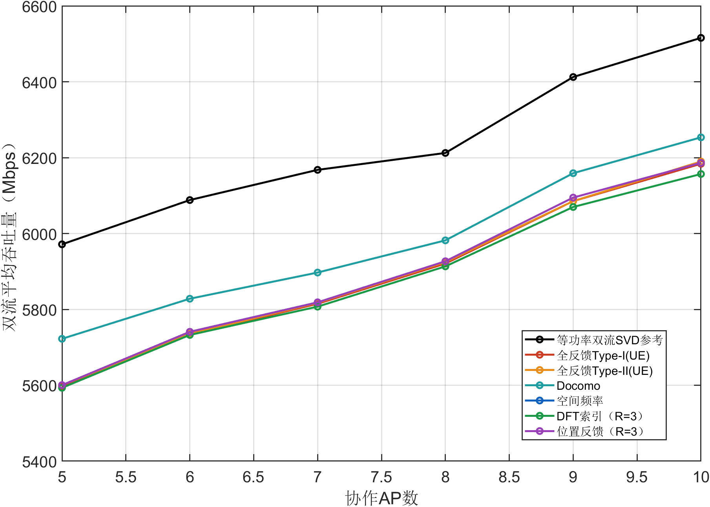

吞吐量结果：位置反馈从横轴5时的5600.44 Mbps变为10时的6186.33 Mbps。终点UE方法中，Docomo均值最高，为6253.41 Mbps；Docomo(UE)在CPU图中为共享参考，SVD单列为理想参考。

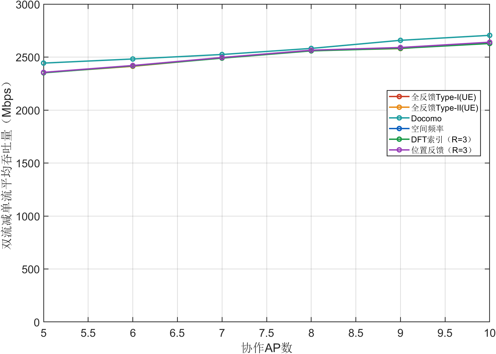

增量结果：本组所有方法和参数点的最小400位置平均增量为2351.32 Mbps，最低正收益比例为100.00%。平均增量为正与每个位置都受益是不同结论，逐位置最差值及非正收益单独保留。

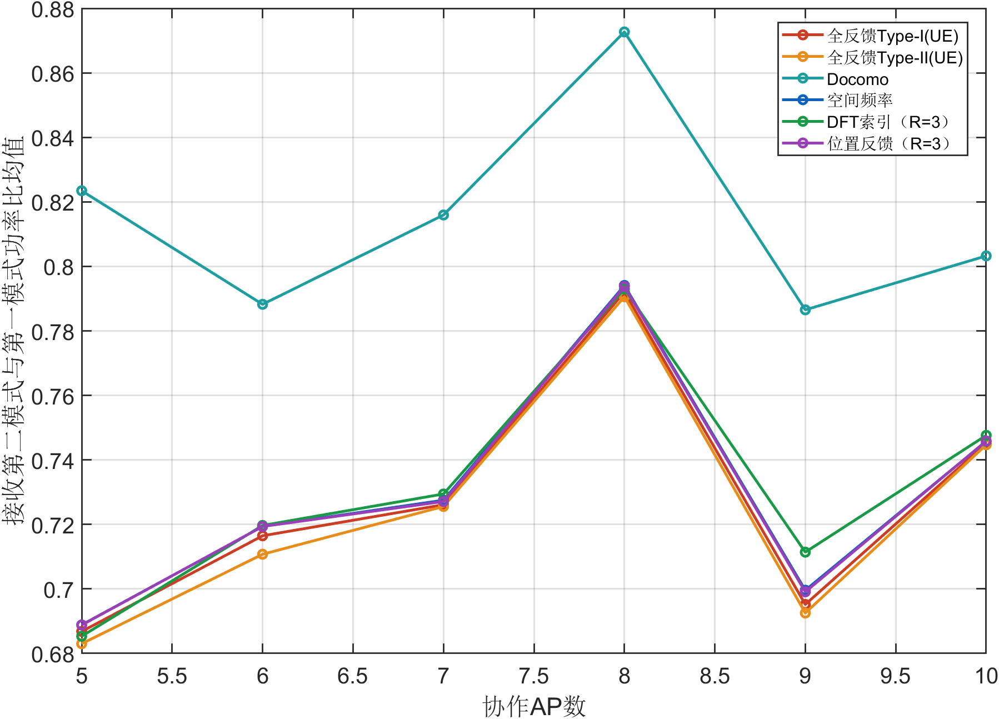

模式结果：位置反馈各参数点的第二与第一接收模式功率比均值范围为0.6888至0.7938；全部参数与位置中最小值为0.35925。该值由真实接收矩阵HW的奇异值平方计算，模式较弱时，即使发送两列也不保证速率增加。

### UE纯LOS莱斯因子K完整扫描

本实验只扫描莱斯因子K，横轴单位为dB。除横轴外采用32×32、B=8、观测30 dB、K=10 dB默认值。每个参数点、每种方法都使用全部400个相同位置，以下逐点数值和三幅图来自同一组消息重放结果。

本组为一致性对照：纯LOS生成式不含K，所有K点必须逐位置相同。该检查已通过，不解释为信道随K变化。

| 方法 | 横轴 | 双流 Mbps | 增量 Mbps | 正收益 % | 第二模式比 |
|---|---|---|---|---|---|
| 全反馈Type-I(UE) | 0 | 5920.80 | 2561.20 | 100.00 | 0.7921 |
| 全反馈Type-I(UE) | 5 | 5920.80 | 2561.20 | 100.00 | 0.7921 |
| 全反馈Type-I(UE) | 10 | 5920.80 | 2561.20 | 100.00 | 0.7921 |
| 全反馈Type-I(UE) | 15 | 5920.80 | 2561.20 | 100.00 | 0.7921 |
| 全反馈Type-I(UE) | 20 | 5920.80 | 2561.20 | 100.00 | 0.7921 |
| 全反馈Type-II(UE) | 0 | 5924.54 | 2561.65 | 100.00 | 0.7906 |
| 全反馈Type-II(UE) | 5 | 5924.54 | 2561.65 | 100.00 | 0.7906 |
| 全反馈Type-II(UE) | 10 | 5924.54 | 2561.65 | 100.00 | 0.7906 |
| 全反馈Type-II(UE) | 15 | 5924.54 | 2561.65 | 100.00 | 0.7906 |
| 全反馈Type-II(UE) | 20 | 5924.54 | 2561.65 | 100.00 | 0.7906 |
| Docomo | 0 | 5981.91 | 2581.95 | 100.00 | 0.8727 |
| Docomo | 5 | 5981.91 | 2581.95 | 100.00 | 0.8727 |
| Docomo | 10 | 5981.91 | 2581.95 | 100.00 | 0.8727 |
| Docomo | 15 | 5981.91 | 2581.95 | 100.00 | 0.8727 |
| Docomo | 20 | 5981.91 | 2581.95 | 100.00 | 0.8727 |
| 空间频率 | 0 | 5926.83 | 2565.00 | 100.00 | 0.7941 |
| 空间频率 | 5 | 5926.83 | 2565.00 | 100.00 | 0.7941 |
| 空间频率 | 10 | 5926.83 | 2565.00 | 100.00 | 0.7941 |
| 空间频率 | 15 | 5926.83 | 2565.00 | 100.00 | 0.7941 |
| 空间频率 | 20 | 5926.83 | 2565.00 | 100.00 | 0.7941 |
| DFT索引 | 0 | 5913.34 | 2558.58 | 100.00 | 0.7930 |
| DFT索引 | 5 | 5913.34 | 2558.58 | 100.00 | 0.7930 |
| DFT索引 | 10 | 5913.34 | 2558.58 | 100.00 | 0.7930 |
| DFT索引 | 15 | 5913.34 | 2558.58 | 100.00 | 0.7930 |
| DFT索引 | 20 | 5913.34 | 2558.58 | 100.00 | 0.7930 |
| 位置反馈 | 0 | 5926.83 | 2565.02 | 100.00 | 0.7938 |
| 位置反馈 | 5 | 5926.83 | 2565.02 | 100.00 | 0.7938 |
| 位置反馈 | 10 | 5926.83 | 2565.02 | 100.00 | 0.7938 |
| 位置反馈 | 15 | 5926.83 | 2565.02 | 100.00 | 0.7938 |
| 位置反馈 | 20 | 5926.83 | 2565.02 | 100.00 | 0.7938 |
| SVD参考 | 0 | 6212.32 | 2681.06 | 100.00 | 0.9132 |
| SVD参考 | 5 | 6212.32 | 2681.06 | 100.00 | 0.9132 |
| SVD参考 | 10 | 6212.32 | 2681.06 | 100.00 | 0.9132 |
| SVD参考 | 15 | 6212.32 | 2681.06 | 100.00 | 0.9132 |
| SVD参考 | 20 | 6212.32 | 2681.06 | 100.00 | 0.9132 |


吞吐量结果：位置反馈从横轴0时的5926.83 Mbps变为20时的5926.83 Mbps。终点UE方法中，Docomo均值最高，为5981.91 Mbps；Docomo(UE)在CPU图中为共享参考，SVD单列为理想参考。


增量结果：本组所有方法和参数点的最小400位置平均增量为2558.58 Mbps，最低正收益比例为100.00%。平均增量为正与每个位置都受益是不同结论，逐位置最差值及非正收益单独保留。


模式结果：位置反馈各参数点的第二与第一接收模式功率比均值范围为0.7938至0.7938；全部参数与位置中最小值为0.58155。该值由真实接收矩阵HW的奇异值平方计算，模式较弱时，即使发送两列也不保证速率增加。

### UE纯LOS默认配置的均值与分布


该柱状图将同一400位置下的单流和双流均值并列，数值见本端默认配置表；两者总功率均为1。SVD两流采用等功率，不能据此表示一般最优功率分配容量。


| 方法 | 最小 Mbps | 5%分位 | 中位 Mbps | 95%分位 | 最大 Mbps |
|---|---|---|---|---|---|
| 全反馈Type-I(UE) | 2397.10 | 2490.82 | 2567.74 | 2612.91 | 2679.18 |
| 全反馈Type-II(UE) | 2330.07 | 2480.81 | 2570.28 | 2616.03 | 2682.94 |
| Docomo | 2495.91 | 2532.58 | 2581.66 | 2630.72 | 2731.27 |
| 空间频率 | 2413.04 | 2498.45 | 2569.63 | 2615.85 | 2679.18 |
| DFT索引 | 2380.98 | 2487.69 | 2563.83 | 2613.64 | 2676.86 |
| 位置反馈 | 2413.04 | 2498.45 | 2569.70 | 2615.85 | 2679.18 |

分布结果：CDF和分位数均按400个配对增量计算，表中5%分位表示约5%的位置收益不超过该值，不能将中位数或均值当作最差用户保证。

### UE混合信道观测SNR完整扫描

本实验只扫描观测SNR，横轴单位为dB。除横轴外采用32×32、B=8、观测30 dB、K=10 dB默认值。每个参数点、每种方法都使用全部400个相同位置，以下逐点数值和三幅图来自同一组消息重放结果。

| 方法 | 横轴 | 双流 Mbps | 增量 Mbps | 正收益 % | 第二模式比 |
|---|---|---|---|---|---|
| 全反馈Type-I(UE) | 20 | 5688.84 | 2389.97 | 100.00 | 0.7474 |
| 全反馈Type-I(UE) | 25 | 5689.52 | 2390.77 | 100.00 | 0.7489 |
| 全反馈Type-I(UE) | 30 | 5689.39 | 2390.88 | 100.00 | 0.7483 |
| 全反馈Type-I(UE) | 35 | 5690.42 | 2391.71 | 100.00 | 0.7498 |
| 全反馈Type-I(UE) | 40 | 5690.95 | 2392.07 | 100.00 | 0.7507 |
| 全反馈Type-II(UE) | 20 | 5668.17 | 2344.28 | 100.00 | 0.6962 |
| 全反馈Type-II(UE) | 25 | 5669.43 | 2345.36 | 100.00 | 0.6965 |
| 全反馈Type-II(UE) | 30 | 5670.72 | 2346.44 | 100.00 | 0.6976 |
| 全反馈Type-II(UE) | 35 | 5671.05 | 2346.70 | 100.00 | 0.6972 |
| 全反馈Type-II(UE) | 40 | 5670.78 | 2346.49 | 100.00 | 0.6969 |
| Docomo | 20 | 5874.39 | 2526.40 | 100.00 | 0.8662 |
| Docomo | 25 | 5874.09 | 2526.20 | 100.00 | 0.8669 |
| Docomo | 30 | 5873.32 | 2525.60 | 100.00 | 0.8664 |
| Docomo | 35 | 5873.37 | 2525.64 | 100.00 | 0.8661 |
| Docomo | 40 | 5873.32 | 2525.56 | 100.00 | 0.8656 |
| 空间频率 | 20 | 5836.25 | 2528.65 | 100.00 | 0.8163 |
| 空间频率 | 25 | 5836.39 | 2528.90 | 100.00 | 0.8167 |
| 空间频率 | 30 | 5836.42 | 2529.16 | 100.00 | 0.8144 |
| 空间频率 | 35 | 5836.56 | 2529.39 | 100.00 | 0.8158 |
| 空间频率 | 40 | 5836.49 | 2529.39 | 100.00 | 0.8165 |
| DFT索引 | 20 | 5823.79 | 2523.33 | 100.00 | 0.8176 |
| DFT索引 | 25 | 5824.10 | 2523.76 | 100.00 | 0.8171 |
| DFT索引 | 30 | 5823.92 | 2523.67 | 100.00 | 0.8177 |
| DFT索引 | 35 | 5823.85 | 2523.72 | 100.00 | 0.8169 |
| DFT索引 | 40 | 5824.01 | 2523.80 | 100.00 | 0.8173 |
| 位置反馈 | 20 | 5836.34 | 2528.75 | 100.00 | 0.8163 |
| 位置反馈 | 25 | 5836.62 | 2529.12 | 100.00 | 0.8164 |
| 位置反馈 | 30 | 5836.57 | 2529.31 | 100.00 | 0.8144 |
| 位置反馈 | 35 | 5836.76 | 2529.59 | 100.00 | 0.8153 |
| 位置反馈 | 40 | 5836.61 | 2529.44 | 100.00 | 0.8160 |
| SVD参考 | 20 | 6216.37 | 2672.83 | 100.00 | 0.8821 |
| SVD参考 | 25 | 6216.37 | 2672.83 | 100.00 | 0.8821 |
| SVD参考 | 30 | 6216.37 | 2672.83 | 100.00 | 0.8821 |
| SVD参考 | 35 | 6216.37 | 2672.83 | 100.00 | 0.8821 |
| SVD参考 | 40 | 6216.37 | 2672.83 | 100.00 | 0.8821 |


吞吐量结果：位置反馈从横轴20时的5836.34 Mbps变为40时的5836.61 Mbps。终点UE方法中，Docomo均值最高，为5873.32 Mbps；Docomo(UE)在CPU图中为共享参考，SVD单列为理想参考。


增量结果：本组所有方法和参数点的最小400位置平均增量为2344.28 Mbps，最低正收益比例为100.00%。平均增量为正与每个位置都受益是不同结论，逐位置最差值及非正收益单独保留。


模式结果：位置反馈各参数点的第二与第一接收模式功率比均值范围为0.8144至0.8164；全部参数与位置中最小值为0.57412。该值由真实接收矩阵HW的奇异值平方计算，模式较弱时，即使发送两列也不保证速率增加。

### UE混合信道UPA阵元数完整扫描

本实验只扫描UPA阵元数，横轴单位为阵元。除横轴外采用32×32、B=8、观测30 dB、K=10 dB默认值。每个参数点、每种方法都使用全部400个相同位置，以下逐点数值和三幅图来自同一组消息重放结果。

| 方法 | 横轴 | 双流 Mbps | 增量 Mbps | 正收益 % | 第二模式比 |
|---|---|---|---|---|---|
| 全反馈Type-I(UE) | 64 | 2722.26 | 939.49 | 100.00 | 0.7672 |
| 全反馈Type-I(UE) | 256 | 4170.97 | 1643.46 | 100.00 | 0.7594 |
| 全反馈Type-I(UE) | 1024 | 5689.39 | 2390.88 | 100.00 | 0.7483 |
| 全反馈Type-II(UE) | 64 | 2703.96 | 898.17 | 100.00 | 0.7078 |
| 全反馈Type-II(UE) | 256 | 4148.26 | 1594.90 | 100.00 | 0.7049 |
| 全反馈Type-II(UE) | 1024 | 5670.72 | 2346.44 | 100.00 | 0.6976 |
| Docomo | 64 | 2811.37 | 1016.20 | 100.00 | 0.8408 |
| Docomo | 256 | 4313.57 | 1749.60 | 100.00 | 0.8506 |
| Docomo | 1024 | 5873.32 | 2525.60 | 100.00 | 0.8664 |
| 空间频率 | 64 | 2810.69 | 1019.44 | 100.00 | 0.8256 |
| 空间频率 | 256 | 4292.04 | 1754.17 | 100.00 | 0.8232 |
| 空间频率 | 1024 | 5836.42 | 2529.16 | 100.00 | 0.8144 |
| DFT索引 | 64 | 2799.61 | 1014.18 | 100.00 | 0.8257 |
| DFT索引 | 256 | 4279.49 | 1748.68 | 100.00 | 0.8223 |
| DFT索引 | 1024 | 5823.92 | 2523.67 | 100.00 | 0.8177 |
| 位置反馈 | 64 | 2810.66 | 1019.59 | 100.00 | 0.8240 |
| 位置反馈 | 256 | 4292.02 | 1754.24 | 100.00 | 0.8234 |
| 位置反馈 | 1024 | 5836.57 | 2529.31 | 100.00 | 0.8144 |
| SVD参考 | 64 | 3102.80 | 1128.88 | 100.00 | 0.8603 |
| SVD参考 | 256 | 4634.31 | 1884.13 | 100.00 | 0.8767 |
| SVD参考 | 1024 | 6216.37 | 2672.83 | 100.00 | 0.8821 |


吞吐量结果：位置反馈从横轴64时的2810.66 Mbps变为1024时的5836.57 Mbps。终点UE方法中，Docomo均值最高，为5873.32 Mbps；Docomo(UE)在CPU图中为共享参考，SVD单列为理想参考。


增量结果：本组所有方法和参数点的最小400位置平均增量为898.17 Mbps，最低正收益比例为100.00%。平均增量为正与每个位置都受益是不同结论，逐位置最差值及非正收益单独保留。


模式结果：位置反馈各参数点的第二与第一接收模式功率比均值范围为0.8144至0.8240；全部参数与位置中最小值为0.57。该值由真实接收矩阵HW的奇异值平方计算，模式较弱时，即使发送两列也不保证速率增加。

### UE混合信道协作AP数完整扫描

本实验只扫描协作AP数，横轴单位为个。除横轴外采用32×32、B=8、观测30 dB、K=10 dB默认值。每个参数点、每种方法都使用全部400个相同位置，以下逐点数值和三幅图来自同一组消息重放结果。

| 方法 | 横轴 | 双流 Mbps | 增量 Mbps | 正收益 % | 第二模式比 |
|---|---|---|---|---|---|
| 全反馈Type-I(UE) | 5 | 5276.76 | 2101.36 | 100.00 | 0.5463 |
| 全反馈Type-I(UE) | 6 | 5488.24 | 2227.01 | 100.00 | 0.6226 |
| 全反馈Type-I(UE) | 7 | 5591.93 | 2325.98 | 100.00 | 0.6953 |
| 全反馈Type-I(UE) | 8 | 5689.39 | 2390.88 | 100.00 | 0.7483 |
| 全反馈Type-I(UE) | 9 | 5794.98 | 2378.45 | 100.00 | 0.6159 |
| 全反馈Type-I(UE) | 10 | 5926.66 | 2443.99 | 100.00 | 0.6228 |
| 全反馈Type-II(UE) | 5 | 5280.29 | 2084.07 | 100.00 | 0.5228 |
| 全反馈Type-II(UE) | 6 | 5459.20 | 2179.73 | 100.00 | 0.5725 |
| 全反馈Type-II(UE) | 7 | 5566.29 | 2277.75 | 100.00 | 0.6480 |
| 全反馈Type-II(UE) | 8 | 5670.72 | 2346.44 | 100.00 | 0.6976 |
| 全反馈Type-II(UE) | 9 | 5771.11 | 2336.80 | 100.00 | 0.5724 |
| 全反馈Type-II(UE) | 10 | 5919.06 | 2416.42 | 100.00 | 0.5852 |
| Docomo | 5 | 5614.94 | 2388.16 | 100.00 | 0.8224 |
| Docomo | 6 | 5722.07 | 2427.34 | 100.00 | 0.7830 |
| Docomo | 7 | 5791.76 | 2470.94 | 100.00 | 0.8127 |
| Docomo | 8 | 5873.32 | 2525.60 | 100.00 | 0.8664 |
| Docomo | 9 | 6052.39 | 2604.56 | 100.00 | 0.7905 |
| Docomo | 10 | 6142.36 | 2647.58 | 100.00 | 0.7986 |
| 空间频率 | 5 | 5507.75 | 2315.34 | 100.00 | 0.7027 |
| 空间频率 | 6 | 5670.50 | 2389.15 | 100.00 | 0.7317 |
| 空间频率 | 7 | 5741.46 | 2465.76 | 100.00 | 0.7501 |
| 空间频率 | 8 | 5836.42 | 2529.16 | 100.00 | 0.8144 |
| 空间频率 | 9 | 5978.14 | 2544.05 | 100.00 | 0.7374 |
| 空间频率 | 10 | 6078.59 | 2595.95 | 100.00 | 0.7540 |
| DFT索引 | 5 | 5500.58 | 2310.91 | 100.00 | 0.6978 |
| DFT索引 | 6 | 5662.32 | 2385.57 | 100.00 | 0.7330 |
| DFT索引 | 7 | 5731.52 | 2461.36 | 100.00 | 0.7527 |
| DFT索引 | 8 | 5823.92 | 2523.67 | 100.00 | 0.8177 |
| DFT索引 | 9 | 5952.11 | 2535.18 | 100.00 | 0.7458 |
| DFT索引 | 10 | 6048.08 | 2583.52 | 100.00 | 0.7542 |
| 位置反馈 | 5 | 5507.73 | 2315.36 | 100.00 | 0.7027 |
| 位置反馈 | 6 | 5670.36 | 2389.10 | 100.00 | 0.7317 |
| 位置反馈 | 7 | 5741.33 | 2465.66 | 100.00 | 0.7502 |
| 位置反馈 | 8 | 5836.57 | 2529.31 | 100.00 | 0.8144 |
| 位置反馈 | 9 | 5977.99 | 2543.90 | 100.00 | 0.7376 |
| 位置反馈 | 10 | 6078.39 | 2595.76 | 100.00 | 0.7536 |
| SVD参考 | 5 | 5947.26 | 2498.41 | 100.00 | 0.7711 |
| SVD参考 | 6 | 6075.71 | 2578.01 | 100.00 | 0.8124 |
| SVD参考 | 7 | 6144.97 | 2626.89 | 100.00 | 0.8518 |
| SVD参考 | 8 | 6216.37 | 2672.83 | 100.00 | 0.8821 |
| SVD参考 | 9 | 6417.83 | 2732.30 | 100.00 | 0.7684 |
| SVD参考 | 10 | 6518.19 | 2787.81 | 100.00 | 0.7829 |

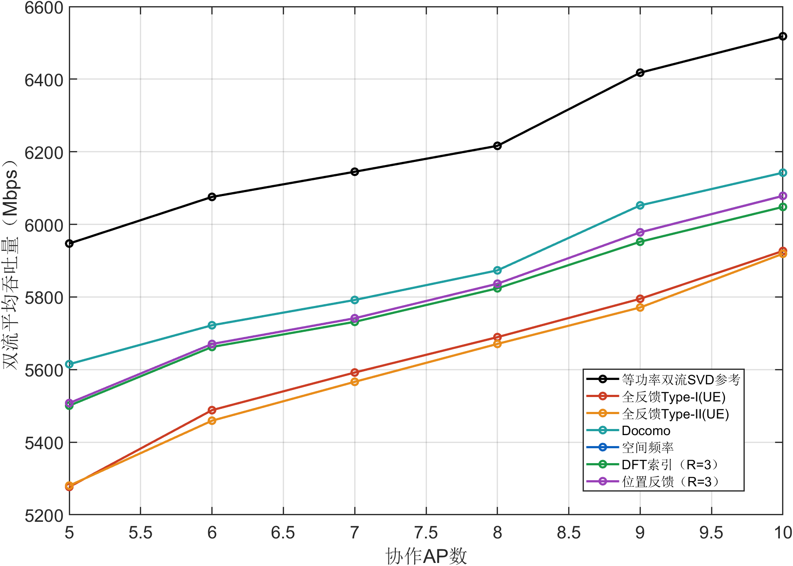

吞吐量结果：位置反馈从横轴5时的5507.73 Mbps变为10时的6078.39 Mbps。终点UE方法中，Docomo均值最高，为6142.36 Mbps；Docomo(UE)在CPU图中为共享参考，SVD单列为理想参考。

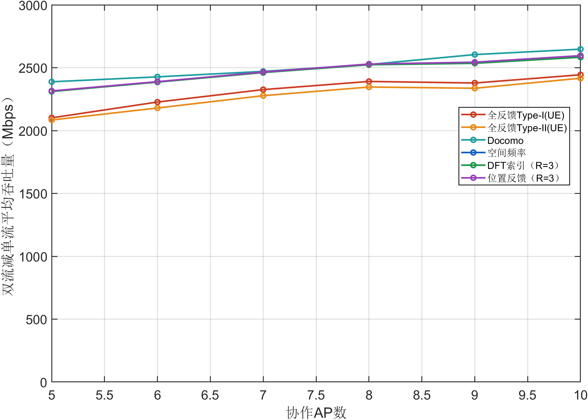

增量结果：本组所有方法和参数点的最小400位置平均增量为2084.07 Mbps，最低正收益比例为100.00%。平均增量为正与每个位置都受益是不同结论，逐位置最差值及非正收益单独保留。

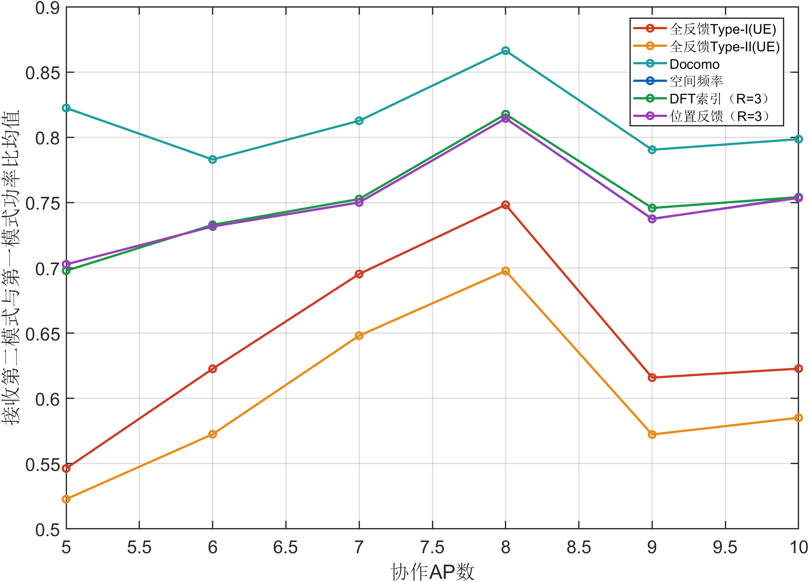

模式结果：位置反馈各参数点的第二与第一接收模式功率比均值范围为0.7027至0.8144；全部参数与位置中最小值为0.361。该值由真实接收矩阵HW的奇异值平方计算，模式较弱时，即使发送两列也不保证速率增加。

### UE混合信道莱斯因子K完整扫描

本实验只扫描莱斯因子K，横轴单位为dB。除横轴外采用32×32、B=8、观测30 dB、K=10 dB默认值。每个参数点、每种方法都使用全部400个相同位置，以下逐点数值和三幅图来自同一组消息重放结果。

| 方法 | 横轴 | 双流 Mbps | 增量 Mbps | 正收益 % | 第二模式比 |
|---|---|---|---|---|---|
| 全反馈Type-I(UE) | 0 | 4425.92 | 1132.93 | 89.25 | 0.1944 |
| 全反馈Type-I(UE) | 5 | 5264.28 | 2000.76 | 99.50 | 0.5034 |
| 全反馈Type-I(UE) | 10 | 5689.39 | 2390.88 | 100.00 | 0.7483 |
| 全反馈Type-I(UE) | 15 | 5835.53 | 2503.58 | 100.00 | 0.7864 |
| 全反馈Type-I(UE) | 20 | 5886.43 | 2537.85 | 100.00 | 0.7897 |
| 全反馈Type-II(UE) | 0 | 4772.87 | 1339.38 | 98.75 | 0.1612 |
| 全反馈Type-II(UE) | 5 | 5337.37 | 1991.50 | 100.00 | 0.4154 |
| 全反馈Type-II(UE) | 10 | 5670.72 | 2346.44 | 100.00 | 0.6976 |
| 全反馈Type-II(UE) | 15 | 5816.92 | 2480.82 | 100.00 | 0.7869 |
| 全反馈Type-II(UE) | 20 | 5875.02 | 2526.73 | 100.00 | 0.7887 |
| Docomo | 0 | 4785.06 | 1641.76 | 98.25 | 0.4484 |
| Docomo | 5 | 5663.21 | 2410.60 | 100.00 | 0.8352 |
| Docomo | 10 | 5873.32 | 2525.60 | 100.00 | 0.8664 |
| Docomo | 15 | 5946.50 | 2563.62 | 100.00 | 0.8727 |
| Docomo | 20 | 5970.77 | 2575.99 | 100.00 | 0.8744 |
| 空间频率 | 0 | 4900.79 | 2041.69 | 99.75 | 0.7399 |
| 空间频率 | 5 | 5630.20 | 2432.27 | 100.00 | 0.8121 |
| 空间频率 | 10 | 5836.42 | 2529.16 | 100.00 | 0.8144 |
| 空间频率 | 15 | 5903.57 | 2557.54 | 100.00 | 0.8066 |
| 空间频率 | 20 | 5923.32 | 2565.33 | 100.00 | 0.8001 |
| DFT索引 | 0 | 5145.35 | 2194.87 | 100.00 | 0.7918 |
| DFT索引 | 5 | 5618.69 | 2426.96 | 100.00 | 0.8136 |
| DFT索引 | 10 | 5823.92 | 2523.67 | 100.00 | 0.8177 |
| DFT索引 | 15 | 5890.54 | 2551.69 | 100.00 | 0.8052 |
| DFT索引 | 20 | 5910.49 | 2559.53 | 100.00 | 0.7978 |
| 位置反馈 | 0 | 4540.68 | 1876.57 | 94.75 | 0.7161 |
| 位置反馈 | 5 | 5629.93 | 2432.13 | 100.00 | 0.8125 |
| 位置反馈 | 10 | 5836.57 | 2529.31 | 100.00 | 0.8144 |
| 位置反馈 | 15 | 5903.77 | 2557.67 | 100.00 | 0.8068 |
| 位置反馈 | 20 | 5923.27 | 2565.29 | 100.00 | 0.7994 |
| SVD参考 | 0 | 6367.15 | 2660.63 | 100.00 | 0.6625 |
| SVD参考 | 5 | 6259.33 | 2662.05 | 100.00 | 0.7922 |
| SVD参考 | 10 | 6216.37 | 2672.83 | 100.00 | 0.8821 |
| SVD参考 | 15 | 6211.09 | 2678.43 | 100.00 | 0.9069 |
| SVD参考 | 20 | 6211.64 | 2680.22 | 100.00 | 0.9116 |


吞吐量结果：位置反馈从横轴0时的4540.68 Mbps变为20时的5923.27 Mbps。终点UE方法中，Docomo均值最高，为5970.77 Mbps；Docomo(UE)在CPU图中为共享参考，SVD单列为理想参考。


增量结果：本组所有方法和参数点的最小400位置平均增量为1132.93 Mbps，最低正收益比例为89.25%。平均增量为正与每个位置都受益是不同结论，逐位置最差值及非正收益单独保留。


模式结果：位置反馈各参数点的第二与第一接收模式功率比均值范围为0.7161至0.8144；全部参数与位置中最小值为0.023403。该值由真实接收矩阵HW的奇异值平方计算，模式较弱时，即使发送两列也不保证速率增加。

### UE混合信道默认配置的均值与分布


该柱状图将同一400位置下的单流和双流均值并列，数值见本端默认配置表；两者总功率均为1。SVD两流采用等功率，不能据此表示一般最优功率分配容量。


| 方法 | 最小 Mbps | 5%分位 | 中位 Mbps | 95%分位 | 最大 Mbps |
|---|---|---|---|---|---|
| 全反馈Type-I(UE) | 1423.56 | 2088.92 | 2429.86 | 2549.58 | 2622.67 |
| 全反馈Type-II(UE) | 1685.00 | 2047.45 | 2372.36 | 2526.04 | 2577.80 |
| Docomo | 2359.58 | 2473.20 | 2524.88 | 2577.44 | 2630.96 |
| 空间频率 | 2338.72 | 2466.60 | 2528.58 | 2589.07 | 2710.96 |
| DFT索引 | 2337.18 | 2462.01 | 2522.91 | 2584.53 | 2710.29 |
| 位置反馈 | 2338.72 | 2464.31 | 2527.89 | 2589.07 | 2710.96 |

分布结果：CDF和分位数均按400个配对增量计算，表中5%分位表示约5%的位置收益不超过该值，不能将中位数或均值当作最差用户保证。

### UE双流有效载荷随AP数量变化

| 方法 | 5 | 6 | 7 | 8 | 9 | 10 |
|---|---|---|---|---|---|---|
| 全反馈Type-I(UE) | 102 | 124 | 146 | 168 | 190 | 212 |
| 全反馈Type-II(UE) | 197 | 238 | 279 | 320 | 361 | 402 |
| Docomo | 97 | 117 | 137 | 157 | 178 | 198 |
| 空间频率 | 116 | 124 | 132 | 140 | 148 | 156 |
| DFT索引 | 74 | 82 | 90 | 98 | 106 | 114 |
| 位置反馈 | 68 | 76 | 84 | 92 | 100 | 108 |

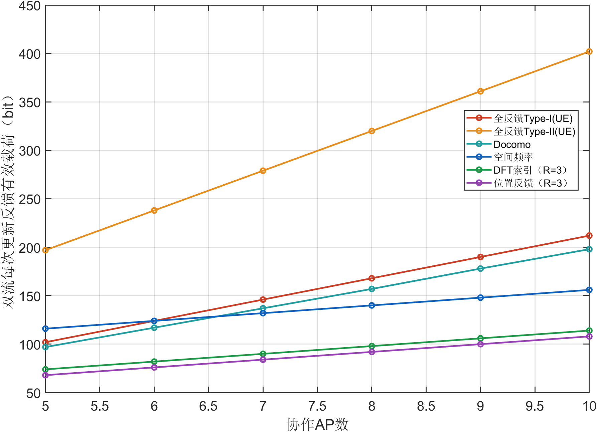

开销结果：CPU三种几何方法不因新增第二流而增加反馈，固定三个参考AP。UE每增加一个协作AP，第二流额外多4 bit；表中为两流总有效载荷，已经包括原空间消息及第一流所需字段。CPU图与UE图采用各自实际消息长度，不把编码后的比特数替换为JSON字符数。

强散射的K=0 dB配置中，位置反馈双流均值为4540.68 Mbps，正收益比例为94.75%；DFT索引双流均值为5145.35 Mbps。位置反馈的低开销优势不代表它在所有信道条件下速率领先。第二相位只能在既定共享波束内调整，不能修复先前定位或空间波束失配。

默认混合信道中Type-II双流均值低于Type-I，Docomo高于两者。当前空间波束与第一相位按单流设计并冻结，双流未重新联合选择空间波束，因此不能从单流排名或码本大小直接推断双流排名。

本端纯LOS与MIX的逐实验图表、数值和解释已分别列出，不合并两种信道均值。

### UE实际反馈开销

| 方法 | 默认单流 bit | 默认双流 bit | 新增 bit |
|---|---|---|---|
| 全反馈Type-I(UE) | 140 | 168 | 28 |
| 全反馈Type-II(UE) | 292 | 320 | 28 |
| Docomo | 129 | 157 | 28 |
| 空间频率 | 112 | 140 | 28 |
| DFT索引 | 70 | 98 | 28 |
| 位置反馈 | 64 | 92 | 28 |

新增开销为4(B−1) bit，B从5增至10时依次为16、20、24、28、32、36 bit。默认位置反馈双流为92 bit，空间频率为140 bit；这只统计各方法一致的有效载荷，不含传输头、纠错等协议开销。Type-I、Type-II与Docomo的空间反馈随阵元数和AP数改变，明细由实际消息长度产生。

## 第二流有效性的判据与不利样本

评价端对真实信道计算G=HW，再由I+ρGᴴG的逆矩阵对角线求各流MMSE SINR，速率为

$$
R=\sum_{s=1}^{2}\log_2(1+\gamma_s)
$$

Mbps等于该频谱效率乘400。保存的联合logdet速率用于交叉检查，MMSE速率不高于联合速率。每条明细还保存真实信道、固定空间波束子空间及最终接收矩阵的第二模式功率比，避免仅凭发送矩阵有两列判断双流有效。

真实CSI直接SVD参考不含CSI估计噪声，但真实信道仍按LOS或MIX生成，接收数据SNR照常计入速率。双流SVD取前两个奇异向量并等功率分配，放松每AP等功率限制；它是等功率双流参考，不是任意功率分配下的一般容量上界。

负收益统计按16组参数配置去除重复默认标签，汇总如下。所有非正收益逐位置记录另存nonpositive_gain_cases.csv，其中保留曲线标签以便定位。

| 端 | 信道 | 方法 | 非正收益条目 | 最差增量 Mbps |
|---|---|---|---|---|
| CPU | LOS | DFT索引 | 15 | -506.86 |
| CPU | LOS | 空间频率 | 7 | -400.18 |
| CPU | LOS | 位置反馈 | 5 | -373.66 |
| CPU | MIX | DFT索引 | 22 | -591.03 |
| CPU | MIX | 空间频率 | 44 | -1581.57 |
| CPU | MIX | 位置反馈 | 52 | -844.33 |
| UE | MIX | Docomo | 7 | -412.71 |
| UE | MIX | 空间频率 | 1 | -779.36 |
| UE | MIX | 位置反馈 | 21 | -381.00 |
| UE | MIX | 全反馈Type-I(UE) | 45 | -425.81 |
| UE | MIX | 全反馈Type-II(UE) | 5 | -220.26 |

负收益表明固定共享波束、保留第一相位并强制等功率双流并不适合所有位置。该实现没有自适应流数或功率分配，也没有用真实信道决定回退单流。后续可在UE观测或CPU模型上设计回退规则，再单独验证其可靠性；本报告不把离线真值择优作为当前算法性能。

按配置归类，非正收益中149条出现在K=0 dB，65条出现在64或256阵元配置。该分布说明默认32×32、K=10 dB下的全部正收益不能推广至小阵列和强散射范围。

## 执行过程和独立核验

先在位置1与399上完成全部16组参数配置的小样本流程检查，覆盖阵元数、AP数、观测质量和K值变化。通过后运行正式400位置扫描。不同计算进程写入互不重叠的参数目录，汇总时验证参数、位置编号和消息字段，重复默认配置复用同一明细。

Python从冻结位置和散射系数独立重建真实信道，逐条解码所有16个配置中的整数消息，计算CPU第二相位参考、系数、功率、发送签名、MMSE速率与第二模式，再重新计算所有均值及单双流配对。共核验281,600条实际明细，其中可实施记录230,400条。全部曲线组均有400个不同位置。

与上一轮400位置单流正式扫描按方法、位置和参数逐条对齐，最大吞吐量差1e-11 Mbps。独立核验最大频谱效率误差1.09e-11，最大真实有效信道误差9.63e-13；CPU连续相位跨实现最大系数差0.00857。LOS的K对照及SVD的观测SNR对照均通过。

连续启发式搜索在MATLAB和NumPy的浮点运算下可能进入不同更新分支。本轮有5条记录的归一化系数差达到预设1e−3核对阈值，全部单列于CPU_continuous_replay_required.csv，并在原MATLAB环境仅凭公共几何和比特串严格重放，要求系数与发送签名误差小于1e−10后才通过最终核验。未修改双流算法或原始结果，也未将这些记录排除。发生上述差异的配置中，独立搜索的模型目标最大差为0.00097515 bit/s/Hz；这与前述对已保存预编码的独立真实速率核验属于不同检查。

## 数据保存和复现

完整明细按16组参数配置保存于results/dual_stream_full400/cases/case_XX。每组含LOS与MIX、CPU与UE、单流与双流全部记录；原始CSV以无损gzip上传，前导零比特串和浮点字段原样保留，并提供SHA256和解压往返校验。汇总及58组PNG与可编辑MATLAB FIG另存，CPU和UE各29组。

运行前只添加8.单流目录，不对历史副本递归添加路径。使用新的输出目录，原有报告、结果和冻结输入不覆盖。

```matlab
addpath('8.单流');
experimentDir=fullfile(pwd,'8.单流','results','new_dual400');
run_dual_stream_task2('OutputDir',experimentDir);
plot_precoding_results(experimentDir);
```

```text
python audit_dual_stream_full.py results/new_dual400 --stage cases
```

```matlab
verify_dual_stream_replay(experimentDir);
```

```text
python audit_dual_stream_full.py results/new_dual400 --stage summary
python package_dual_stream_results.py results/new_dual400
```

需要并行运行时，四个进程分别传入Stage=run、Worker=1至4、Workers=4，完成后单独以Stage=finalize汇总。并行只划分参数配置，不改变样本、算法或消息。包内README给出逐条数据读取与审计方式。

本轮已完成既定四类参数的完整双流实验。同步误差、移动性、宽带逐子载波处理、自适应流数与双极化不属于当前单极化扩展模型，尚无对应验证结论。
