# UPA单极化双流400位置完整实验报告

2026年10月25日更新。本文解释UPA单极化方案在400个冻结位置上的实现和实验结果，CPU、UE分别报告，纯LOS与MIX逐实验分开展示。定位误差的观测SNR改为−20:10:40，吞吐量改为−20:5:20；单流补齐原先正文缺失的LOS结果。数据链路SNR保持固定。

本版汇总22个不同物理配置，共387,200条含单双流配对的原生明细。新增8个低SNR配置，每个含LOS、MIX及400位置；其余14个配置直接复用已审计结果。每张曲线和表格均按400个位置求均值，未筛除不利或越界样本。

正文保持每端定位误差三项、吞吐量三项、比特数与AP数一项的结构。每个实验均附图片、完整数值和结果说明。图例保持全反馈Type-I(UE)、全反馈Type-II(UE)、Docomo、空间频率、DFT索引、位置反馈，CPU共享Docomo标作Docomo(UE)。

## 1 方法与实验口径

| 项目 | 设置 |
|---|---|
| 阵列和接收端 | 单极化UPA，UE四接收阵元 |
| 位置和信道 | 冻结位置1至400全部保留；纯LOS和MIX分别给出结果 |
| 默认配置 | 每AP32×32阵元、协作AP数8、定位参考AP数3、观测SNR 30 dB、K=10 dB |
| 定位误差的观测SNR | −20、−10、0、10、20、30、40 dB |
| 吞吐量的观测SNR | −20、−15、−10、−5、0、5、10、15、20 dB |
| UPA阵元数 | 64、256、1024 |
| 协作AP数 | 原始5至10；图的显示范围5至9，横轴仅整数 |
| 莱斯因子 | 0、5、10、15、20 dB；纯LOS不使用K，仅作一致性对照 |
| 功率和带宽 | 总功率1，各AP总功率1/B；400 MHz直接换算，不增加OFDM或带宽噪声模型 |
| 评价用数据SNR | 固定参考数据SNR 10 dB及原参考功率，不随观测SNR改变 |
| 主参考 | 真实信道直接SVD；单流取最优第一右奇异向量，双流取前两向量并等功率 |
| 反馈 | 实际MSB优先整数比特串；CPU独立解码；各方法一致不含公共配置、传输头与FEC |

观测信道由真实信道加CSI估计噪声得到。真实信道仍包含相应的LOS传播或LOS与散射混合传播。普通方法只根据带噪观测或收到的空间消息设计，真实信道只用于评价和SVD参考。观测SNR扫描改变CSI质量，数据链路噪声照常保留，因此SVD参考随观测SNR保持不变。

本轮使用两类SNR点的并集计算或复用物理案例，再按对应实验取点；不是只裁剪旧曲线。所有SNR配置使用同一批位置、散射系数和冻结噪声种子，改变噪声幅度。每点400个不同位置，不把CPU和UE、单双流、重复默认标签作为独立随机样本。定位SNR图纵轴标为“定位误差（m）”；吞吐量采用线性纵轴，下限按该图所有方法的最低值向下留少量余量，上限同样留白。

### 单流空间波束与第一流相位

Type-I将联合观测信道的主右奇异向量按AP分块，匹配本地二维DFT波束。Type-II在同一正交分组选择两条波束，组合幅度3 bit、内部相位2 bit。Type-I、Type-II、空间频率、DFT索引和位置反馈五种普通UE方法统一使用联合主模式投影，共相位以首AP为0，其余AP的相对相位各4 bit。

空间频率反馈三个参考AP的两维估计频率，每维14 bit；DFT索引反馈同三个AP的二维码本索引。位置反馈先以连续空间频率在UE定位，再将坐标按13/14/9 bit量化一次。位置方案不使用已经量化的频率来定位，也不先量化频率再量化坐标。

CPU端三种几何方法仅依靠收到的空间整数消息和公共AP几何恢复位置、空间波束与模型，并在模型上计算相位。CPU不接收参考AP的完整观测信道或UE连续位置。UE端则用全AP观测CSI和消息恢复后的波束计算相位，再反馈相位整数。实现中实际使用从整数消息恢复的发送向量，而非直接使用UE浮点波束。

### Docomo的实现范围

Docomo依据Near-Field Line-of-Sight MIMO Precoding with Distributed Antennas第IV节式25至27与第V节，采用每AP本地DFT波束、QPSK共相位和跨AP模式的结构。当前不规则部署使用公开AP顺序的一维逻辑DFT，保留项目码本和三轮坐标更新；它是结构适配，并非论文全部场景的复现。论文Type-I为NCJT，本项目Type-I含共相位，两者定义不同。默认单流Docomo为129 bit，不套用论文特定场景的26 bit。既有48项Docomo专项、701项协议及42项UPA/POS验证保留，详见[Docomo专项说明](Docomo结构适配与专项验证.md)。

### 从单流扩展到双流

首先完整运行各方法的单流流程，得到每AP一条单位范数空间波束及第一流跨AP相位。把这些波束置于BN×B块对角矩阵F中，系数矩阵C从B×1扩展为B×2，发送矩阵为

$$
W=FC
$$

单流每AP系数为

$$
C_{b,1}=\frac{e^{j\theta_{b,1}}}{\sqrt{B}}
$$

双流每AP的两个系数为

$$
C_{b,s}=\frac{e^{j\theta_{b,s}}}{\sqrt{2B}},\quad s=1,2
$$

两流共用同一条每AP空间波束。第一列只缩放为原单流的1/√2，第一相位保持不变。第二流新增的是每个AP各自的相对相位；仅给整列一个全局相位会令两列共线，不能形成第二模式。每AP两列合计功率1/B，两流各占总功率的一半。

对低维有效信道E=[H_b f_b]设计第二相位。先比较残余主模式和跨AP相位斜坡两个固定初始化，再进行三轮坐标更新，以线性MMSE两流速率和为目标。UE每次搜索16个离散相位，CPU用64点粗搜索及24步固定连续细化。CPU的E来自公共几何模型，UE的E来自带噪观测。该启发式搜索不保证全局最优，本轮仅拓宽观测SNR，没有修改优化规则。

UE额外发送B−1个4 bit第二流相位，新增4(B−1) bit；CPU几何方法自行计算第二相位，空间消息不重复发送，新增0 bit。Type-II两流仍共享其原有复合波束。Docomo第二流采用同样的通用相位扩展，未完整复现论文多列AP二维DFT子集算法。

定位前端和空间消息被两流直接复用，因此同一位置与配置下，单双流的定位误差相同。多一条数据流本身不增加定位观测。双流主指标为真实信道上线性MMSE两流速率和，另保存联合logdet速率核对；等功率两流SVD是参考，不能称为任意功率分配下的一般容量上界。

## 2 CPU端正式实验

以下纯LOS、MIX分别列出，每个图表点均为400位置均值。CPU图中的全反馈Type-I(UE)、全反馈Type-II(UE)、Docomo(UE)复用同一配置下的UE结果，作为共享参考；不新增CPU算法或样本。定位误差只比较空间频率、DFT索引和位置反馈三种有位置输出的方法。

### 2.1 定位误差组

**CPU双流纯LOS定位误差与观测SNR**

横轴为观测SNR，纵轴为定位误差（m）。

| 方法 | -20 | -10 | 0 | 10 | 20 | 30 | 40 |
|---|---|---|---|---|---|---|---|
| 空间频率 | 3.048485 | 0.070169 | 0.022173 | 0.007192 | 0.002818 | 0.001940 | 0.001915 |
| DFT索引 | 9.865992 | 0.246754 | 0.235532 | 0.233766 | 0.231956 | 0.232083 | 0.233291 |
| 位置反馈 | 1.808583 | 0.070440 | 0.022458 | 0.008063 | 0.004417 | 0.003723 | 0.003634 |

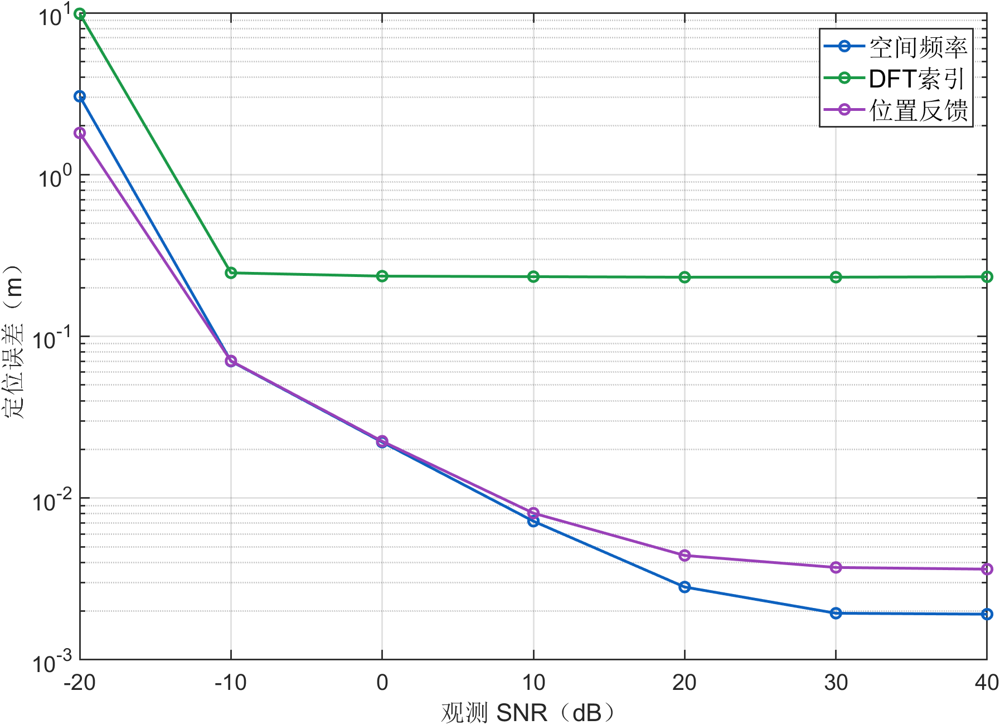

结果：位置反馈在横轴-20时为1.808583 m，在40时为0.003634 m。空间频率、DFT索引使用各自解码方向定位，位置反馈使用一次量化后的坐标。 高SNR后的残余误差受空间估计、信道模型和有限反馈共同影响，不能要求逐点单调。

**CPU双流混合信道定位误差与观测SNR**

横轴为观测SNR，纵轴为定位误差（m）。

| 方法 | -20 | -10 | 0 | 10 | 20 | 30 | 40 |
|---|---|---|---|---|---|---|---|
| 空间频率 | 4.345898 | 0.074362 | 0.025053 | 0.011433 | 0.008926 | 0.008532 | 0.008547 |
| DFT索引 | 10.573065 | 0.249121 | 0.233680 | 0.232275 | 0.234350 | 0.235091 | 0.235091 |
| 位置反馈 | 2.509786 | 0.074379 | 0.025191 | 0.012117 | 0.009745 | 0.009490 | 0.009432 |

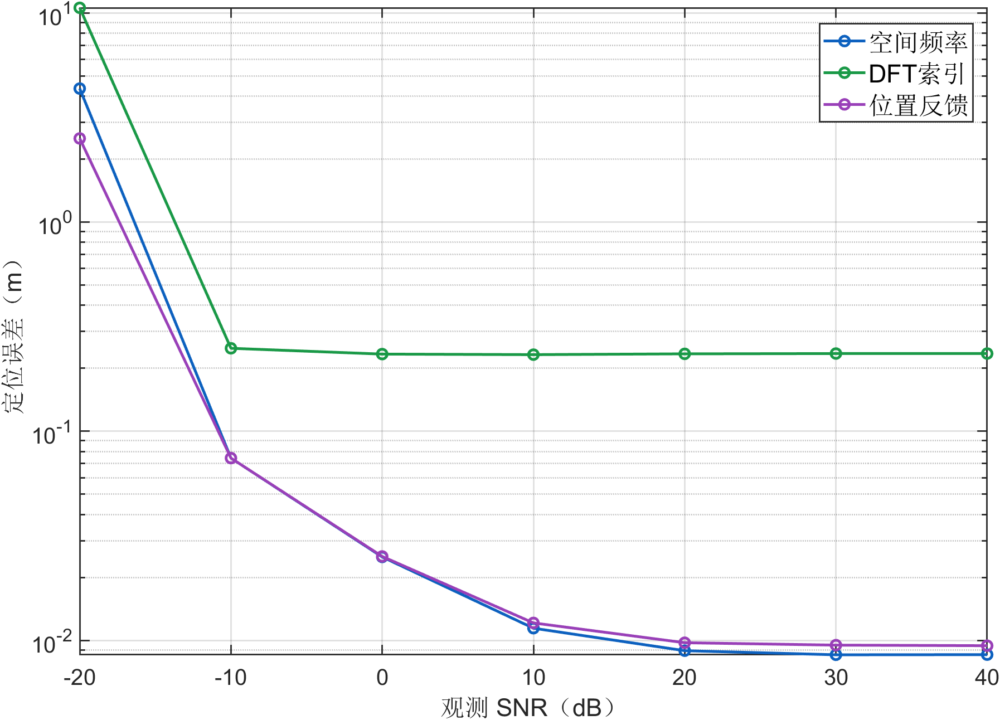

结果：位置反馈在横轴-20时为2.509786 m，在40时为0.009432 m。空间频率、DFT索引使用各自解码方向定位，位置反馈使用一次量化后的坐标。 高SNR后的残余误差受空间估计、信道模型和有限反馈共同影响，不能要求逐点单调。

**CPU双流纯LOS定位误差与UPA阵元数**

横轴为UPA阵元数，纵轴为定位误差（m）。

| 方法 | 64 | 256 | 1024 |
|---|---|---|---|
| 空间频率 | 0.010948 | 0.003084 | 0.001940 |
| DFT索引 | 0.928820 | 0.457306 | 0.232083 |
| 位置反馈 | 0.011495 | 0.004618 | 0.003723 |

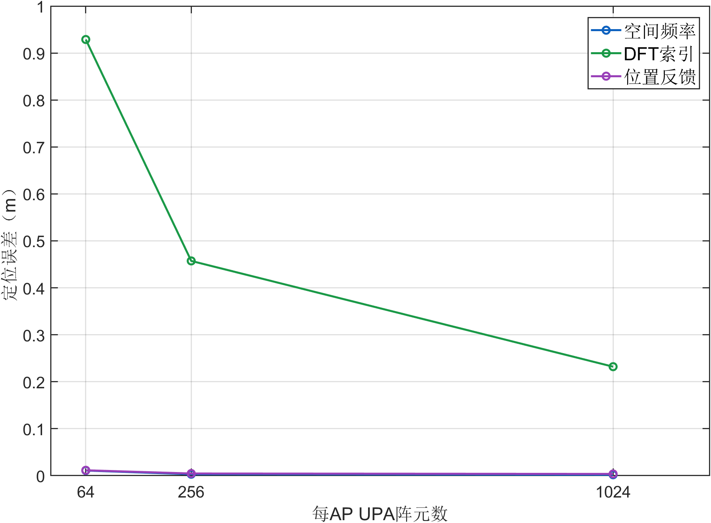

结果：位置反馈在横轴64时为0.011495 m，在1024时为0.003723 m。空间频率、DFT索引使用各自解码方向定位，位置反馈使用一次量化后的坐标。

**CPU双流混合信道定位误差与UPA阵元数**

横轴为UPA阵元数，纵轴为定位误差（m）。

| 方法 | 64 | 256 | 1024 |
|---|---|---|---|
| 空间频率 | 0.137977 | 0.037209 | 0.008532 |
| DFT索引 | 0.903049 | 0.464450 | 0.235091 |
| 位置反馈 | 0.137989 | 0.037184 | 0.009490 |

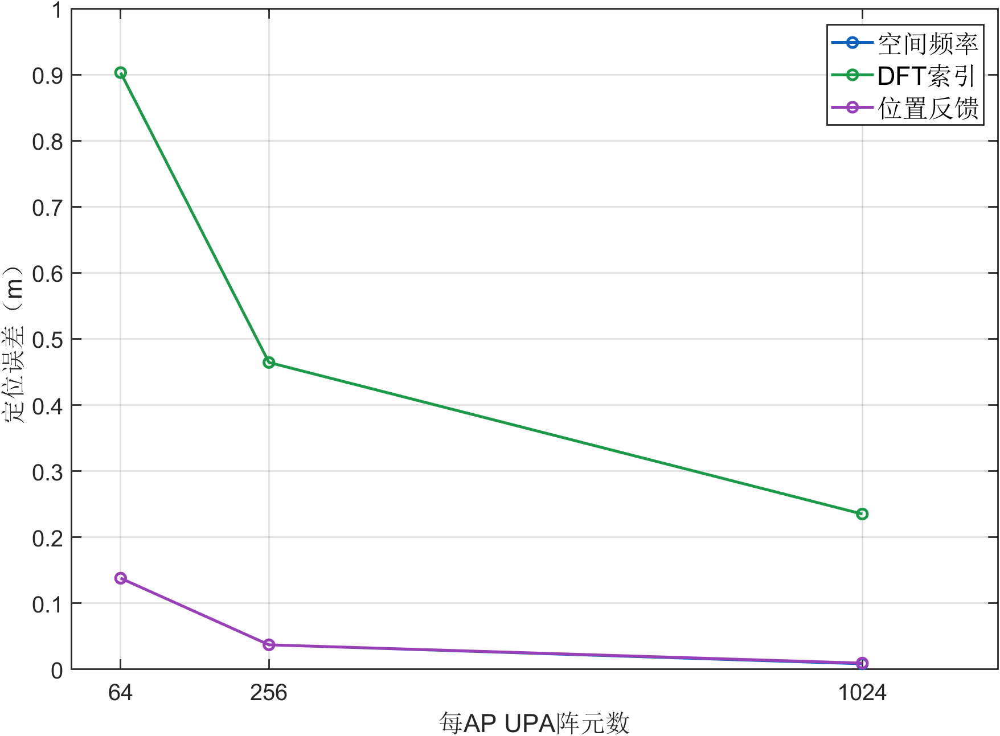

结果：位置反馈在横轴64时为0.137989 m，在1024时为0.009490 m。空间频率、DFT索引使用各自解码方向定位，位置反馈使用一次量化后的坐标。

**CPU双流纯LOS定位误差与协作AP数**

横轴为协作AP数，纵轴为定位误差（m）。

| 方法 | 5 | 6 | 7 | 8 | 9 | 10 |
|---|---|---|---|---|---|---|
| 空间频率 | 0.001933 | 0.001934 | 0.001941 | 0.001940 | 0.001948 | 0.001944 |
| DFT索引 | 0.232083 | 0.232083 | 0.232083 | 0.232083 | 0.232083 | 0.232083 |
| 位置反馈 | 0.003724 | 0.003719 | 0.003724 | 0.003723 | 0.003727 | 0.003724 |

结果：位置反馈在横轴5时为0.003724 m，在10时为0.003724 m。定位参考数仍固定3，增加协作AP不等于增加定位参考观测。

**CPU双流混合信道定位误差与协作AP数**

横轴为协作AP数，纵轴为定位误差（m）。

| 方法 | 5 | 6 | 7 | 8 | 9 | 10 |
|---|---|---|---|---|---|---|
| 空间频率 | 0.008546 | 0.008548 | 0.008542 | 0.008532 | 0.008540 | 0.008544 |
| DFT索引 | 0.235091 | 0.235091 | 0.235091 | 0.235091 | 0.235091 | 0.235091 |
| 位置反馈 | 0.009493 | 0.009490 | 0.009490 | 0.009490 | 0.009489 | 0.009487 |

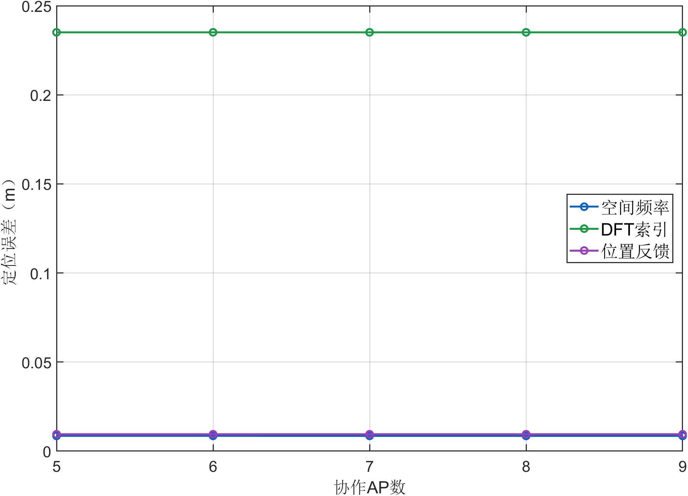

结果：位置反馈在横轴5时为0.009493 m，在10时为0.009487 m。定位参考数仍固定3，增加协作AP不等于增加定位参考观测。

### 2.2 吞吐量组

**CPU双流纯LOS吞吐量与观测SNR**

横轴为观测SNR，纵轴为吞吐量（Mbps）。

| 方法 | -20 | -15 | -10 | -5 | 0 | 5 | 10 | 15 | 20 |
|---|---|---|---|---|---|---|---|---|---|
| SVD参考 | 6212.32 | 6212.32 | 6212.32 | 6212.32 | 6212.32 | 6212.32 | 6212.32 | 6212.32 | 6212.32 |
| 全反馈Type-I(UE) | 4594.99 | 5598.21 | 5849.78 | 5896.62 | 5913.54 | 5928.17 | 5926.63 | 5925.76 | 5924.82 |
| 全反馈Type-II(UE) | 4222.08 | 5355.21 | 5724.52 | 5832.66 | 5883.60 | 5915.25 | 5925.03 | 5928.83 | 5928.82 |
| Docomo(UE) | 5040.48 | 5807.25 | 5951.31 | 5971.55 | 5979.28 | 5980.91 | 5981.65 | 5981.53 | 5981.64 |
| 空间频率 | 4459.34 | 5106.12 | 5143.27 | 5191.39 | 5264.61 | 5355.81 | 5571.62 | 5752.26 | 5839.96 |
| DFT索引 | 3381.05 | 4872.68 | 4923.81 | 4926.65 | 4932.92 | 4937.73 | 4946.07 | 4945.72 | 4951.90 |
| 位置反馈 | 4212.08 | 5113.03 | 5147.37 | 5194.58 | 5280.78 | 5363.80 | 5583.05 | 5771.08 | 5858.46 |

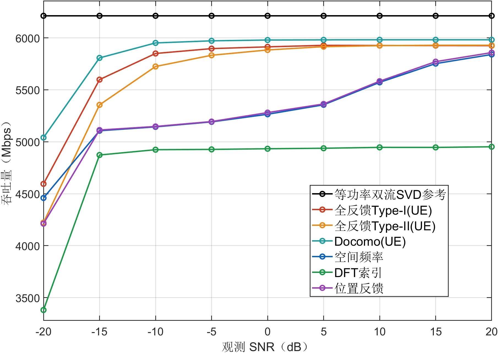

结果：位置反馈在横轴-20时为4212.08 Mbps，在20时为5858.46 Mbps。只改变CSI观测噪声，数据SNR固定，SVD保持不变。更准确的CSI不保证离散码本及固定启发式的每个均值都严格上升。 纵轴根据本图所有曲线的最小值和最大值留少量余量，未改变数据。

**CPU双流混合信道吞吐量与观测SNR**

横轴为观测SNR，纵轴为吞吐量（Mbps）。

| 方法 | -20 | -15 | -10 | -5 | 0 | 5 | 10 | 15 | 20 |
|---|---|---|---|---|---|---|---|---|---|
| SVD参考 | 6216.37 | 6216.37 | 6216.37 | 6216.37 | 6216.37 | 6216.37 | 6216.37 | 6216.37 | 6216.37 |
| 全反馈Type-I(UE) | 4377.16 | 5464.04 | 5722.93 | 5732.75 | 5701.17 | 5691.25 | 5688.15 | 5687.98 | 5688.84 |
| 全反馈Type-II(UE) | 3977.67 | 5200.87 | 5609.35 | 5693.65 | 5678.47 | 5672.18 | 5670.70 | 5668.67 | 5668.17 |
| Docomo(UE) | 4797.07 | 5663.28 | 5839.33 | 5863.33 | 5870.01 | 5873.36 | 5874.18 | 5874.42 | 5874.39 |
| 空间频率 | 4134.99 | 5007.66 | 5017.36 | 5101.52 | 5190.02 | 5228.65 | 5364.31 | 5445.86 | 5482.16 |
| DFT索引 | 3102.62 | 4765.92 | 4827.69 | 4817.73 | 4834.31 | 4844.29 | 4845.35 | 4844.32 | 4843.57 |
| 位置反馈 | 3775.10 | 5005.59 | 4996.25 | 5115.62 | 5184.48 | 5217.67 | 5356.80 | 5457.40 | 5491.64 |

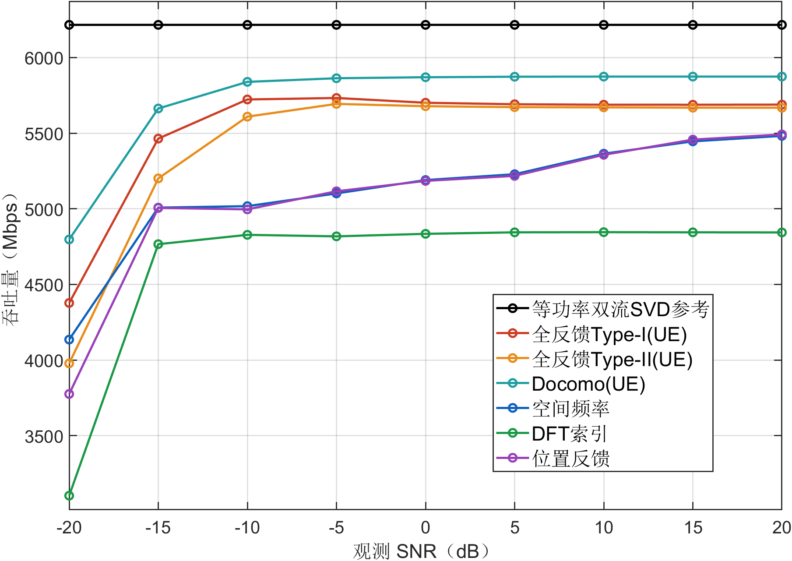

结果：位置反馈在横轴-20时为3775.10 Mbps，在20时为5491.64 Mbps。只改变CSI观测噪声，数据SNR固定，SVD保持不变。更准确的CSI不保证离散码本及固定启发式的每个均值都严格上升。 纵轴根据本图所有曲线的最小值和最大值留少量余量，未改变数据。

**CPU双流纯LOS吞吐量与UPA阵元数**

横轴为UPA阵元数，纵轴为吞吐量（Mbps）。

| 方法 | 64 | 256 | 1024 |
|---|---|---|---|
| SVD参考 | 3089.63 | 4628.25 | 6212.32 |
| 全反馈Type-I(UE) | 2841.50 | 4355.57 | 5920.80 |
| 全反馈Type-II(UE) | 2845.39 | 4361.88 | 5924.54 |
| Docomo(UE) | 2887.90 | 4412.96 | 5981.91 |
| 空间频率 | 2396.70 | 4271.11 | 5877.47 |
| DFT索引 | 1983.18 | 3378.56 | 4956.44 |
| 位置反馈 | 2410.81 | 4288.49 | 5896.02 |

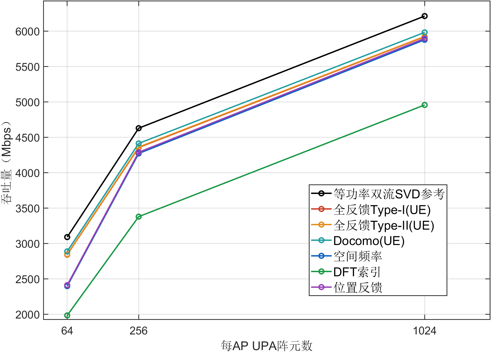

结果：位置反馈在横轴64时为2410.81 Mbps，在1024时为5896.02 Mbps。其他参数保持默认值；结论限于当前冻结部署。 纵轴根据本图所有曲线的最小值和最大值留少量余量，未改变数据。

**CPU双流混合信道吞吐量与UPA阵元数**

横轴为UPA阵元数，纵轴为吞吐量（Mbps）。

| 方法 | 64 | 256 | 1024 |
|---|---|---|---|
| SVD参考 | 3102.80 | 4634.31 | 6216.37 |
| 全反馈Type-I(UE) | 2722.26 | 4170.97 | 5689.39 |
| 全反馈Type-II(UE) | 2703.96 | 4148.26 | 5670.72 |
| Docomo(UE) | 2811.37 | 4313.57 | 5873.32 |
| 空间频率 | 2030.62 | 3597.56 | 5499.84 |
| DFT索引 | 1898.37 | 3286.83 | 4838.70 |
| 位置反馈 | 2031.65 | 3595.46 | 5498.79 |

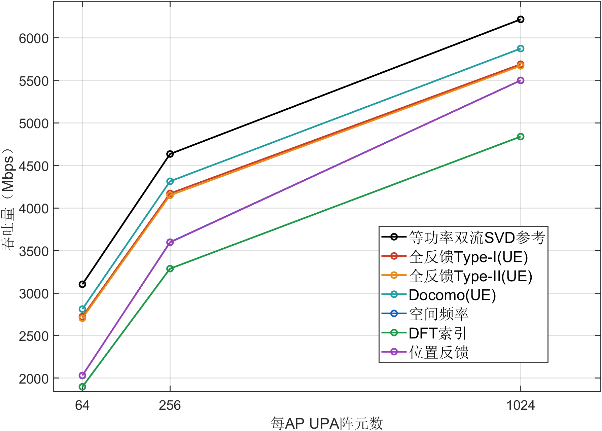

结果：位置反馈在横轴64时为2031.65 Mbps，在1024时为5498.79 Mbps。其他参数保持默认值；结论限于当前冻结部署。 纵轴根据本图所有曲线的最小值和最大值留少量余量，未改变数据。

**CPU双流纯LOS吞吐量与莱斯因子K**

横轴为莱斯因子K，纵轴为吞吐量（Mbps）。

| 方法 | 0 | 5 | 10 | 15 | 20 |
|---|---|---|---|---|---|
| SVD参考 | 6212.32 | 6212.32 | 6212.32 | 6212.32 | 6212.32 |
| 全反馈Type-I(UE) | 5920.80 | 5920.80 | 5920.80 | 5920.80 | 5920.80 |
| 全反馈Type-II(UE) | 5924.54 | 5924.54 | 5924.54 | 5924.54 | 5924.54 |
| Docomo(UE) | 5981.91 | 5981.91 | 5981.91 | 5981.91 | 5981.91 |
| 空间频率 | 5877.47 | 5877.47 | 5877.47 | 5877.47 | 5877.47 |
| DFT索引 | 4956.44 | 4956.44 | 4956.44 | 4956.44 | 4956.44 |
| 位置反馈 | 5896.02 | 5896.02 | 5896.02 | 5896.02 | 5896.02 |

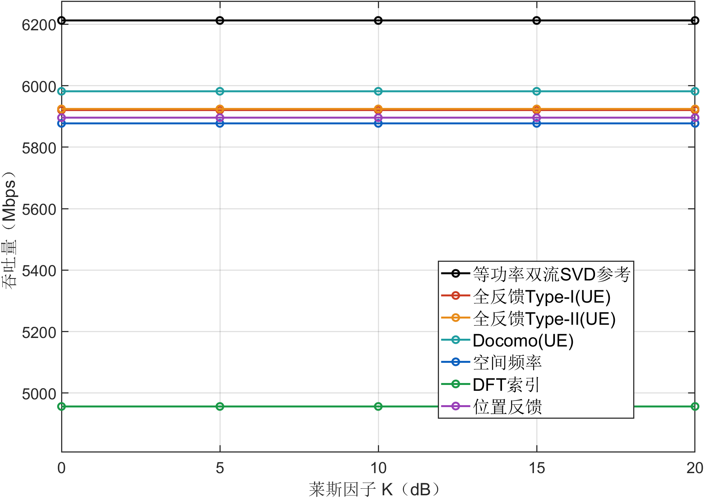

结果：位置反馈在横轴0时为5896.02 Mbps，在20时为5896.02 Mbps。纯LOS不使用K，平线仅作一致性对照；MIX的K扫描才改变LOS和散射比例。 纵轴根据本图所有曲线的最小值和最大值留少量余量，未改变数据。

**CPU双流混合信道吞吐量与莱斯因子K**

横轴为莱斯因子K，纵轴为吞吐量（Mbps）。

| 方法 | 0 | 5 | 10 | 15 | 20 |
|---|---|---|---|---|---|
| SVD参考 | 6367.15 | 6259.33 | 6216.37 | 6211.09 | 6211.64 |
| 全反馈Type-I(UE) | 4425.92 | 5264.28 | 5689.39 | 5835.53 | 5886.43 |
| 全反馈Type-II(UE) | 4772.87 | 5337.37 | 5670.72 | 5816.92 | 5875.02 |
| Docomo(UE) | 4785.06 | 5663.21 | 5873.32 | 5946.50 | 5970.77 |
| 空间频率 | 4087.75 | 5130.82 | 5499.84 | 5715.59 | 5817.53 |
| DFT索引 | 4180.73 | 4637.19 | 4838.70 | 4910.99 | 4935.67 |
| 位置反馈 | 3896.35 | 5145.03 | 5498.79 | 5728.32 | 5831.57 |

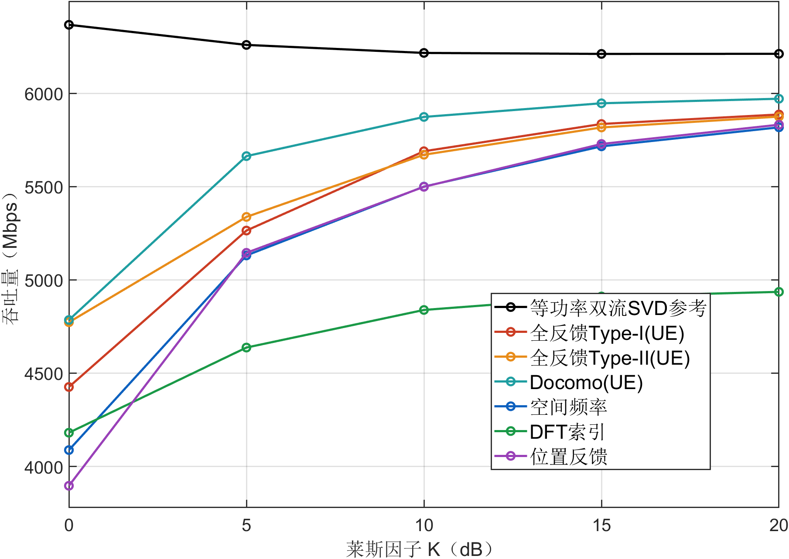

结果：位置反馈在横轴0时为3896.35 Mbps，在20时为5831.57 Mbps。其他参数保持默认值；结论限于当前冻结部署。 纵轴根据本图所有曲线的最小值和最大值留少量余量，未改变数据。

### 2.3 比特数与AP数目

横轴为协作AP数，纵轴为每次更新反馈有效载荷（bit）。长度规则不依赖信道类型，LOS与MIX相同；表内保留5至10 AP，图中仅显示整数5至9。

| 方法 | 5 | 6 | 7 | 8 | 9 | 10 |
|---|---|---|---|---|---|---|
| 全反馈Type-I(UE) | 102 | 124 | 146 | 168 | 190 | 212 |
| 全反馈Type-II(UE) | 197 | 238 | 279 | 320 | 361 | 402 |
| Docomo(UE) | 97 | 117 | 137 | 157 | 178 | 198 |
| 空间频率 | 84 | 84 | 84 | 84 | 84 | 84 |
| DFT索引 | 42 | 42 | 42 | 42 | 42 | 42 |
| 位置反馈 | 36 | 36 | 36 | 36 | 36 | 36 |

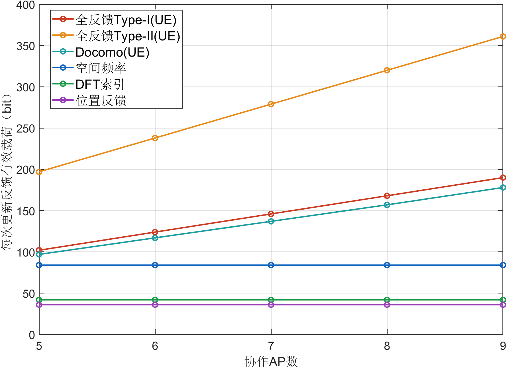

结果：CPU三种几何方法始终为84、42、36 bit。CPU图中的Type-I、Type-II和Docomo为完整UE消息的共享参考；不能将其计为CPU独立算法。UE几何方案还包含4(B−1) bit第一相位。双流UE再增加4(B−1) bit第二相位，CPU不增加反馈。

## 3 UE端正式实验

以下纯LOS、MIX分别列出，每个图表点均为400位置均值。CPU图中的全反馈Type-I(UE)、全反馈Type-II(UE)、Docomo(UE)复用同一配置下的UE结果，作为共享参考；不新增CPU算法或样本。定位误差只比较空间频率、DFT索引和位置反馈三种有位置输出的方法。

### 3.1 定位误差组

**UE双流纯LOS定位误差与观测SNR**

横轴为观测SNR，纵轴为定位误差（m）。

| 方法 | -20 | -10 | 0 | 10 | 20 | 30 | 40 |
|---|---|---|---|---|---|---|---|
| 空间频率 | 3.048485 | 0.070169 | 0.022173 | 0.007192 | 0.002818 | 0.001940 | 0.001915 |
| DFT索引 | 9.865992 | 0.246754 | 0.235532 | 0.233766 | 0.231956 | 0.232083 | 0.233291 |
| 位置反馈 | 1.808583 | 0.070440 | 0.022458 | 0.008063 | 0.004417 | 0.003723 | 0.003634 |

结果：位置反馈在横轴-20时为1.808583 m，在40时为0.003634 m。空间频率、DFT索引使用各自解码方向定位，位置反馈使用一次量化后的坐标。 高SNR后的残余误差受空间估计、信道模型和有限反馈共同影响，不能要求逐点单调。

**UE双流混合信道定位误差与观测SNR**

横轴为观测SNR，纵轴为定位误差（m）。

| 方法 | -20 | -10 | 0 | 10 | 20 | 30 | 40 |
|---|---|---|---|---|---|---|---|
| 空间频率 | 4.345898 | 0.074362 | 0.025053 | 0.011433 | 0.008926 | 0.008532 | 0.008547 |
| DFT索引 | 10.573065 | 0.249121 | 0.233680 | 0.232275 | 0.234350 | 0.235091 | 0.235091 |
| 位置反馈 | 2.509786 | 0.074379 | 0.025191 | 0.012117 | 0.009745 | 0.009490 | 0.009432 |

结果：位置反馈在横轴-20时为2.509786 m，在40时为0.009432 m。空间频率、DFT索引使用各自解码方向定位，位置反馈使用一次量化后的坐标。 高SNR后的残余误差受空间估计、信道模型和有限反馈共同影响，不能要求逐点单调。

**UE双流纯LOS定位误差与UPA阵元数**

横轴为UPA阵元数，纵轴为定位误差（m）。

| 方法 | 64 | 256 | 1024 |
|---|---|---|---|
| 空间频率 | 0.010948 | 0.003084 | 0.001940 |
| DFT索引 | 0.928820 | 0.457306 | 0.232083 |
| 位置反馈 | 0.011495 | 0.004618 | 0.003723 |

结果：位置反馈在横轴64时为0.011495 m，在1024时为0.003723 m。空间频率、DFT索引使用各自解码方向定位，位置反馈使用一次量化后的坐标。

**UE双流混合信道定位误差与UPA阵元数**

横轴为UPA阵元数，纵轴为定位误差（m）。

| 方法 | 64 | 256 | 1024 |
|---|---|---|---|
| 空间频率 | 0.137977 | 0.037209 | 0.008532 |
| DFT索引 | 0.903049 | 0.464450 | 0.235091 |
| 位置反馈 | 0.137989 | 0.037184 | 0.009490 |

结果：位置反馈在横轴64时为0.137989 m，在1024时为0.009490 m。空间频率、DFT索引使用各自解码方向定位，位置反馈使用一次量化后的坐标。

**UE双流纯LOS定位误差与协作AP数**

横轴为协作AP数，纵轴为定位误差（m）。

| 方法 | 5 | 6 | 7 | 8 | 9 | 10 |
|---|---|---|---|---|---|---|
| 空间频率 | 0.001933 | 0.001934 | 0.001941 | 0.001940 | 0.001948 | 0.001944 |
| DFT索引 | 0.232083 | 0.232083 | 0.232083 | 0.232083 | 0.232083 | 0.232083 |
| 位置反馈 | 0.003724 | 0.003719 | 0.003724 | 0.003723 | 0.003727 | 0.003724 |

结果：位置反馈在横轴5时为0.003724 m，在10时为0.003724 m。定位参考数仍固定3，增加协作AP不等于增加定位参考观测。

**UE双流混合信道定位误差与协作AP数**

横轴为协作AP数，纵轴为定位误差（m）。

| 方法 | 5 | 6 | 7 | 8 | 9 | 10 |
|---|---|---|---|---|---|---|
| 空间频率 | 0.008546 | 0.008548 | 0.008542 | 0.008532 | 0.008540 | 0.008544 |
| DFT索引 | 0.235091 | 0.235091 | 0.235091 | 0.235091 | 0.235091 | 0.235091 |
| 位置反馈 | 0.009493 | 0.009490 | 0.009490 | 0.009490 | 0.009489 | 0.009487 |

结果：位置反馈在横轴5时为0.009493 m，在10时为0.009487 m。定位参考数仍固定3，增加协作AP不等于增加定位参考观测。

### 3.2 吞吐量组

**UE双流纯LOS吞吐量与观测SNR**

横轴为观测SNR，纵轴为吞吐量（Mbps）。

| 方法 | -20 | -15 | -10 | -5 | 0 | 5 | 10 | 15 | 20 |
|---|---|---|---|---|---|---|---|---|---|
| SVD参考 | 6212.32 | 6212.32 | 6212.32 | 6212.32 | 6212.32 | 6212.32 | 6212.32 | 6212.32 | 6212.32 |
| 全反馈Type-I(UE) | 4594.99 | 5598.21 | 5849.78 | 5896.62 | 5913.54 | 5928.17 | 5926.63 | 5925.76 | 5924.82 |
| 全反馈Type-II(UE) | 4222.08 | 5355.21 | 5724.52 | 5832.66 | 5883.60 | 5915.25 | 5925.03 | 5928.83 | 5928.82 |
| Docomo | 5040.48 | 5807.25 | 5951.31 | 5971.55 | 5979.28 | 5980.91 | 5981.65 | 5981.53 | 5981.64 |
| 空间频率 | 5389.44 | 5933.94 | 5967.34 | 5968.03 | 5955.88 | 5944.40 | 5935.98 | 5931.72 | 5928.82 |
| DFT索引 | 4200.86 | 5883.18 | 5951.87 | 5954.73 | 5941.09 | 5931.63 | 5923.22 | 5919.08 | 5915.85 |
| 位置反馈 | 4959.95 | 5934.61 | 5967.87 | 5968.52 | 5955.62 | 5944.42 | 5935.84 | 5931.61 | 5928.98 |

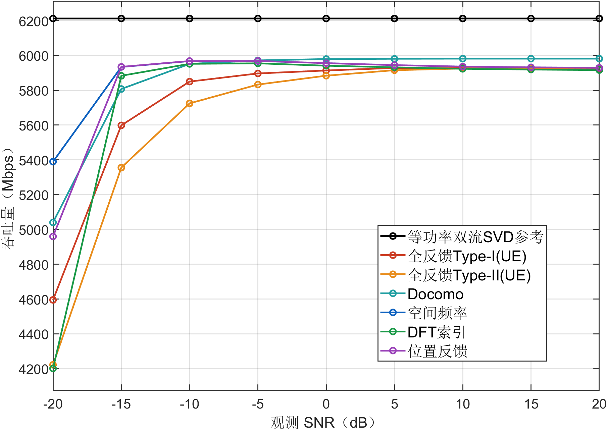

结果：位置反馈在横轴-20时为4959.95 Mbps，在20时为5928.98 Mbps。只改变CSI观测噪声，数据SNR固定，SVD保持不变。更准确的CSI不保证离散码本及固定启发式的每个均值都严格上升。 纵轴根据本图所有曲线的最小值和最大值留少量余量，未改变数据。

**UE双流混合信道吞吐量与观测SNR**

横轴为观测SNR，纵轴为吞吐量（Mbps）。

| 方法 | -20 | -15 | -10 | -5 | 0 | 5 | 10 | 15 | 20 |
|---|---|---|---|---|---|---|---|---|---|
| SVD参考 | 6216.37 | 6216.37 | 6216.37 | 6216.37 | 6216.37 | 6216.37 | 6216.37 | 6216.37 | 6216.37 |
| 全反馈Type-I(UE) | 4377.16 | 5464.04 | 5722.93 | 5732.75 | 5701.17 | 5691.25 | 5688.15 | 5687.98 | 5688.84 |
| 全反馈Type-II(UE) | 3977.67 | 5200.87 | 5609.35 | 5693.65 | 5678.47 | 5672.18 | 5670.70 | 5668.67 | 5668.17 |
| Docomo | 4797.07 | 5663.28 | 5839.33 | 5863.33 | 5870.01 | 5873.36 | 5874.18 | 5874.42 | 5874.39 |
| 空间频率 | 5045.63 | 5822.76 | 5857.83 | 5854.04 | 5842.72 | 5840.00 | 5837.08 | 5836.65 | 5836.25 |
| DFT索引 | 3840.90 | 5754.02 | 5843.25 | 5840.88 | 5829.51 | 5827.42 | 5825.09 | 5824.00 | 5823.79 |
| 位置反馈 | 4427.42 | 5824.48 | 5858.71 | 5854.53 | 5842.56 | 5839.77 | 5837.18 | 5836.51 | 5836.34 |

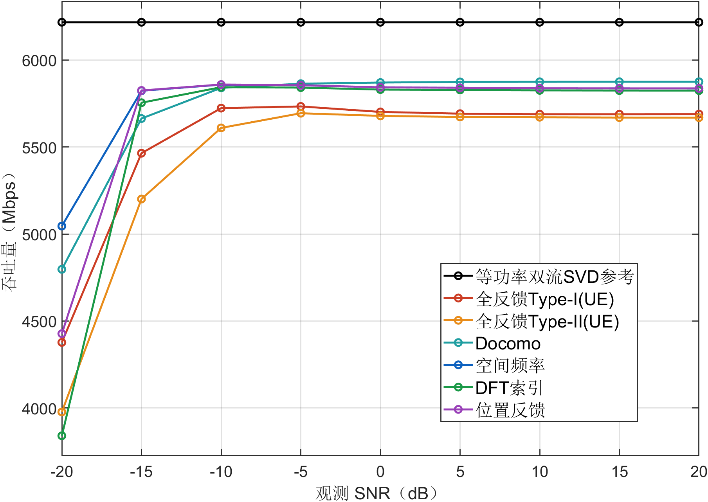

结果：位置反馈在横轴-20时为4427.42 Mbps，在20时为5836.34 Mbps。只改变CSI观测噪声，数据SNR固定，SVD保持不变。更准确的CSI不保证离散码本及固定启发式的每个均值都严格上升。 纵轴根据本图所有曲线的最小值和最大值留少量余量，未改变数据。

**UE双流纯LOS吞吐量与UPA阵元数**

横轴为UPA阵元数，纵轴为吞吐量（Mbps）。

| 方法 | 64 | 256 | 1024 |
|---|---|---|---|
| SVD参考 | 3089.63 | 4628.25 | 6212.32 |
| 全反馈Type-I(UE) | 2841.50 | 4355.57 | 5920.80 |
| 全反馈Type-II(UE) | 2845.39 | 4361.88 | 5924.54 |
| Docomo | 2887.90 | 4412.96 | 5981.91 |
| 空间频率 | 2844.71 | 4358.07 | 5926.83 |
| DFT索引 | 2832.69 | 4346.25 | 5913.34 |
| 位置反馈 | 2844.91 | 4358.08 | 5926.83 |

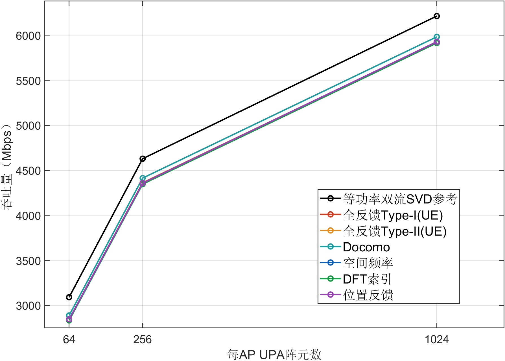

结果：位置反馈在横轴64时为2844.91 Mbps，在1024时为5926.83 Mbps。其他参数保持默认值；结论限于当前冻结部署。 纵轴根据本图所有曲线的最小值和最大值留少量余量，未改变数据。

**UE双流混合信道吞吐量与UPA阵元数**

横轴为UPA阵元数，纵轴为吞吐量（Mbps）。

| 方法 | 64 | 256 | 1024 |
|---|---|---|---|
| SVD参考 | 3102.80 | 4634.31 | 6216.37 |
| 全反馈Type-I(UE) | 2722.26 | 4170.97 | 5689.39 |
| 全反馈Type-II(UE) | 2703.96 | 4148.26 | 5670.72 |
| Docomo | 2811.37 | 4313.57 | 5873.32 |
| 空间频率 | 2810.69 | 4292.04 | 5836.42 |
| DFT索引 | 2799.61 | 4279.49 | 5823.92 |
| 位置反馈 | 2810.66 | 4292.02 | 5836.57 |

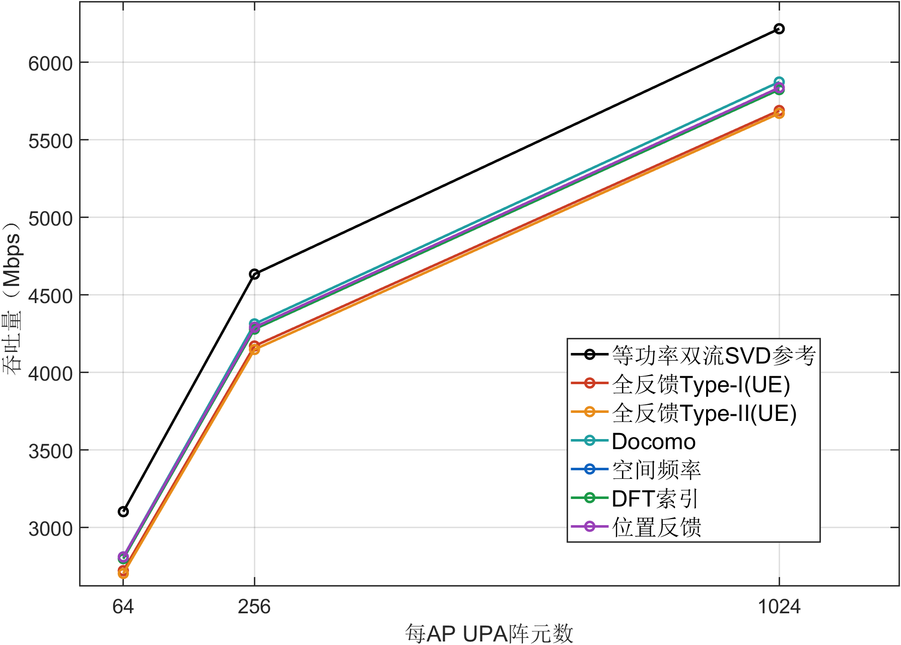

结果：位置反馈在横轴64时为2810.66 Mbps，在1024时为5836.57 Mbps。其他参数保持默认值；结论限于当前冻结部署。 纵轴根据本图所有曲线的最小值和最大值留少量余量，未改变数据。

**UE双流纯LOS吞吐量与莱斯因子K**

横轴为莱斯因子K，纵轴为吞吐量（Mbps）。

| 方法 | 0 | 5 | 10 | 15 | 20 |
|---|---|---|---|---|---|
| SVD参考 | 6212.32 | 6212.32 | 6212.32 | 6212.32 | 6212.32 |
| 全反馈Type-I(UE) | 5920.80 | 5920.80 | 5920.80 | 5920.80 | 5920.80 |
| 全反馈Type-II(UE) | 5924.54 | 5924.54 | 5924.54 | 5924.54 | 5924.54 |
| Docomo | 5981.91 | 5981.91 | 5981.91 | 5981.91 | 5981.91 |
| 空间频率 | 5926.83 | 5926.83 | 5926.83 | 5926.83 | 5926.83 |
| DFT索引 | 5913.34 | 5913.34 | 5913.34 | 5913.34 | 5913.34 |
| 位置反馈 | 5926.83 | 5926.83 | 5926.83 | 5926.83 | 5926.83 |

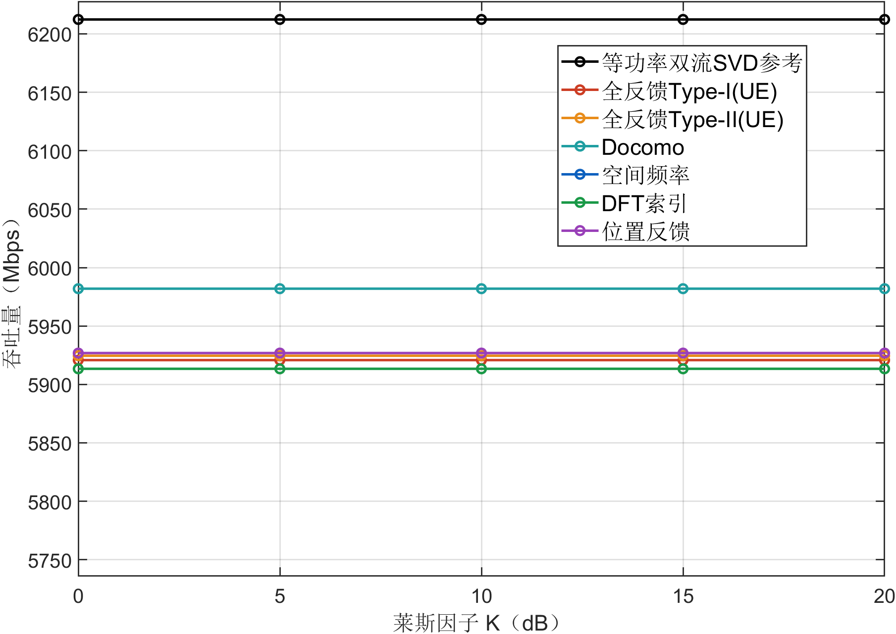

结果：位置反馈在横轴0时为5926.83 Mbps，在20时为5926.83 Mbps。纯LOS不使用K，平线仅作一致性对照；MIX的K扫描才改变LOS和散射比例。 纵轴根据本图所有曲线的最小值和最大值留少量余量，未改变数据。

**UE双流混合信道吞吐量与莱斯因子K**

横轴为莱斯因子K，纵轴为吞吐量（Mbps）。

| 方法 | 0 | 5 | 10 | 15 | 20 |
|---|---|---|---|---|---|
| SVD参考 | 6367.15 | 6259.33 | 6216.37 | 6211.09 | 6211.64 |
| 全反馈Type-I(UE) | 4425.92 | 5264.28 | 5689.39 | 5835.53 | 5886.43 |
| 全反馈Type-II(UE) | 4772.87 | 5337.37 | 5670.72 | 5816.92 | 5875.02 |
| Docomo | 4785.06 | 5663.21 | 5873.32 | 5946.50 | 5970.77 |
| 空间频率 | 4900.79 | 5630.20 | 5836.42 | 5903.57 | 5923.32 |
| DFT索引 | 5145.35 | 5618.69 | 5823.92 | 5890.54 | 5910.49 |
| 位置反馈 | 4540.68 | 5629.93 | 5836.57 | 5903.77 | 5923.27 |

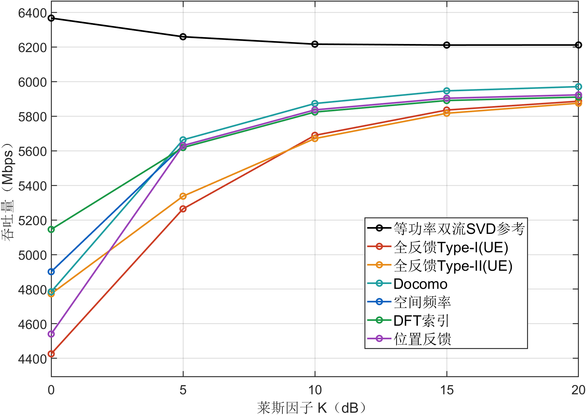

结果：位置反馈在横轴0时为4540.68 Mbps，在20时为5923.27 Mbps。其他参数保持默认值；结论限于当前冻结部署。 纵轴根据本图所有曲线的最小值和最大值留少量余量，未改变数据。

### 3.3 比特数与AP数目

横轴为协作AP数，纵轴为每次更新反馈有效载荷（bit）。长度规则不依赖信道类型，LOS与MIX相同；表内保留5至10 AP，图中仅显示整数5至9。

| 方法 | 5 | 6 | 7 | 8 | 9 | 10 |
|---|---|---|---|---|---|---|
| 全反馈Type-I(UE) | 102 | 124 | 146 | 168 | 190 | 212 |
| 全反馈Type-II(UE) | 197 | 238 | 279 | 320 | 361 | 402 |
| Docomo | 97 | 117 | 137 | 157 | 178 | 198 |
| 空间频率 | 116 | 124 | 132 | 140 | 148 | 156 |
| DFT索引 | 74 | 82 | 90 | 98 | 106 | 114 |
| 位置反馈 | 68 | 76 | 84 | 92 | 100 | 108 |

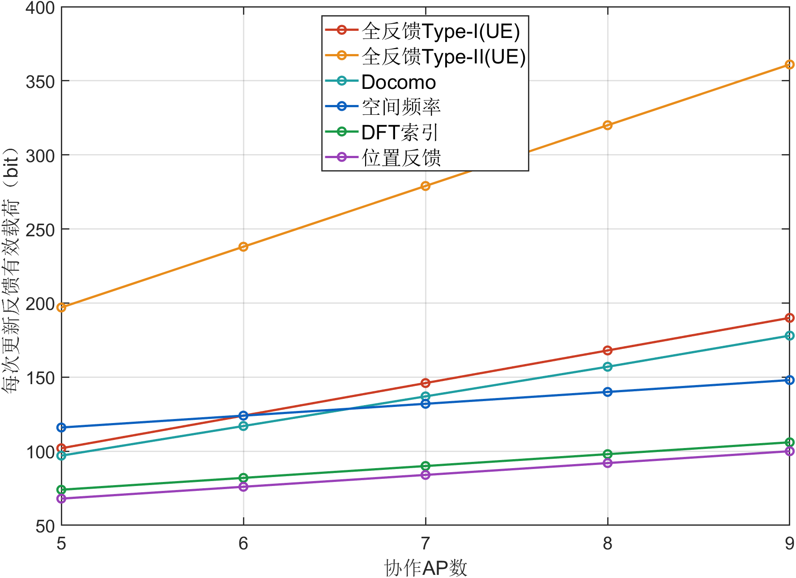

结果：CPU三种几何方法始终为84、42、36 bit。CPU图中的Type-I、Type-II和Docomo为完整UE消息的共享参考；不能将其计为CPU独立算法。UE几何方案还包含4(B−1) bit第一相位。双流UE再增加4(B−1) bit第二相位，CPU不增加反馈。

## 4 额外补充

补充实验也使用当前SNR范围。单流定位前端的量化与越界诊断单独列出；双流补充逐位置增量、第二模式以及默认配置分布。

### 4.1 固定8个协作AP的定位参考数扫描

本实验固定协作AP总数B=8，横轴改为参与定位的参考／反馈AP数R=3、4、5、6、7、8。采用全部400个冻结位置、每AP32×32单极化UPA、观测SNR 30 dB；LOS与MIX分别运行，MIX的K=10 dB。原正文中固定R=3、改变协作AP总数的实验完整保留，二者是不同自变量。

每个位置与信道只生成一次完整8 AP观测，8个AP的连续空间频率及DFT方向索引各估计一次。按预先公开的活动AP顺序取前R个，形成嵌套集合，各R共用同一份观测及固定噪声方差；不按结果选择AP，也不重新生成噪声。

| 参考／反馈AP数R | 物理AP编号 |
|---|---|
| 3 | 1,2,3 |
| 4 | 1,2,3,6 |
| 5 | 1,2,3,6,8 |
| 6 | 1,2,3,6,8,4 |
| 7 | 1,2,3,6,8,4,5 |
| 8 | 1,2,3,6,8,4,5,7 |

空间频率与DFT索引实际打包R个AP的方向整数，CPU解码后定位。位置反馈则由UE用R个AP的连续频率直接定位，再按13/14/9 bit只量化一次坐标；R增加不表示反馈R份位置。所有方法均由整数消息独立恢复用于评价的坐标。

双流的定位来自共用空间前端，与流数和共相位的计算端无关。因此本节CPU、UE及另一份流数报告共用同一份物理定位记录，不把重复展示当作独立试验；增加第二流不增加定位观测。该实验采用LOC_REF_SWEEP_V1定位消息，未将原SSTR_V2的完整预编码协议从R=3改为R=8，不据此给出新增吞吐量结论。

**CPU双流纯LOS定位误差与定位参考AP数**

纵轴为400位置平均定位误差（m），横轴为整数R，协作AP总数始终为8。

| 方法 | 3 | 4 | 5 | 6 | 7 | 8 |
|---|---|---|---|---|---|---|
| 空间频率 | 0.001940 | 0.001701 | 0.001665 | 0.001609 | 0.001514 | 0.001260 |
| DFT索引 | 0.232083 | 0.209027 | 0.193461 | 0.176769 | 0.152713 | 0.134888 |
| 位置反馈 | 0.003723 | 0.003695 | 0.003725 | 0.003742 | 0.003764 | 0.003648 |

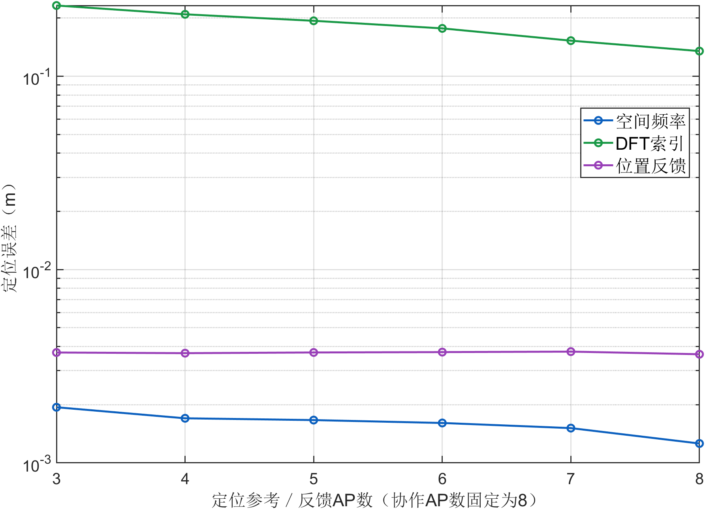

结果：位置反馈从R=3的0.003723 m变为R=8的0.003648 m，均值变化对应降幅2.02%。CPU与UE位置结果一致，反映共用定位消息，不代表相位设计和吞吐量也相同。

**CPU双流混合信道定位误差与定位参考AP数**

纵轴为400位置平均定位误差（m），横轴为整数R，协作AP总数始终为8。

| 方法 | 3 | 4 | 5 | 6 | 7 | 8 |
|---|---|---|---|---|---|---|
| 空间频率 | 0.008532 | 0.008317 | 0.008751 | 0.008940 | 0.006708 | 0.006004 |
| DFT索引 | 0.235091 | 0.212181 | 0.198531 | 0.181151 | 0.154409 | 0.136136 |
| 位置反馈 | 0.009490 | 0.009269 | 0.009667 | 0.009787 | 0.007772 | 0.007140 |

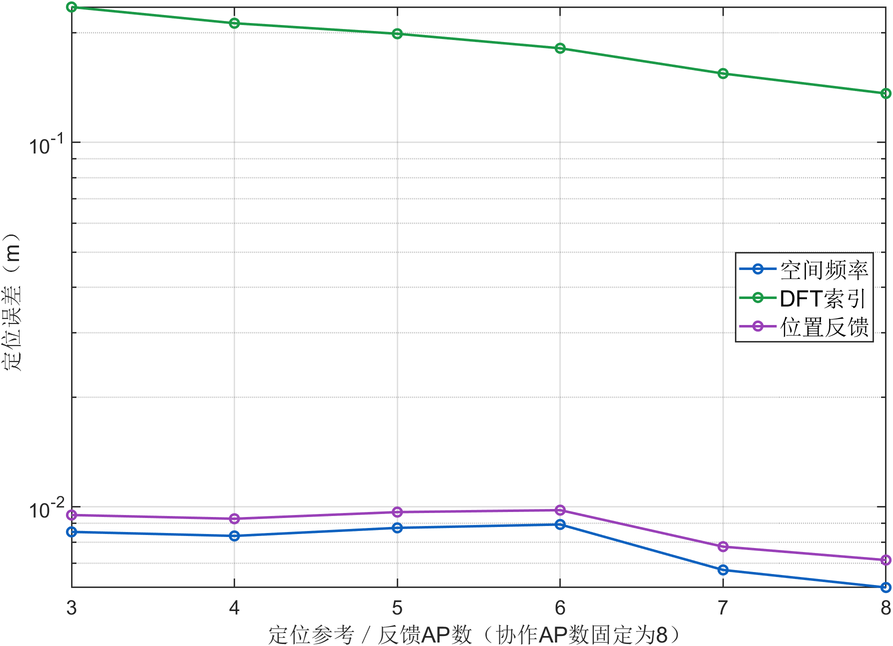

结果：位置反馈从R=3的0.009490 m变为R=8的0.007140 m，均值变化对应降幅24.77%。CPU与UE位置结果一致，反映共用定位消息，不代表相位设计和吞吐量也相同。

**UE双流纯LOS定位误差与定位参考AP数**

纵轴为400位置平均定位误差（m），横轴为整数R，协作AP总数始终为8。

| 方法 | 3 | 4 | 5 | 6 | 7 | 8 |
|---|---|---|---|---|---|---|
| 空间频率 | 0.001940 | 0.001701 | 0.001665 | 0.001609 | 0.001514 | 0.001260 |
| DFT索引 | 0.232083 | 0.209027 | 0.193461 | 0.176769 | 0.152713 | 0.134888 |
| 位置反馈 | 0.003723 | 0.003695 | 0.003725 | 0.003742 | 0.003764 | 0.003648 |

结果：位置反馈从R=3的0.003723 m变为R=8的0.003648 m，均值变化对应降幅2.02%。CPU与UE位置结果一致，反映共用定位消息，不代表相位设计和吞吐量也相同。

**UE双流混合信道定位误差与定位参考AP数**

纵轴为400位置平均定位误差（m），横轴为整数R，协作AP总数始终为8。

| 方法 | 3 | 4 | 5 | 6 | 7 | 8 |
|---|---|---|---|---|---|---|
| 空间频率 | 0.008532 | 0.008317 | 0.008751 | 0.008940 | 0.006708 | 0.006004 |
| DFT索引 | 0.235091 | 0.212181 | 0.198531 | 0.181151 | 0.154409 | 0.136136 |
| 位置反馈 | 0.009490 | 0.009269 | 0.009667 | 0.009787 | 0.007772 | 0.007140 |

结果：位置反馈从R=3的0.009490 m变为R=8的0.007140 m，均值变化对应降幅24.77%。CPU与UE位置结果一致，反映共用定位消息，不代表相位设计和吞吐量也相同。

**从3个到8个参考AP的收益与限制**

| 信道 | 方法 | R=3均值 mm | R=8均值 mm | 均值降幅 % | 逐位置改善 % |
|---|---|---|---|---|---|
| 纯LOS | 空间频率 | 1.940 | 1.260 | 35.05 | 73.50 |
| 纯LOS | DFT索引 | 232.083 | 134.888 | 41.88 | 77.75 |
| 纯LOS | 位置反馈 | 3.723 | 3.648 | 2.02 | 51.25 |
| 混合信道 | 空间频率 | 8.532 | 6.004 | 29.63 | 60.25 |
| 混合信道 | DFT索引 | 235.091 | 136.136 | 42.09 | 79.00 |
| 混合信道 | 位置反馈 | 9.490 | 7.140 | 24.77 | 58.75 |

增加参考AP同时增加了方向观测并改变射线的空间几何。当前定位仍使用原无权重射线最小二乘，未调整AP选择、权重或频率估计器；加入一个AP不保证每个位置或每个中间R点都改善。表中同时给出逐位置严格改善比例，全部位置保留，不将平均降幅解释为逐位置保证。此结论仅对应预先固定的嵌套AP顺序。

**位置反馈的连续定位与坐标量化**

| 信道 纯LOS | 连续误差 mm | 解码误差 mm | 中位误差 mm | 95%分位 mm |
|---|---|---|---|---|
| R=3 | 0.852 | 3.723 | 3.514 | 6.621 |
| R=4 | 0.804 | 3.695 | 3.475 | 6.612 |
| R=5 | 0.917 | 3.725 | 3.482 | 6.656 |
| R=6 | 0.939 | 3.742 | 3.496 | 6.676 |
| R=7 | 0.995 | 3.764 | 3.546 | 6.622 |
| R=8 | 0.690 | 3.648 | 3.475 | 6.639 |

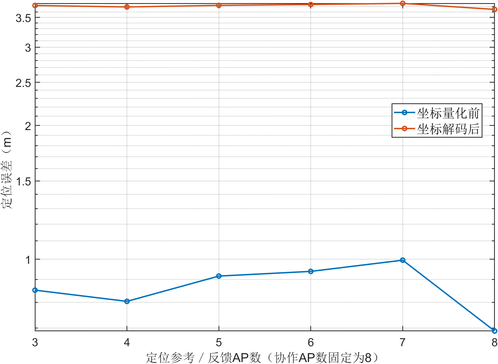

结果：连续定位与量化后位置分开统计，固定坐标量化会影响参考AP增加带来的最终收益；这里始终是连续频率定位后只量化一次坐标。

| 信道 混合信道 | 连续误差 mm | 解码误差 mm | 中位误差 mm | 95%分位 mm |
|---|---|---|---|---|
| R=3 | 8.249 | 9.490 | 7.115 | 26.279 |
| R=4 | 8.075 | 9.269 | 7.283 | 25.232 |
| R=5 | 8.563 | 9.667 | 7.674 | 24.590 |
| R=6 | 8.800 | 9.787 | 7.897 | 23.808 |
| R=7 | 6.589 | 7.772 | 7.065 | 16.716 |
| R=8 | 5.871 | 7.140 | 6.537 | 13.332 |

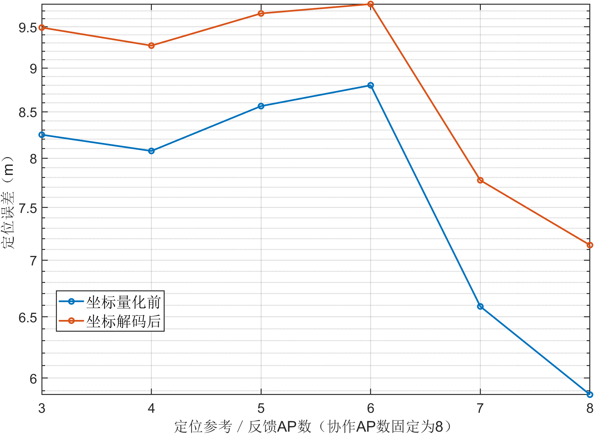

结果：连续定位与量化后位置分开统计，固定坐标量化会影响参考AP增加带来的最终收益；这里始终是连续频率定位后只量化一次坐标。

**仅空间消息的反馈量**

| 方法 | R=3 | R=4 | R=5 | R=6 | R=7 | R=8 |
|---|---|---|---|---|---|---|
| 空间频率 | 84 | 112 | 140 | 168 | 196 | 224 |
| DFT索引 | 42 | 56 | 70 | 84 | 98 | 112 |
| 位置反馈 | 36 | 36 | 36 | 36 | 36 | 36 |

单位为bit，仅统计本定位实验的空间消息；不含相位、公共配置头和FEC。位置反馈只发送一份36 bit坐标，方向消息则随R增加。更多参考AP的观测、计算与导频成本未纳入该bit表，不能据36 bit不变认定其没有其他代价。正文原完整通信开销实验不被此表替换。

独立恢复全部14,400条物理定位记录，重算均值、中位数和95%分位。R=3与当前400位置正式结果的2,400条位置误差对齐，最大差8.02e-14 m；原32位置预实验全部R值的1,152条消息与误差也对齐。

[本补充实验的数据、配置、整数消息和复现命令](../results/reference_ap_full400_20261025/README.md)。

### CPU纯LOS频谱效率与观测SNR

| 方法 | -20 | -15 | -10 | -5 | 0 | 5 | 10 | 15 | 20 |
|---|---|---|---|---|---|---|---|---|---|
| SVD参考 | 15.5308 | 15.5308 | 15.5308 | 15.5308 | 15.5308 | 15.5308 | 15.5308 | 15.5308 | 15.5308 |
| 全反馈Type-I(UE) | 11.4875 | 13.9955 | 14.6245 | 14.7416 | 14.7839 | 14.8204 | 14.8166 | 14.8144 | 14.8121 |
| 全反馈Type-II(UE) | 10.5552 | 13.3880 | 14.3113 | 14.5816 | 14.7090 | 14.7881 | 14.8126 | 14.8221 | 14.8221 |
| Docomo(UE) | 12.6012 | 14.5181 | 14.8783 | 14.9289 | 14.9482 | 14.9523 | 14.9541 | 14.9538 | 14.9541 |
| 空间频率 | 11.1483 | 12.7653 | 12.8582 | 12.9785 | 13.1615 | 13.3895 | 13.9291 | 14.3806 | 14.5999 |
| DFT索引 | 8.4526 | 12.1817 | 12.3095 | 12.3166 | 12.3323 | 12.3443 | 12.3652 | 12.3643 | 12.3797 |
| 位置反馈 | 10.5302 | 12.7826 | 12.8684 | 12.9865 | 13.2019 | 13.4095 | 13.9576 | 14.4277 | 14.6461 |

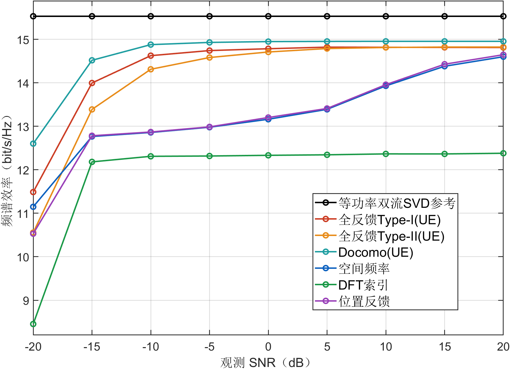

结果：逐点满足吞吐量Mbps=400×频谱效率，横轴使用−20至20 dB、间隔5 dB。

### CPU纯LOS观测SNR下的双流增量和第二模式

| 方法 | 横轴 | 平均增量 Mbps | 正收益 % | 最差增量 Mbps | 第二模式比 |
|---|---|---|---|---|---|
| 全反馈Type-I(UE) | -20 | 1720.68 | 97.25 | -1751.34 | 0.4932 |
| 全反馈Type-I(UE) | -15 | 2375.12 | 100.00 | 1339.93 | 0.7689 |
| 全反馈Type-I(UE) | -10 | 2513.98 | 100.00 | 2165.43 | 0.8266 |
| 全反馈Type-I(UE) | -5 | 2540.13 | 100.00 | 2139.49 | 0.8308 |
| 全反馈Type-I(UE) | 0 | 2553.77 | 100.00 | 2094.51 | 0.8135 |
| 全反馈Type-I(UE) | 5 | 2564.45 | 100.00 | 2280.57 | 0.8030 |
| 全反馈Type-I(UE) | 10 | 2565.26 | 100.00 | 2267.46 | 0.8009 |
| 全反馈Type-I(UE) | 15 | 2565.06 | 100.00 | 2330.08 | 0.7968 |
| 全反馈Type-I(UE) | 20 | 2564.33 | 100.00 | 2399.97 | 0.7944 |
| 全反馈Type-II(UE) | -20 | 1543.67 | 97.50 | -1233.14 | 0.4852 |
| 全反馈Type-II(UE) | -15 | 2245.88 | 100.00 | 1069.97 | 0.7480 |
| 全反馈Type-II(UE) | -10 | 2446.61 | 100.00 | 1990.49 | 0.8206 |
| 全反馈Type-II(UE) | -5 | 2503.93 | 100.00 | 2087.31 | 0.8234 |
| 全反馈Type-II(UE) | 0 | 2535.71 | 100.00 | 2067.88 | 0.8090 |
| 全反馈Type-II(UE) | 5 | 2556.43 | 100.00 | 2218.46 | 0.8023 |
| 全反馈Type-II(UE) | 10 | 2563.28 | 100.00 | 2296.22 | 0.7981 |
| 全反馈Type-II(UE) | 15 | 2565.64 | 100.00 | 2329.68 | 0.7951 |
| 全反馈Type-II(UE) | 20 | 2565.16 | 100.00 | 2336.55 | 0.7931 |
| Docomo(UE) | -20 | 2023.83 | 100.00 | 815.41 | 0.6052 |
| Docomo(UE) | -15 | 2481.76 | 100.00 | 1889.89 | 0.8051 |
| Docomo(UE) | -10 | 2563.55 | 100.00 | 2399.48 | 0.8465 |
| Docomo(UE) | -5 | 2576.60 | 100.00 | 2458.42 | 0.8601 |
| Docomo(UE) | 0 | 2580.22 | 100.00 | 2494.22 | 0.8678 |
| Docomo(UE) | 5 | 2581.34 | 100.00 | 2486.85 | 0.8732 |
| Docomo(UE) | 10 | 2581.65 | 100.00 | 2495.91 | 0.8723 |
| Docomo(UE) | 15 | 2581.65 | 100.00 | 2495.91 | 0.8717 |
| Docomo(UE) | 20 | 2581.65 | 100.00 | 2495.91 | 0.8734 |
| 空间频率 | -20 | 1607.57 | 90.25 | -1897.07 | 0.4061 |
| 空间频率 | -15 | 2075.03 | 99.75 | -536.15 | 0.4857 |
| 空间频率 | -10 | 2091.27 | 100.00 | 732.01 | 0.4884 |
| 空间频率 | -5 | 2131.73 | 100.00 | 523.17 | 0.4990 |
| 空间频率 | 0 | 2177.22 | 100.00 | 368.54 | 0.5144 |
| 空间频率 | 5 | 2235.74 | 100.00 | 335.80 | 0.5565 |
| 空间频率 | 10 | 2365.11 | 100.00 | 517.20 | 0.6373 |
| 空间频率 | 15 | 2460.71 | 100.00 | 217.26 | 0.7089 |
| 空间频率 | 20 | 2508.85 | 100.00 | 1524.16 | 0.7478 |
| DFT索引 | -20 | 867.70 | 72.75 | -1830.32 | 0.3004 |
| DFT索引 | -15 | 1938.71 | 99.50 | -1542.92 | 0.4490 |
| DFT索引 | -10 | 1966.64 | 100.00 | 92.25 | 0.4592 |
| DFT索引 | -5 | 1970.93 | 100.00 | 368.66 | 0.4613 |
| DFT索引 | 0 | 1978.83 | 100.00 | 368.66 | 0.4612 |
| DFT索引 | 5 | 1981.46 | 100.00 | 368.66 | 0.4605 |
| DFT索引 | 10 | 1985.54 | 100.00 | 368.66 | 0.4634 |
| DFT索引 | 15 | 1983.78 | 100.00 | 368.66 | 0.4623 |
| DFT索引 | 20 | 1986.66 | 100.00 | 368.66 | 0.4623 |
| 位置反馈 | -20 | 1628.88 | 90.50 | -1401.73 | 0.4152 |
| 位置反馈 | -15 | 2079.68 | 100.00 | 58.13 | 0.4904 |
| 位置反馈 | -10 | 2091.56 | 100.00 | 472.08 | 0.4892 |
| 位置反馈 | -5 | 2131.59 | 100.00 | 273.60 | 0.5011 |
| 位置反馈 | 0 | 2189.46 | 100.00 | 445.39 | 0.5169 |
| 位置反馈 | 5 | 2244.79 | 100.00 | 91.92 | 0.5564 |
| 位置反馈 | 10 | 2372.44 | 100.00 | 416.15 | 0.6403 |
| 位置反馈 | 15 | 2470.10 | 100.00 | 691.44 | 0.7200 |
| 位置反馈 | 20 | 2517.62 | 100.00 | 1811.34 | 0.7554 |

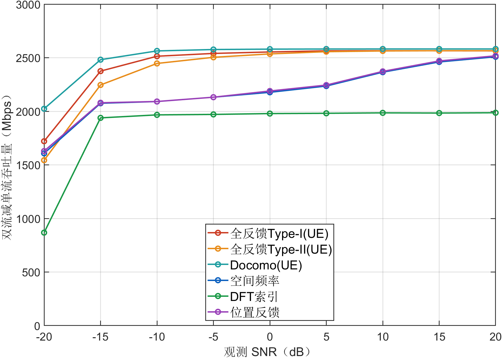

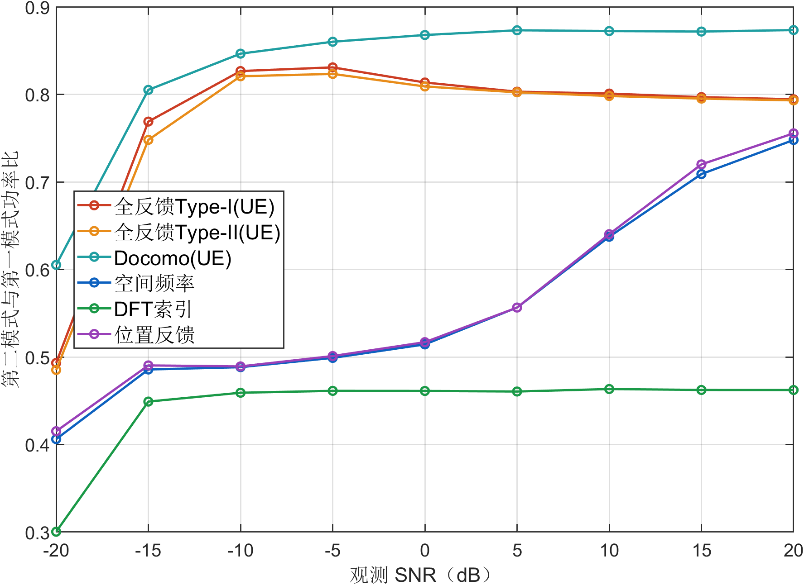

结果：本组最低平均增量867.70 Mbps，最低正收益比例72.75%。平均正收益不保证每个位置受益，低SNR下强制双流也可能退化。第二模式比按真实接收矩阵HW的奇异值平方计算。

### CPU纯LOSUPA阵元数下的双流增量和第二模式

| 方法 | 横轴 | 平均增量 Mbps | 正收益 % | 最差增量 Mbps | 第二模式比 |
|---|---|---|---|---|---|
| 全反馈Type-I(UE) | 64 | 1046.40 | 100.00 | 866.03 | 0.7923 |
| 全反馈Type-I(UE) | 256 | 1784.22 | 100.00 | 1608.52 | 0.7900 |
| 全反馈Type-I(UE) | 1024 | 2561.20 | 100.00 | 2397.10 | 0.7921 |
| 全反馈Type-II(UE) | 64 | 1047.73 | 100.00 | 858.73 | 0.7897 |
| 全反馈Type-II(UE) | 256 | 1787.02 | 100.00 | 1629.94 | 0.7876 |
| 全反馈Type-II(UE) | 1024 | 2561.65 | 100.00 | 2330.07 | 0.7906 |
| Docomo(UE) | 64 | 1057.60 | 100.00 | 965.45 | 0.8611 |
| Docomo(UE) | 256 | 1802.48 | 100.00 | 1703.47 | 0.8659 |
| Docomo(UE) | 1024 | 2581.95 | 100.00 | 2495.91 | 0.8727 |
| 空间频率 | 64 | 815.61 | 98.25 | -400.18 | 0.5740 |
| 空间频率 | 256 | 1730.26 | 100.00 | 1217.03 | 0.7400 |
| 空间频率 | 1024 | 2528.52 | 100.00 | 2315.37 | 0.7652 |
| DFT索引 | 64 | 576.92 | 98.00 | -161.98 | 0.4377 |
| DFT索引 | 256 | 1199.97 | 98.50 | -493.09 | 0.4536 |
| DFT索引 | 1024 | 1990.00 | 100.00 | 368.66 | 0.4638 |
| 位置反馈 | 64 | 825.82 | 98.75 | -373.66 | 0.5776 |
| 位置反馈 | 256 | 1739.08 | 100.00 | 1335.80 | 0.7499 |
| 位置反馈 | 1024 | 2537.62 | 100.00 | 2321.82 | 0.7724 |

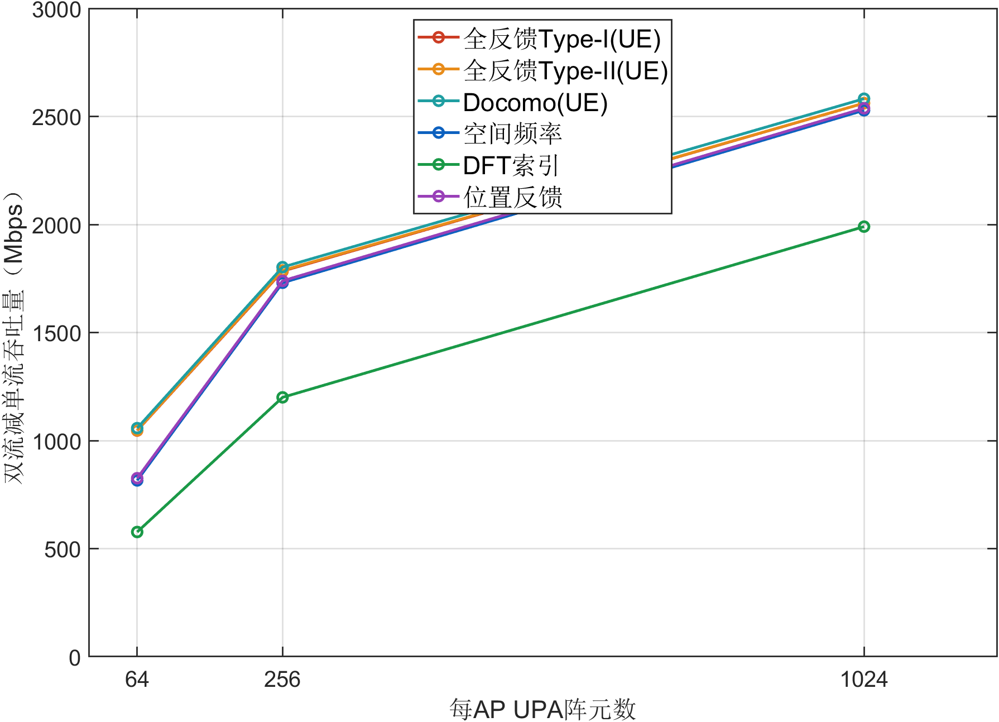

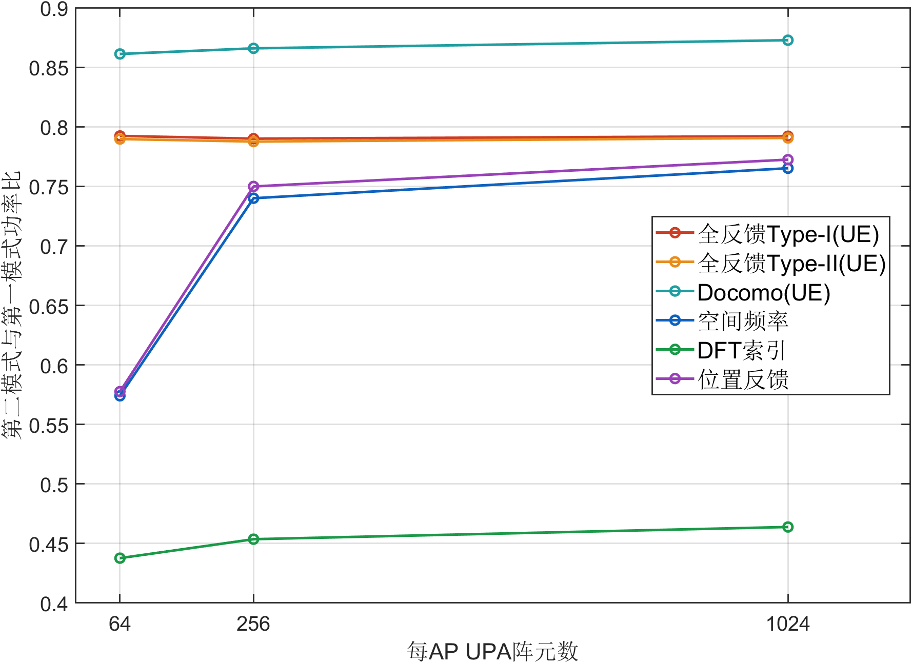

结果：本组最低平均增量576.92 Mbps，最低正收益比例98.00%。平均正收益不保证每个位置受益，低SNR下强制双流也可能退化。第二模式比按真实接收矩阵HW的奇异值平方计算。

### CPU纯LOS协作AP数下的双流增量和第二模式

| 方法 | 横轴 | 平均增量 Mbps | 正收益 % | 最差增量 Mbps | 第二模式比 |
|---|---|---|---|---|---|
| 全反馈Type-I(UE) | 5 | 2353.27 | 100.00 | 2161.02 | 0.6868 |
| 全反馈Type-I(UE) | 6 | 2414.84 | 100.00 | 2129.72 | 0.7165 |
| 全反馈Type-I(UE) | 7 | 2493.05 | 100.00 | 2245.76 | 0.7261 |
| 全反馈Type-I(UE) | 8 | 2561.20 | 100.00 | 2397.10 | 0.7921 |
| 全反馈Type-I(UE) | 9 | 2583.08 | 100.00 | 2428.84 | 0.6952 |
| 全反馈Type-I(UE) | 10 | 2638.47 | 100.00 | 2475.49 | 0.7451 |
| 全反馈Type-II(UE) | 5 | 2353.43 | 100.00 | 2134.05 | 0.6830 |
| 全反馈Type-II(UE) | 6 | 2412.99 | 100.00 | 1934.15 | 0.7107 |
| 全反馈Type-II(UE) | 7 | 2492.02 | 100.00 | 1942.49 | 0.7256 |
| 全反馈Type-II(UE) | 8 | 2561.65 | 100.00 | 2330.07 | 0.7906 |
| 全反馈Type-II(UE) | 9 | 2580.18 | 100.00 | 2425.95 | 0.6925 |
| 全反馈Type-II(UE) | 10 | 2640.57 | 100.00 | 2482.84 | 0.7447 |
| Docomo(UE) | 5 | 2443.29 | 100.00 | 2220.94 | 0.8234 |
| Docomo(UE) | 6 | 2482.03 | 100.00 | 2321.30 | 0.7882 |
| Docomo(UE) | 7 | 2524.45 | 100.00 | 2404.26 | 0.8159 |
| Docomo(UE) | 8 | 2581.95 | 100.00 | 2495.91 | 0.8727 |
| Docomo(UE) | 9 | 2658.24 | 100.00 | 2468.25 | 0.7865 |
| Docomo(UE) | 10 | 2705.25 | 100.00 | 2457.97 | 0.8032 |
| 空间频率 | 5 | 2332.72 | 100.00 | 1974.98 | 0.6601 |
| 空间频率 | 6 | 2403.17 | 100.00 | 2137.52 | 0.6854 |
| 空间频率 | 7 | 2441.19 | 100.00 | 2192.40 | 0.6419 |
| 空间频率 | 8 | 2528.52 | 100.00 | 2315.37 | 0.7652 |
| 空间频率 | 9 | 2536.46 | 100.00 | 2185.54 | 0.6252 |
| 空间频率 | 10 | 2601.09 | 100.00 | 2411.21 | 0.6910 |
| DFT索引 | 5 | 2013.55 | 100.00 | 93.46 | 0.4625 |
| DFT索引 | 6 | 2027.95 | 100.00 | 211.39 | 0.4568 |
| DFT索引 | 7 | 1995.65 | 100.00 | 74.31 | 0.4637 |
| DFT索引 | 8 | 1990.00 | 100.00 | 368.66 | 0.4638 |
| DFT索引 | 9 | 1970.83 | 100.00 | 836.12 | 0.4332 |
| DFT索引 | 10 | 1878.37 | 99.75 | -506.86 | 0.3926 |
| 位置反馈 | 5 | 2340.65 | 100.00 | 2110.41 | 0.6670 |
| 位置反馈 | 6 | 2410.36 | 100.00 | 2215.50 | 0.6981 |
| 位置反馈 | 7 | 2454.07 | 100.00 | 2287.17 | 0.6503 |
| 位置反馈 | 8 | 2537.62 | 100.00 | 2321.82 | 0.7724 |
| 位置反馈 | 9 | 2551.78 | 100.00 | 2337.77 | 0.6353 |
| 位置反馈 | 10 | 2611.52 | 100.00 | 2437.83 | 0.6933 |

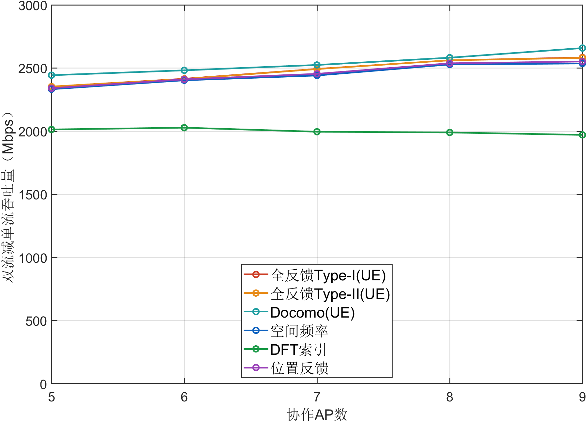

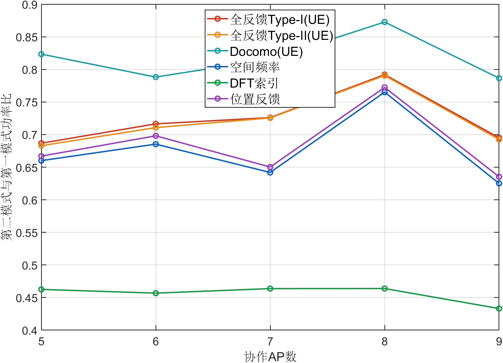

结果：本组最低平均增量1878.37 Mbps，最低正收益比例99.75%。平均正收益不保证每个位置受益，低SNR下强制双流也可能退化。第二模式比按真实接收矩阵HW的奇异值平方计算。

| 方法 | 5 | 6 | 7 | 8 | 9 | 10 |
|---|---|---|---|---|---|---|
| SVD参考 | 5971.46 | 6088.19 | 6167.77 | 6212.32 | 6412.47 | 6515.66 |
| 全反馈Type-I(UE) | 5596.94 | 5733.84 | 5814.78 | 5920.80 | 6085.30 | 6183.78 |
| 全反馈Type-II(UE) | 5600.36 | 5735.37 | 5817.41 | 5924.54 | 6085.32 | 6189.78 |
| Docomo(UE) | 5722.48 | 5828.07 | 5897.10 | 5981.91 | 6158.97 | 6253.41 |
| 空间频率 | 5566.23 | 5713.59 | 5752.12 | 5877.47 | 6029.75 | 6133.89 |
| DFT索引 | 4992.88 | 5022.95 | 4986.05 | 4956.44 | 4967.10 | 4851.46 |
| 位置反馈 | 5582.26 | 5728.42 | 5773.85 | 5896.02 | 6054.18 | 6155.33 |

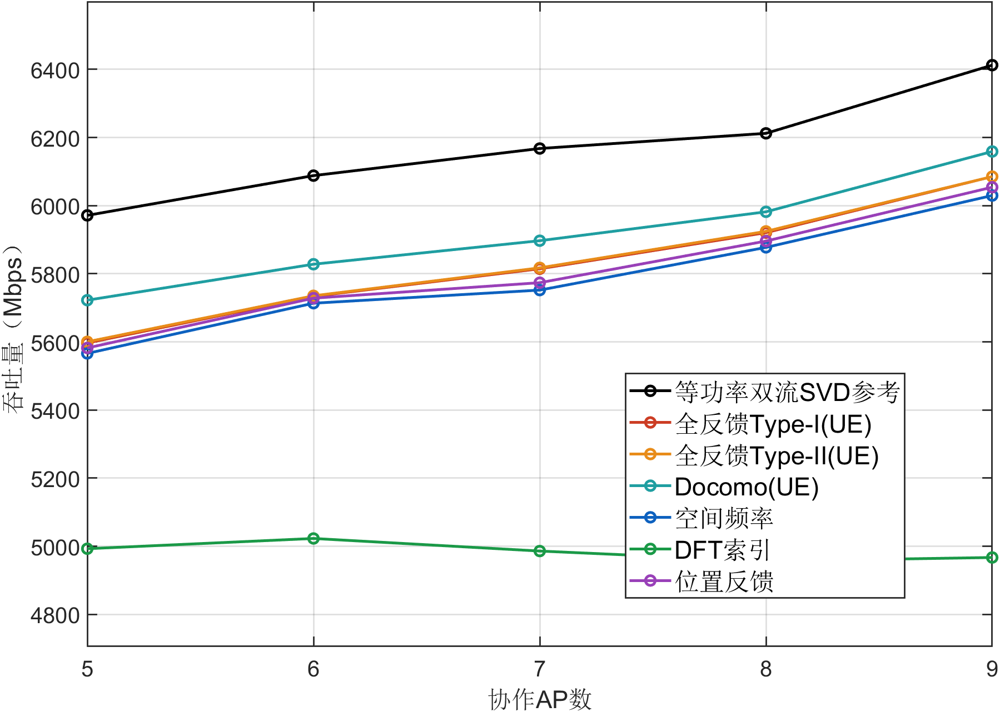

AP数与吞吐量保留在补充；正文对应的主要开销实验是比特数与AP数。

### CPU纯LOS莱斯因子K下的双流增量和第二模式

| 方法 | 横轴 | 平均增量 Mbps | 正收益 % | 最差增量 Mbps | 第二模式比 |
|---|---|---|---|---|---|
| 全反馈Type-I(UE) | 0 | 2561.20 | 100.00 | 2397.10 | 0.7921 |
| 全反馈Type-I(UE) | 5 | 2561.20 | 100.00 | 2397.10 | 0.7921 |
| 全反馈Type-I(UE) | 10 | 2561.20 | 100.00 | 2397.10 | 0.7921 |
| 全反馈Type-I(UE) | 15 | 2561.20 | 100.00 | 2397.10 | 0.7921 |
| 全反馈Type-I(UE) | 20 | 2561.20 | 100.00 | 2397.10 | 0.7921 |
| 全反馈Type-II(UE) | 0 | 2561.65 | 100.00 | 2330.07 | 0.7906 |
| 全反馈Type-II(UE) | 5 | 2561.65 | 100.00 | 2330.07 | 0.7906 |
| 全反馈Type-II(UE) | 10 | 2561.65 | 100.00 | 2330.07 | 0.7906 |
| 全反馈Type-II(UE) | 15 | 2561.65 | 100.00 | 2330.07 | 0.7906 |
| 全反馈Type-II(UE) | 20 | 2561.65 | 100.00 | 2330.07 | 0.7906 |
| Docomo(UE) | 0 | 2581.95 | 100.00 | 2495.91 | 0.8727 |
| Docomo(UE) | 5 | 2581.95 | 100.00 | 2495.91 | 0.8727 |
| Docomo(UE) | 10 | 2581.95 | 100.00 | 2495.91 | 0.8727 |
| Docomo(UE) | 15 | 2581.95 | 100.00 | 2495.91 | 0.8727 |
| Docomo(UE) | 20 | 2581.95 | 100.00 | 2495.91 | 0.8727 |
| 空间频率 | 0 | 2528.52 | 100.00 | 2315.37 | 0.7652 |
| 空间频率 | 5 | 2528.52 | 100.00 | 2315.37 | 0.7652 |
| 空间频率 | 10 | 2528.52 | 100.00 | 2315.37 | 0.7652 |
| 空间频率 | 15 | 2528.52 | 100.00 | 2315.37 | 0.7652 |
| 空间频率 | 20 | 2528.52 | 100.00 | 2315.37 | 0.7652 |
| DFT索引 | 0 | 1990.00 | 100.00 | 368.66 | 0.4638 |
| DFT索引 | 5 | 1990.00 | 100.00 | 368.66 | 0.4638 |
| DFT索引 | 10 | 1990.00 | 100.00 | 368.66 | 0.4638 |
| DFT索引 | 15 | 1990.00 | 100.00 | 368.66 | 0.4638 |
| DFT索引 | 20 | 1990.00 | 100.00 | 368.66 | 0.4638 |
| 位置反馈 | 0 | 2537.62 | 100.00 | 2321.82 | 0.7724 |
| 位置反馈 | 5 | 2537.62 | 100.00 | 2321.82 | 0.7724 |
| 位置反馈 | 10 | 2537.62 | 100.00 | 2321.82 | 0.7724 |
| 位置反馈 | 15 | 2537.62 | 100.00 | 2321.82 | 0.7724 |
| 位置反馈 | 20 | 2537.62 | 100.00 | 2321.82 | 0.7724 |

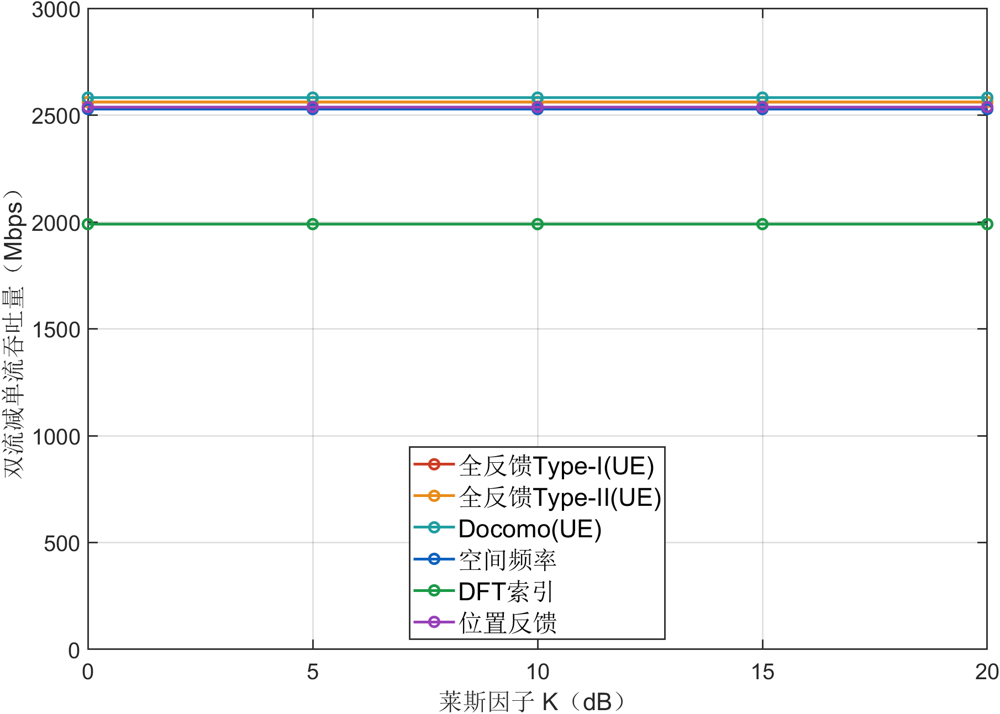

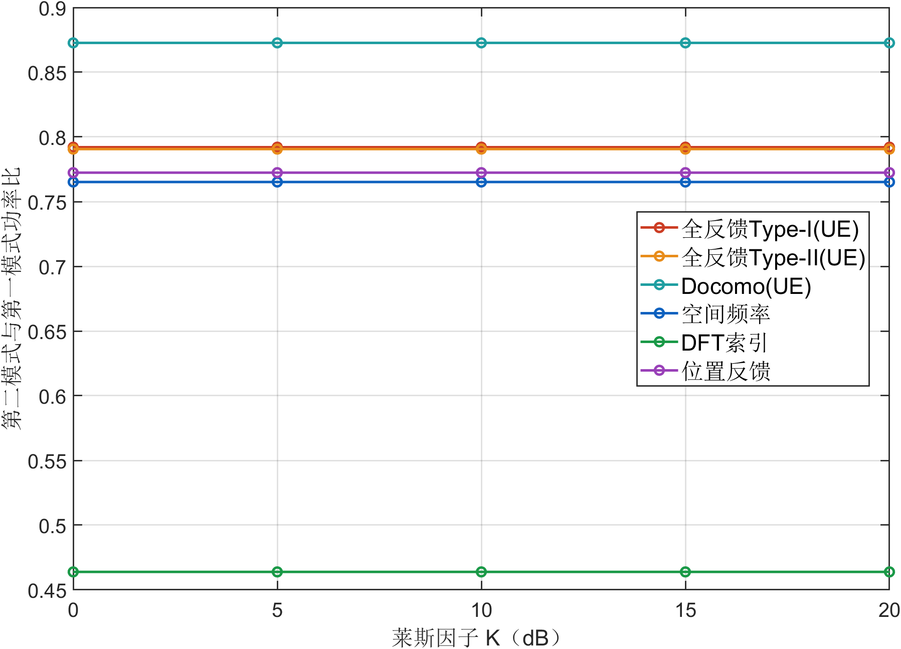

结果：本组最低平均增量1990.00 Mbps，最低正收益比例100.00%。平均正收益不保证每个位置受益，低SNR下强制双流也可能退化。第二模式比按真实接收矩阵HW的奇异值平方计算。

### CPU纯LOS默认配置单双流与增量分布

| 方法 | 单流 Mbps | 双流 Mbps | 增量 Mbps | 正收益 % |
|---|---|---|---|---|
| 全反馈Type-I(UE) | 3359.60 | 5920.80 | 2561.20 | 100.00 |
| 全反馈Type-II(UE) | 3362.89 | 5924.54 | 2561.65 | 100.00 |
| Docomo(UE) | 3399.96 | 5981.91 | 2581.95 | 100.00 |
| 空间频率 | 3348.95 | 5877.47 | 2528.52 | 100.00 |
| DFT索引 | 2966.44 | 4956.44 | 1990.00 | 100.00 |
| 位置反馈 | 3358.40 | 5896.02 | 2537.62 | 100.00 |

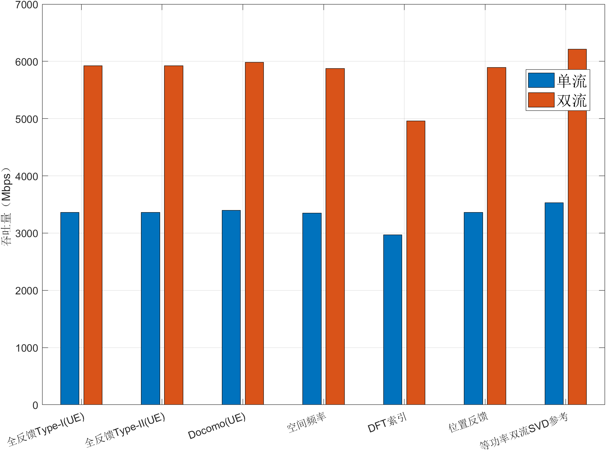

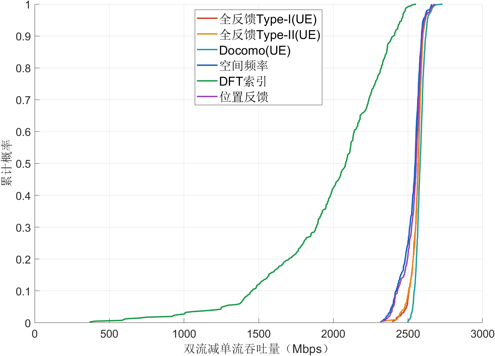

结果：默认配置仍为观测SNR 30 dB。此处是单独默认点，不向吞吐量SNR扫描中额外插入30 dB；CDF使用全部400个配对位置，数据沿用同一默认案例。

### CPU混合信道频谱效率与观测SNR

| 方法 | -20 | -15 | -10 | -5 | 0 | 5 | 10 | 15 | 20 |
|---|---|---|---|---|---|---|---|---|---|
| SVD参考 | 15.5409 | 15.5409 | 15.5409 | 15.5409 | 15.5409 | 15.5409 | 15.5409 | 15.5409 | 15.5409 |
| 全反馈Type-I(UE) | 10.9429 | 13.6601 | 14.3073 | 14.3319 | 14.2529 | 14.2281 | 14.2204 | 14.2200 | 14.2221 |
| 全反馈Type-II(UE) | 9.9442 | 13.0022 | 14.0234 | 14.2341 | 14.1962 | 14.1804 | 14.1768 | 14.1717 | 14.1704 |
| Docomo(UE) | 11.9927 | 14.1582 | 14.5983 | 14.6583 | 14.6750 | 14.6834 | 14.6855 | 14.6861 | 14.6860 |
| 空间频率 | 10.3375 | 12.5192 | 12.5434 | 12.7538 | 12.9750 | 13.0716 | 13.4108 | 13.6147 | 13.7054 |
| DFT索引 | 7.7565 | 11.9148 | 12.0692 | 12.0443 | 12.0858 | 12.1107 | 12.1134 | 12.1108 | 12.1089 |
| 位置反馈 | 9.4378 | 12.5140 | 12.4906 | 12.7890 | 12.9612 | 13.0442 | 13.3920 | 13.6435 | 13.7291 |

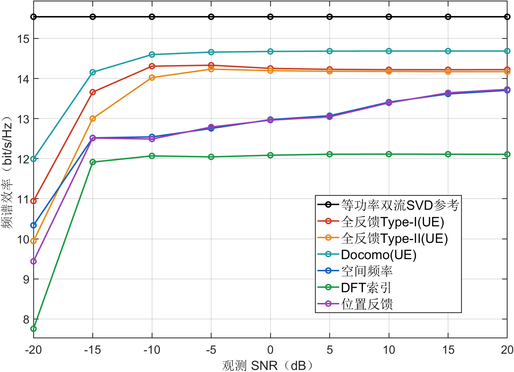

结果：逐点满足吞吐量Mbps=400×频谱效率，横轴使用−20至20 dB、间隔5 dB。

### CPU混合信道观测SNR下的双流增量和第二模式

| 方法 | 横轴 | 平均增量 Mbps | 正收益 % | 最差增量 Mbps | 第二模式比 |
|---|---|---|---|---|---|
| 全反馈Type-I(UE) | -20 | 1597.01 | 96.25 | -1756.96 | 0.4692 |
| 全反馈Type-I(UE) | -15 | 2301.40 | 100.00 | 1498.28 | 0.7499 |
| 全反馈Type-I(UE) | -10 | 2442.28 | 100.00 | 1859.91 | 0.8108 |
| 全反馈Type-I(UE) | -5 | 2431.13 | 100.00 | 1606.67 | 0.7832 |
| 全反馈Type-I(UE) | 0 | 2403.08 | 100.00 | 1396.23 | 0.7575 |
| 全反馈Type-I(UE) | 5 | 2393.53 | 100.00 | 1410.85 | 0.7481 |
| 全反馈Type-I(UE) | 10 | 2389.37 | 100.00 | 1432.43 | 0.7461 |
| 全反馈Type-I(UE) | 15 | 2389.73 | 100.00 | 1433.78 | 0.7515 |
| 全反馈Type-I(UE) | 20 | 2389.97 | 100.00 | 1423.56 | 0.7474 |
| 全反馈Type-II(UE) | -20 | 1400.97 | 97.25 | -1383.52 | 0.4542 |
| 全反馈Type-II(UE) | -15 | 2159.23 | 100.00 | 1244.48 | 0.7253 |
| 全反馈Type-II(UE) | -10 | 2368.07 | 100.00 | 1824.90 | 0.7899 |
| 全反馈Type-II(UE) | -5 | 2381.80 | 100.00 | 1730.22 | 0.7462 |
| 全反馈Type-II(UE) | 0 | 2357.12 | 100.00 | 1669.84 | 0.7104 |
| 全反馈Type-II(UE) | 5 | 2348.80 | 100.00 | 1717.08 | 0.7010 |
| 全反馈Type-II(UE) | 10 | 2346.88 | 100.00 | 1673.62 | 0.6994 |
| 全反馈Type-II(UE) | 15 | 2344.58 | 100.00 | 1682.53 | 0.6969 |
| 全反馈Type-II(UE) | 20 | 2344.28 | 100.00 | 1685.00 | 0.6962 |
| Docomo(UE) | -20 | 1874.68 | 99.50 | -270.65 | 0.5572 |
| Docomo(UE) | -15 | 2405.02 | 100.00 | 1563.79 | 0.7901 |
| Docomo(UE) | -10 | 2504.62 | 100.00 | 2308.22 | 0.8455 |
| Docomo(UE) | -5 | 2520.50 | 100.00 | 2371.80 | 0.8612 |
| Docomo(UE) | 0 | 2524.58 | 100.00 | 2386.30 | 0.8600 |
| Docomo(UE) | 5 | 2526.61 | 100.00 | 2386.30 | 0.8655 |
| Docomo(UE) | 10 | 2526.68 | 100.00 | 2437.77 | 0.8672 |
| Docomo(UE) | 15 | 2526.51 | 100.00 | 2420.02 | 0.8678 |
| Docomo(UE) | 20 | 2526.40 | 100.00 | 2420.02 | 0.8662 |
| 空间频率 | -20 | 1399.67 | 85.75 | -1884.49 | 0.4040 |
| 空间频率 | -15 | 2024.61 | 99.75 | -210.85 | 0.4920 |
| 空间频率 | -10 | 2037.78 | 100.00 | 695.44 | 0.4815 |
| 空间频率 | -5 | 2087.51 | 100.00 | 519.97 | 0.5028 |
| 空间频率 | 0 | 2148.47 | 100.00 | 543.08 | 0.5261 |
| 空间频率 | 5 | 2175.29 | 100.00 | 125.98 | 0.5415 |
| 空间频率 | 10 | 2252.20 | 100.00 | 157.51 | 0.6010 |
| 空间频率 | 15 | 2294.98 | 100.00 | 43.23 | 0.6367 |
| 空间频率 | 20 | 2310.89 | 100.00 | 43.23 | 0.6478 |
| DFT索引 | -20 | 699.62 | 68.25 | -1798.79 | 0.2802 |
| DFT索引 | -15 | 1877.45 | 99.00 | -1600.75 | 0.4480 |
| DFT索引 | -10 | 1925.21 | 100.00 | 23.14 | 0.4651 |
| DFT索引 | -5 | 1912.74 | 100.00 | 242.23 | 0.4609 |
| DFT索引 | 0 | 1923.65 | 100.00 | 242.23 | 0.4611 |
| DFT索引 | 5 | 1932.67 | 100.00 | 242.23 | 0.4642 |
| DFT索引 | 10 | 1933.29 | 100.00 | 242.23 | 0.4652 |
| DFT索引 | 15 | 1932.47 | 100.00 | 242.23 | 0.4638 |
| DFT索引 | 20 | 1931.24 | 100.00 | 242.23 | 0.4636 |
| 位置反馈 | -20 | 1425.16 | 84.00 | -1439.44 | 0.4111 |
| 位置反馈 | -15 | 2022.32 | 99.75 | -311.00 | 0.4896 |
| 位置反馈 | -10 | 2020.91 | 100.00 | 286.33 | 0.4744 |
| 位置反馈 | -5 | 2095.29 | 100.00 | 441.38 | 0.5090 |
| 位置反馈 | 0 | 2139.39 | 100.00 | 103.13 | 0.5244 |
| 位置反馈 | 5 | 2167.17 | 100.00 | 244.32 | 0.5390 |
| 位置反馈 | 10 | 2244.88 | 99.75 | -19.78 | 0.6010 |
| 位置反馈 | 15 | 2297.06 | 99.75 | -57.04 | 0.6427 |
| 位置反馈 | 20 | 2313.49 | 99.75 | -36.91 | 0.6555 |

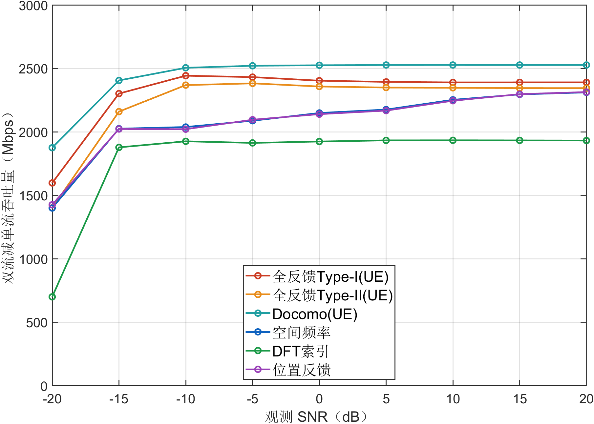

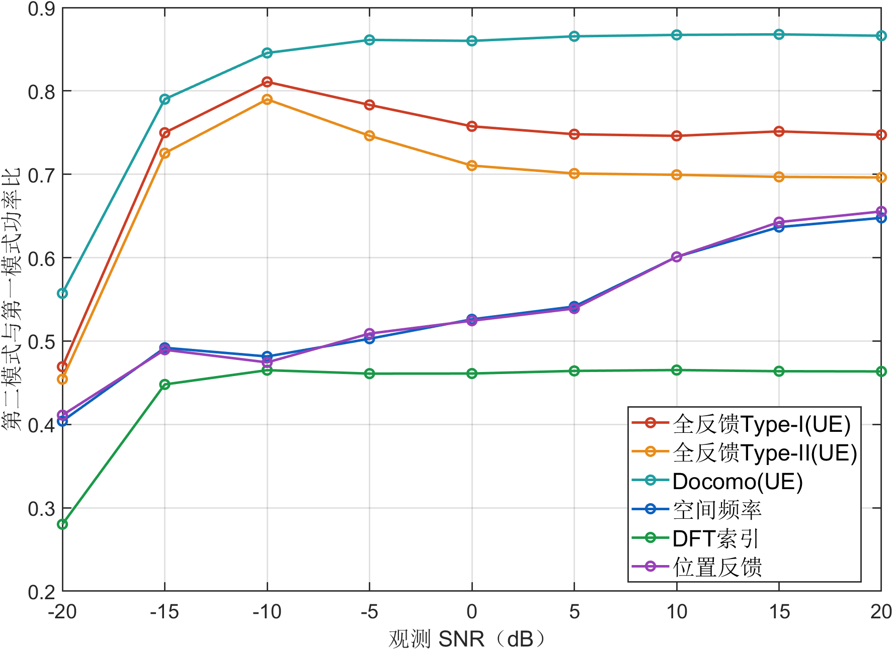

结果：本组最低平均增量699.62 Mbps，最低正收益比例68.25%。平均正收益不保证每个位置受益，低SNR下强制双流也可能退化。第二模式比按真实接收矩阵HW的奇异值平方计算。

### CPU混合信道UPA阵元数下的双流增量和第二模式

| 方法 | 横轴 | 平均增量 Mbps | 正收益 % | 最差增量 Mbps | 第二模式比 |
|---|---|---|---|---|---|
| 全反馈Type-I(UE) | 64 | 939.49 | 100.00 | 407.32 | 0.7672 |
| 全反馈Type-I(UE) | 256 | 1643.46 | 100.00 | 938.86 | 0.7594 |
| 全反馈Type-I(UE) | 1024 | 2390.88 | 100.00 | 1423.56 | 0.7483 |
| 全反馈Type-II(UE) | 64 | 898.17 | 100.00 | 511.42 | 0.7078 |
| 全反馈Type-II(UE) | 256 | 1594.90 | 100.00 | 1017.14 | 0.7049 |
| 全反馈Type-II(UE) | 1024 | 2346.44 | 100.00 | 1685.00 | 0.6976 |
| Docomo(UE) | 64 | 1016.20 | 100.00 | 907.04 | 0.8408 |
| Docomo(UE) | 256 | 1749.60 | 100.00 | 1633.17 | 0.8506 |
| Docomo(UE) | 1024 | 2525.60 | 100.00 | 2359.58 | 0.8664 |
| 空间频率 | 64 | 596.96 | 97.50 | -379.34 | 0.4696 |
| 空间频率 | 256 | 1345.62 | 99.75 | -312.04 | 0.5038 |
| 空间频率 | 1024 | 2322.45 | 100.00 | 550.69 | 0.6551 |
| DFT索引 | 64 | 537.75 | 97.25 | -338.97 | 0.4297 |
| DFT索引 | 256 | 1155.67 | 98.50 | -539.60 | 0.4503 |
| DFT索引 | 1024 | 1929.08 | 100.00 | 242.23 | 0.4627 |
| 位置反馈 | 64 | 594.91 | 97.75 | -471.34 | 0.4734 |
| 位置反馈 | 256 | 1343.21 | 99.50 | -731.00 | 0.5029 |
| 位置反馈 | 1024 | 2314.79 | 100.00 | 9.14 | 0.6579 |

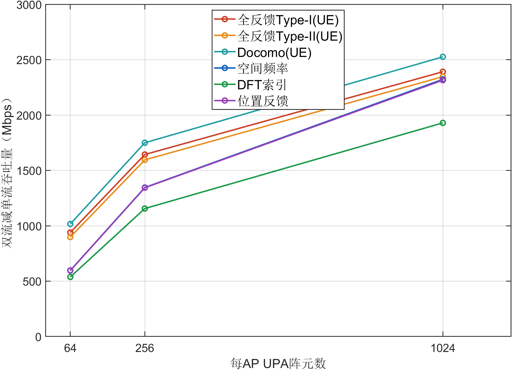

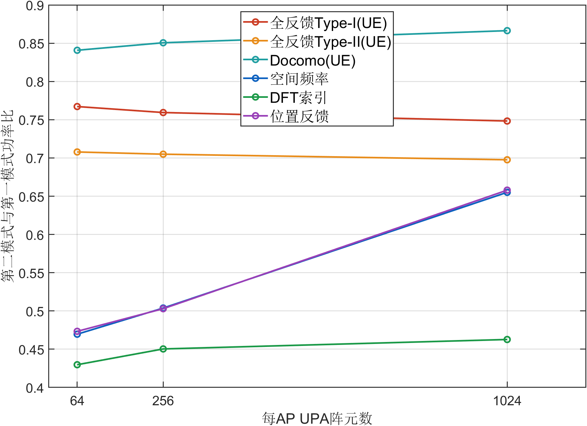

结果：本组最低平均增量537.75 Mbps，最低正收益比例97.25%。平均正收益不保证每个位置受益，低SNR下强制双流也可能退化。第二模式比按真实接收矩阵HW的奇异值平方计算。

### CPU混合信道协作AP数下的双流增量和第二模式

| 方法 | 横轴 | 平均增量 Mbps | 正收益 % | 最差增量 Mbps | 第二模式比 |
|---|---|---|---|---|---|
| 全反馈Type-I(UE) | 5 | 2101.36 | 100.00 | 1712.68 | 0.5463 |
| 全反馈Type-I(UE) | 6 | 2227.01 | 100.00 | 1477.84 | 0.6226 |
| 全反馈Type-I(UE) | 7 | 2325.98 | 100.00 | 1683.54 | 0.6953 |
| 全反馈Type-I(UE) | 8 | 2390.88 | 100.00 | 1423.56 | 0.7483 |
| 全反馈Type-I(UE) | 9 | 2378.45 | 100.00 | 1513.64 | 0.6159 |
| 全反馈Type-I(UE) | 10 | 2443.99 | 100.00 | 1746.81 | 0.6228 |
| 全反馈Type-II(UE) | 5 | 2084.07 | 100.00 | 1774.00 | 0.5228 |
| 全反馈Type-II(UE) | 6 | 2179.73 | 100.00 | 1376.21 | 0.5725 |
| 全反馈Type-II(UE) | 7 | 2277.75 | 100.00 | 1615.76 | 0.6480 |
| 全反馈Type-II(UE) | 8 | 2346.44 | 100.00 | 1685.00 | 0.6976 |
| 全反馈Type-II(UE) | 9 | 2336.80 | 100.00 | 1424.27 | 0.5724 |
| 全反馈Type-II(UE) | 10 | 2416.42 | 100.00 | 1938.86 | 0.5852 |
| Docomo(UE) | 5 | 2388.16 | 100.00 | 2068.02 | 0.8224 |
| Docomo(UE) | 6 | 2427.34 | 100.00 | 2202.87 | 0.7830 |
| Docomo(UE) | 7 | 2470.94 | 100.00 | 2340.38 | 0.8127 |
| Docomo(UE) | 8 | 2525.60 | 100.00 | 2359.58 | 0.8664 |
| Docomo(UE) | 9 | 2604.56 | 100.00 | 2223.15 | 0.7905 |
| Docomo(UE) | 10 | 2647.58 | 100.00 | 2119.66 | 0.7986 |
| 空间频率 | 5 | 2185.38 | 100.00 | 548.18 | 0.6114 |
| 空间频率 | 6 | 2266.48 | 100.00 | 996.18 | 0.6169 |
| 空间频率 | 7 | 2215.05 | 100.00 | 227.96 | 0.5592 |
| 空间频率 | 8 | 2322.45 | 100.00 | 550.69 | 0.6551 |
| 空间频率 | 9 | 2231.07 | 100.00 | 233.07 | 0.5175 |
| 空间频率 | 10 | 2331.90 | 100.00 | 829.56 | 0.5982 |
| DFT索引 | 5 | 1973.12 | 100.00 | 11.34 | 0.4693 |
| DFT索引 | 6 | 1977.54 | 100.00 | 281.20 | 0.4595 |
| DFT索引 | 7 | 1936.05 | 99.50 | -48.47 | 0.4626 |
| DFT索引 | 8 | 1929.08 | 100.00 | 242.23 | 0.4627 |
| DFT索引 | 9 | 1912.63 | 100.00 | 727.07 | 0.4311 |
| DFT索引 | 10 | 1833.90 | 99.75 | -591.03 | 0.3942 |
| 位置反馈 | 5 | 2193.22 | 100.00 | 287.76 | 0.6177 |
| 位置反馈 | 6 | 2273.82 | 100.00 | 1123.92 | 0.6230 |
| 位置反馈 | 7 | 2219.21 | 100.00 | 85.58 | 0.5656 |
| 位置反馈 | 8 | 2314.79 | 100.00 | 9.14 | 0.6579 |
| 位置反馈 | 9 | 2251.44 | 100.00 | 192.85 | 0.5220 |
| 位置反馈 | 10 | 2343.19 | 100.00 | 710.54 | 0.6010 |

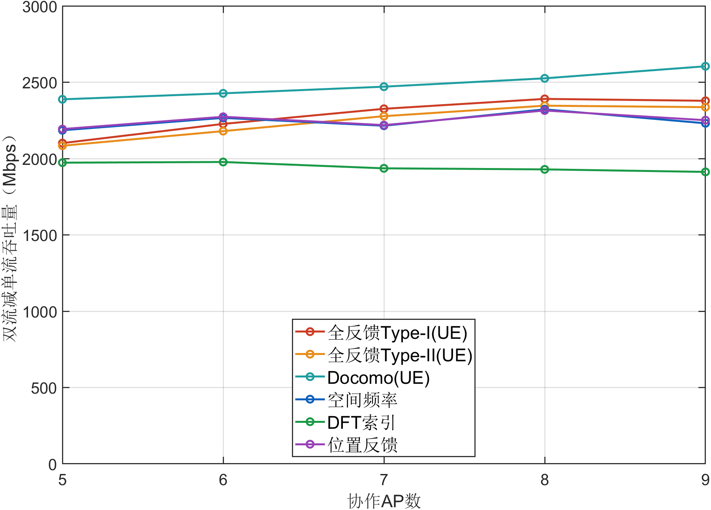

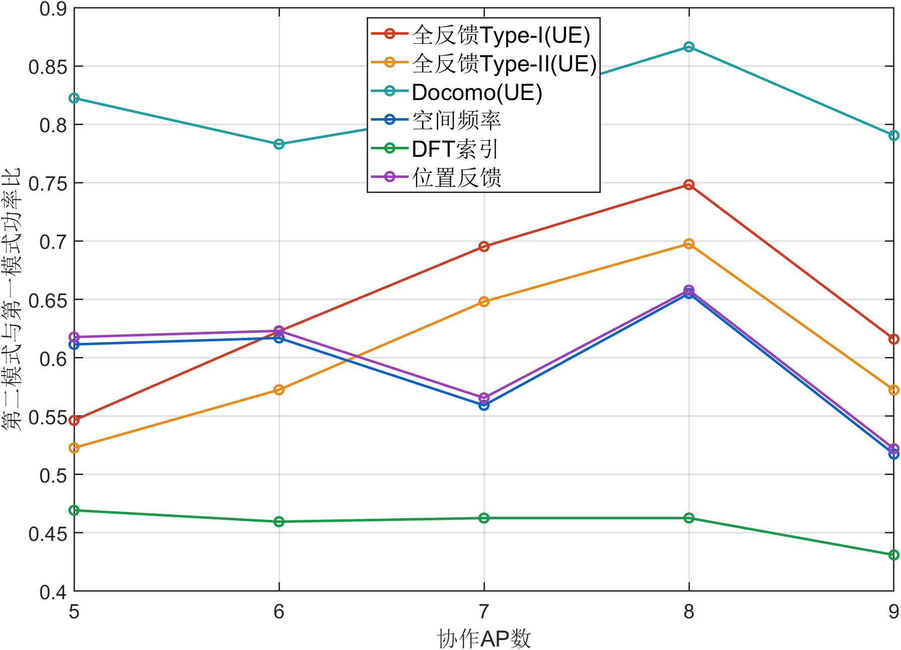

结果：本组最低平均增量1833.90 Mbps，最低正收益比例99.50%。平均正收益不保证每个位置受益，低SNR下强制双流也可能退化。第二模式比按真实接收矩阵HW的奇异值平方计算。

| 方法 | 5 | 6 | 7 | 8 | 9 | 10 |
|---|---|---|---|---|---|---|
| SVD参考 | 5947.26 | 6075.71 | 6144.97 | 6216.37 | 6417.83 | 6518.19 |
| 全反馈Type-I(UE) | 5276.76 | 5488.24 | 5591.93 | 5689.39 | 5794.98 | 5926.66 |
| 全反馈Type-II(UE) | 5280.29 | 5459.20 | 5566.29 | 5670.72 | 5771.11 | 5919.06 |
| Docomo(UE) | 5614.94 | 5722.07 | 5791.76 | 5873.32 | 6052.39 | 6142.36 |
| 空间频率 | 5312.97 | 5467.81 | 5384.36 | 5499.84 | 5467.02 | 5591.55 |
| DFT索引 | 4901.42 | 4918.54 | 4871.23 | 4838.70 | 4849.32 | 4747.71 |
| 位置反馈 | 5325.36 | 5480.25 | 5396.42 | 5498.79 | 5493.54 | 5610.89 |

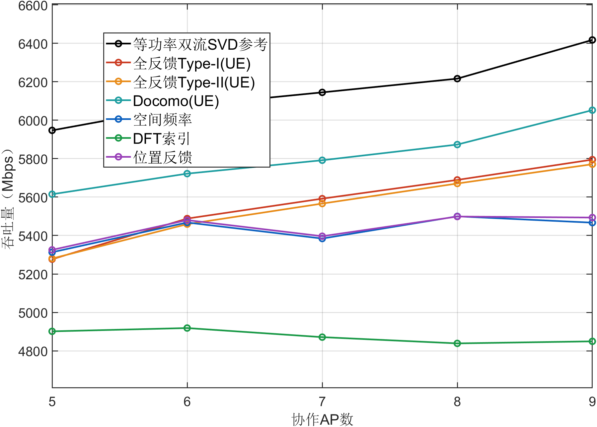

AP数与吞吐量保留在补充；正文对应的主要开销实验是比特数与AP数。

### CPU混合信道莱斯因子K下的双流增量和第二模式

| 方法 | 横轴 | 平均增量 Mbps | 正收益 % | 最差增量 Mbps | 第二模式比 |
|---|---|---|---|---|---|
| 全反馈Type-I(UE) | 0 | 1132.93 | 89.25 | -425.81 | 0.1944 |
| 全反馈Type-I(UE) | 5 | 2000.76 | 99.50 | -294.22 | 0.5034 |
| 全反馈Type-I(UE) | 10 | 2390.88 | 100.00 | 1423.56 | 0.7483 |
| 全反馈Type-I(UE) | 15 | 2503.58 | 100.00 | 1908.66 | 0.7864 |
| 全反馈Type-I(UE) | 20 | 2537.85 | 100.00 | 2186.95 | 0.7897 |
| 全反馈Type-II(UE) | 0 | 1339.38 | 98.75 | -220.26 | 0.1612 |
| 全反馈Type-II(UE) | 5 | 1991.50 | 100.00 | 878.23 | 0.4154 |
| 全反馈Type-II(UE) | 10 | 2346.44 | 100.00 | 1685.00 | 0.6976 |
| 全反馈Type-II(UE) | 15 | 2480.82 | 100.00 | 2049.61 | 0.7869 |
| 全反馈Type-II(UE) | 20 | 2526.73 | 100.00 | 2134.44 | 0.7887 |
| Docomo(UE) | 0 | 1641.76 | 98.25 | -412.71 | 0.4484 |
| Docomo(UE) | 5 | 2410.60 | 100.00 | 1779.99 | 0.8352 |
| Docomo(UE) | 10 | 2525.60 | 100.00 | 2359.58 | 0.8664 |
| Docomo(UE) | 15 | 2563.62 | 100.00 | 2489.68 | 0.8727 |
| Docomo(UE) | 20 | 2575.99 | 100.00 | 2502.56 | 0.8744 |
| 空间频率 | 0 | 1503.46 | 92.00 | -1581.57 | 0.4603 |
| 空间频率 | 5 | 2121.71 | 99.75 | -49.03 | 0.5897 |
| 空间频率 | 10 | 2322.45 | 100.00 | 550.69 | 0.6551 |
| 空间频率 | 15 | 2438.22 | 100.00 | 1277.32 | 0.7094 |
| 空间频率 | 20 | 2497.82 | 100.00 | 1898.22 | 0.7435 |
| DFT索引 | 0 | 1596.92 | 99.50 | -195.02 | 0.4598 |
| DFT索引 | 5 | 1822.92 | 100.00 | 82.29 | 0.4584 |
| DFT索引 | 10 | 1929.08 | 100.00 | 242.23 | 0.4627 |
| DFT索引 | 15 | 1965.28 | 100.00 | 320.64 | 0.4624 |
| DFT索引 | 20 | 1977.99 | 100.00 | 347.12 | 0.4624 |
| 位置反馈 | 0 | 1503.08 | 90.50 | -844.33 | 0.4565 |
| 位置反馈 | 5 | 2131.57 | 99.50 | -96.44 | 0.5971 |
| 位置反馈 | 10 | 2314.79 | 100.00 | 9.14 | 0.6579 |
| 位置反馈 | 15 | 2443.87 | 100.00 | 1473.22 | 0.7151 |
| 位置反馈 | 20 | 2504.89 | 100.00 | 2078.85 | 0.7505 |

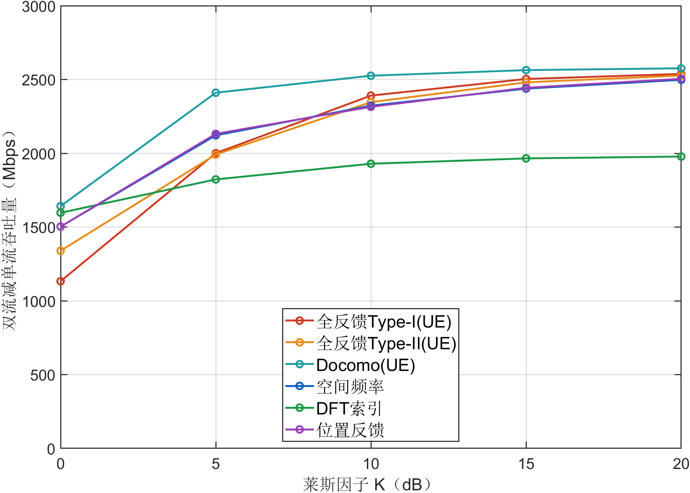

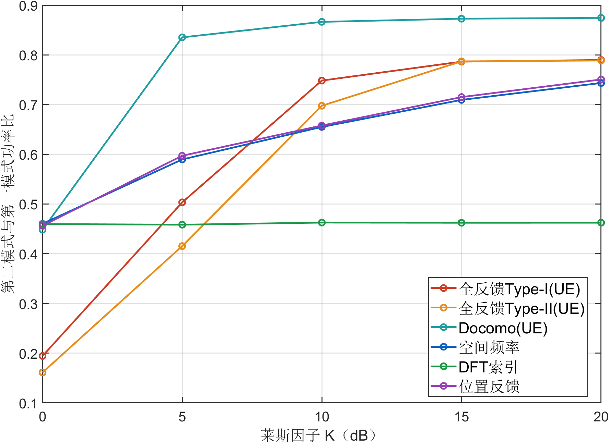

结果：本组最低平均增量1132.93 Mbps，最低正收益比例89.25%。平均正收益不保证每个位置受益，低SNR下强制双流也可能退化。第二模式比按真实接收矩阵HW的奇异值平方计算。

### CPU混合信道默认配置单双流与增量分布

| 方法 | 单流 Mbps | 双流 Mbps | 增量 Mbps | 正收益 % |
|---|---|---|---|---|
| 全反馈Type-I(UE) | 3298.51 | 5689.39 | 2390.88 | 100.00 |
| 全反馈Type-II(UE) | 3324.28 | 5670.72 | 2346.44 | 100.00 |
| Docomo(UE) | 3347.72 | 5873.32 | 2525.60 | 100.00 |
| 空间频率 | 3177.40 | 5499.84 | 2322.45 | 100.00 |
| DFT索引 | 2909.63 | 4838.70 | 1929.08 | 100.00 |
| 位置反馈 | 3184.00 | 5498.79 | 2314.79 | 100.00 |

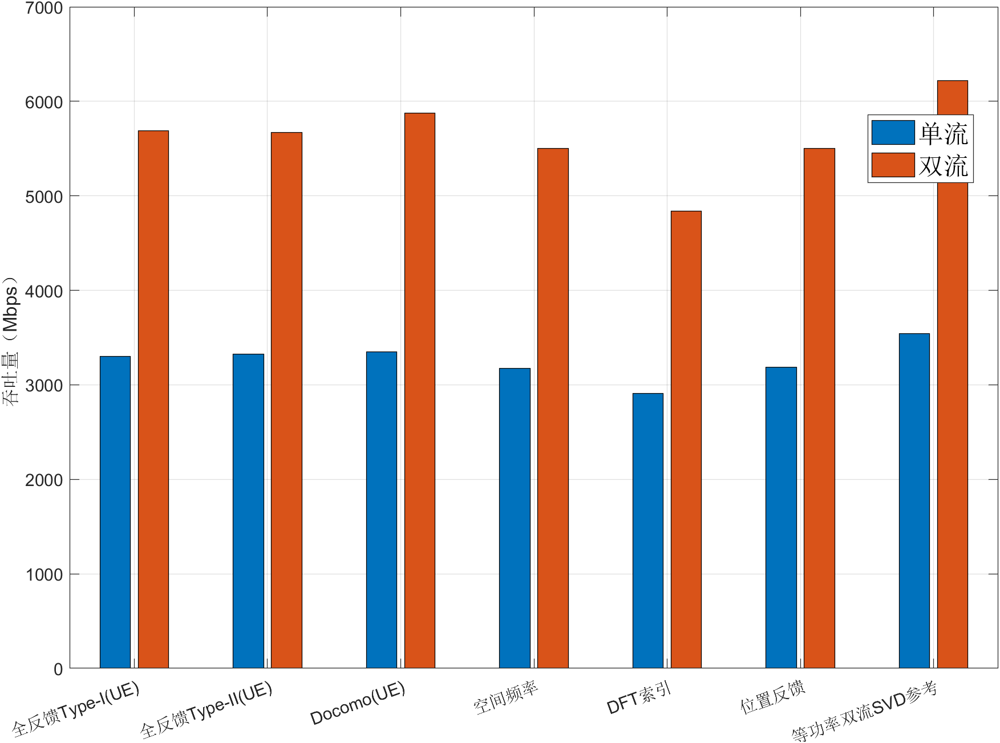

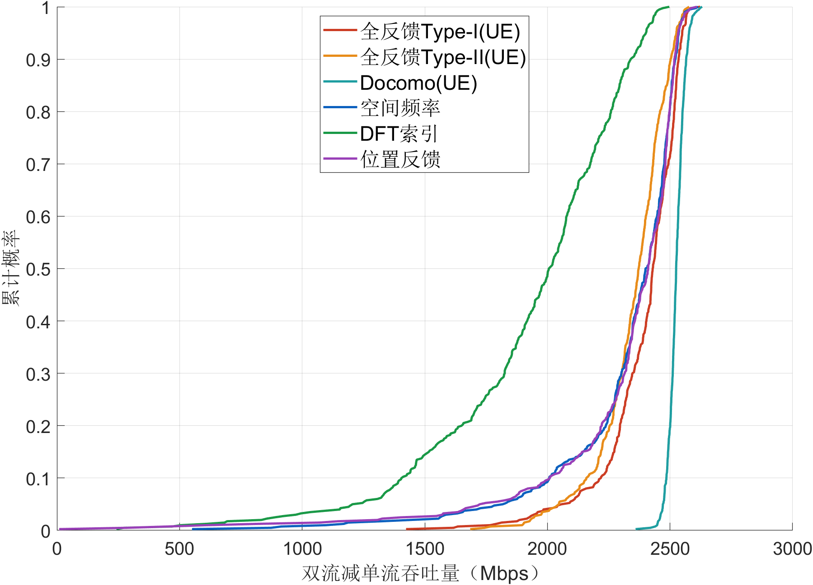

结果：默认配置仍为观测SNR 30 dB。此处是单独默认点，不向吞吐量SNR扫描中额外插入30 dB；CDF使用全部400个配对位置，数据沿用同一默认案例。

### UE纯LOS频谱效率与观测SNR

| 方法 | -20 | -15 | -10 | -5 | 0 | 5 | 10 | 15 | 20 |
|---|---|---|---|---|---|---|---|---|---|
| SVD参考 | 15.5308 | 15.5308 | 15.5308 | 15.5308 | 15.5308 | 15.5308 | 15.5308 | 15.5308 | 15.5308 |
| 全反馈Type-I(UE) | 11.4875 | 13.9955 | 14.6245 | 14.7416 | 14.7839 | 14.8204 | 14.8166 | 14.8144 | 14.8121 |
| 全反馈Type-II(UE) | 10.5552 | 13.3880 | 14.3113 | 14.5816 | 14.7090 | 14.7881 | 14.8126 | 14.8221 | 14.8221 |
| Docomo | 12.6012 | 14.5181 | 14.8783 | 14.9289 | 14.9482 | 14.9523 | 14.9541 | 14.9538 | 14.9541 |
| 空间频率 | 13.4736 | 14.8348 | 14.9183 | 14.9201 | 14.8897 | 14.8610 | 14.8399 | 14.8293 | 14.8221 |
| DFT索引 | 10.5021 | 14.7079 | 14.8797 | 14.8868 | 14.8527 | 14.8291 | 14.8080 | 14.7977 | 14.7896 |
| 位置反馈 | 12.3999 | 14.8365 | 14.9197 | 14.9213 | 14.8891 | 14.8611 | 14.8396 | 14.8290 | 14.8225 |

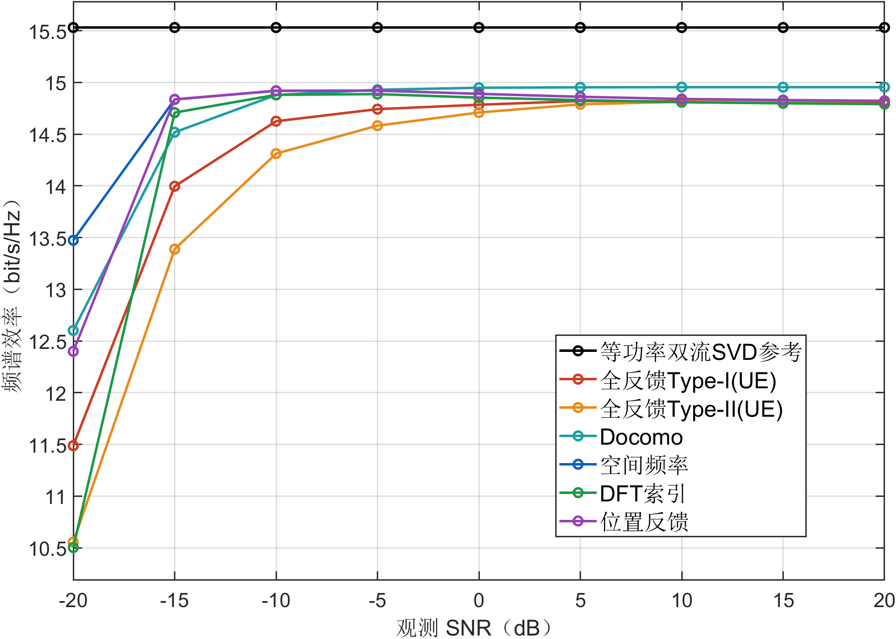

结果：逐点满足吞吐量Mbps=400×频谱效率，横轴使用−20至20 dB、间隔5 dB。

### UE纯LOS观测SNR下的双流增量和第二模式

| 方法 | 横轴 | 平均增量 Mbps | 正收益 % | 最差增量 Mbps | 第二模式比 |
|---|---|---|---|---|---|
| 全反馈Type-I(UE) | -20 | 1720.68 | 97.25 | -1751.34 | 0.4932 |
| 全反馈Type-I(UE) | -15 | 2375.12 | 100.00 | 1339.93 | 0.7689 |
| 全反馈Type-I(UE) | -10 | 2513.98 | 100.00 | 2165.43 | 0.8266 |
| 全反馈Type-I(UE) | -5 | 2540.13 | 100.00 | 2139.49 | 0.8308 |
| 全反馈Type-I(UE) | 0 | 2553.77 | 100.00 | 2094.51 | 0.8135 |
| 全反馈Type-I(UE) | 5 | 2564.45 | 100.00 | 2280.57 | 0.8030 |
| 全反馈Type-I(UE) | 10 | 2565.26 | 100.00 | 2267.46 | 0.8009 |
| 全反馈Type-I(UE) | 15 | 2565.06 | 100.00 | 2330.08 | 0.7968 |
| 全反馈Type-I(UE) | 20 | 2564.33 | 100.00 | 2399.97 | 0.7944 |
| 全反馈Type-II(UE) | -20 | 1543.67 | 97.50 | -1233.14 | 0.4852 |
| 全反馈Type-II(UE) | -15 | 2245.88 | 100.00 | 1069.97 | 0.7480 |
| 全反馈Type-II(UE) | -10 | 2446.61 | 100.00 | 1990.49 | 0.8206 |
| 全反馈Type-II(UE) | -5 | 2503.93 | 100.00 | 2087.31 | 0.8234 |
| 全反馈Type-II(UE) | 0 | 2535.71 | 100.00 | 2067.88 | 0.8090 |
| 全反馈Type-II(UE) | 5 | 2556.43 | 100.00 | 2218.46 | 0.8023 |
| 全反馈Type-II(UE) | 10 | 2563.28 | 100.00 | 2296.22 | 0.7981 |
| 全反馈Type-II(UE) | 15 | 2565.64 | 100.00 | 2329.68 | 0.7951 |
| 全反馈Type-II(UE) | 20 | 2565.16 | 100.00 | 2336.55 | 0.7931 |
| Docomo | -20 | 2023.83 | 100.00 | 815.41 | 0.6052 |
| Docomo | -15 | 2481.76 | 100.00 | 1889.89 | 0.8051 |
| Docomo | -10 | 2563.55 | 100.00 | 2399.48 | 0.8465 |
| Docomo | -5 | 2576.60 | 100.00 | 2458.42 | 0.8601 |
| Docomo | 0 | 2580.22 | 100.00 | 2494.22 | 0.8678 |
| Docomo | 5 | 2581.34 | 100.00 | 2486.85 | 0.8732 |
| Docomo | 10 | 2581.65 | 100.00 | 2495.91 | 0.8723 |
| Docomo | 15 | 2581.65 | 100.00 | 2495.91 | 0.8717 |
| Docomo | 20 | 2581.65 | 100.00 | 2495.91 | 0.8734 |
| 空间频率 | -20 | 2241.87 | 97.75 | -1194.76 | 0.6913 |
| 空间频率 | -15 | 2571.49 | 100.00 | 2392.04 | 0.8132 |
| 空间频率 | -10 | 2584.48 | 100.00 | 2436.12 | 0.8368 |
| 空间频率 | -5 | 2585.35 | 100.00 | 2469.89 | 0.8330 |
| 空间频率 | 0 | 2581.25 | 100.00 | 2428.99 | 0.8180 |
| 空间频率 | 5 | 2575.25 | 100.00 | 2420.87 | 0.8074 |
| 空间频率 | 10 | 2571.38 | 100.00 | 2416.51 | 0.8014 |
| 空间频率 | 15 | 2568.60 | 100.00 | 2386.38 | 0.7979 |
| 空间频率 | 20 | 2566.77 | 100.00 | 2413.04 | 0.7949 |
| DFT索引 | -20 | 1477.37 | 88.75 | -1687.53 | 0.4817 |
| DFT索引 | -15 | 2542.63 | 100.00 | 1042.33 | 0.8086 |
| DFT索引 | -10 | 2576.20 | 100.00 | 2456.29 | 0.8324 |
| DFT索引 | -5 | 2578.95 | 100.00 | 2429.40 | 0.8291 |
| DFT索引 | 0 | 2574.08 | 100.00 | 2450.93 | 0.8144 |
| DFT索引 | 5 | 2569.70 | 100.00 | 2420.83 | 0.8084 |
| DFT索引 | 10 | 2566.00 | 100.00 | 2416.56 | 0.8003 |
| DFT索引 | 15 | 2563.16 | 100.00 | 2400.79 | 0.7954 |
| DFT索引 | 20 | 2560.79 | 100.00 | 2373.02 | 0.7926 |
| 位置反馈 | -20 | 2088.06 | 91.00 | -949.11 | 0.6681 |
| 位置反馈 | -15 | 2571.50 | 100.00 | 2424.39 | 0.8147 |
| 位置反馈 | -10 | 2584.62 | 100.00 | 2436.12 | 0.8368 |
| 位置反馈 | -5 | 2585.72 | 100.00 | 2469.89 | 0.8328 |
| 位置反馈 | 0 | 2581.02 | 100.00 | 2428.99 | 0.8177 |
| 位置反馈 | 5 | 2575.22 | 100.00 | 2419.30 | 0.8075 |
| 位置反馈 | 10 | 2571.28 | 100.00 | 2416.51 | 0.8014 |
| 位置反馈 | 15 | 2568.54 | 100.00 | 2386.38 | 0.7978 |
| 位置反馈 | 20 | 2566.95 | 100.00 | 2413.04 | 0.7952 |

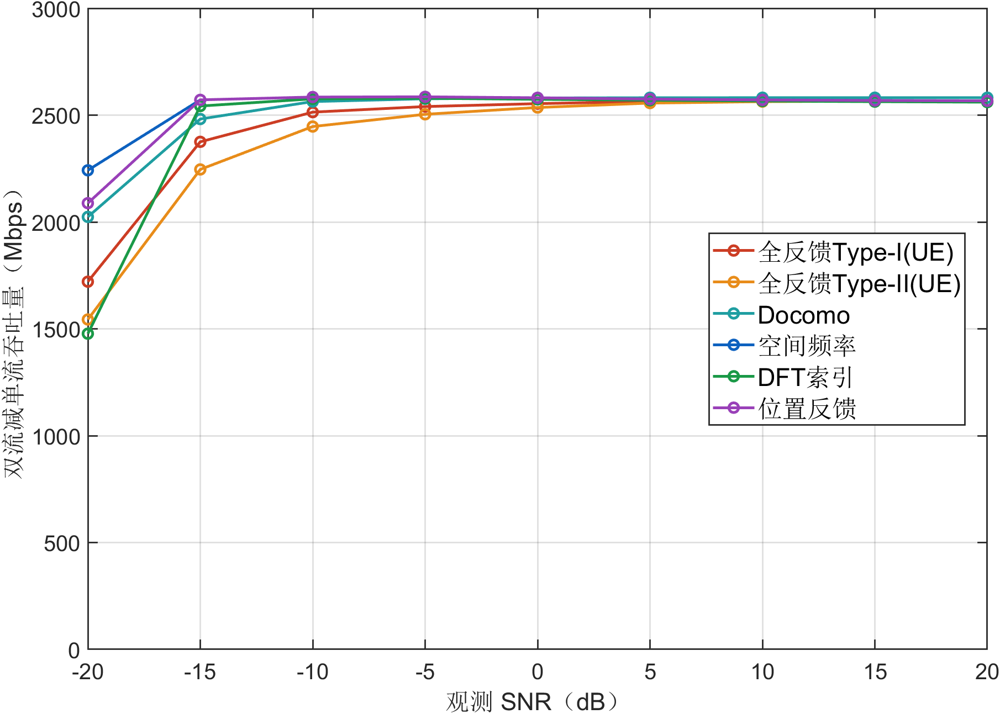

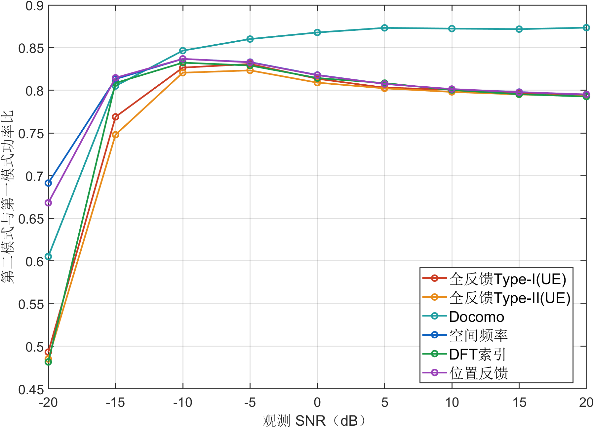

结果：本组最低平均增量1477.37 Mbps，最低正收益比例88.75%。平均正收益不保证每个位置受益，低SNR下强制双流也可能退化。第二模式比按真实接收矩阵HW的奇异值平方计算。

### UE纯LOSUPA阵元数下的双流增量和第二模式

| 方法 | 横轴 | 平均增量 Mbps | 正收益 % | 最差增量 Mbps | 第二模式比 |
|---|---|---|---|---|---|
| 全反馈Type-I(UE) | 64 | 1046.40 | 100.00 | 866.03 | 0.7923 |
| 全反馈Type-I(UE) | 256 | 1784.22 | 100.00 | 1608.52 | 0.7900 |
| 全反馈Type-I(UE) | 1024 | 2561.20 | 100.00 | 2397.10 | 0.7921 |
| 全反馈Type-II(UE) | 64 | 1047.73 | 100.00 | 858.73 | 0.7897 |
| 全反馈Type-II(UE) | 256 | 1787.02 | 100.00 | 1629.94 | 0.7876 |
| 全反馈Type-II(UE) | 1024 | 2561.65 | 100.00 | 2330.07 | 0.7906 |
| Docomo | 64 | 1057.60 | 100.00 | 965.45 | 0.8611 |
| Docomo | 256 | 1802.48 | 100.00 | 1703.47 | 0.8659 |
| Docomo | 1024 | 2581.95 | 100.00 | 2495.91 | 0.8727 |
| 空间频率 | 64 | 1048.50 | 100.00 | 917.24 | 0.7918 |
| 空间频率 | 256 | 1786.01 | 100.00 | 1629.44 | 0.7892 |
| 空间频率 | 1024 | 2565.00 | 100.00 | 2413.04 | 0.7941 |
| DFT索引 | 64 | 1043.07 | 100.00 | 908.03 | 0.7911 |
| DFT索引 | 256 | 1781.04 | 100.00 | 1622.52 | 0.7892 |
| DFT索引 | 1024 | 2558.58 | 100.00 | 2380.98 | 0.7930 |
| 位置反馈 | 64 | 1048.70 | 100.00 | 917.24 | 0.7920 |
| 位置反馈 | 256 | 1786.01 | 100.00 | 1629.44 | 0.7890 |
| 位置反馈 | 1024 | 2565.02 | 100.00 | 2413.04 | 0.7938 |

结果：本组最低平均增量1043.07 Mbps，最低正收益比例100.00%。平均正收益不保证每个位置受益，低SNR下强制双流也可能退化。第二模式比按真实接收矩阵HW的奇异值平方计算。

### UE纯LOS协作AP数下的双流增量和第二模式

| 方法 | 横轴 | 平均增量 Mbps | 正收益 % | 最差增量 Mbps | 第二模式比 |
|---|---|---|---|---|---|
| 全反馈Type-I(UE) | 5 | 2353.27 | 100.00 | 2161.02 | 0.6868 |
| 全反馈Type-I(UE) | 6 | 2414.84 | 100.00 | 2129.72 | 0.7165 |
| 全反馈Type-I(UE) | 7 | 2493.05 | 100.00 | 2245.76 | 0.7261 |
| 全反馈Type-I(UE) | 8 | 2561.20 | 100.00 | 2397.10 | 0.7921 |
| 全反馈Type-I(UE) | 9 | 2583.08 | 100.00 | 2428.84 | 0.6952 |
| 全反馈Type-I(UE) | 10 | 2638.47 | 100.00 | 2475.49 | 0.7451 |
| 全反馈Type-II(UE) | 5 | 2353.43 | 100.00 | 2134.05 | 0.6830 |
| 全反馈Type-II(UE) | 6 | 2412.99 | 100.00 | 1934.15 | 0.7107 |
| 全反馈Type-II(UE) | 7 | 2492.02 | 100.00 | 1942.49 | 0.7256 |
| 全反馈Type-II(UE) | 8 | 2561.65 | 100.00 | 2330.07 | 0.7906 |
| 全反馈Type-II(UE) | 9 | 2580.18 | 100.00 | 2425.95 | 0.6925 |
| 全反馈Type-II(UE) | 10 | 2640.57 | 100.00 | 2482.84 | 0.7447 |
| Docomo | 5 | 2443.29 | 100.00 | 2220.94 | 0.8234 |
| Docomo | 6 | 2482.03 | 100.00 | 2321.30 | 0.7882 |
| Docomo | 7 | 2524.45 | 100.00 | 2404.26 | 0.8159 |
| Docomo | 8 | 2581.95 | 100.00 | 2495.91 | 0.8727 |
| Docomo | 9 | 2658.24 | 100.00 | 2468.25 | 0.7865 |
| Docomo | 10 | 2705.25 | 100.00 | 2457.97 | 0.8032 |
| 空间频率 | 5 | 2355.88 | 100.00 | 2161.02 | 0.6889 |
| 空间频率 | 6 | 2420.49 | 100.00 | 2244.38 | 0.7194 |
| 空间频率 | 7 | 2496.11 | 100.00 | 2328.76 | 0.7275 |
| 空间频率 | 8 | 2565.00 | 100.00 | 2413.04 | 0.7941 |
| 空间频率 | 9 | 2590.36 | 100.00 | 2471.71 | 0.6996 |
| 空间频率 | 10 | 2640.35 | 100.00 | 2475.49 | 0.7458 |
| DFT索引 | 5 | 2351.32 | 100.00 | 2171.97 | 0.6853 |
| DFT索引 | 6 | 2416.37 | 100.00 | 2244.10 | 0.7197 |
| DFT索引 | 7 | 2490.18 | 100.00 | 2359.14 | 0.7294 |
| DFT索引 | 8 | 2558.58 | 100.00 | 2380.98 | 0.7930 |
| DFT索引 | 9 | 2582.39 | 100.00 | 2466.35 | 0.7114 |
| DFT索引 | 10 | 2628.22 | 100.00 | 2441.43 | 0.7476 |
| 位置反馈 | 5 | 2355.86 | 100.00 | 2161.02 | 0.6888 |
| 位置反馈 | 6 | 2420.41 | 100.00 | 2244.38 | 0.7194 |
| 位置反馈 | 7 | 2496.04 | 100.00 | 2328.76 | 0.7271 |
| 位置反馈 | 8 | 2565.02 | 100.00 | 2413.04 | 0.7938 |
| 位置反馈 | 9 | 2590.29 | 100.00 | 2471.71 | 0.6991 |
| 位置反馈 | 10 | 2640.40 | 100.00 | 2474.62 | 0.7459 |

结果：本组最低平均增量2351.32 Mbps，最低正收益比例100.00%。平均正收益不保证每个位置受益，低SNR下强制双流也可能退化。第二模式比按真实接收矩阵HW的奇异值平方计算。

| 方法 | 5 | 6 | 7 | 8 | 9 | 10 |
|---|---|---|---|---|---|---|
| SVD参考 | 5971.46 | 6088.19 | 6167.77 | 6212.32 | 6412.47 | 6515.66 |
| 全反馈Type-I(UE) | 5596.94 | 5733.84 | 5814.78 | 5920.80 | 6085.30 | 6183.78 |
| 全反馈Type-II(UE) | 5600.36 | 5735.37 | 5817.41 | 5924.54 | 6085.32 | 6189.78 |
| Docomo | 5722.48 | 5828.07 | 5897.10 | 5981.91 | 6158.97 | 6253.41 |
| 空间频率 | 5600.45 | 5740.92 | 5818.60 | 5926.83 | 6094.66 | 6186.26 |
| DFT索引 | 5593.29 | 5732.57 | 5807.19 | 5913.34 | 6069.86 | 6156.82 |
| 位置反馈 | 5600.44 | 5740.82 | 5818.49 | 5926.83 | 6094.66 | 6186.33 |

AP数与吞吐量保留在补充；正文对应的主要开销实验是比特数与AP数。

### UE纯LOS莱斯因子K下的双流增量和第二模式

| 方法 | 横轴 | 平均增量 Mbps | 正收益 % | 最差增量 Mbps | 第二模式比 |
|---|---|---|---|---|---|
| 全反馈Type-I(UE) | 0 | 2561.20 | 100.00 | 2397.10 | 0.7921 |
| 全反馈Type-I(UE) | 5 | 2561.20 | 100.00 | 2397.10 | 0.7921 |
| 全反馈Type-I(UE) | 10 | 2561.20 | 100.00 | 2397.10 | 0.7921 |
| 全反馈Type-I(UE) | 15 | 2561.20 | 100.00 | 2397.10 | 0.7921 |
| 全反馈Type-I(UE) | 20 | 2561.20 | 100.00 | 2397.10 | 0.7921 |
| 全反馈Type-II(UE) | 0 | 2561.65 | 100.00 | 2330.07 | 0.7906 |
| 全反馈Type-II(UE) | 5 | 2561.65 | 100.00 | 2330.07 | 0.7906 |
| 全反馈Type-II(UE) | 10 | 2561.65 | 100.00 | 2330.07 | 0.7906 |
| 全反馈Type-II(UE) | 15 | 2561.65 | 100.00 | 2330.07 | 0.7906 |
| 全反馈Type-II(UE) | 20 | 2561.65 | 100.00 | 2330.07 | 0.7906 |
| Docomo | 0 | 2581.95 | 100.00 | 2495.91 | 0.8727 |
| Docomo | 5 | 2581.95 | 100.00 | 2495.91 | 0.8727 |
| Docomo | 10 | 2581.95 | 100.00 | 2495.91 | 0.8727 |
| Docomo | 15 | 2581.95 | 100.00 | 2495.91 | 0.8727 |
| Docomo | 20 | 2581.95 | 100.00 | 2495.91 | 0.8727 |
| 空间频率 | 0 | 2565.00 | 100.00 | 2413.04 | 0.7941 |
| 空间频率 | 5 | 2565.00 | 100.00 | 2413.04 | 0.7941 |
| 空间频率 | 10 | 2565.00 | 100.00 | 2413.04 | 0.7941 |
| 空间频率 | 15 | 2565.00 | 100.00 | 2413.04 | 0.7941 |
| 空间频率 | 20 | 2565.00 | 100.00 | 2413.04 | 0.7941 |
| DFT索引 | 0 | 2558.58 | 100.00 | 2380.98 | 0.7930 |
| DFT索引 | 5 | 2558.58 | 100.00 | 2380.98 | 0.7930 |
| DFT索引 | 10 | 2558.58 | 100.00 | 2380.98 | 0.7930 |
| DFT索引 | 15 | 2558.58 | 100.00 | 2380.98 | 0.7930 |
| DFT索引 | 20 | 2558.58 | 100.00 | 2380.98 | 0.7930 |
| 位置反馈 | 0 | 2565.02 | 100.00 | 2413.04 | 0.7938 |
| 位置反馈 | 5 | 2565.02 | 100.00 | 2413.04 | 0.7938 |
| 位置反馈 | 10 | 2565.02 | 100.00 | 2413.04 | 0.7938 |
| 位置反馈 | 15 | 2565.02 | 100.00 | 2413.04 | 0.7938 |
| 位置反馈 | 20 | 2565.02 | 100.00 | 2413.04 | 0.7938 |

结果：本组最低平均增量2558.58 Mbps，最低正收益比例100.00%。平均正收益不保证每个位置受益，低SNR下强制双流也可能退化。第二模式比按真实接收矩阵HW的奇异值平方计算。

### UE纯LOS默认配置单双流与增量分布

| 方法 | 单流 Mbps | 双流 Mbps | 增量 Mbps | 正收益 % |
|---|---|---|---|---|
| 全反馈Type-I(UE) | 3359.60 | 5920.80 | 2561.20 | 100.00 |
| 全反馈Type-II(UE) | 3362.89 | 5924.54 | 2561.65 | 100.00 |
| Docomo | 3399.96 | 5981.91 | 2581.95 | 100.00 |
| 空间频率 | 3361.83 | 5926.83 | 2565.00 | 100.00 |
| DFT索引 | 3354.76 | 5913.34 | 2558.58 | 100.00 |
| 位置反馈 | 3361.81 | 5926.83 | 2565.02 | 100.00 |

结果：默认配置仍为观测SNR 30 dB。此处是单独默认点，不向吞吐量SNR扫描中额外插入30 dB；CDF使用全部400个配对位置，数据沿用同一默认案例。

### UE混合信道频谱效率与观测SNR

| 方法 | -20 | -15 | -10 | -5 | 0 | 5 | 10 | 15 | 20 |
|---|---|---|---|---|---|---|---|---|---|
| SVD参考 | 15.5409 | 15.5409 | 15.5409 | 15.5409 | 15.5409 | 15.5409 | 15.5409 | 15.5409 | 15.5409 |
| 全反馈Type-I(UE) | 10.9429 | 13.6601 | 14.3073 | 14.3319 | 14.2529 | 14.2281 | 14.2204 | 14.2200 | 14.2221 |
| 全反馈Type-II(UE) | 9.9442 | 13.0022 | 14.0234 | 14.2341 | 14.1962 | 14.1804 | 14.1768 | 14.1717 | 14.1704 |
| Docomo | 11.9927 | 14.1582 | 14.5983 | 14.6583 | 14.6750 | 14.6834 | 14.6855 | 14.6861 | 14.6860 |
| 空间频率 | 12.6141 | 14.5569 | 14.6446 | 14.6351 | 14.6068 | 14.6000 | 14.5927 | 14.5916 | 14.5906 |
| DFT索引 | 9.6023 | 14.3851 | 14.6081 | 14.6022 | 14.5738 | 14.5685 | 14.5627 | 14.5600 | 14.5595 |
| 位置反馈 | 11.0685 | 14.5612 | 14.6468 | 14.6363 | 14.6064 | 14.5994 | 14.5930 | 14.5913 | 14.5909 |

结果：逐点满足吞吐量Mbps=400×频谱效率，横轴使用−20至20 dB、间隔5 dB。

### UE混合信道观测SNR下的双流增量和第二模式

| 方法 | 横轴 | 平均增量 Mbps | 正收益 % | 最差增量 Mbps | 第二模式比 |
|---|---|---|---|---|---|
| 全反馈Type-I(UE) | -20 | 1597.01 | 96.25 | -1756.96 | 0.4692 |
| 全反馈Type-I(UE) | -15 | 2301.40 | 100.00 | 1498.28 | 0.7499 |
| 全反馈Type-I(UE) | -10 | 2442.28 | 100.00 | 1859.91 | 0.8108 |
| 全反馈Type-I(UE) | -5 | 2431.13 | 100.00 | 1606.67 | 0.7832 |
| 全反馈Type-I(UE) | 0 | 2403.08 | 100.00 | 1396.23 | 0.7575 |
| 全反馈Type-I(UE) | 5 | 2393.53 | 100.00 | 1410.85 | 0.7481 |
| 全反馈Type-I(UE) | 10 | 2389.37 | 100.00 | 1432.43 | 0.7461 |
| 全反馈Type-I(UE) | 15 | 2389.73 | 100.00 | 1433.78 | 0.7515 |
| 全反馈Type-I(UE) | 20 | 2389.97 | 100.00 | 1423.56 | 0.7474 |
| 全反馈Type-II(UE) | -20 | 1400.97 | 97.25 | -1383.52 | 0.4542 |
| 全反馈Type-II(UE) | -15 | 2159.23 | 100.00 | 1244.48 | 0.7253 |
| 全反馈Type-II(UE) | -10 | 2368.07 | 100.00 | 1824.90 | 0.7899 |
| 全反馈Type-II(UE) | -5 | 2381.80 | 100.00 | 1730.22 | 0.7462 |
| 全反馈Type-II(UE) | 0 | 2357.12 | 100.00 | 1669.84 | 0.7104 |
| 全反馈Type-II(UE) | 5 | 2348.80 | 100.00 | 1717.08 | 0.7010 |
| 全反馈Type-II(UE) | 10 | 2346.88 | 100.00 | 1673.62 | 0.6994 |
| 全反馈Type-II(UE) | 15 | 2344.58 | 100.00 | 1682.53 | 0.6969 |
| 全反馈Type-II(UE) | 20 | 2344.28 | 100.00 | 1685.00 | 0.6962 |
| Docomo | -20 | 1874.68 | 99.50 | -270.65 | 0.5572 |
| Docomo | -15 | 2405.02 | 100.00 | 1563.79 | 0.7901 |
| Docomo | -10 | 2504.62 | 100.00 | 2308.22 | 0.8455 |
| Docomo | -5 | 2520.50 | 100.00 | 2371.80 | 0.8612 |
| Docomo | 0 | 2524.58 | 100.00 | 2386.30 | 0.8600 |
| Docomo | 5 | 2526.61 | 100.00 | 2386.30 | 0.8655 |
| Docomo | 10 | 2526.68 | 100.00 | 2437.77 | 0.8672 |
| Docomo | 15 | 2526.51 | 100.00 | 2420.02 | 0.8678 |
| Docomo | 20 | 2526.40 | 100.00 | 2420.02 | 0.8662 |
| 空间频率 | -20 | 2044.29 | 97.25 | -1443.89 | 0.6439 |
| 空间频率 | -15 | 2516.17 | 100.00 | 2366.21 | 0.8149 |
| 空间频率 | -10 | 2531.94 | 100.00 | 2407.41 | 0.8381 |
| 空间频率 | -5 | 2533.50 | 100.00 | 2377.82 | 0.8315 |
| 空间频率 | 0 | 2530.90 | 100.00 | 2392.59 | 0.8194 |
| 空间频率 | 5 | 2530.11 | 100.00 | 2367.73 | 0.8174 |
| 空间频率 | 10 | 2528.60 | 100.00 | 2363.98 | 0.8153 |
| 空间频率 | 15 | 2528.63 | 100.00 | 2322.25 | 0.8178 |
| 空间频率 | 20 | 2528.65 | 100.00 | 2338.72 | 0.8163 |
| DFT索引 | -20 | 1247.66 | 84.00 | -1637.04 | 0.4382 |
| DFT索引 | -15 | 2479.52 | 100.00 | 985.07 | 0.8054 |
| DFT索引 | -10 | 2524.44 | 100.00 | 2406.65 | 0.8323 |
| DFT索引 | -5 | 2526.85 | 100.00 | 2377.82 | 0.8320 |
| DFT索引 | 0 | 2524.69 | 100.00 | 2361.49 | 0.8193 |
| DFT索引 | 5 | 2524.50 | 100.00 | 2383.61 | 0.8181 |
| DFT索引 | 10 | 2523.51 | 100.00 | 2357.70 | 0.8160 |
| DFT索引 | 15 | 2523.18 | 100.00 | 2357.70 | 0.8174 |
| DFT索引 | 20 | 2523.33 | 100.00 | 2369.00 | 0.8176 |
| 位置反馈 | -20 | 1822.65 | 86.75 | -839.34 | 0.6193 |
| 位置反馈 | -15 | 2516.63 | 100.00 | 2366.21 | 0.8128 |
| 位置反馈 | -10 | 2532.73 | 100.00 | 2407.41 | 0.8377 |
| 位置反馈 | -5 | 2533.80 | 100.00 | 2377.82 | 0.8327 |
| 位置反馈 | 0 | 2530.78 | 100.00 | 2392.59 | 0.8197 |
| 位置反馈 | 5 | 2530.07 | 100.00 | 2367.73 | 0.8167 |
| 位置反馈 | 10 | 2528.73 | 100.00 | 2363.98 | 0.8150 |
| 位置反馈 | 15 | 2528.43 | 100.00 | 2322.25 | 0.8181 |
| 位置反馈 | 20 | 2528.75 | 100.00 | 2338.72 | 0.8163 |

结果：本组最低平均增量1247.66 Mbps，最低正收益比例84.00%。平均正收益不保证每个位置受益，低SNR下强制双流也可能退化。第二模式比按真实接收矩阵HW的奇异值平方计算。

### UE混合信道UPA阵元数下的双流增量和第二模式

| 方法 | 横轴 | 平均增量 Mbps | 正收益 % | 最差增量 Mbps | 第二模式比 |
|---|---|---|---|---|---|
| 全反馈Type-I(UE) | 64 | 939.49 | 100.00 | 407.32 | 0.7672 |
| 全反馈Type-I(UE) | 256 | 1643.46 | 100.00 | 938.86 | 0.7594 |
| 全反馈Type-I(UE) | 1024 | 2390.88 | 100.00 | 1423.56 | 0.7483 |
| 全反馈Type-II(UE) | 64 | 898.17 | 100.00 | 511.42 | 0.7078 |
| 全反馈Type-II(UE) | 256 | 1594.90 | 100.00 | 1017.14 | 0.7049 |
| 全反馈Type-II(UE) | 1024 | 2346.44 | 100.00 | 1685.00 | 0.6976 |
| Docomo | 64 | 1016.20 | 100.00 | 907.04 | 0.8408 |
| Docomo | 256 | 1749.60 | 100.00 | 1633.17 | 0.8506 |
| Docomo | 1024 | 2525.60 | 100.00 | 2359.58 | 0.8664 |
| 空间频率 | 64 | 1019.44 | 100.00 | 869.80 | 0.8256 |
| 空间频率 | 256 | 1754.17 | 100.00 | 1589.13 | 0.8232 |
| 空间频率 | 1024 | 2529.16 | 100.00 | 2338.72 | 0.8144 |
| DFT索引 | 64 | 1014.18 | 100.00 | 902.67 | 0.8257 |
| DFT索引 | 256 | 1748.68 | 100.00 | 1629.06 | 0.8223 |
| DFT索引 | 1024 | 2523.67 | 100.00 | 2337.18 | 0.8177 |
| 位置反馈 | 64 | 1019.59 | 100.00 | 898.50 | 0.8240 |
| 位置反馈 | 256 | 1754.24 | 100.00 | 1589.13 | 0.8234 |
| 位置反馈 | 1024 | 2529.31 | 100.00 | 2338.72 | 0.8144 |

结果：本组最低平均增量898.17 Mbps，最低正收益比例100.00%。平均正收益不保证每个位置受益，低SNR下强制双流也可能退化。第二模式比按真实接收矩阵HW的奇异值平方计算。

### UE混合信道协作AP数下的双流增量和第二模式

| 方法 | 横轴 | 平均增量 Mbps | 正收益 % | 最差增量 Mbps | 第二模式比 |
|---|---|---|---|---|---|
| 全反馈Type-I(UE) | 5 | 2101.36 | 100.00 | 1712.68 | 0.5463 |
| 全反馈Type-I(UE) | 6 | 2227.01 | 100.00 | 1477.84 | 0.6226 |
| 全反馈Type-I(UE) | 7 | 2325.98 | 100.00 | 1683.54 | 0.6953 |
| 全反馈Type-I(UE) | 8 | 2390.88 | 100.00 | 1423.56 | 0.7483 |
| 全反馈Type-I(UE) | 9 | 2378.45 | 100.00 | 1513.64 | 0.6159 |
| 全反馈Type-I(UE) | 10 | 2443.99 | 100.00 | 1746.81 | 0.6228 |
| 全反馈Type-II(UE) | 5 | 2084.07 | 100.00 | 1774.00 | 0.5228 |
| 全反馈Type-II(UE) | 6 | 2179.73 | 100.00 | 1376.21 | 0.5725 |
| 全反馈Type-II(UE) | 7 | 2277.75 | 100.00 | 1615.76 | 0.6480 |
| 全反馈Type-II(UE) | 8 | 2346.44 | 100.00 | 1685.00 | 0.6976 |
| 全反馈Type-II(UE) | 9 | 2336.80 | 100.00 | 1424.27 | 0.5724 |
| 全反馈Type-II(UE) | 10 | 2416.42 | 100.00 | 1938.86 | 0.5852 |
| Docomo | 5 | 2388.16 | 100.00 | 2068.02 | 0.8224 |
| Docomo | 6 | 2427.34 | 100.00 | 2202.87 | 0.7830 |
| Docomo | 7 | 2470.94 | 100.00 | 2340.38 | 0.8127 |
| Docomo | 8 | 2525.60 | 100.00 | 2359.58 | 0.8664 |
| Docomo | 9 | 2604.56 | 100.00 | 2223.15 | 0.7905 |
| Docomo | 10 | 2647.58 | 100.00 | 2119.66 | 0.7986 |
| 空间频率 | 5 | 2315.34 | 100.00 | 2086.62 | 0.7027 |
| 空间频率 | 6 | 2389.15 | 100.00 | 2200.22 | 0.7317 |
| 空间频率 | 7 | 2465.76 | 100.00 | 2265.81 | 0.7501 |
| 空间频率 | 8 | 2529.16 | 100.00 | 2338.72 | 0.8144 |
| 空间频率 | 9 | 2544.05 | 100.00 | 2395.88 | 0.7374 |
| 空间频率 | 10 | 2595.95 | 100.00 | 2423.13 | 0.7540 |
| DFT索引 | 5 | 2310.91 | 100.00 | 2086.62 | 0.6978 |
| DFT索引 | 6 | 2385.57 | 100.00 | 2200.09 | 0.7330 |
| DFT索引 | 7 | 2461.36 | 100.00 | 2300.70 | 0.7527 |
| DFT索引 | 8 | 2523.67 | 100.00 | 2337.18 | 0.8177 |
| DFT索引 | 9 | 2535.18 | 100.00 | 2391.50 | 0.7458 |
| DFT索引 | 10 | 2583.52 | 100.00 | 2413.49 | 0.7542 |
| 位置反馈 | 5 | 2315.36 | 100.00 | 2086.62 | 0.7027 |
| 位置反馈 | 6 | 2389.10 | 100.00 | 2200.22 | 0.7317 |
| 位置反馈 | 7 | 2465.66 | 100.00 | 2265.81 | 0.7502 |
| 位置反馈 | 8 | 2529.31 | 100.00 | 2338.72 | 0.8144 |
| 位置反馈 | 9 | 2543.90 | 100.00 | 2394.69 | 0.7376 |
| 位置反馈 | 10 | 2595.76 | 100.00 | 2418.46 | 0.7536 |

结果：本组最低平均增量2084.07 Mbps，最低正收益比例100.00%。平均正收益不保证每个位置受益，低SNR下强制双流也可能退化。第二模式比按真实接收矩阵HW的奇异值平方计算。

| 方法 | 5 | 6 | 7 | 8 | 9 | 10 |
|---|---|---|---|---|---|---|
| SVD参考 | 5947.26 | 6075.71 | 6144.97 | 6216.37 | 6417.83 | 6518.19 |
| 全反馈Type-I(UE) | 5276.76 | 5488.24 | 5591.93 | 5689.39 | 5794.98 | 5926.66 |
| 全反馈Type-II(UE) | 5280.29 | 5459.20 | 5566.29 | 5670.72 | 5771.11 | 5919.06 |
| Docomo | 5614.94 | 5722.07 | 5791.76 | 5873.32 | 6052.39 | 6142.36 |
| 空间频率 | 5507.75 | 5670.50 | 5741.46 | 5836.42 | 5978.14 | 6078.59 |
| DFT索引 | 5500.58 | 5662.32 | 5731.52 | 5823.92 | 5952.11 | 6048.08 |
| 位置反馈 | 5507.73 | 5670.36 | 5741.33 | 5836.57 | 5977.99 | 6078.39 |

AP数与吞吐量保留在补充；正文对应的主要开销实验是比特数与AP数。

### UE混合信道莱斯因子K下的双流增量和第二模式

| 方法 | 横轴 | 平均增量 Mbps | 正收益 % | 最差增量 Mbps | 第二模式比 |
|---|---|---|---|---|---|
| 全反馈Type-I(UE) | 0 | 1132.93 | 89.25 | -425.81 | 0.1944 |
| 全反馈Type-I(UE) | 5 | 2000.76 | 99.50 | -294.22 | 0.5034 |
| 全反馈Type-I(UE) | 10 | 2390.88 | 100.00 | 1423.56 | 0.7483 |
| 全反馈Type-I(UE) | 15 | 2503.58 | 100.00 | 1908.66 | 0.7864 |
| 全反馈Type-I(UE) | 20 | 2537.85 | 100.00 | 2186.95 | 0.7897 |
| 全反馈Type-II(UE) | 0 | 1339.38 | 98.75 | -220.26 | 0.1612 |
| 全反馈Type-II(UE) | 5 | 1991.50 | 100.00 | 878.23 | 0.4154 |
| 全反馈Type-II(UE) | 10 | 2346.44 | 100.00 | 1685.00 | 0.6976 |
| 全反馈Type-II(UE) | 15 | 2480.82 | 100.00 | 2049.61 | 0.7869 |
| 全反馈Type-II(UE) | 20 | 2526.73 | 100.00 | 2134.44 | 0.7887 |
| Docomo | 0 | 1641.76 | 98.25 | -412.71 | 0.4484 |
| Docomo | 5 | 2410.60 | 100.00 | 1779.99 | 0.8352 |
| Docomo | 10 | 2525.60 | 100.00 | 2359.58 | 0.8664 |
| Docomo | 15 | 2563.62 | 100.00 | 2489.68 | 0.8727 |
| Docomo | 20 | 2575.99 | 100.00 | 2502.56 | 0.8744 |
| 空间频率 | 0 | 2041.69 | 99.75 | -779.36 | 0.7399 |
| 空间频率 | 5 | 2432.27 | 100.00 | 2234.58 | 0.8121 |
| 空间频率 | 10 | 2529.16 | 100.00 | 2338.72 | 0.8144 |
| 空间频率 | 15 | 2557.54 | 100.00 | 2412.43 | 0.8066 |
| 空间频率 | 20 | 2565.33 | 100.00 | 2375.33 | 0.8001 |
| DFT索引 | 0 | 2194.87 | 100.00 | 1985.94 | 0.7918 |
| DFT索引 | 5 | 2426.96 | 100.00 | 2256.54 | 0.8136 |
| DFT索引 | 10 | 2523.67 | 100.00 | 2337.18 | 0.8177 |
| DFT索引 | 15 | 2551.69 | 100.00 | 2365.72 | 0.8052 |
| DFT索引 | 20 | 2559.53 | 100.00 | 2386.88 | 0.7978 |
| 位置反馈 | 0 | 1876.57 | 94.75 | -381.00 | 0.7161 |
| 位置反馈 | 5 | 2432.13 | 100.00 | 2234.58 | 0.8125 |
| 位置反馈 | 10 | 2529.31 | 100.00 | 2338.72 | 0.8144 |
| 位置反馈 | 15 | 2557.67 | 100.00 | 2412.43 | 0.8068 |
| 位置反馈 | 20 | 2565.29 | 100.00 | 2375.33 | 0.7994 |

结果：本组最低平均增量1132.93 Mbps，最低正收益比例89.25%。平均正收益不保证每个位置受益，低SNR下强制双流也可能退化。第二模式比按真实接收矩阵HW的奇异值平方计算。

### UE混合信道默认配置单双流与增量分布

| 方法 | 单流 Mbps | 双流 Mbps | 增量 Mbps | 正收益 % |
|---|---|---|---|---|
| 全反馈Type-I(UE) | 3298.51 | 5689.39 | 2390.88 | 100.00 |
| 全反馈Type-II(UE) | 3324.28 | 5670.72 | 2346.44 | 100.00 |
| Docomo | 3347.72 | 5873.32 | 2525.60 | 100.00 |
| 空间频率 | 3307.27 | 5836.42 | 2529.16 | 100.00 |
| DFT索引 | 3300.25 | 5823.92 | 2523.67 | 100.00 |
| 位置反馈 | 3307.26 | 5836.57 | 2529.31 | 100.00 |

结果：默认配置仍为观测SNR 30 dB。此处是单独默认点，不向吞吐量SNR扫描中额外插入30 dB；CDF使用全部400个配对位置，数据沿用同一默认案例。

## 5 实现过程与数据复现

先按两类SNR范围的并集确定11个SNR点。已有20、30、40 dB直接复用原物理案例；新增−20、−15、−10、−5、0、5、10、15 dB，保持原信道、噪声种子、码本、第一相位、第二相位优化及整数消息规则。阵元数、AP数、K扫描复用原案例；单流LOS使用同一案例保存的第一流结果。

新增案例先在原MATLAB环境运行，再由独立Python程序解码比特串、重建真实有效信道、核对功率、发送签名、MMSE速率、第二模式及均值。连续第二相位在跨实现浮点边界处有分歧的记录逐条保留，并在原生解码器中仅凭公共几何和整数消息严格重放。定位指标独立从空间前缀恢复；另外重新计算连续位置诊断并与保存的解码位置逐条对齐。

原单流MIX重叠配置共核对61,600条，最大吞吐量差1e-11 Mbps。坐标诊断与消息解码核对24,000条，最大误差差值5.15e-14 m。SVD随观测SNR不变、纯LOS随K不变及全部曲线组400位置均通过检查。

[数据、配置来源及运行命令](../results/upa_snr_revision400_20261025/README.md)。原400位置数据、原小样本SNR预实验和固定8 AP参考数预实验继续保留；本次正式报告替换原报告同名入口，所有新图使用独立版本路径避免缓存。

位置反馈的完整通信协议仍固定三个定位参考AP；固定B=8、R=3至8的400位置定位诊断列为本报告补充第一个实验，独立保存数据，不覆盖原协作AP数扫描。观测SNR提高不能消除离散反馈和模型误差，双流也不保证每个位置或每个低SNR配置都比单流更好。Word与Markdown由同一内容生成；按用户要求Word不追加检查。
