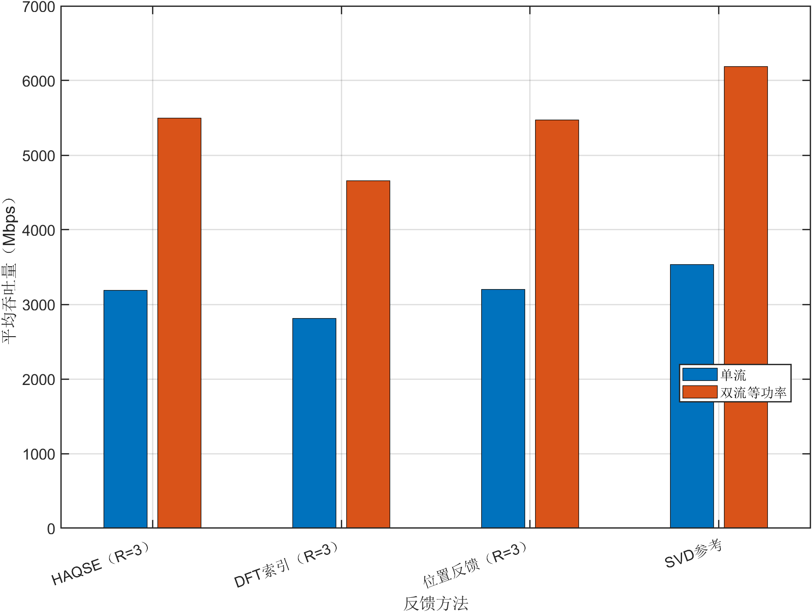
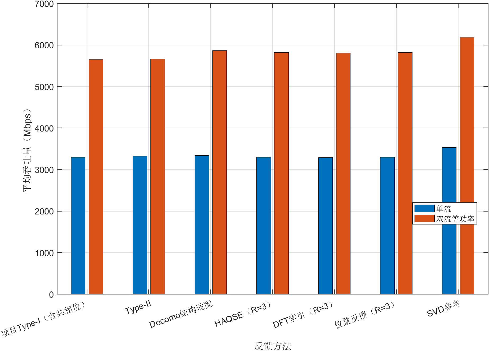

# UPA单极化双流扩展实现与验证报告

2026年10月23日。结论是当前UPA单极化场景可以在不增加第二空间波束的条件下形成两个有效接收模式。预定32个位置分别测试LOS和K=10 dB混合信道，CPU三种方法、UE六种方法共576个可实施单双流配对全部获得正速率增量。该结论是默认配置的最小可行性证据，不是全参数双流扫描。

## 验证范围

采用每AP32×32 UPA、8个AP、UE四接收阵元、观测SNR30 dB、总功率1、400 MHz直接换算。位置固定为1至32，不根据秩或收益筛选。用于单元检查的位置399与这32个性能位置分离。CPU与UE分别计算，LOS与混合信道分别汇总。

单流和双流使用完全相同的真实信道、观测噪声、空间消息、每AP空间波束以及第一流相位。比较的是同一方法在同一位置的一流与两流，不将400位置单流均值与32位置双流均值相减。

## 从单流到双流改变了什么

设每AP有N个阵元、B个AP。每个方法先按现有单流规则产生单位范数空间波束f_b。将这些波束放入块对角矩阵F，其尺寸是BN×B；单极化没有此前双极化模型的2B系数维度。AP系数矩阵C尺寸为B×流数，发送预编码为

$$
W=FC
$$

单流时，每AP系数为

$$
C_{b,1}=\frac{e^{j\theta_{b,1}}}{\sqrt{B}}
$$

双流时，两个数据符号共享同一个f_b，每个系数改为

$$
C_{b,s}=\frac{e^{j\theta_{b,s}}}{\sqrt{2B}},\quad s=1,2
$$

第一流的波束与相位不变，只因两流平分总功率而缩放。第二流新增加的是每AP的一组相位，不增加第二条空间波束，不重新定位，也不重复发送空间消息。每流功率1/2、每AP两流合计功率1/B、总功率1。

| 环节 | 单流 | 双流 |
|---|---|---|
| 每AP空间波束 | 一条f_b | 两流共用同一条f_b |
| 第一流相位 | 已有单流相位 | 原样保留 |
| 第二流相位 | 无 | 新增跨AP分布 |
| 系数矩阵 | B×1 | B×2 |
| CPU新增反馈 | 无 | 无 |
| UE新增反馈 | 无 | B−1个4 bit相对相位 |

如果第二流仅给整列增加一个共同相位，两列仍共线，接收秩至多1。因此本实现真正搜索跨AP不同的第二流相位，而不是复制第一列。

## 第二流相位如何设计

先形成低维有效信道E，每AP一列，为该AP信道乘以已有空间波束。保留第一流系数，使用两个固定初始化：一是去除第一接收方向后残余有效信道的主模式相位，二是第一相位叠加跨AP相位斜坡。按设计端可见的信道选较优初始化，进行三轮坐标更新。

目标是两流线性MMSE接收的速率和。UE直接在16个相位上搜索；CPU使用64点粗搜索加24次固定黄金分割细化，产生连续相位。所有参数预先冻结，每轮目标不下降，不用真实信道选择候选或调参。该算法是启发式，不声称全局最优。

Type-I/II与几何方法保留各自单流空间波束；Type-II两流共享原复合波束。Docomo也保留其单流适配波束及第一相位，第二流按统一框架增加相位，因此属于Docomo结构适配的统一双流扩展，不是论文原始多列DFT子集方案的完整复现。

## CPU计算和信息边界

CPU接收原有空间消息，解码位置和共享空间波束；只用公共几何模型形成有效信道，保留模型第一相位并搜索第二相位。解码接口不接收Hobs、Htrue或UE连续位置。两流总反馈仍为HAQSE84 bit、DFT42 bit、POS36 bit，未增加相位反馈。

CPU重复从同一消息和公共配置计算得到完全相同的两流发送矩阵。固定的是反馈消息规模，不是CPU整体计算量；第二流优化会增加CPU工作量，当前没有声称运行开销不变。

### CPU纯LOS结果

| 方法 | 单流 Mbps | 双流 Mbps | 增量 Mbps | 正收益比例 | 第二模式功率比均值 |
|---|---:|---:|---:|---:|---:|
| HAQSE | 3346.347 | 5871.511 | 2525.165 | 100% | 0.7706 |
| DFT索引 | 2869.501 | 4781.992 | 1912.491 | 100% | 0.4545 |
| 位置反馈 | 3354.370 | 5890.959 | 2536.590 | 100% | 0.7769 |

### CPU混合信道结果

| 方法 | 单流 Mbps | 双流 Mbps | 增量 Mbps | 正收益比例 | 第二模式功率比均值 |
|---|---:|---:|---:|---:|---:|
| HAQSE | 3188.372 | 5494.901 | 2306.529 | 100% | 0.6375 |
| DFT索引 | 2812.759 | 4654.937 | 1842.178 | 100% | 0.4454 |
| 位置反馈 | 3197.909 | 5474.507 | 2276.598 | 100% | 0.6459 |

默认混合信道下，位置反馈由3197.909提升至5474.507 Mbps。DFT在CPU端仍受到定位与模型相位误差影响，平均收益低于另两种几何方法。各方法32个位置均有正收益，但不说明不同噪声、K值或AP配置下必然如此。



## UE计算和反馈增加

UE用全部活动AP的带噪CSI和消息解码后的共享波束形成E，保留第一相位，量化第二流相对相位。CPU从原单流消息及新增相位整数恢复两流发送矩阵，不接收UE生成的浮点系数。

| UE方法 | 单流 bit | 双流 bit | 新增 bit |
|---|---:|---:|---:|
| 项目Type-I | 140 | 168 | 28 |
| 项目Type-II | 292 | 320 | 28 |
| Docomo结构适配 | 129 | 157 | 28 |
| HAQSE | 112 | 140 | 28 |
| DFT索引 | 70 | 98 | 28 |
| 位置反馈 | 64 | 92 | 28 |

### UE纯LOS结果

| 方法 | 单流 Mbps | 双流 Mbps | 增量 Mbps | 正收益比例 | 第二模式功率比均值 |
|---|---:|---:|---:|---:|---:|
| 项目Type-I 含共相位 | 3361.322 | 5922.105 | 2560.783 | 100% | 0.7962 |
| 项目Type-II | 3364.769 | 5927.901 | 2563.132 | 100% | 0.7971 |
| Docomo结构适配 | 3392.969 | 5970.875 | 2577.906 | 100% | 0.8738 |
| HAQSE | 3361.190 | 5922.937 | 2561.747 | 100% | 0.7998 |
| DFT索引 | 3355.030 | 5911.357 | 2556.327 | 100% | 0.7963 |
| 位置反馈 | 3361.343 | 5923.405 | 2562.062 | 100% | 0.7993 |

### UE混合信道结果

| 方法 | 单流 Mbps | 双流 Mbps | 增量 Mbps | 正收益比例 | 第二模式功率比均值 |
|---|---:|---:|---:|---:|---:|
| 项目Type-I 含共相位 | 3299.221 | 5654.107 | 2354.886 | 100% | 0.7211 |
| 项目Type-II | 3324.753 | 5660.068 | 2335.315 | 100% | 0.6904 |
| Docomo结构适配 | 3342.388 | 5863.839 | 2521.451 | 100% | 0.8740 |
| HAQSE | 3299.682 | 5823.382 | 2523.700 | 100% | 0.7939 |
| DFT索引 | 3291.522 | 5810.837 | 2519.315 | 100% | 0.8083 |
| 位置反馈 | 3299.572 | 5822.836 | 2523.265 | 100% | 0.7958 |

默认混合信道下，位置反馈由3299.571提升至5822.836 Mbps，反馈由64增至92 bit。其他方法也形成两流，说明本结论并非只对位置反馈成立。实际速率收益与第一流目标、码本约束、第二流相位优化及观测误差共同有关。



## 怎样判断第二流有效

接收有效矩阵为G=HW。评价使用A=I+rho乘G的共轭转置乘G，根据A逆矩阵对角线求每流MMSE SINR，再计算

$$
R=\sum_{s=1}^{2}\log_2(1+\gamma_s)
$$

同时记录联合logdet速率，两流MMSE速率不超过联合速率。没有把两列接收功率相加后套用单流公式。

本轮保存真实信道第二模式、固定空间波束子空间第二模式及最终接收第二模式。576个可实施配对的最小正收益为9.137 Mbps，最终接收第二与第一模式功率比的最小值约0.0352，说明形成的第二模式不仅是浮点意义下的非零值。所有样本保留，未删去不利位置。

真实信道SVD另列单流最优参考和双流等功率参考。双流SVD不是任意功率分配下的一般容量上界；它同样放松每AP等功率限制。单流与双流的总功率均为1。

## 实现检查和独立核验

54项双流单元检查通过，验证共享波束、第一列仅缩放、总功率与每AP功率、UE多28 bit和CPU不增加bit、消息重放，以及“仅加全局相位会秩1”的反例。合成双模式案例验证了双流收益和MMSE与联合速率关系。

主验证生成1,408条记录、704组含SVD参考的配对，其中可实施配对576组。Python从公共样本库独立重建真实信道和空间波束，核验1,152条可实施记录、反馈长度、系数、全部指标和汇总均值。有效真实信道最大误差约8.49×10⁻¹³，频谱效率最大误差约1.69×10⁻¹²；CPU连续优化的跨实现系数最大数值差约2.93×10⁻⁷。

## 复现与结论边界

```matlab
verify_dual_stream('results/new_dual_unit');
run_dual_stream_minimal('OutputDir','results/new_dual32');
plot_precoding_results('results/new_dual32');
```

```text
python audit_dual_stream.py results/dual_stream_minimal32
```

已证实当前默认UPA单极化配置中，复用每AP空间波束、只新增第二流AP相位能够实现有用双流。当前只做32位置和两种信道的最小验证；未进行400位置或全SNR、全AP数的双流扫描，也未做自适应流数、功率分配或同步误差验证。后续是否扩大双流对比，应基于这一结果另行决定。
