# UPA单流400位置正式实验报告

2026年10月25日更新。本文解释UPA单极化方案在400个冻结位置上的实现和实验结果，CPU、UE分别报告，纯LOS与MIX逐实验分开展示。定位误差的观测SNR改为−20:10:40，吞吐量改为−20:5:20；单流补齐原先正文缺失的LOS结果。数据链路SNR保持固定。

本版汇总22个不同物理配置，共387,200条含单双流配对的原生明细。新增8个低SNR配置，每个含LOS、MIX及400位置；其余14个配置直接复用已审计结果。每张曲线和表格均按400个位置求均值，未筛除不利或越界样本。

正文保持每端定位误差三项、吞吐量三项、比特数与AP数一项的结构。每个实验均附图片、完整数值和结果说明。图例保持全反馈Type-I(UE)、全反馈Type-II(UE)、Docomo、空间频率、DFT索引、位置反馈，CPU共享Docomo标作Docomo(UE)。

## 1 方法与实验口径

| 项目 | 设置 |
|---|---|
| 阵列和接收端 | 单极化UPA，UE四接收阵元 |
| 位置和信道 | 冻结位置1至400全部保留；纯LOS和MIX分别给出结果 |
| 默认配置 | 每AP32×32阵元、协作AP数8、定位参考AP数3、观测SNR 30 dB、K=10 dB |
| 定位误差的观测SNR | −20、−10、0、10、20、30、40 dB |
| 吞吐量的观测SNR | −20、−15、−10、−5、0、5、10、15、20 dB |
| UPA阵元数 | 64、256、1024 |
| 协作AP数 | 原始5至10；图的显示范围5至9，横轴仅整数 |
| 莱斯因子 | 0、5、10、15、20 dB；纯LOS不使用K，仅作一致性对照 |
| 功率和带宽 | 总功率1，各AP总功率1/B；400 MHz直接换算，不增加OFDM或带宽噪声模型 |
| 评价用数据SNR | 固定参考数据SNR 10 dB及原参考功率，不随观测SNR改变 |
| 主参考 | 真实信道直接SVD；单流取最优第一右奇异向量，双流取前两向量并等功率 |
| 反馈 | 实际MSB优先整数比特串；CPU独立解码；各方法一致不含公共配置、传输头与FEC |

观测信道由真实信道加CSI估计噪声得到。真实信道仍包含相应的LOS传播或LOS与散射混合传播。普通方法只根据带噪观测或收到的空间消息设计，真实信道只用于评价和SVD参考。观测SNR扫描改变CSI质量，数据链路噪声照常保留，因此SVD参考随观测SNR保持不变。

本轮使用两类SNR点的并集计算或复用物理案例，再按对应实验取点；不是只裁剪旧曲线。所有SNR配置使用同一批位置、散射系数和冻结噪声种子，改变噪声幅度。每点400个不同位置，不把CPU和UE、单双流、重复默认标签作为独立随机样本。定位SNR图纵轴标为“定位误差（m）”；吞吐量采用线性纵轴，下限按该图所有方法的最低值向下留少量余量，上限同样留白。

### 单流空间波束与第一流相位

Type-I将联合观测信道的主右奇异向量按AP分块，匹配本地二维DFT波束。Type-II在同一正交分组选择两条波束，组合幅度3 bit、内部相位2 bit。Type-I、Type-II、空间频率、DFT索引和位置反馈五种普通UE方法统一使用联合主模式投影，共相位以首AP为0，其余AP的相对相位各4 bit。

空间频率反馈三个参考AP的两维估计频率，每维14 bit；DFT索引反馈同三个AP的二维码本索引。位置反馈先以连续空间频率在UE定位，再将坐标按13/14/9 bit量化一次。位置方案不使用已经量化的频率来定位，也不先量化频率再量化坐标。

CPU端三种几何方法仅依靠收到的空间整数消息和公共AP几何恢复位置、空间波束与模型，并在模型上计算相位。CPU不接收参考AP的完整观测信道或UE连续位置。UE端则用全AP观测CSI和消息恢复后的波束计算相位，再反馈相位整数。实现中实际使用从整数消息恢复的发送向量，而非直接使用UE浮点波束。

### Docomo的实现范围

Docomo依据Near-Field Line-of-Sight MIMO Precoding with Distributed Antennas第IV节式25至27与第V节，采用每AP本地DFT波束、QPSK共相位和跨AP模式的结构。当前不规则部署使用公开AP顺序的一维逻辑DFT，保留项目码本和三轮坐标更新；它是结构适配，并非论文全部场景的复现。论文Type-I为NCJT，本项目Type-I含共相位，两者定义不同。默认单流Docomo为129 bit，不套用论文特定场景的26 bit。既有48项Docomo专项、701项协议及42项UPA/POS验证保留，详见[Docomo专项说明](Docomo结构适配与专项验证.md)。

单流使用一个发送向量，速率为log2(1+ρ‖Hw‖²)，Mbps等于频谱效率乘400。真实CSI直接SVD在总功率1下给出最优单流参考，放松可实施方法的每AP等功率约束。

新增单流LOS结果直接取自已验证配对案例中的stream_count=1，使用同一个原生单流设计和解码器；第二流设计不反向修改第一流。现有MIX配置已与此前正式单流逐位置对齐，不能把配对来源理解为使用双流结果代替单流。

## 2 CPU端正式实验

以下纯LOS、MIX分别列出，每个图表点均为400位置均值。CPU图中的全反馈Type-I(UE)、全反馈Type-II(UE)、Docomo(UE)复用同一配置下的UE结果，作为共享参考；不新增CPU算法或样本。定位误差只比较空间频率、DFT索引和位置反馈三种有位置输出的方法。

### 2.1 定位误差组

**CPU单流纯LOS定位误差与观测SNR**

横轴为观测SNR，纵轴为定位误差（m）。

| 方法 | -20 | -10 | 0 | 10 | 20 | 30 | 40 |
|---|---|---|---|---|---|---|---|
| 空间频率 | 3.048485 | 0.070169 | 0.022173 | 0.007192 | 0.002818 | 0.001940 | 0.001915 |
| DFT索引 | 9.865992 | 0.246754 | 0.235532 | 0.233766 | 0.231956 | 0.232083 | 0.233291 |
| 位置反馈 | 1.808583 | 0.070440 | 0.022458 | 0.008063 | 0.004417 | 0.003723 | 0.003634 |

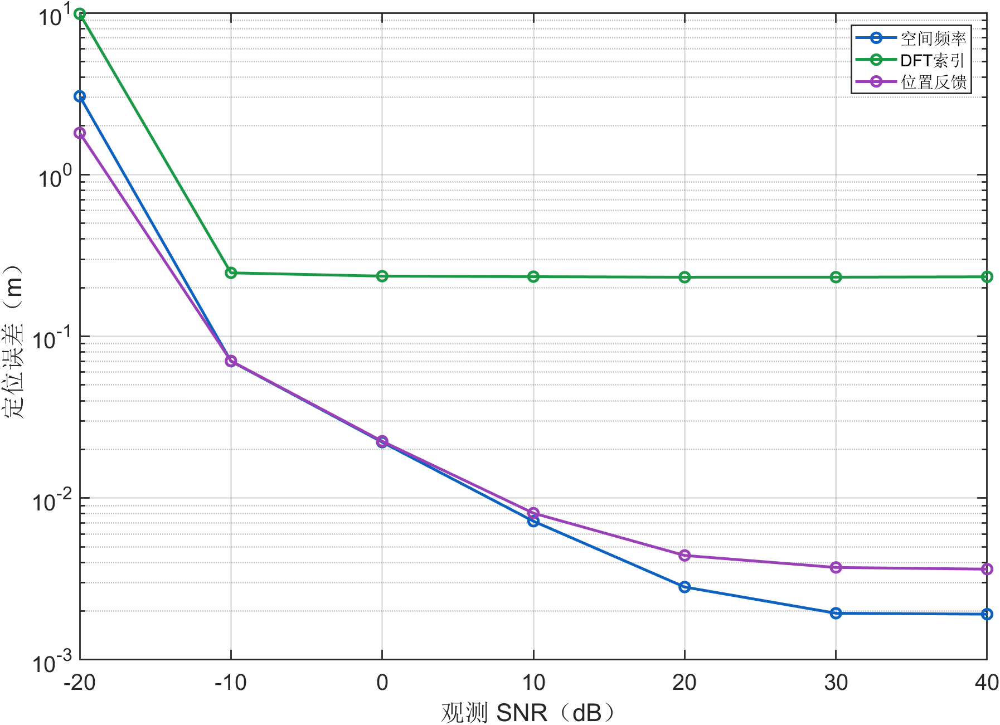

结果：位置反馈在横轴-20时为1.808583 m，在40时为0.003634 m。空间频率、DFT索引使用各自解码方向定位，位置反馈使用一次量化后的坐标。 高SNR后的残余误差受空间估计、信道模型和有限反馈共同影响，不能要求逐点单调。

**CPU单流混合信道定位误差与观测SNR**

横轴为观测SNR，纵轴为定位误差（m）。

| 方法 | -20 | -10 | 0 | 10 | 20 | 30 | 40 |
|---|---|---|---|---|---|---|---|
| 空间频率 | 4.345898 | 0.074362 | 0.025053 | 0.011433 | 0.008926 | 0.008532 | 0.008547 |
| DFT索引 | 10.573065 | 0.249121 | 0.233680 | 0.232275 | 0.234350 | 0.235091 | 0.235091 |
| 位置反馈 | 2.509786 | 0.074379 | 0.025191 | 0.012117 | 0.009745 | 0.009490 | 0.009432 |

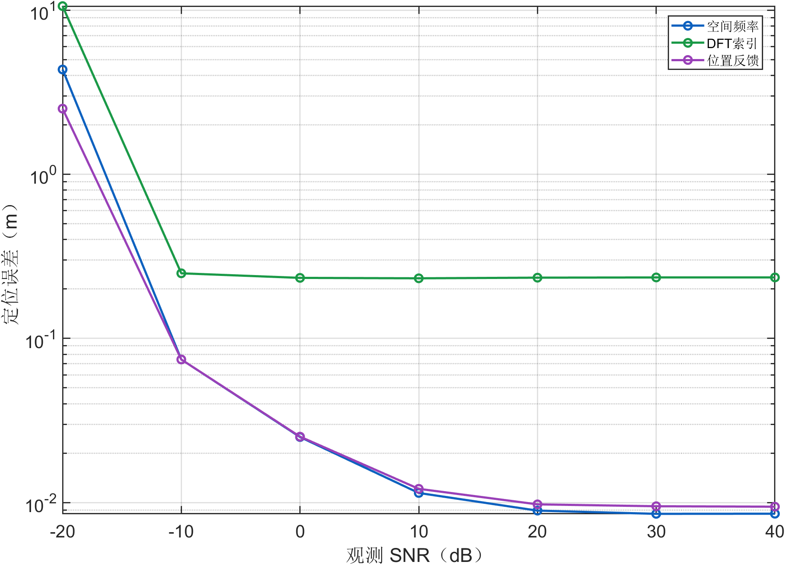

结果：位置反馈在横轴-20时为2.509786 m，在40时为0.009432 m。空间频率、DFT索引使用各自解码方向定位，位置反馈使用一次量化后的坐标。 高SNR后的残余误差受空间估计、信道模型和有限反馈共同影响，不能要求逐点单调。

**CPU单流纯LOS定位误差与UPA阵元数**

横轴为UPA阵元数，纵轴为定位误差（m）。

| 方法 | 64 | 256 | 1024 |
|---|---|---|---|
| 空间频率 | 0.010948 | 0.003084 | 0.001940 |
| DFT索引 | 0.928820 | 0.457306 | 0.232083 |
| 位置反馈 | 0.011495 | 0.004618 | 0.003723 |

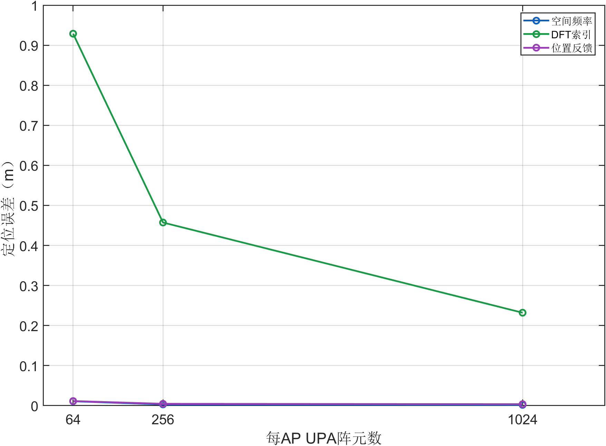

结果：位置反馈在横轴64时为0.011495 m，在1024时为0.003723 m。空间频率、DFT索引使用各自解码方向定位，位置反馈使用一次量化后的坐标。

**CPU单流混合信道定位误差与UPA阵元数**

横轴为UPA阵元数，纵轴为定位误差（m）。

| 方法 | 64 | 256 | 1024 |
|---|---|---|---|
| 空间频率 | 0.137977 | 0.037209 | 0.008532 |
| DFT索引 | 0.903049 | 0.464450 | 0.235091 |
| 位置反馈 | 0.137989 | 0.037184 | 0.009490 |

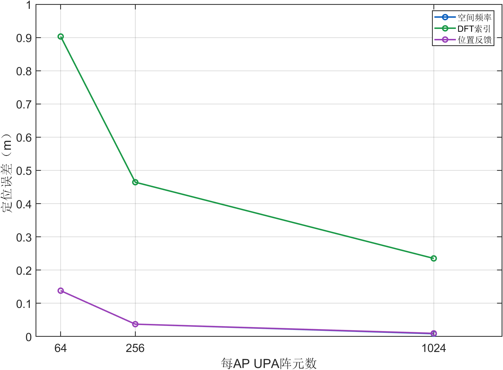

结果：位置反馈在横轴64时为0.137989 m，在1024时为0.009490 m。空间频率、DFT索引使用各自解码方向定位，位置反馈使用一次量化后的坐标。

**CPU单流纯LOS定位误差与协作AP数**

横轴为协作AP数，纵轴为定位误差（m）。

| 方法 | 5 | 6 | 7 | 8 | 9 | 10 |
|---|---|---|---|---|---|---|
| 空间频率 | 0.001933 | 0.001934 | 0.001941 | 0.001940 | 0.001948 | 0.001944 |
| DFT索引 | 0.232083 | 0.232083 | 0.232083 | 0.232083 | 0.232083 | 0.232083 |
| 位置反馈 | 0.003724 | 0.003719 | 0.003724 | 0.003723 | 0.003727 | 0.003724 |

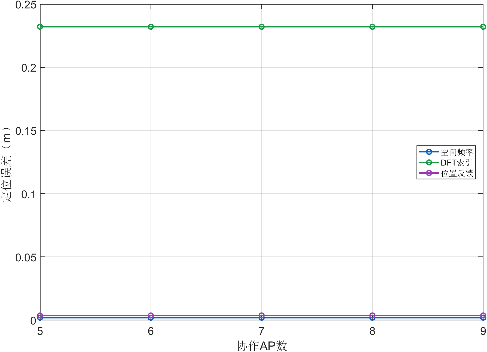

结果：位置反馈在横轴5时为0.003724 m，在10时为0.003724 m。定位参考数仍固定3，增加协作AP不等于增加定位参考观测。

**CPU单流混合信道定位误差与协作AP数**

横轴为协作AP数，纵轴为定位误差（m）。

| 方法 | 5 | 6 | 7 | 8 | 9 | 10 |
|---|---|---|---|---|---|---|
| 空间频率 | 0.008546 | 0.008548 | 0.008542 | 0.008532 | 0.008540 | 0.008544 |
| DFT索引 | 0.235091 | 0.235091 | 0.235091 | 0.235091 | 0.235091 | 0.235091 |
| 位置反馈 | 0.009493 | 0.009490 | 0.009490 | 0.009490 | 0.009489 | 0.009487 |

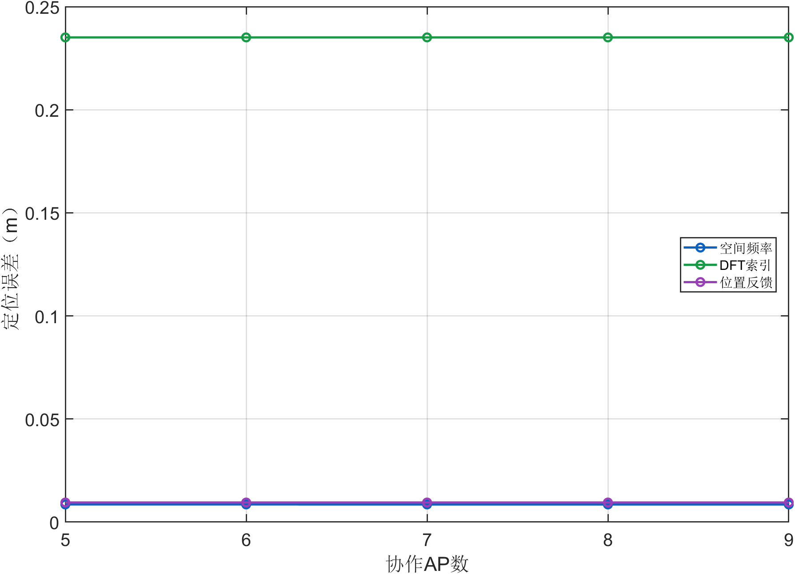

结果：位置反馈在横轴5时为0.009493 m，在10时为0.009487 m。定位参考数仍固定3，增加协作AP不等于增加定位参考观测。

### 2.2 吞吐量组

**CPU单流纯LOS吞吐量与观测SNR**

横轴为观测SNR，纵轴为吞吐量（Mbps）。

| 方法 | -20 | -15 | -10 | -5 | 0 | 5 | 10 | 15 | 20 |
|---|---|---|---|---|---|---|---|---|---|
| SVD参考 | 3531.25 | 3531.25 | 3531.25 | 3531.25 | 3531.25 | 3531.25 | 3531.25 | 3531.25 | 3531.25 |
| 全反馈Type-I(UE) | 2874.30 | 3223.09 | 3335.80 | 3356.50 | 3359.77 | 3363.73 | 3361.37 | 3360.70 | 3360.49 |
| 全反馈Type-II(UE) | 2678.40 | 3109.33 | 3277.91 | 3328.73 | 3347.90 | 3358.81 | 3361.75 | 3363.18 | 3363.66 |
| Docomo(UE) | 3016.65 | 3325.49 | 3387.76 | 3394.95 | 3399.06 | 3399.57 | 3400.01 | 3399.88 | 3399.99 |
| 空间频率 | 2851.77 | 3031.09 | 3052.00 | 3059.65 | 3087.39 | 3120.07 | 3206.52 | 3291.55 | 3331.11 |
| DFT索引 | 2513.35 | 2933.97 | 2957.17 | 2955.72 | 2954.09 | 2956.27 | 2960.54 | 2961.95 | 2965.24 |
| 位置反馈 | 2583.19 | 3033.36 | 3055.82 | 3063.00 | 3091.32 | 3119.01 | 3210.61 | 3300.99 | 3340.83 |

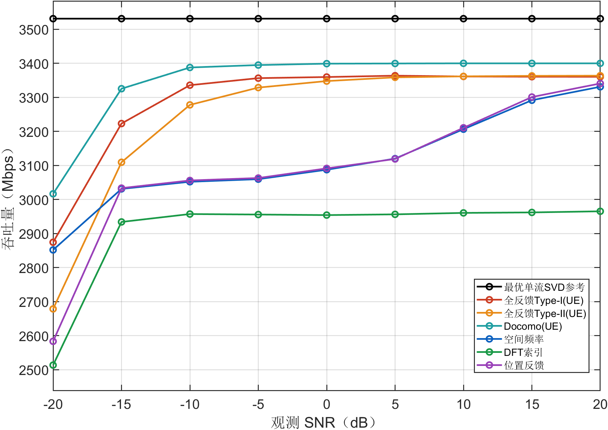

结果：位置反馈在横轴-20时为2583.19 Mbps，在20时为3340.83 Mbps。只改变CSI观测噪声，数据SNR固定，SVD保持不变。更准确的CSI不保证离散码本及固定启发式的每个均值都严格上升。 纵轴根据本图所有曲线的最小值和最大值留少量余量，未改变数据。

**CPU单流混合信道吞吐量与观测SNR**

横轴为观测SNR，纵轴为吞吐量（Mbps）。

| 方法 | -20 | -15 | -10 | -5 | 0 | 5 | 10 | 15 | 20 |
|---|---|---|---|---|---|---|---|---|---|
| SVD参考 | 3543.54 | 3543.54 | 3543.54 | 3543.54 | 3543.54 | 3543.54 | 3543.54 | 3543.54 | 3543.54 |
| 全反馈Type-I(UE) | 2780.15 | 3162.64 | 3280.65 | 3301.62 | 3298.09 | 3297.72 | 3298.79 | 3298.25 | 3298.87 |
| 全反馈Type-II(UE) | 2576.69 | 3041.64 | 3241.28 | 3311.84 | 3321.35 | 3323.38 | 3323.82 | 3324.08 | 3323.89 |
| Docomo(UE) | 2922.39 | 3258.26 | 3334.72 | 3342.83 | 3345.44 | 3346.75 | 3347.50 | 3347.91 | 3347.99 |
| 空间频率 | 2735.32 | 2983.05 | 2979.58 | 3014.01 | 3041.55 | 3053.36 | 3112.12 | 3150.89 | 3171.27 |
| DFT索引 | 2402.99 | 2888.48 | 2902.48 | 2904.98 | 2910.66 | 2911.62 | 2912.06 | 2911.85 | 2912.33 |
| 位置反馈 | 2349.94 | 2983.26 | 2975.33 | 3020.33 | 3045.09 | 3050.49 | 3111.92 | 3160.34 | 3178.16 |

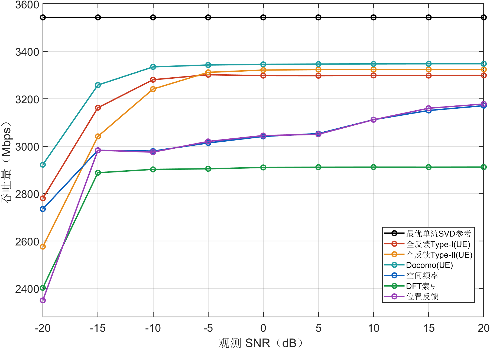

结果：位置反馈在横轴-20时为2349.94 Mbps，在20时为3178.16 Mbps。只改变CSI观测噪声，数据SNR固定，SVD保持不变。更准确的CSI不保证离散码本及固定启发式的每个均值都严格上升。 纵轴根据本图所有曲线的最小值和最大值留少量余量，未改变数据。

**CPU单流纯LOS吞吐量与UPA阵元数**

横轴为UPA阵元数，纵轴为吞吐量（Mbps）。

| 方法 | 64 | 256 | 1024 |
|---|---|---|---|
| SVD参考 | 1950.13 | 2735.12 | 3531.25 |
| 全反馈Type-I(UE) | 1795.10 | 2571.35 | 3359.60 |
| 全反馈Type-II(UE) | 1797.65 | 2574.85 | 3362.89 |
| Docomo(UE) | 1830.30 | 2610.48 | 3399.96 |
| 空间频率 | 1581.08 | 2540.85 | 3348.95 |
| DFT索引 | 1406.26 | 2178.59 | 2966.44 |
| 位置反馈 | 1584.99 | 2549.40 | 3358.40 |

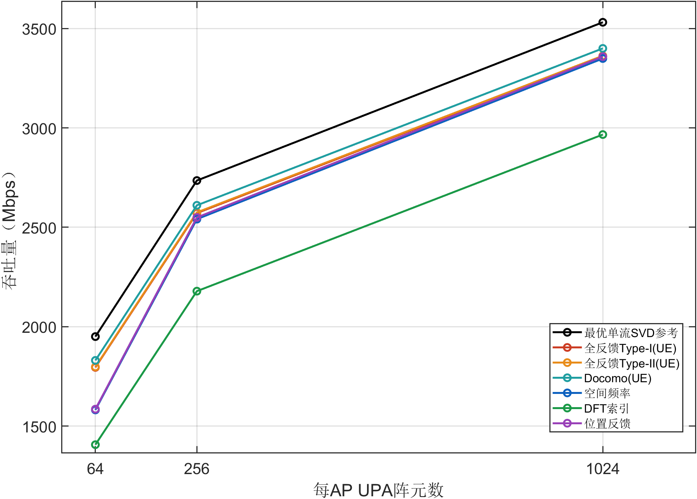

结果：位置反馈在横轴64时为1584.99 Mbps，在1024时为3358.40 Mbps。其他参数保持默认值；结论限于当前冻结部署。 纵轴根据本图所有曲线的最小值和最大值留少量余量，未改变数据。

**CPU单流混合信道吞吐量与UPA阵元数**

横轴为UPA阵元数，纵轴为吞吐量（Mbps）。

| 方法 | 64 | 256 | 1024 |
|---|---|---|---|
| SVD参考 | 1973.93 | 2750.19 | 3543.54 |
| 全反馈Type-I(UE) | 1782.77 | 2527.51 | 3298.51 |
| 全反馈Type-II(UE) | 1805.79 | 2553.36 | 3324.28 |
| Docomo(UE) | 1795.17 | 2563.97 | 3347.72 |
| 空间频率 | 1433.67 | 2251.94 | 3177.40 |
| DFT索引 | 1360.62 | 2131.16 | 2909.63 |
| 位置反馈 | 1436.74 | 2252.26 | 3184.00 |

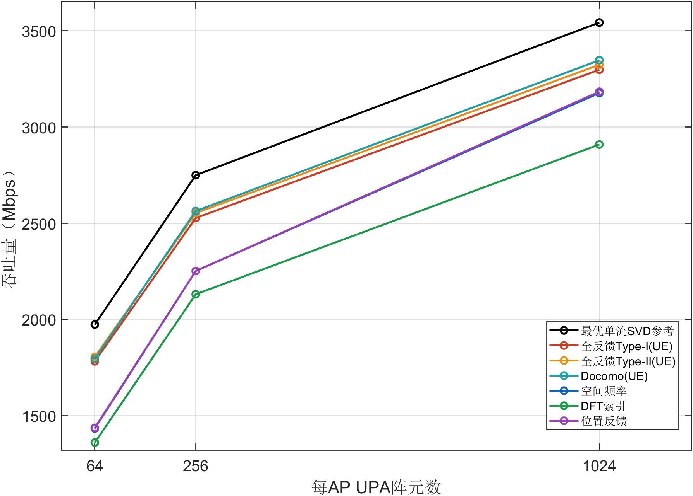

结果：位置反馈在横轴64时为1436.74 Mbps，在1024时为3184.00 Mbps。其他参数保持默认值；结论限于当前冻结部署。 纵轴根据本图所有曲线的最小值和最大值留少量余量，未改变数据。

**CPU单流纯LOS吞吐量与莱斯因子K**

横轴为莱斯因子K，纵轴为吞吐量（Mbps）。

| 方法 | 0 | 5 | 10 | 15 | 20 |
|---|---|---|---|---|---|
| SVD参考 | 3531.25 | 3531.25 | 3531.25 | 3531.25 | 3531.25 |
| 全反馈Type-I(UE) | 3359.60 | 3359.60 | 3359.60 | 3359.60 | 3359.60 |
| 全反馈Type-II(UE) | 3362.89 | 3362.89 | 3362.89 | 3362.89 | 3362.89 |
| Docomo(UE) | 3399.96 | 3399.96 | 3399.96 | 3399.96 | 3399.96 |
| 空间频率 | 3348.95 | 3348.95 | 3348.95 | 3348.95 | 3348.95 |
| DFT索引 | 2966.44 | 2966.44 | 2966.44 | 2966.44 | 2966.44 |
| 位置反馈 | 3358.40 | 3358.40 | 3358.40 | 3358.40 | 3358.40 |

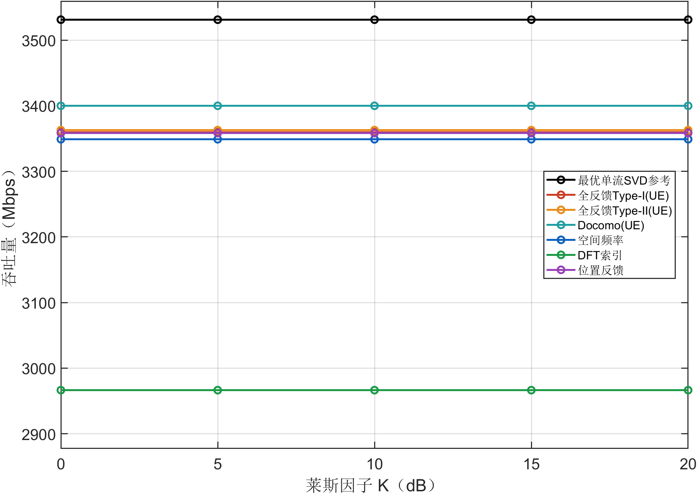

结果：位置反馈在横轴0时为3358.40 Mbps，在20时为3358.40 Mbps。纯LOS不使用K，平线仅作一致性对照；MIX的K扫描才改变LOS和散射比例。 纵轴根据本图所有曲线的最小值和最大值留少量余量，未改变数据。

**CPU单流混合信道吞吐量与莱斯因子K**

横轴为莱斯因子K，纵轴为吞吐量（Mbps）。

| 方法 | 0 | 5 | 10 | 15 | 20 |
|---|---|---|---|---|---|
| SVD参考 | 3706.52 | 3597.27 | 3543.54 | 3532.66 | 3531.42 |
| 全反馈Type-I(UE) | 3292.99 | 3263.52 | 3298.51 | 3331.95 | 3348.58 |
| 全反馈Type-II(UE) | 3433.49 | 3345.88 | 3324.28 | 3336.10 | 3348.30 |
| Docomo(UE) | 3143.30 | 3252.61 | 3347.72 | 3382.88 | 3394.78 |
| 空间频率 | 2584.29 | 3009.11 | 3177.40 | 3277.36 | 3319.70 |
| DFT索引 | 2583.81 | 2814.27 | 2909.63 | 2945.71 | 2957.68 |
| 位置反馈 | 2393.28 | 3013.46 | 3184.00 | 3284.45 | 3326.69 |

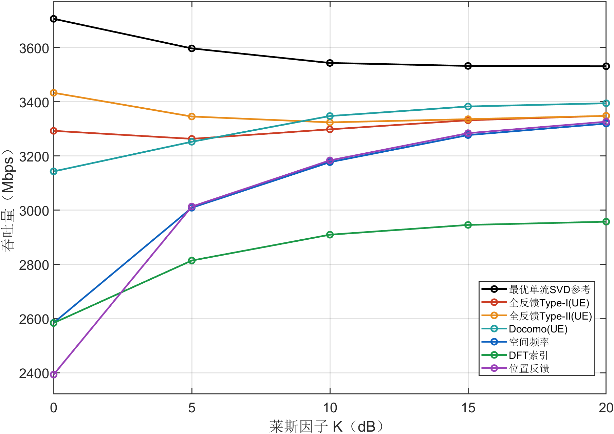

结果：位置反馈在横轴0时为2393.28 Mbps，在20时为3326.69 Mbps。其他参数保持默认值；结论限于当前冻结部署。 纵轴根据本图所有曲线的最小值和最大值留少量余量，未改变数据。

### 2.3 比特数与AP数目

横轴为协作AP数，纵轴为每次更新反馈有效载荷（bit）。长度规则不依赖信道类型，LOS与MIX相同；表内保留5至10 AP，图中仅显示整数5至9。

| 方法 | 5 | 6 | 7 | 8 | 9 | 10 |
|---|---|---|---|---|---|---|
| 全反馈Type-I(UE) | 86 | 104 | 122 | 140 | 158 | 176 |
| 全反馈Type-II(UE) | 181 | 218 | 255 | 292 | 329 | 366 |
| Docomo(UE) | 81 | 97 | 113 | 129 | 146 | 162 |
| 空间频率 | 84 | 84 | 84 | 84 | 84 | 84 |
| DFT索引 | 42 | 42 | 42 | 42 | 42 | 42 |
| 位置反馈 | 36 | 36 | 36 | 36 | 36 | 36 |

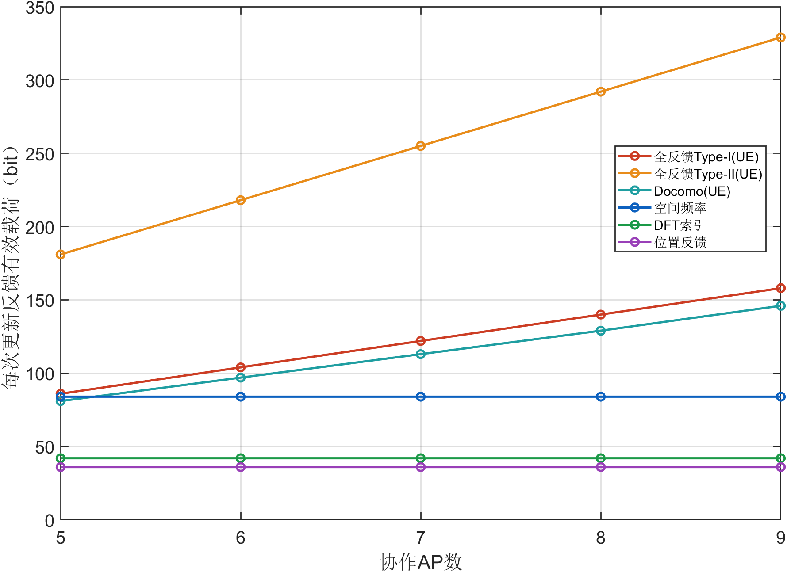

结果：CPU三种几何方法始终为84、42、36 bit。CPU图中的Type-I、Type-II和Docomo为完整UE消息的共享参考；不能将其计为CPU独立算法。UE几何方案还包含4(B−1) bit第一相位。空间消息固定三个参考AP，所以CPU几何开销不随协作AP数增加。

## 3 UE端正式实验

以下纯LOS、MIX分别列出，每个图表点均为400位置均值。CPU图中的全反馈Type-I(UE)、全反馈Type-II(UE)、Docomo(UE)复用同一配置下的UE结果，作为共享参考；不新增CPU算法或样本。定位误差只比较空间频率、DFT索引和位置反馈三种有位置输出的方法。

### 3.1 定位误差组

**UE单流纯LOS定位误差与观测SNR**

横轴为观测SNR，纵轴为定位误差（m）。

| 方法 | -20 | -10 | 0 | 10 | 20 | 30 | 40 |
|---|---|---|---|---|---|---|---|
| 空间频率 | 3.048485 | 0.070169 | 0.022173 | 0.007192 | 0.002818 | 0.001940 | 0.001915 |
| DFT索引 | 9.865992 | 0.246754 | 0.235532 | 0.233766 | 0.231956 | 0.232083 | 0.233291 |
| 位置反馈 | 1.808583 | 0.070440 | 0.022458 | 0.008063 | 0.004417 | 0.003723 | 0.003634 |

结果：位置反馈在横轴-20时为1.808583 m，在40时为0.003634 m。空间频率、DFT索引使用各自解码方向定位，位置反馈使用一次量化后的坐标。 高SNR后的残余误差受空间估计、信道模型和有限反馈共同影响，不能要求逐点单调。

**UE单流混合信道定位误差与观测SNR**

横轴为观测SNR，纵轴为定位误差（m）。

| 方法 | -20 | -10 | 0 | 10 | 20 | 30 | 40 |
|---|---|---|---|---|---|---|---|
| 空间频率 | 4.345898 | 0.074362 | 0.025053 | 0.011433 | 0.008926 | 0.008532 | 0.008547 |
| DFT索引 | 10.573065 | 0.249121 | 0.233680 | 0.232275 | 0.234350 | 0.235091 | 0.235091 |
| 位置反馈 | 2.509786 | 0.074379 | 0.025191 | 0.012117 | 0.009745 | 0.009490 | 0.009432 |

结果：位置反馈在横轴-20时为2.509786 m，在40时为0.009432 m。空间频率、DFT索引使用各自解码方向定位，位置反馈使用一次量化后的坐标。 高SNR后的残余误差受空间估计、信道模型和有限反馈共同影响，不能要求逐点单调。

**UE单流纯LOS定位误差与UPA阵元数**

横轴为UPA阵元数，纵轴为定位误差（m）。

| 方法 | 64 | 256 | 1024 |
|---|---|---|---|
| 空间频率 | 0.010948 | 0.003084 | 0.001940 |
| DFT索引 | 0.928820 | 0.457306 | 0.232083 |
| 位置反馈 | 0.011495 | 0.004618 | 0.003723 |

结果：位置反馈在横轴64时为0.011495 m，在1024时为0.003723 m。空间频率、DFT索引使用各自解码方向定位，位置反馈使用一次量化后的坐标。

**UE单流混合信道定位误差与UPA阵元数**

横轴为UPA阵元数，纵轴为定位误差（m）。

| 方法 | 64 | 256 | 1024 |
|---|---|---|---|
| 空间频率 | 0.137977 | 0.037209 | 0.008532 |
| DFT索引 | 0.903049 | 0.464450 | 0.235091 |
| 位置反馈 | 0.137989 | 0.037184 | 0.009490 |

结果：位置反馈在横轴64时为0.137989 m，在1024时为0.009490 m。空间频率、DFT索引使用各自解码方向定位，位置反馈使用一次量化后的坐标。

**UE单流纯LOS定位误差与协作AP数**

横轴为协作AP数，纵轴为定位误差（m）。

| 方法 | 5 | 6 | 7 | 8 | 9 | 10 |
|---|---|---|---|---|---|---|
| 空间频率 | 0.001933 | 0.001934 | 0.001941 | 0.001940 | 0.001948 | 0.001944 |
| DFT索引 | 0.232083 | 0.232083 | 0.232083 | 0.232083 | 0.232083 | 0.232083 |
| 位置反馈 | 0.003724 | 0.003719 | 0.003724 | 0.003723 | 0.003727 | 0.003724 |

结果：位置反馈在横轴5时为0.003724 m，在10时为0.003724 m。定位参考数仍固定3，增加协作AP不等于增加定位参考观测。

**UE单流混合信道定位误差与协作AP数**

横轴为协作AP数，纵轴为定位误差（m）。

| 方法 | 5 | 6 | 7 | 8 | 9 | 10 |
|---|---|---|---|---|---|---|
| 空间频率 | 0.008546 | 0.008548 | 0.008542 | 0.008532 | 0.008540 | 0.008544 |
| DFT索引 | 0.235091 | 0.235091 | 0.235091 | 0.235091 | 0.235091 | 0.235091 |
| 位置反馈 | 0.009493 | 0.009490 | 0.009490 | 0.009490 | 0.009489 | 0.009487 |

结果：位置反馈在横轴5时为0.009493 m，在10时为0.009487 m。定位参考数仍固定3，增加协作AP不等于增加定位参考观测。

### 3.2 吞吐量组

**UE单流纯LOS吞吐量与观测SNR**

横轴为观测SNR，纵轴为吞吐量（Mbps）。

| 方法 | -20 | -15 | -10 | -5 | 0 | 5 | 10 | 15 | 20 |
|---|---|---|---|---|---|---|---|---|---|
| SVD参考 | 3531.25 | 3531.25 | 3531.25 | 3531.25 | 3531.25 | 3531.25 | 3531.25 | 3531.25 | 3531.25 |
| 全反馈Type-I(UE) | 2874.30 | 3223.09 | 3335.80 | 3356.50 | 3359.77 | 3363.73 | 3361.37 | 3360.70 | 3360.49 |
| 全反馈Type-II(UE) | 2678.40 | 3109.33 | 3277.91 | 3328.73 | 3347.90 | 3358.81 | 3361.75 | 3363.18 | 3363.66 |
| Docomo | 3016.65 | 3325.49 | 3387.76 | 3394.95 | 3399.06 | 3399.57 | 3400.01 | 3399.88 | 3399.99 |
| 空间频率 | 3147.57 | 3362.44 | 3382.86 | 3382.68 | 3374.63 | 3369.14 | 3364.60 | 3363.12 | 3362.05 |
| DFT索引 | 2723.48 | 3340.55 | 3375.67 | 3375.78 | 3367.01 | 3361.93 | 3357.22 | 3355.91 | 3355.06 |
| 位置反馈 | 2871.89 | 3363.10 | 3383.25 | 3382.80 | 3374.60 | 3369.21 | 3364.56 | 3363.06 | 3362.04 |

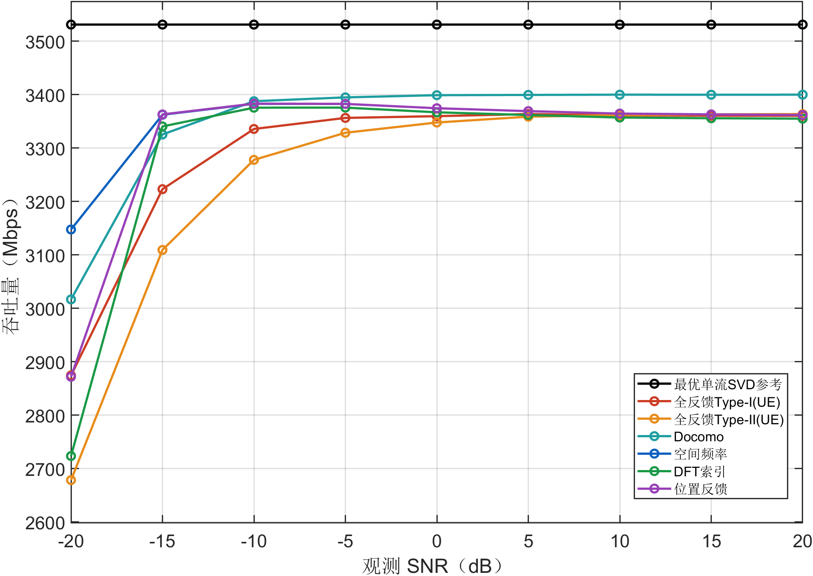

结果：位置反馈在横轴-20时为2871.89 Mbps，在20时为3362.04 Mbps。只改变CSI观测噪声，数据SNR固定，SVD保持不变。更准确的CSI不保证离散码本及固定启发式的每个均值都严格上升。 纵轴根据本图所有曲线的最小值和最大值留少量余量，未改变数据。

**UE单流混合信道吞吐量与观测SNR**

横轴为观测SNR，纵轴为吞吐量（Mbps）。

| 方法 | -20 | -15 | -10 | -5 | 0 | 5 | 10 | 15 | 20 |
|---|---|---|---|---|---|---|---|---|---|
| SVD参考 | 3543.54 | 3543.54 | 3543.54 | 3543.54 | 3543.54 | 3543.54 | 3543.54 | 3543.54 | 3543.54 |
| 全反馈Type-I(UE) | 2780.15 | 3162.64 | 3280.65 | 3301.62 | 3298.09 | 3297.72 | 3298.79 | 3298.25 | 3298.87 |
| 全反馈Type-II(UE) | 2576.69 | 3041.64 | 3241.28 | 3311.84 | 3321.35 | 3323.38 | 3323.82 | 3324.08 | 3323.89 |
| Docomo | 2922.39 | 3258.26 | 3334.72 | 3342.83 | 3345.44 | 3346.75 | 3347.50 | 3347.91 | 3347.99 |
| 空间频率 | 3001.33 | 3306.59 | 3325.89 | 3320.54 | 3311.82 | 3309.89 | 3308.48 | 3308.01 | 3307.60 |
| DFT索引 | 2593.24 | 3274.50 | 3318.81 | 3314.04 | 3304.82 | 3302.92 | 3301.57 | 3300.83 | 3300.46 |
| 位置反馈 | 2604.77 | 3307.85 | 3325.98 | 3320.73 | 3311.79 | 3309.70 | 3308.45 | 3308.08 | 3307.59 |

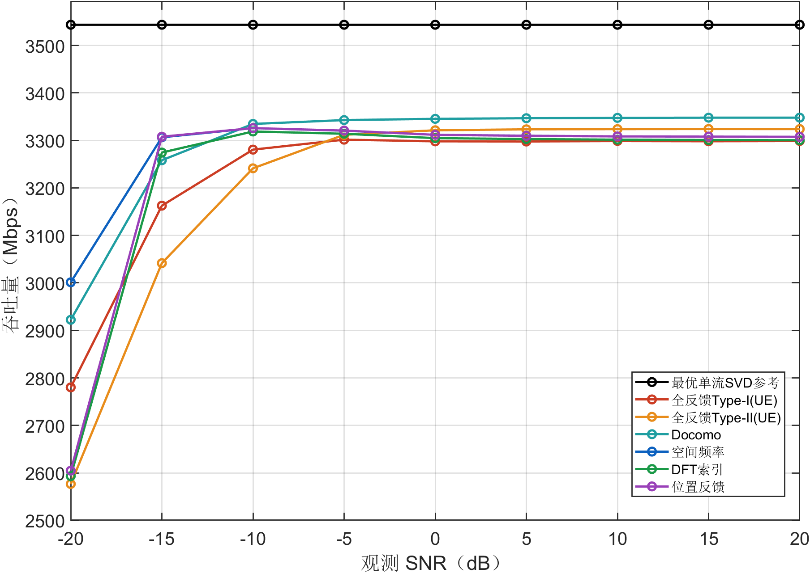

结果：位置反馈在横轴-20时为2604.77 Mbps，在20时为3307.59 Mbps。只改变CSI观测噪声，数据SNR固定，SVD保持不变。更准确的CSI不保证离散码本及固定启发式的每个均值都严格上升。 纵轴根据本图所有曲线的最小值和最大值留少量余量，未改变数据。

**UE单流纯LOS吞吐量与UPA阵元数**

横轴为UPA阵元数，纵轴为吞吐量（Mbps）。

| 方法 | 64 | 256 | 1024 |
|---|---|---|---|
| SVD参考 | 1950.13 | 2735.12 | 3531.25 |
| 全反馈Type-I(UE) | 1795.10 | 2571.35 | 3359.60 |
| 全反馈Type-II(UE) | 1797.65 | 2574.85 | 3362.89 |
| Docomo | 1830.30 | 2610.48 | 3399.96 |
| 空间频率 | 1796.21 | 2572.06 | 3361.83 |
| DFT索引 | 1789.62 | 2565.21 | 3354.76 |
| 位置反馈 | 1796.20 | 2572.06 | 3361.81 |

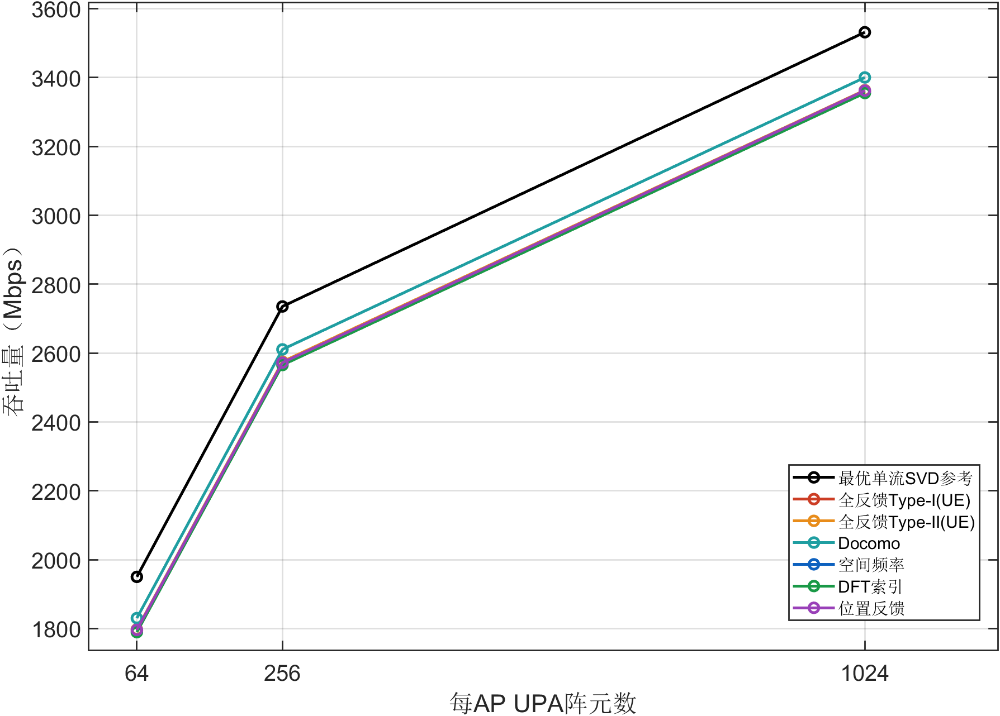

结果：位置反馈在横轴64时为1796.20 Mbps，在1024时为3361.81 Mbps。其他参数保持默认值；结论限于当前冻结部署。 纵轴根据本图所有曲线的最小值和最大值留少量余量，未改变数据。

**UE单流混合信道吞吐量与UPA阵元数**

横轴为UPA阵元数，纵轴为吞吐量（Mbps）。

| 方法 | 64 | 256 | 1024 |
|---|---|---|---|
| SVD参考 | 1973.93 | 2750.19 | 3543.54 |
| 全反馈Type-I(UE) | 1782.77 | 2527.51 | 3298.51 |
| 全反馈Type-II(UE) | 1805.79 | 2553.36 | 3324.28 |
| Docomo | 1795.17 | 2563.97 | 3347.72 |
| 空间频率 | 1791.26 | 2537.87 | 3307.27 |
| DFT索引 | 1785.44 | 2530.81 | 3300.25 |
| 位置反馈 | 1791.07 | 2537.78 | 3307.26 |

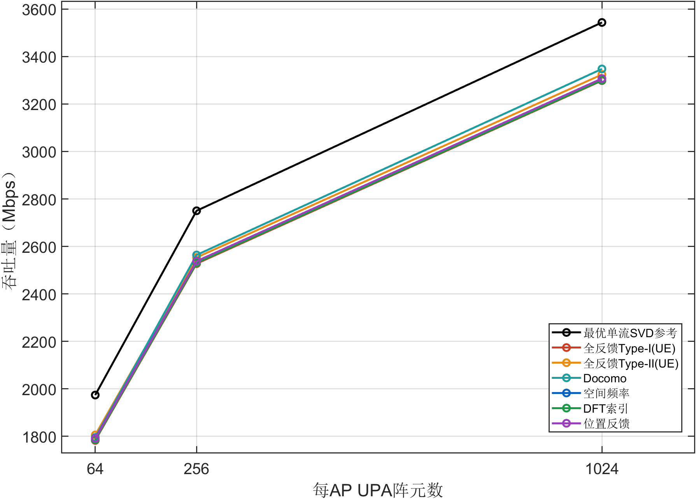

结果：位置反馈在横轴64时为1791.07 Mbps，在1024时为3307.26 Mbps。其他参数保持默认值；结论限于当前冻结部署。 纵轴根据本图所有曲线的最小值和最大值留少量余量，未改变数据。

**UE单流纯LOS吞吐量与莱斯因子K**

横轴为莱斯因子K，纵轴为吞吐量（Mbps）。

| 方法 | 0 | 5 | 10 | 15 | 20 |
|---|---|---|---|---|---|
| SVD参考 | 3531.25 | 3531.25 | 3531.25 | 3531.25 | 3531.25 |
| 全反馈Type-I(UE) | 3359.60 | 3359.60 | 3359.60 | 3359.60 | 3359.60 |
| 全反馈Type-II(UE) | 3362.89 | 3362.89 | 3362.89 | 3362.89 | 3362.89 |
| Docomo | 3399.96 | 3399.96 | 3399.96 | 3399.96 | 3399.96 |
| 空间频率 | 3361.83 | 3361.83 | 3361.83 | 3361.83 | 3361.83 |
| DFT索引 | 3354.76 | 3354.76 | 3354.76 | 3354.76 | 3354.76 |
| 位置反馈 | 3361.81 | 3361.81 | 3361.81 | 3361.81 | 3361.81 |

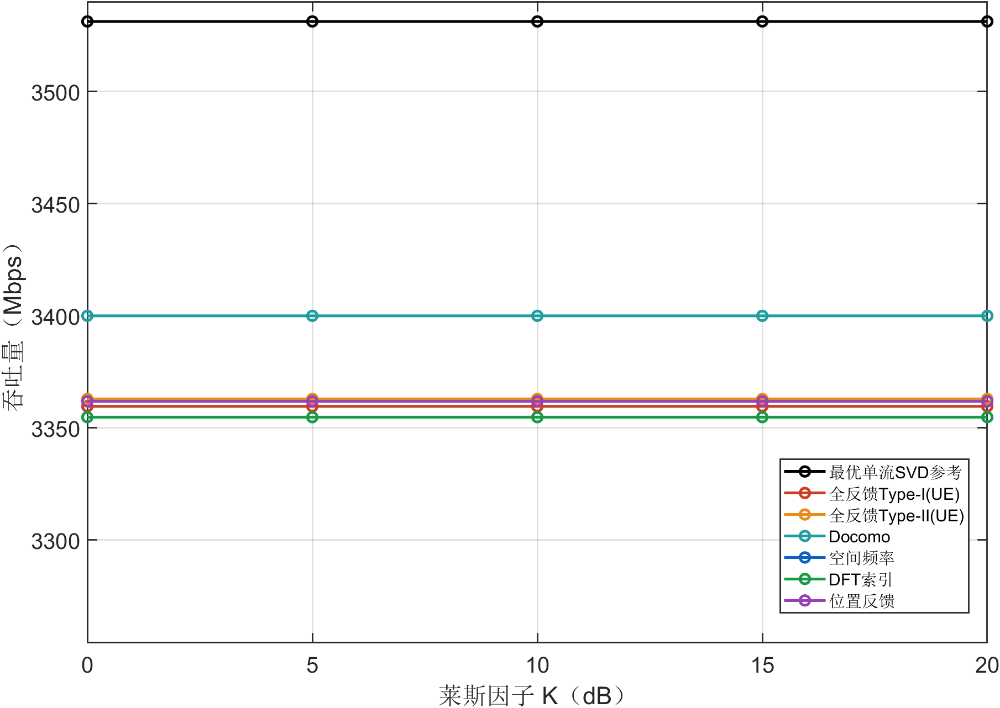

结果：位置反馈在横轴0时为3361.81 Mbps，在20时为3361.81 Mbps。纯LOS不使用K，平线仅作一致性对照；MIX的K扫描才改变LOS和散射比例。 纵轴根据本图所有曲线的最小值和最大值留少量余量，未改变数据。

**UE单流混合信道吞吐量与莱斯因子K**

横轴为莱斯因子K，纵轴为吞吐量（Mbps）。

| 方法 | 0 | 5 | 10 | 15 | 20 |
|---|---|---|---|---|---|
| SVD参考 | 3706.52 | 3597.27 | 3543.54 | 3532.66 | 3531.42 |
| 全反馈Type-I(UE) | 3292.99 | 3263.52 | 3298.51 | 3331.95 | 3348.58 |
| 全反馈Type-II(UE) | 3433.49 | 3345.88 | 3324.28 | 3336.10 | 3348.30 |
| Docomo | 3143.30 | 3252.61 | 3347.72 | 3382.88 | 3394.78 |
| 空间频率 | 2859.10 | 3197.93 | 3307.27 | 3346.03 | 3357.99 |
| DFT索引 | 2950.47 | 3191.72 | 3300.25 | 3338.85 | 3350.96 |
| 位置反馈 | 2664.11 | 3197.80 | 3307.26 | 3346.11 | 3357.97 |

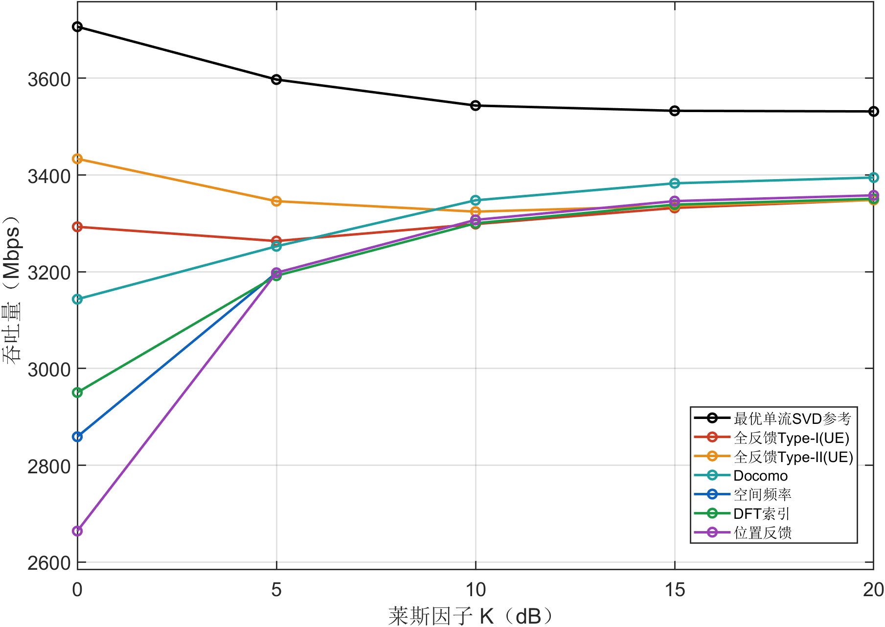

结果：位置反馈在横轴0时为2664.11 Mbps，在20时为3357.97 Mbps。其他参数保持默认值；结论限于当前冻结部署。 纵轴根据本图所有曲线的最小值和最大值留少量余量，未改变数据。

### 3.3 比特数与AP数目

横轴为协作AP数，纵轴为每次更新反馈有效载荷（bit）。长度规则不依赖信道类型，LOS与MIX相同；表内保留5至10 AP，图中仅显示整数5至9。

| 方法 | 5 | 6 | 7 | 8 | 9 | 10 |
|---|---|---|---|---|---|---|
| 全反馈Type-I(UE) | 86 | 104 | 122 | 140 | 158 | 176 |
| 全反馈Type-II(UE) | 181 | 218 | 255 | 292 | 329 | 366 |
| Docomo | 81 | 97 | 113 | 129 | 146 | 162 |
| 空间频率 | 100 | 104 | 108 | 112 | 116 | 120 |
| DFT索引 | 58 | 62 | 66 | 70 | 74 | 78 |
| 位置反馈 | 52 | 56 | 60 | 64 | 68 | 72 |

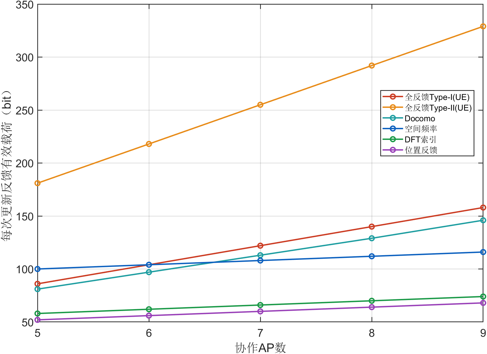

结果：CPU三种几何方法始终为84、42、36 bit。CPU图中的Type-I、Type-II和Docomo为完整UE消息的共享参考；不能将其计为CPU独立算法。UE几何方案还包含4(B−1) bit第一相位。空间消息固定三个参考AP，所以CPU几何开销不随协作AP数增加。

## 4 额外补充

补充实验也使用当前SNR范围。单流定位前端的量化与越界诊断单独列出；双流补充逐位置增量、第二模式以及默认配置分布。

### 4.1 固定8个协作AP的定位参考数扫描

本实验固定协作AP总数B=8，横轴改为参与定位的参考／反馈AP数R=3、4、5、6、7、8。采用全部400个冻结位置、每AP32×32单极化UPA、观测SNR 30 dB；LOS与MIX分别运行，MIX的K=10 dB。原正文中固定R=3、改变协作AP总数的实验完整保留，二者是不同自变量。

每个位置与信道只生成一次完整8 AP观测，8个AP的连续空间频率及DFT方向索引各估计一次。按预先公开的活动AP顺序取前R个，形成嵌套集合，各R共用同一份观测及固定噪声方差；不按结果选择AP，也不重新生成噪声。

| 参考／反馈AP数R | 物理AP编号 |
|---|---|
| 3 | 1,2,3 |
| 4 | 1,2,3,6 |
| 5 | 1,2,3,6,8 |
| 6 | 1,2,3,6,8,4 |
| 7 | 1,2,3,6,8,4,5 |
| 8 | 1,2,3,6,8,4,5,7 |

空间频率与DFT索引实际打包R个AP的方向整数，CPU解码后定位。位置反馈则由UE用R个AP的连续频率直接定位，再按13/14/9 bit只量化一次坐标；R增加不表示反馈R份位置。所有方法均由整数消息独立恢复用于评价的坐标。

单流的定位来自共用空间前端，与流数和共相位的计算端无关。因此本节CPU、UE及另一份流数报告共用同一份物理定位记录，不把重复展示当作独立试验；增加第二流不增加定位观测。该实验采用LOC_REF_SWEEP_V1定位消息，未将原SSTR_V2的完整预编码协议从R=3改为R=8，不据此给出新增吞吐量结论。

**CPU单流纯LOS定位误差与定位参考AP数**

纵轴为400位置平均定位误差（m），横轴为整数R，协作AP总数始终为8。

| 方法 | 3 | 4 | 5 | 6 | 7 | 8 |
|---|---|---|---|---|---|---|
| 空间频率 | 0.001940 | 0.001701 | 0.001665 | 0.001609 | 0.001514 | 0.001260 |
| DFT索引 | 0.232083 | 0.209027 | 0.193461 | 0.176769 | 0.152713 | 0.134888 |
| 位置反馈 | 0.003723 | 0.003695 | 0.003725 | 0.003742 | 0.003764 | 0.003648 |

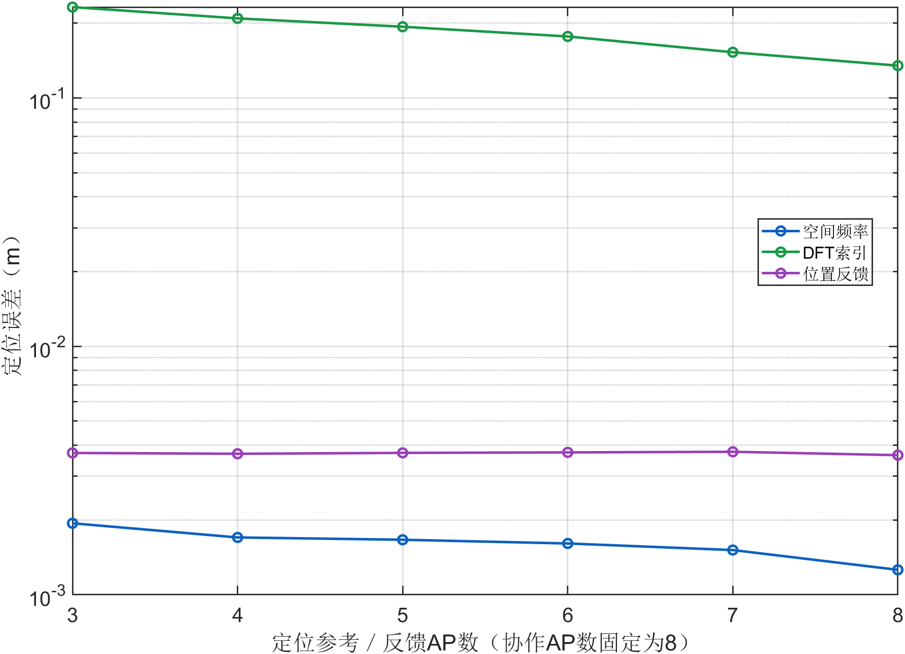

结果：位置反馈从R=3的0.003723 m变为R=8的0.003648 m，均值变化对应降幅2.02%。CPU与UE位置结果一致，反映共用定位消息，不代表相位设计和吞吐量也相同。

**CPU单流混合信道定位误差与定位参考AP数**

纵轴为400位置平均定位误差（m），横轴为整数R，协作AP总数始终为8。

| 方法 | 3 | 4 | 5 | 6 | 7 | 8 |
|---|---|---|---|---|---|---|
| 空间频率 | 0.008532 | 0.008317 | 0.008751 | 0.008940 | 0.006708 | 0.006004 |
| DFT索引 | 0.235091 | 0.212181 | 0.198531 | 0.181151 | 0.154409 | 0.136136 |
| 位置反馈 | 0.009490 | 0.009269 | 0.009667 | 0.009787 | 0.007772 | 0.007140 |

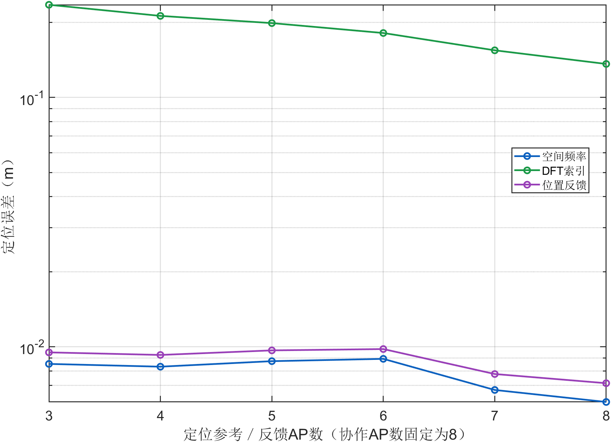

结果：位置反馈从R=3的0.009490 m变为R=8的0.007140 m，均值变化对应降幅24.77%。CPU与UE位置结果一致，反映共用定位消息，不代表相位设计和吞吐量也相同。

**UE单流纯LOS定位误差与定位参考AP数**

纵轴为400位置平均定位误差（m），横轴为整数R，协作AP总数始终为8。

| 方法 | 3 | 4 | 5 | 6 | 7 | 8 |
|---|---|---|---|---|---|---|
| 空间频率 | 0.001940 | 0.001701 | 0.001665 | 0.001609 | 0.001514 | 0.001260 |
| DFT索引 | 0.232083 | 0.209027 | 0.193461 | 0.176769 | 0.152713 | 0.134888 |
| 位置反馈 | 0.003723 | 0.003695 | 0.003725 | 0.003742 | 0.003764 | 0.003648 |

结果：位置反馈从R=3的0.003723 m变为R=8的0.003648 m，均值变化对应降幅2.02%。CPU与UE位置结果一致，反映共用定位消息，不代表相位设计和吞吐量也相同。

**UE单流混合信道定位误差与定位参考AP数**

纵轴为400位置平均定位误差（m），横轴为整数R，协作AP总数始终为8。

| 方法 | 3 | 4 | 5 | 6 | 7 | 8 |
|---|---|---|---|---|---|---|
| 空间频率 | 0.008532 | 0.008317 | 0.008751 | 0.008940 | 0.006708 | 0.006004 |
| DFT索引 | 0.235091 | 0.212181 | 0.198531 | 0.181151 | 0.154409 | 0.136136 |
| 位置反馈 | 0.009490 | 0.009269 | 0.009667 | 0.009787 | 0.007772 | 0.007140 |

结果：位置反馈从R=3的0.009490 m变为R=8的0.007140 m，均值变化对应降幅24.77%。CPU与UE位置结果一致，反映共用定位消息，不代表相位设计和吞吐量也相同。

**从3个到8个参考AP的收益与限制**

| 信道 | 方法 | R=3均值 mm | R=8均值 mm | 均值降幅 % | 逐位置改善 % |
|---|---|---|---|---|---|
| 纯LOS | 空间频率 | 1.940 | 1.260 | 35.05 | 73.50 |
| 纯LOS | DFT索引 | 232.083 | 134.888 | 41.88 | 77.75 |
| 纯LOS | 位置反馈 | 3.723 | 3.648 | 2.02 | 51.25 |
| 混合信道 | 空间频率 | 8.532 | 6.004 | 29.63 | 60.25 |
| 混合信道 | DFT索引 | 235.091 | 136.136 | 42.09 | 79.00 |
| 混合信道 | 位置反馈 | 9.490 | 7.140 | 24.77 | 58.75 |

增加参考AP同时增加了方向观测并改变射线的空间几何。当前定位仍使用原无权重射线最小二乘，未调整AP选择、权重或频率估计器；加入一个AP不保证每个位置或每个中间R点都改善。表中同时给出逐位置严格改善比例，全部位置保留，不将平均降幅解释为逐位置保证。此结论仅对应预先固定的嵌套AP顺序。

**位置反馈的连续定位与坐标量化**

| 信道 纯LOS | 连续误差 mm | 解码误差 mm | 中位误差 mm | 95%分位 mm |
|---|---|---|---|---|
| R=3 | 0.852 | 3.723 | 3.514 | 6.621 |
| R=4 | 0.804 | 3.695 | 3.475 | 6.612 |
| R=5 | 0.917 | 3.725 | 3.482 | 6.656 |
| R=6 | 0.939 | 3.742 | 3.496 | 6.676 |
| R=7 | 0.995 | 3.764 | 3.546 | 6.622 |
| R=8 | 0.690 | 3.648 | 3.475 | 6.639 |

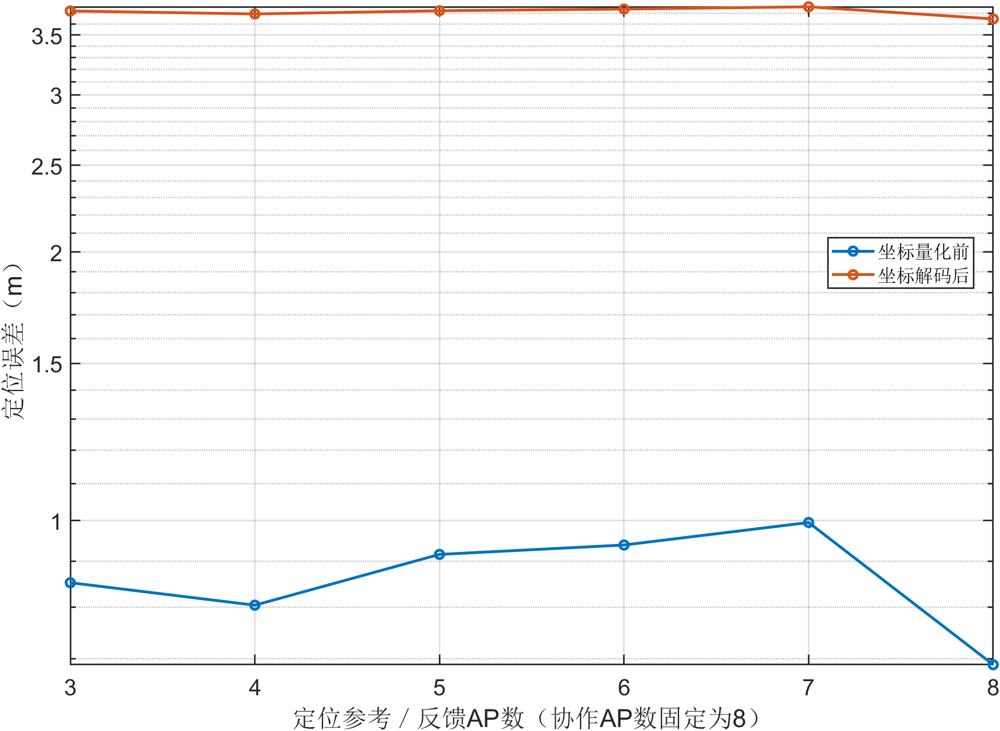

结果：连续定位与量化后位置分开统计，固定坐标量化会影响参考AP增加带来的最终收益；这里始终是连续频率定位后只量化一次坐标。

| 信道 混合信道 | 连续误差 mm | 解码误差 mm | 中位误差 mm | 95%分位 mm |
|---|---|---|---|---|
| R=3 | 8.249 | 9.490 | 7.115 | 26.279 |
| R=4 | 8.075 | 9.269 | 7.283 | 25.232 |
| R=5 | 8.563 | 9.667 | 7.674 | 24.590 |
| R=6 | 8.800 | 9.787 | 7.897 | 23.808 |
| R=7 | 6.589 | 7.772 | 7.065 | 16.716 |
| R=8 | 5.871 | 7.140 | 6.537 | 13.332 |

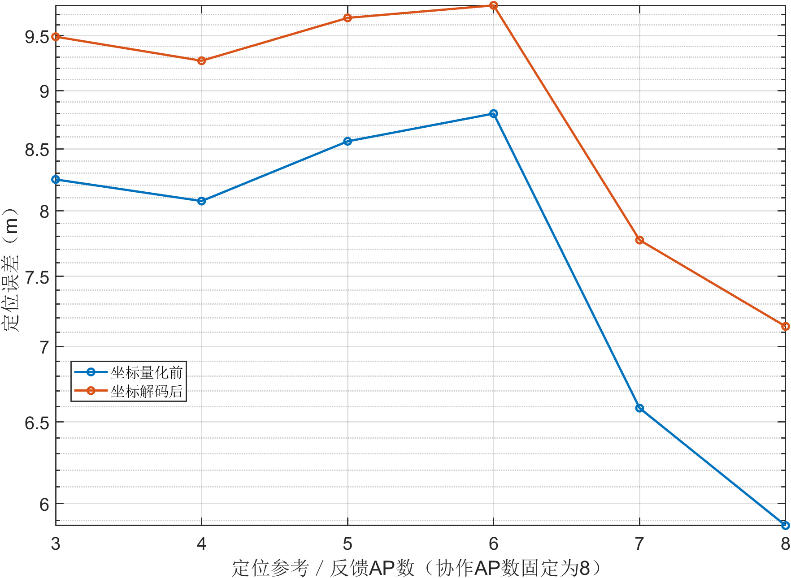

结果：连续定位与量化后位置分开统计，固定坐标量化会影响参考AP增加带来的最终收益；这里始终是连续频率定位后只量化一次坐标。

**仅空间消息的反馈量**

| 方法 | R=3 | R=4 | R=5 | R=6 | R=7 | R=8 |
|---|---|---|---|---|---|---|
| 空间频率 | 84 | 112 | 140 | 168 | 196 | 224 |
| DFT索引 | 42 | 56 | 70 | 84 | 98 | 112 |
| 位置反馈 | 36 | 36 | 36 | 36 | 36 | 36 |

单位为bit，仅统计本定位实验的空间消息；不含相位、公共配置头和FEC。位置反馈只发送一份36 bit坐标，方向消息则随R增加。更多参考AP的观测、计算与导频成本未纳入该bit表，不能据36 bit不变认定其没有其他代价。正文原完整通信开销实验不被此表替换。

独立恢复全部14,400条物理定位记录，重算均值、中位数和95%分位。R=3与当前400位置正式结果的2,400条位置误差对齐，最大差8.02e-14 m；原32位置预实验全部R值的1,152条消息与误差也对齐。

[本补充实验的数据、配置、整数消息和复现命令](../results/reference_ap_full400_20261025/README.md)。

### CPU纯LOS频谱效率与观测SNR

| 方法 | -20 | -15 | -10 | -5 | 0 | 5 | 10 | 15 | 20 |
|---|---|---|---|---|---|---|---|---|---|
| SVD参考 | 8.8281 | 8.8281 | 8.8281 | 8.8281 | 8.8281 | 8.8281 | 8.8281 | 8.8281 | 8.8281 |
| 全反馈Type-I(UE) | 7.1858 | 8.0577 | 8.3395 | 8.3912 | 8.3994 | 8.4093 | 8.4034 | 8.4018 | 8.4012 |
| 全反馈Type-II(UE) | 6.6960 | 7.7733 | 8.1948 | 8.3218 | 8.3697 | 8.3970 | 8.4044 | 8.4080 | 8.4092 |
| Docomo(UE) | 7.5416 | 8.3137 | 8.4694 | 8.4874 | 8.4976 | 8.4989 | 8.5000 | 8.4997 | 8.5000 |
| 空间频率 | 7.1294 | 7.5777 | 7.6300 | 7.6491 | 7.7185 | 7.8002 | 8.0163 | 8.2289 | 8.3278 |
| DFT索引 | 6.2834 | 7.3349 | 7.3929 | 7.3893 | 7.3852 | 7.3907 | 7.4013 | 7.4049 | 7.4131 |
| 位置反馈 | 6.4580 | 7.5834 | 7.6395 | 7.6575 | 7.7283 | 7.7975 | 8.0265 | 8.2525 | 8.3521 |

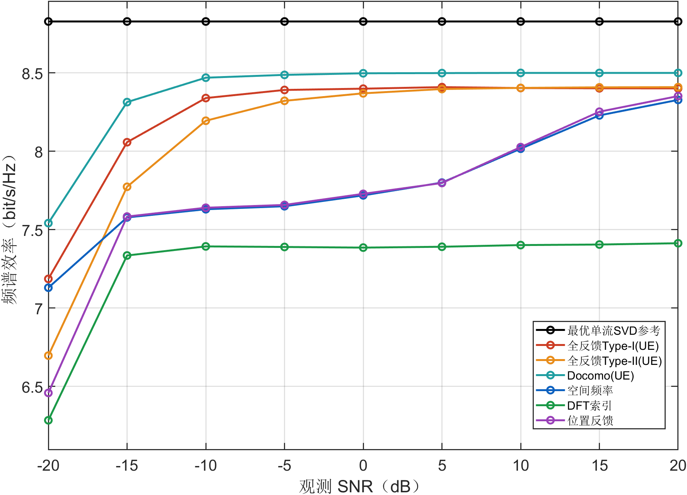

结果：逐点满足吞吐量Mbps=400×频谱效率，横轴使用−20至20 dB、间隔5 dB。

### CPU纯LOS位置反馈坐标量化前后

| 观测SNR dB | 量化前误差 m | 解码后误差 m |
|---|---|---|
| -20 | 3.048214 | 1.808583 |
| -10 | 0.070312 | 0.070440 |
| 0 | 0.022109 | 0.022458 |
| 10 | 0.006984 | 0.008063 |
| 20 | 0.002238 | 0.004417 |
| 30 | 0.000852 | 0.003723 |
| 40 | 0.000587 | 0.003634 |

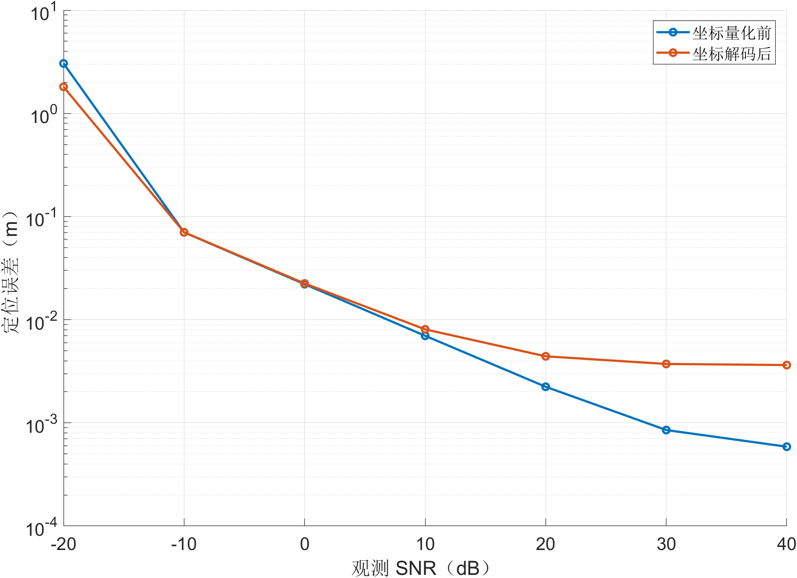

结果：先连续频率定位、再量化坐标一次。低SNR下坐标区域截断可使平均欧氏误差降低，包含公开区域先验，不表示量化提高定位算法精度。CPU与UE使用同一空间消息，因此此处诊断相同。

### CPU纯LOS坐标量化越界与莱斯因子

| K dB | 连续误差 m | 解码误差 m | 越界比例 % |
|---|---|---|---|
| 0 | 0.000852 | 0.003723 | 0.00 |
| 5 | 0.000852 | 0.003723 | 0.00 |
| 10 | 0.000852 | 0.003723 | 0.00 |
| 15 | 0.000852 | 0.003723 | 0.00 |
| 20 | 0.000852 | 0.003723 | 0.00 |

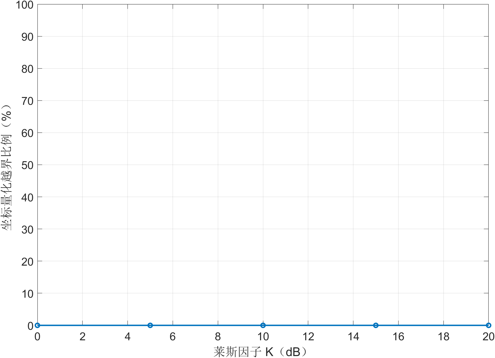

结果：本组最大越界比例为0.00%，全部位置保留；越界坐标按原公共量化区域截断。

### CPU混合信道频谱效率与观测SNR

| 方法 | -20 | -15 | -10 | -5 | 0 | 5 | 10 | 15 | 20 |
|---|---|---|---|---|---|---|---|---|---|
| SVD参考 | 8.8588 | 8.8588 | 8.8588 | 8.8588 | 8.8588 | 8.8588 | 8.8588 | 8.8588 | 8.8588 |
| 全反馈Type-I(UE) | 6.9504 | 7.9066 | 8.2016 | 8.2541 | 8.2452 | 8.2443 | 8.2470 | 8.2456 | 8.2472 |
| 全反馈Type-II(UE) | 6.4417 | 7.6041 | 8.1032 | 8.2796 | 8.3034 | 8.3084 | 8.3096 | 8.3102 | 8.3097 |
| Docomo(UE) | 7.3060 | 8.1456 | 8.3368 | 8.3571 | 8.3636 | 8.3669 | 8.3688 | 8.3698 | 8.3700 |
| 空间频率 | 6.8383 | 7.4576 | 7.4490 | 7.5350 | 7.6039 | 7.6334 | 7.7803 | 7.8772 | 7.9282 |
| DFT索引 | 6.0075 | 7.2212 | 7.2562 | 7.2625 | 7.2767 | 7.2791 | 7.2802 | 7.2796 | 7.2808 |
| 位置反馈 | 5.8749 | 7.4582 | 7.4383 | 7.5508 | 7.6127 | 7.6262 | 7.7798 | 7.9009 | 7.9454 |

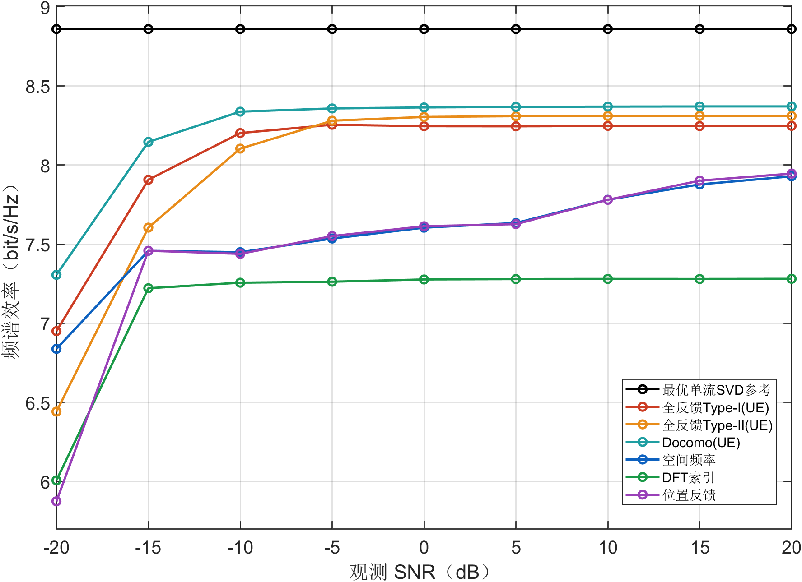

结果：逐点满足吞吐量Mbps=400×频谱效率，横轴使用−20至20 dB、间隔5 dB。

### CPU混合信道位置反馈坐标量化前后

| 观测SNR dB | 量化前误差 m | 解码后误差 m |
|---|---|---|
| -20 | 4.345806 | 2.509786 |
| -10 | 0.074408 | 0.074379 |
| 0 | 0.024987 | 0.025191 |
| 10 | 0.011285 | 0.012117 |
| 20 | 0.008588 | 0.009745 |
| 30 | 0.008249 | 0.009490 |
| 40 | 0.008219 | 0.009432 |

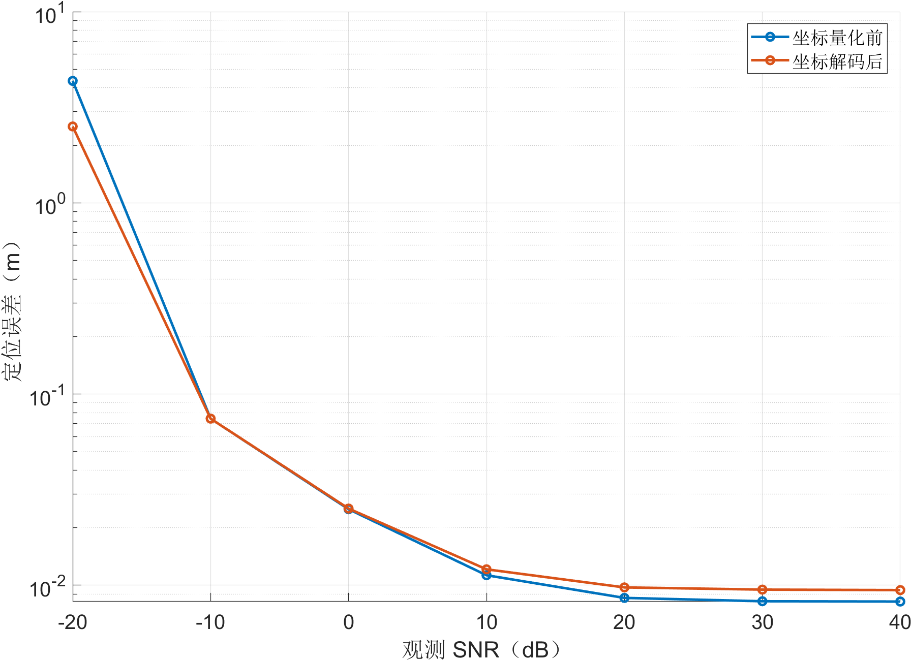

结果：先连续频率定位、再量化坐标一次。低SNR下坐标区域截断可使平均欧氏误差降低，包含公开区域先验，不表示量化提高定位算法精度。CPU与UE使用同一空间消息，因此此处诊断相同。

### CPU混合信道坐标量化越界与莱斯因子

| K dB | 连续误差 m | 解码误差 m | 越界比例 % |
|---|---|---|---|
| 0 | 2.139687 | 1.288964 | 15.00 |
| 5 | 0.014612 | 0.015313 | 0.00 |
| 10 | 0.008249 | 0.009490 | 0.00 |
| 15 | 0.004710 | 0.006290 | 0.00 |
| 20 | 0.002762 | 0.004884 | 0.00 |

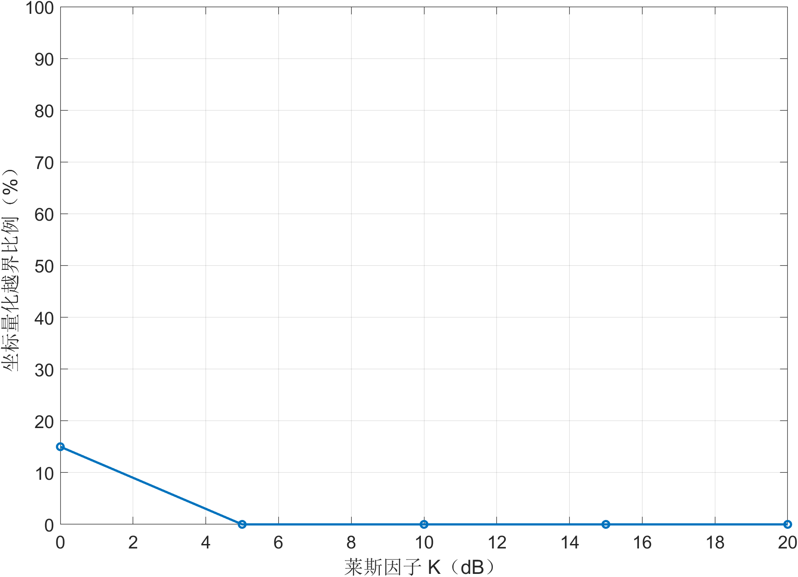

结果：本组最大越界比例为15.00%，全部位置保留；越界坐标按原公共量化区域截断。

### CPU坐标bit分配

| 坐标 | bit | 位置是否改变分配 |
|---|---|---|
| x | 13 | 否 |
| y | 14 | 否 |
| z | 9 | 否 |

结果：按公共几何的相对AP相位敏感度固定分配13/14/9 bit，总计36 bit。LOS和MIX、单双流均相同，不用未知真实位置在线调整。图中真实x只用于展示，图沿用原冻结分配检查。

### UE纯LOS频谱效率与观测SNR

| 方法 | -20 | -15 | -10 | -5 | 0 | 5 | 10 | 15 | 20 |
|---|---|---|---|---|---|---|---|---|---|
| SVD参考 | 8.8281 | 8.8281 | 8.8281 | 8.8281 | 8.8281 | 8.8281 | 8.8281 | 8.8281 | 8.8281 |
| 全反馈Type-I(UE) | 7.1858 | 8.0577 | 8.3395 | 8.3912 | 8.3994 | 8.4093 | 8.4034 | 8.4018 | 8.4012 |
| 全反馈Type-II(UE) | 6.6960 | 7.7733 | 8.1948 | 8.3218 | 8.3697 | 8.3970 | 8.4044 | 8.4080 | 8.4092 |
| Docomo | 7.5416 | 8.3137 | 8.4694 | 8.4874 | 8.4976 | 8.4989 | 8.5000 | 8.4997 | 8.5000 |
| 空间频率 | 7.8689 | 8.4061 | 8.4571 | 8.4567 | 8.4366 | 8.4229 | 8.4115 | 8.4078 | 8.4051 |
| DFT索引 | 6.8087 | 8.3514 | 8.4392 | 8.4394 | 8.4175 | 8.4048 | 8.3930 | 8.3898 | 8.3877 |
| 位置反馈 | 7.1797 | 8.4078 | 8.4581 | 8.4570 | 8.4365 | 8.4230 | 8.4114 | 8.4077 | 8.4051 |

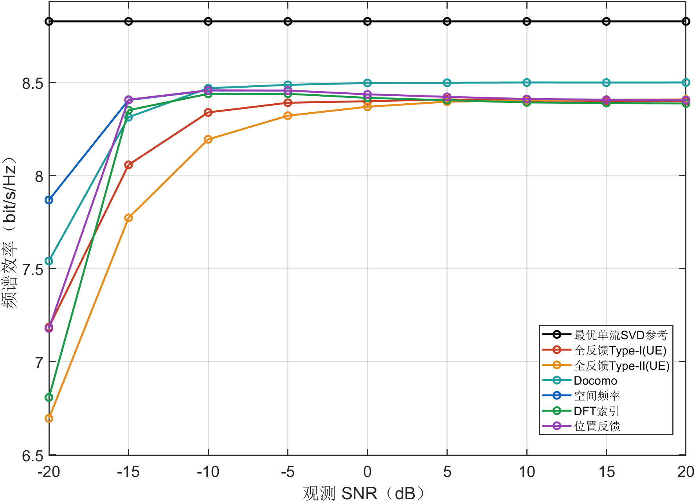

结果：逐点满足吞吐量Mbps=400×频谱效率，横轴使用−20至20 dB、间隔5 dB。

### UE纯LOS位置反馈坐标量化前后

| 观测SNR dB | 量化前误差 m | 解码后误差 m |
|---|---|---|
| -20 | 3.048214 | 1.808583 |
| -10 | 0.070312 | 0.070440 |
| 0 | 0.022109 | 0.022458 |
| 10 | 0.006984 | 0.008063 |
| 20 | 0.002238 | 0.004417 |
| 30 | 0.000852 | 0.003723 |
| 40 | 0.000587 | 0.003634 |

结果：先连续频率定位、再量化坐标一次。低SNR下坐标区域截断可使平均欧氏误差降低，包含公开区域先验，不表示量化提高定位算法精度。CPU与UE使用同一空间消息，因此此处诊断相同。

### UE纯LOS坐标量化越界与莱斯因子

| K dB | 连续误差 m | 解码误差 m | 越界比例 % |
|---|---|---|---|
| 0 | 0.000852 | 0.003723 | 0.00 |
| 5 | 0.000852 | 0.003723 | 0.00 |
| 10 | 0.000852 | 0.003723 | 0.00 |
| 15 | 0.000852 | 0.003723 | 0.00 |
| 20 | 0.000852 | 0.003723 | 0.00 |

结果：本组最大越界比例为0.00%，全部位置保留；越界坐标按原公共量化区域截断。

### UE混合信道频谱效率与观测SNR

| 方法 | -20 | -15 | -10 | -5 | 0 | 5 | 10 | 15 | 20 |
|---|---|---|---|---|---|---|---|---|---|
| SVD参考 | 8.8588 | 8.8588 | 8.8588 | 8.8588 | 8.8588 | 8.8588 | 8.8588 | 8.8588 | 8.8588 |
| 全反馈Type-I(UE) | 6.9504 | 7.9066 | 8.2016 | 8.2541 | 8.2452 | 8.2443 | 8.2470 | 8.2456 | 8.2472 |
| 全反馈Type-II(UE) | 6.4417 | 7.6041 | 8.1032 | 8.2796 | 8.3034 | 8.3084 | 8.3096 | 8.3102 | 8.3097 |
| Docomo | 7.3060 | 8.1456 | 8.3368 | 8.3571 | 8.3636 | 8.3669 | 8.3688 | 8.3698 | 8.3700 |
| 空间频率 | 7.5033 | 8.2665 | 8.3147 | 8.3014 | 8.2796 | 8.2747 | 8.2712 | 8.2700 | 8.2690 |
| DFT索引 | 6.4831 | 8.1863 | 8.2970 | 8.2851 | 8.2621 | 8.2573 | 8.2539 | 8.2521 | 8.2512 |
| 位置反馈 | 6.5119 | 8.2696 | 8.3150 | 8.3018 | 8.2795 | 8.2743 | 8.2711 | 8.2702 | 8.2690 |

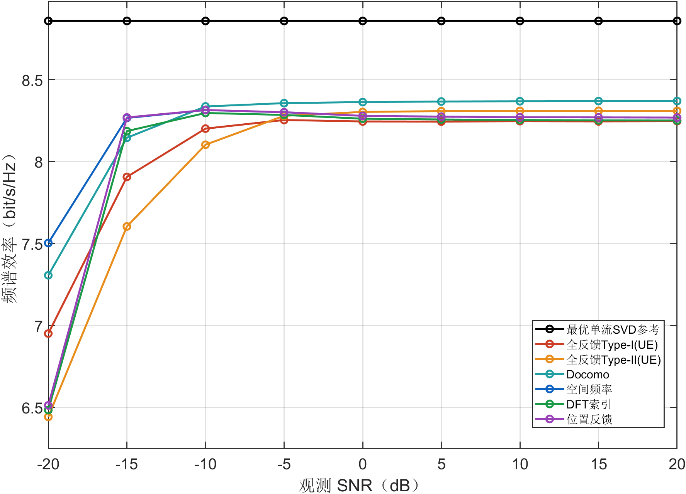

结果：逐点满足吞吐量Mbps=400×频谱效率，横轴使用−20至20 dB、间隔5 dB。

### UE混合信道位置反馈坐标量化前后

| 观测SNR dB | 量化前误差 m | 解码后误差 m |
|---|---|---|
| -20 | 4.345806 | 2.509786 |
| -10 | 0.074408 | 0.074379 |
| 0 | 0.024987 | 0.025191 |
| 10 | 0.011285 | 0.012117 |
| 20 | 0.008588 | 0.009745 |
| 30 | 0.008249 | 0.009490 |
| 40 | 0.008219 | 0.009432 |

结果：先连续频率定位、再量化坐标一次。低SNR下坐标区域截断可使平均欧氏误差降低，包含公开区域先验，不表示量化提高定位算法精度。CPU与UE使用同一空间消息，因此此处诊断相同。

### UE混合信道坐标量化越界与莱斯因子

| K dB | 连续误差 m | 解码误差 m | 越界比例 % |
|---|---|---|---|
| 0 | 2.139687 | 1.288964 | 15.00 |
| 5 | 0.014612 | 0.015313 | 0.00 |
| 10 | 0.008249 | 0.009490 | 0.00 |
| 15 | 0.004710 | 0.006290 | 0.00 |
| 20 | 0.002762 | 0.004884 | 0.00 |

结果：本组最大越界比例为15.00%，全部位置保留；越界坐标按原公共量化区域截断。

### UE坐标bit分配

| 坐标 | bit | 位置是否改变分配 |
|---|---|---|
| x | 13 | 否 |
| y | 14 | 否 |
| z | 9 | 否 |

结果：按公共几何的相对AP相位敏感度固定分配13/14/9 bit，总计36 bit。LOS和MIX、单双流均相同，不用未知真实位置在线调整。图中真实x只用于展示，图沿用原冻结分配检查。

## 5 实现过程与数据复现

先按两类SNR范围的并集确定11个SNR点。已有20、30、40 dB直接复用原物理案例；新增−20、−15、−10、−5、0、5、10、15 dB，保持原信道、噪声种子、码本、第一相位、第二相位优化及整数消息规则。阵元数、AP数、K扫描复用原案例；单流LOS使用同一案例保存的第一流结果。

新增案例先在原MATLAB环境运行，再由独立Python程序解码比特串、重建真实有效信道、核对功率、发送签名、MMSE速率、第二模式及均值。连续第二相位在跨实现浮点边界处有分歧的记录逐条保留，并在原生解码器中仅凭公共几何和整数消息严格重放。定位指标独立从空间前缀恢复；另外重新计算连续位置诊断并与保存的解码位置逐条对齐。

原单流MIX重叠配置共核对61,600条，最大吞吐量差1e-11 Mbps。坐标诊断与消息解码核对24,000条，最大误差差值5.15e-14 m。SVD随观测SNR不变、纯LOS随K不变及全部曲线组400位置均通过检查。

[数据、配置来源及运行命令](../results/upa_snr_revision400_20261025/README.md)。原400位置数据、原小样本SNR预实验和固定8 AP参考数预实验继续保留；本次正式报告替换原报告同名入口，所有新图使用独立版本路径避免缓存。

位置反馈的完整通信协议仍固定三个定位参考AP；固定B=8、R=3至8的400位置定位诊断列为本报告补充第一个实验，独立保存数据，不覆盖原协作AP数扫描。观测SNR提高不能消除离散反馈和模型误差，双流也不保证每个位置或每个低SNR配置都比单流更好。Word与Markdown由同一内容生成；按用户要求Word不追加检查。
