# UPA单极化单流正式实验报告

2026年10月23日。已完成400个冻结位置的UPA单极化单流扫描，共98,800条记录，包含19个曲线标签、16个不同物理配置。所有有限反馈消息、数值指标和汇总均值均经独立Python程序核验。CPU与UE分别报告，双流结果另见专门报告。

2026年10月24日补齐全部22幅实验图、对应逐点数值和结论，实验数据不变。最新单流与双流统一在feat/upa-single-dual-complete-20261024维护，后续修改继续使用该分支。

## 实验范围与评价口径

| 项目 | 设置 |
|---|---|
| AP与UE | 默认8个AP，每AP32×32单极化UPA，UE有4个接收阵元 |
| 阵列扫描 | 每AP8×8、16×16、32×32 |
| AP扫描 | 5至10个AP |
| 信道 | 正式单流扫描为LOS加散射多径的混合信道 |
| 观测SNR扫描 | 20至40 dB，间隔5 dB；默认30 dB |
| 莱斯因子扫描 | 0至20 dB，间隔5 dB；默认10 dB |
| 位置 | 同一冻结样本库的1至400，全部保留 |
| 主参考 | 无信道估计噪声的真实信道直接SVD，使用第一右奇异向量 |
| 功率与速率 | 总功率1，可实施方案每AP功率1/B；Mbps等于400乘频谱效率 |

真实信道包含实际LOS与散射传播，无额外的信道估计噪声；观测信道是在其上添加估计噪声。普通方法只用观测CSI设计，真实信道仅供评价。数据噪声通过固定数据链路rho体现，不因“完美CSI”而消失。SVD是总功率约束下的最优单流上界，放松每AP等功率限制。

400 MHz仅直接换算，不引入OFDM或带宽相关噪声重标定。同算法观测与完美CSI配对仅为此前小样本补充，未扩入正式主扫描。

19个标签分别服务SNR、阵元数、AP数和K曲线，默认配置重复四次。程序缓存重复默认点，因此实际计算16个物理配置共6,400个位置与配置案例；按曲线标签展开为7,600个案例，不将重复标签当成新样本。

## 方法与实现过程

Type-I从联合观测信道的主右奇异向量按AP分块匹配二维DFT波束。Type-II在同一正交分组内选两条，组合幅度3 bit、内部相位2 bit。普通五种UE方法统一采用主模式投影，将首AP相位固定0后，对其余相对相位量化4 bit。

位置反馈由连续空间频率在UE定位，然后仅量化一次坐标，固定13/14/9 bit。UE按CPU同样的解码规则恢复波束，再用观测CSI计算共相位。CPU则只凭空间消息和公共几何重构模型并计算相位，不接收参考AP完整观测信道。上述核心口径此前已在第5、第6目录建立，本轮是恢复新增单流入口的一致性并补齐完整消息重放。

每个方法实际打包整数比特串，再由CPU独立恢复最终发送向量。统计有效载荷，不含预先共享的方法配置、传输头和FEC；JSON仅用于审计，不按JSON文本长度计费。

## Docomo实现与验证

依据Li、Hou、Chen的Near-Field Line-of-Sight MIMO Precoding with Distributed Antennas，IEEE PIMRC 2024，第IV节式25至27和第V节。保留每AP本地DFT波束、QPSK共相位和跨AP模式的分块结构。当前不规则AP使用公开顺序的一维逻辑DFT，固定单极化单流、项目码本和三轮坐标更新；不称为完整论文复现。论文的Type-I是NCJT，当前项目Type-I含共相位，两者名称相近但定义不同。

Docomo专项48项检查通过，覆盖三种UPA、B为4/8/10的9个随机案例及6个物理LOS或混合信道案例。交替更新观测目标不下降，解码重建误差0。B=4时固定本地波束，枚举256种相位与模式组合；三个随机案例与枚举最优值一致，但不证明联合波束全局最优。701项协议检查和此前42项UPA及位置反馈检查仍通过。

默认Docomo反馈129 bit，由本地索引、QPSK beta和AP模式索引实际编码得到，不能套用论文特定场景的26 bit。

## CPU单流结果

下表为默认配置的400位置均值，列出CPU三种几何方法和Docomo(UE)共享参考。

| 方法 | 平均吞吐量 Mbps | 定位误差 m | 反馈 bit |
|---|---:|---:|---:|
| 空间频率 | 3177.396 | 0.008532 | 84 |
| DFT索引 | 2909.626 | 0.235091 | 42 |
| 位置反馈 | 3184.002 | 0.009490 | 36 |
| Docomo(UE) | 3347.721 | 不适用 | 129 |

位置反馈以36 bit获得3184.002 Mbps，空间频率反馈以84 bit获得3177.396 Mbps，当前默认点两者速率相近。位置误差略大并不必然导致更低速率，因为坐标量化按相对相位敏感度分配，定位欧氏误差不是唯一性能因素。DFT索引定位误差较大，对CPU几何共相位的影响更明显。

CPU图中的全反馈Type-I(UE)、全反馈Type-II(UE)和Docomo(UE)均为UE计算的共享参考。默认均值分别为3298.510、3324.283和3347.721 Mbps；理想单流SVD为3543.540 Mbps。Docomo(UE)反馈129 bit，结果直接复用UE数据，不新增CPU算法或样本。定位误差图只列有位置输出的三种几何方法。


## UE单流结果

下表同样为默认配置的400位置均值；几何位置仍来自带噪观测，不是完美CSI输入。

| 方法 | 平均吞吐量 Mbps | 定位误差 m | 反馈 bit |
|---|---:|---:|---:|
| 全反馈Type-I(UE) | 3298.510 | 不适用 | 140 |
| 全反馈Type-II(UE) | 3324.283 | 不适用 | 292 |
| Docomo | 3347.721 | 不适用 | 129 |
| 空间频率 | 3307.265 | 0.008532 | 112 |
| DFT索引 | 3300.250 | 0.235091 | 70 |
| 位置反馈 | 3307.261 | 0.009490 | 64 |

位置反馈与空间频率默认平均速率分别为3307.261和3307.265 Mbps，而反馈64与112 bit，减少约42.9%。这支持本配置下位置反馈的压缩价值，不宣称所有配置严格等效。UE由观测信道计算共相位，能补偿部分定位误差对跨AP相位的影响；因此DFT方案在UE侧比CPU侧更接近其他几何方法。

Docomo在此配置达到3347.721 Mbps、129 bit。由于场景、码本和项目基线定义与论文不同，不将本排序称为论文图表复现。


## 定位越界与统计解释

| K dB | 坐标量化前误差 m | 坐标解码后误差 m | 越界比例 |
|---:|---:|---:|---:|
| 0 | 2.139687 | 1.288964 | 15.0% |
| 5 | 0.014612 | 0.015313 | 0.0% |
| 10 | 0.008249 | 0.009490 | 0.0% |
| 15 | 0.004710 | 0.006290 | 0.0% |
| 20 | 0.002762 | 0.004884 | 0.0% |

K=0 dB不是纯NLOS，而是LOS和NLOS功率相当。该点60个位置越界，占400个位置的15%；原始误差2.139687 m，解码后1.288964 m。改善主要包含区域截断先验，不能称为量化提升定位精度。CPU与UE共享同一坐标消息，120条越界记录对应同一批60个位置在两分支中的重复记录。

## 验证证据与复现

独立审计核验83,600条有限反馈记录，最大预编码检查量误差约5.22×10⁻¹¹，CPU相位系数误差约2.35×10⁻¹⁰。所有247个汇总组均包含400个不同位置，无缺失、无重复样本，全部均值重新计算。

原始CSV为120,691,123字节，GitHub提供无损gzip约18.5 MB；压缩前与解压后SHA256一致。本地保留CSV，远端可直接用pandas读取gzip，MATLAB绘图入口也支持自动解压。冻结依赖、历史数据和已有分支均未改动。

```matlab
run_single_stream_task2('Mode','full','IncludeCSIPairs',false,'OutputDir','results/new_full400');
```

```text
python audit_single_stream_protocol.py results/single_stream_V3_full400
```

本轮已经完成正式单流扫描；不将绝对Mbps解读为完整物理系统吞吐量。结论限定于当前冻结信道、总功率、码本和400 MHz换算口径。双流已按同一400位置和参数逐条配对核对，结果另见双流完整报告，不混入本报告的单流统计。

## CPU单流逐实验图表和数值

以下每图均使用400位置均值，信道固定为MIX。各表列标题是图中的实际横轴数值；CPU图中的全反馈Type-I(UE)、全反馈Type-II(UE)和Docomo(UE)均为UE计算的共享参考，定位误差图只列三种几何方法。

### CPU观测SNR定位误差实验

实验设置：只改变横轴的观测SNR，其余采用默认配置；表内为平均定位误差 m。

| 方法 | 20 | 25 | 30 | 35 | 40 |
|---|---|---|---|---|---|
| 空间频率 | 0.008926 | 0.008621 | 0.008532 | 0.008566 | 0.008547 |
| DFT索引 | 0.234350 | 0.235696 | 0.235091 | 0.235091 | 0.235091 |
| 位置反馈 | 0.009745 | 0.009570 | 0.009490 | 0.009418 | 0.009432 |

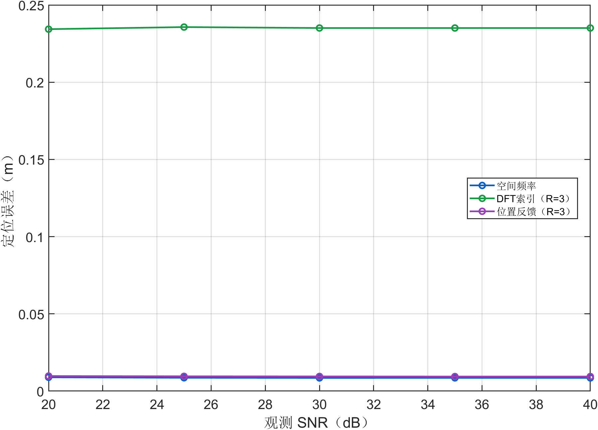

结果：位置反馈在横轴20时平均误差0.009745 m，横轴40时为0.009432 m。该指标比较位置估计，不直接等同于波束成形或速率损失。AP数扫描仍固定三个参考AP，增加协作AP不等于增加定位观测。

### CPUUPA阵元数定位误差实验

实验设置：只改变横轴的UPA阵元数，其余采用默认配置；表内为平均定位误差 m。

| 方法 | 64 | 256 | 1024 |
|---|---|---|---|
| 空间频率 | 0.137977 | 0.037209 | 0.008532 |
| DFT索引 | 0.903049 | 0.464450 | 0.235091 |
| 位置反馈 | 0.137989 | 0.037184 | 0.009490 |

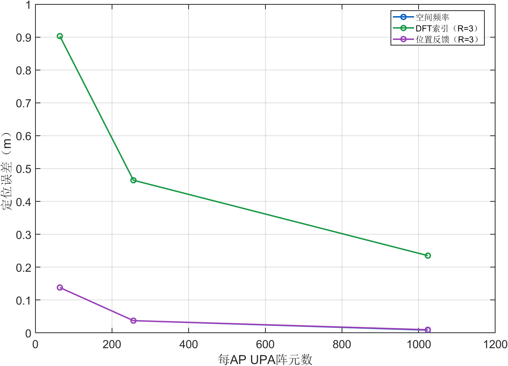

结果：位置反馈在横轴64时平均误差0.137989 m，横轴1024时为0.009490 m。该指标比较位置估计，不直接等同于波束成形或速率损失。AP数扫描仍固定三个参考AP，增加协作AP不等于增加定位观测。

### CPU协作AP数定位误差实验

实验设置：只改变横轴的协作AP数，其余采用默认配置；表内为平均定位误差 m。

| 方法 | 5 | 6 | 7 | 8 | 9 | 10 |
|---|---|---|---|---|---|---|
| 空间频率 | 0.008546 | 0.008548 | 0.008542 | 0.008532 | 0.008540 | 0.008544 |
| DFT索引 | 0.235091 | 0.235091 | 0.235091 | 0.235091 | 0.235091 | 0.235091 |
| 位置反馈 | 0.009493 | 0.009490 | 0.009490 | 0.009490 | 0.009489 | 0.009487 |

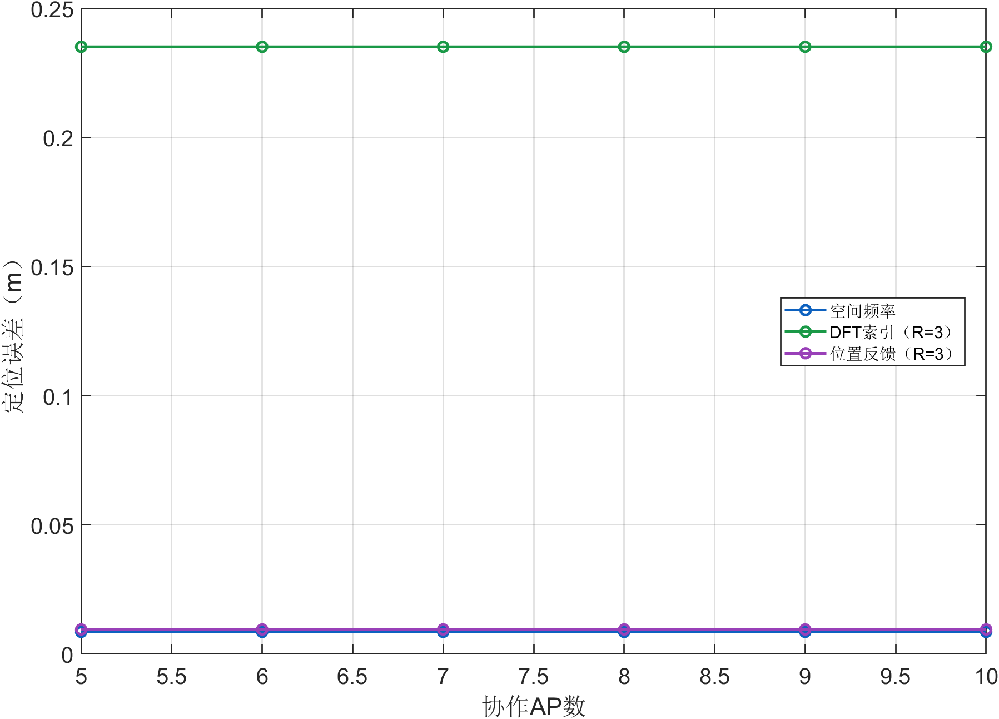

结果：位置反馈在横轴5时平均误差0.009493 m，横轴10时为0.009487 m。该指标比较位置估计，不直接等同于波束成形或速率损失。AP数扫描仍固定三个参考AP，增加协作AP不等于增加定位观测。

### CPU观测SNR吞吐量实验

实验设置：只改变横轴的观测SNR，其余采用默认配置；表内为平均吞吐量 Mbps。

| 方法 | 20 | 25 | 30 | 35 | 40 |
|---|---|---|---|---|---|
| SVD参考 | 3543.54 | 3543.54 | 3543.54 | 3543.54 | 3543.54 |
| 全反馈Type-I(UE) | 3298.87 | 3298.74 | 3298.51 | 3298.71 | 3298.88 |
| 全反馈Type-II(UE) | 3323.89 | 3324.07 | 3324.28 | 3324.35 | 3324.28 |
| Docomo(UE) | 3347.99 | 3347.89 | 3347.72 | 3347.73 | 3347.76 |
| 空间频率 | 3171.27 | 3174.70 | 3177.40 | 3178.18 | 3177.95 |
| DFT索引 | 2912.33 | 2909.19 | 2909.63 | 2909.63 | 2909.63 |
| 位置反馈 | 3178.16 | 3183.36 | 3184.00 | 3185.71 | 3185.13 |

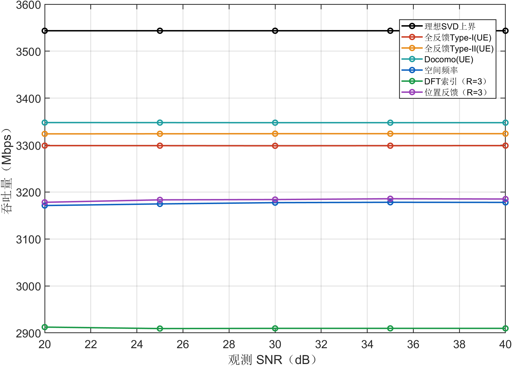

结果：位置反馈从横轴20时的3178.16变为40时的3185.13，单位同表。各方法中间点均保留；观测SNR只影响CSI质量，真实SVD参考随其不变。

### CPUUPA阵元数吞吐量实验

实验设置：只改变横轴的UPA阵元数，其余采用默认配置；表内为平均吞吐量 Mbps。

| 方法 | 64 | 256 | 1024 |
|---|---|---|---|
| SVD参考 | 1973.93 | 2750.19 | 3543.54 |
| 全反馈Type-I(UE) | 1782.77 | 2527.51 | 3298.51 |
| 全反馈Type-II(UE) | 1805.79 | 2553.36 | 3324.28 |
| Docomo(UE) | 1795.17 | 2563.97 | 3347.72 |
| 空间频率 | 1433.67 | 2251.94 | 3177.40 |
| DFT索引 | 1360.62 | 2131.16 | 2909.63 |
| 位置反馈 | 1436.74 | 2252.26 | 3184.00 |

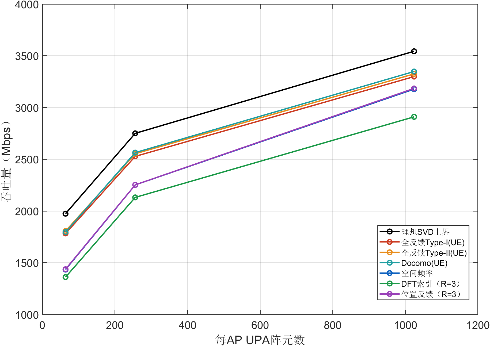

结果：位置反馈从横轴64时的1436.74变为1024时的3184.00，单位同表。阵元数或K改变了真实信道与可用波束，不能把该曲线解释为仅改变CSI观测噪声。

### CPU莱斯因子K吞吐量实验

实验设置：只改变横轴的莱斯因子K，其余采用默认配置；表内为平均吞吐量 Mbps。

| 方法 | 0 | 5 | 10 | 15 | 20 |
|---|---|---|---|---|---|
| SVD参考 | 3706.52 | 3597.27 | 3543.54 | 3532.66 | 3531.42 |
| 全反馈Type-I(UE) | 3292.99 | 3263.52 | 3298.51 | 3331.95 | 3348.58 |
| 全反馈Type-II(UE) | 3433.49 | 3345.88 | 3324.28 | 3336.10 | 3348.30 |
| Docomo(UE) | 3143.30 | 3252.61 | 3347.72 | 3382.88 | 3394.78 |
| 空间频率 | 2584.29 | 3009.11 | 3177.40 | 3277.36 | 3319.70 |
| DFT索引 | 2583.81 | 2814.27 | 2909.63 | 2945.71 | 2957.68 |
| 位置反馈 | 2393.28 | 3013.46 | 3184.00 | 3284.45 | 3326.69 |

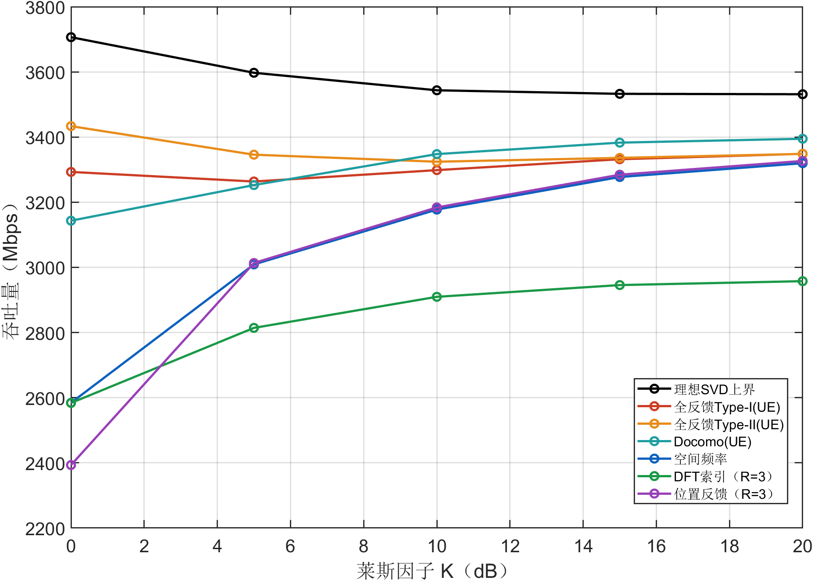

结果：位置反馈从横轴0时的2393.28变为20时的3326.69，单位同表。阵元数或K改变了真实信道与可用波束，不能把该曲线解释为仅改变CSI观测噪声。

### CPU协作AP数比特数实验

实验设置：只改变横轴的协作AP数，其余采用默认配置；表内为实际有效载荷 bit。

| 方法 | 5 | 6 | 7 | 8 | 9 | 10 |
|---|---|---|---|---|---|---|
| 全反馈Type-I(UE) | 86 | 104 | 122 | 140 | 158 | 176 |
| 全反馈Type-II(UE) | 181 | 218 | 255 | 292 | 329 | 366 |
| Docomo(UE) | 81 | 97 | 113 | 129 | 146 | 162 |
| 空间频率 | 84 | 84 | 84 | 84 | 84 | 84 |
| DFT索引 | 42 | 42 | 42 | 42 | 42 | 42 |
| 位置反馈 | 36 | 36 | 36 | 36 | 36 | 36 |

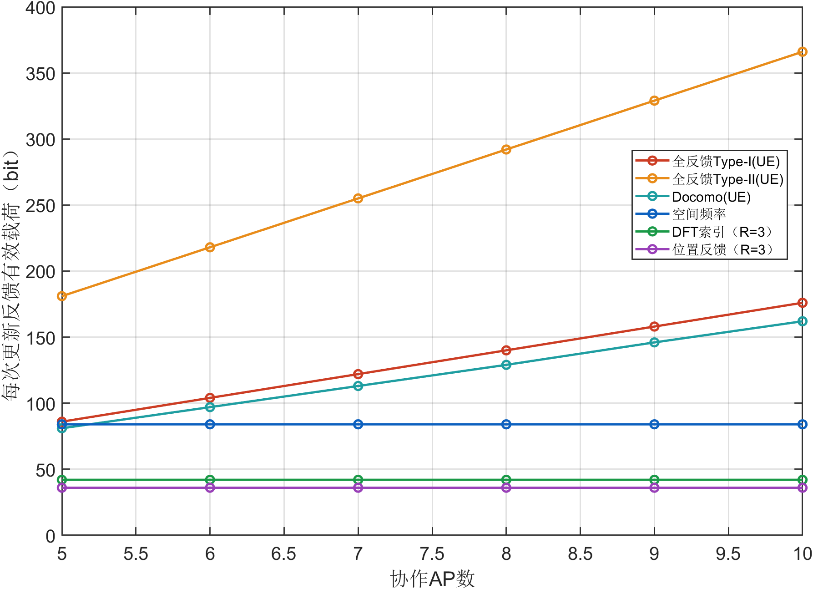

结果：默认32×32下CPU三种几何消息为空间频率84、DFT42、POS36 bit；UE几何方法再增加4(B−1) bit第一相位。UE的Type-I、Type-II、Docomo空间字段随AP数增长，图中展示实际打包长度。理想SVD没有有限反馈值，不将它作为0 bit可实施方法。

### CPU观测SNR频谱效率实验

实验设置：只改变横轴的观测SNR，其余采用默认配置；表内为频谱效率 bit/s/Hz。

| 方法 | 20 | 25 | 30 | 35 | 40 |
|---|---|---|---|---|---|
| SVD参考 | 8.8588 | 8.8588 | 8.8588 | 8.8588 | 8.8588 |
| 全反馈Type-I(UE) | 8.2472 | 8.2469 | 8.2463 | 8.2468 | 8.2472 |
| 全反馈Type-II(UE) | 8.3097 | 8.3102 | 8.3107 | 8.3109 | 8.3107 |
| Docomo(UE) | 8.3700 | 8.3697 | 8.3693 | 8.3693 | 8.3694 |
| 空间频率 | 7.9282 | 7.9367 | 7.9435 | 7.9455 | 7.9449 |
| DFT索引 | 7.2808 | 7.2730 | 7.2741 | 7.2741 | 7.2741 |
| 位置反馈 | 7.9454 | 7.9584 | 7.9600 | 7.9643 | 7.9628 |

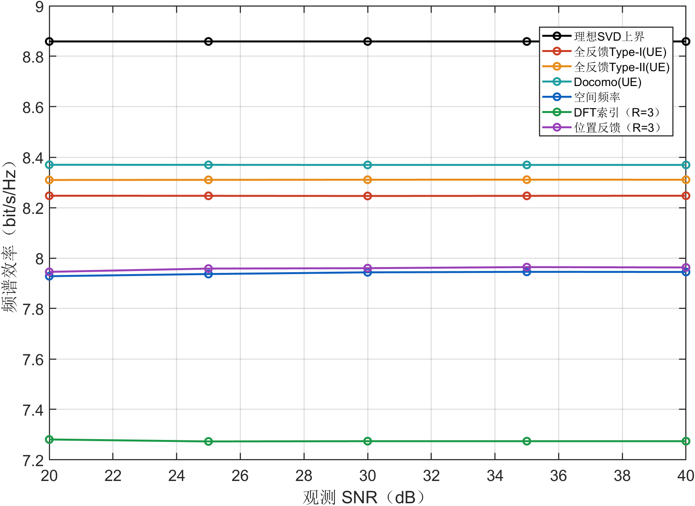

结果：位置反馈从横轴20时的7.9454变为40时的7.9628，单位同表。各方法中间点均保留；观测SNR只影响CSI质量，真实SVD参考随其不变。

### CPU位置反馈坐标量化前后实验

| 观测SNR dB | 连续定位误差 m | 解码坐标误差 m |
|---|---|---|
| 20 | 0.008588 | 0.009745 |
| 25 | 0.008332 | 0.009570 |
| 30 | 0.008249 | 0.009490 |
| 35 | 0.008224 | 0.009418 |
| 40 | 0.008219 | 0.009432 |

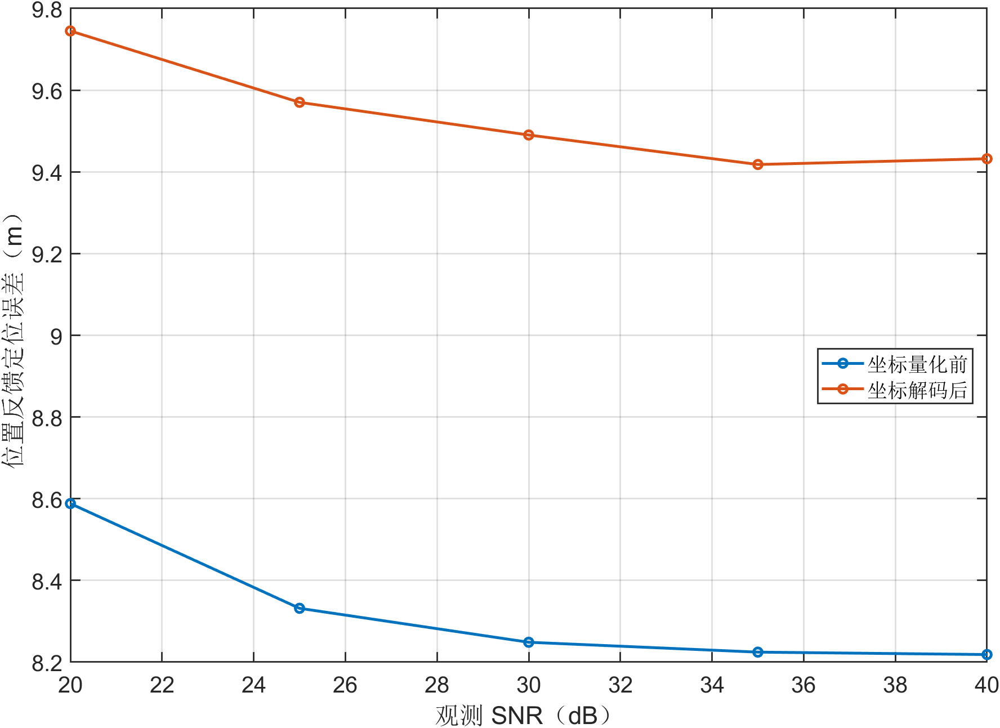

结果：先以连续空间频率定位，再量化一次坐标。两条曲线衡量同一定位结果在坐标编码前后的误差，不存在先量化频率再定位再量化坐标的处理。坐标量化后的欧氏误差变化不直接决定共相位敏感方向的误差。

### CPU位置反馈坐标越界实验

| K dB | 连续误差 m | 解码误差 m | 越界比例 % |
|---|---|---|---|
| 0 | 2.139687 | 1.288964 | 15.00 |
| 5 | 0.014612 | 0.015313 | 0.00 |
| 10 | 0.008249 | 0.009490 | 0.00 |
| 15 | 0.004710 | 0.006290 | 0.00 |
| 20 | 0.002762 | 0.004884 | 0.00 |

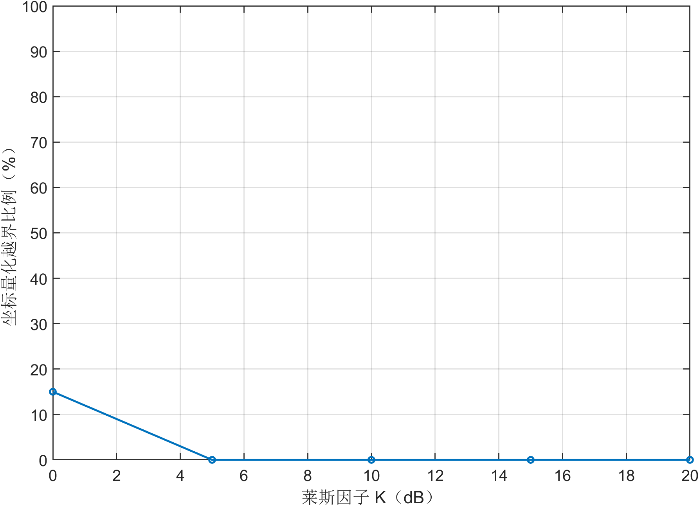

结果：K=0 dB时60个位置越界，占15%，其余K点为0。越界坐标截断到公共区域后，平均欧氏误差可能降低，其中包含区域先验；这不证明坐标量化提高定位算法精度。全部位置保留，未剔除越界点。

### CPU相位敏感度坐标bit分配检查

| 坐标 | bit | 400个位置是否一致 |
|---|---|---|
| x | 13 | 是 |
| y | 14 | 是 |
| z | 9 | 是 |

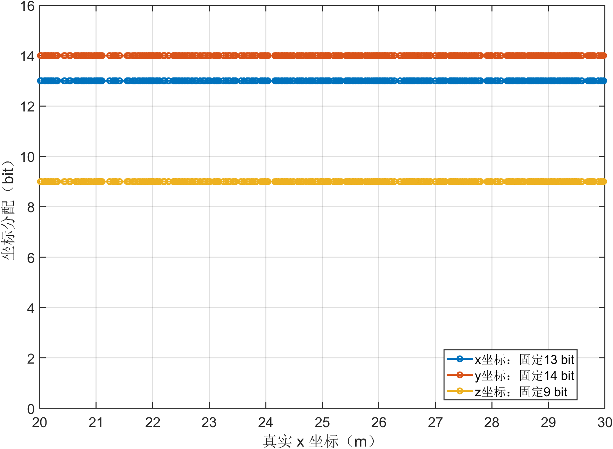

结果：三个方向始终分配13/14/9 bit，总计36 bit。规则由公共几何的相对AP相位敏感度预先固定，不依赖未知真实位置在线调整，也没有隐藏的逐位置分配头。图中真实x仅用于横轴展示，不作为分配算法输入。

## UE单流逐实验图表和数值

以下每图均使用400位置均值，信道固定为MIX。各表列标题是图中的实际横轴数值；CPU图中的全反馈Type-I(UE)、全反馈Type-II(UE)和Docomo(UE)均为UE计算的共享参考，定位误差图只列三种几何方法。

### UE观测SNR定位误差实验

实验设置：只改变横轴的观测SNR，其余采用默认配置；表内为平均定位误差 m。

| 方法 | 20 | 25 | 30 | 35 | 40 |
|---|---|---|---|---|---|
| 空间频率 | 0.008926 | 0.008621 | 0.008532 | 0.008566 | 0.008547 |
| DFT索引 | 0.234350 | 0.235696 | 0.235091 | 0.235091 | 0.235091 |
| 位置反馈 | 0.009745 | 0.009570 | 0.009490 | 0.009418 | 0.009432 |

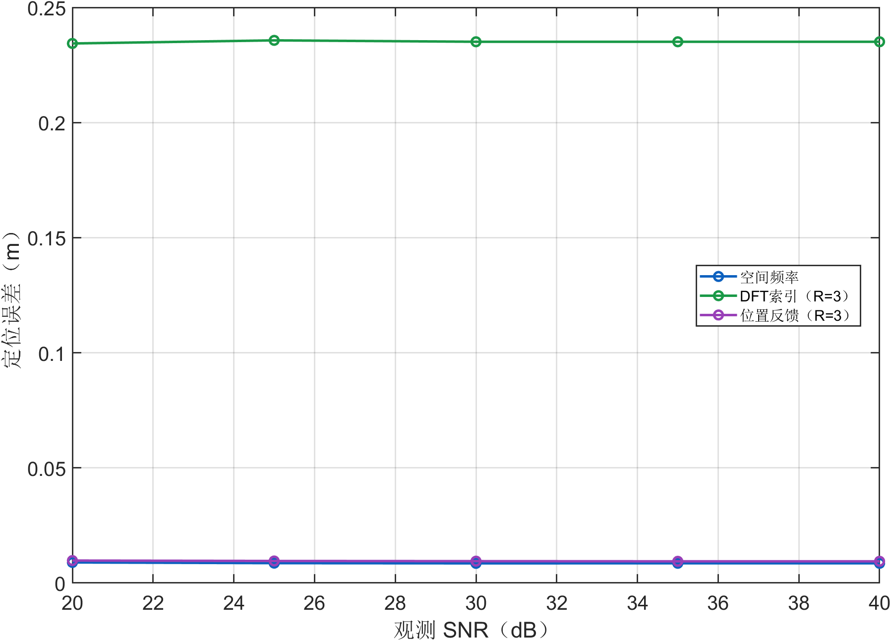

结果：位置反馈在横轴20时平均误差0.009745 m，横轴40时为0.009432 m。该指标比较位置估计，不直接等同于波束成形或速率损失。AP数扫描仍固定三个参考AP，增加协作AP不等于增加定位观测。

### UEUPA阵元数定位误差实验

实验设置：只改变横轴的UPA阵元数，其余采用默认配置；表内为平均定位误差 m。

| 方法 | 64 | 256 | 1024 |
|---|---|---|---|
| 空间频率 | 0.137977 | 0.037209 | 0.008532 |
| DFT索引 | 0.903049 | 0.464450 | 0.235091 |
| 位置反馈 | 0.137989 | 0.037184 | 0.009490 |

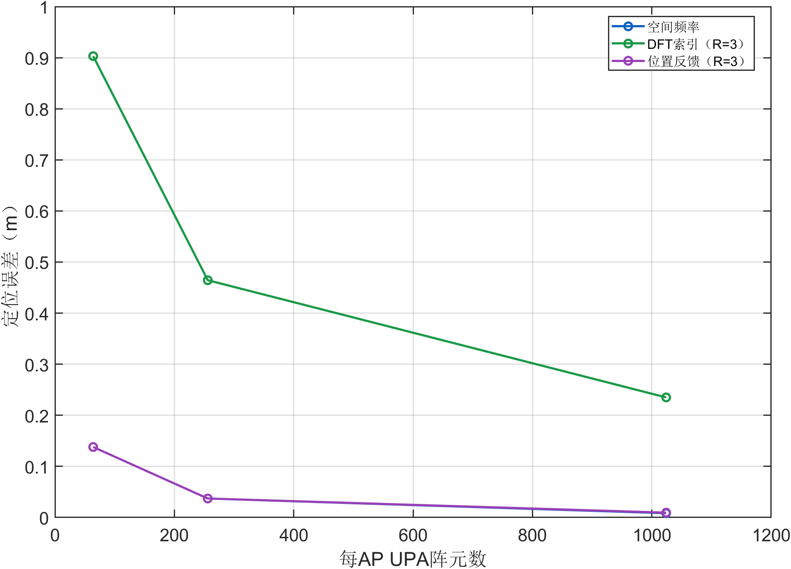

结果：位置反馈在横轴64时平均误差0.137989 m，横轴1024时为0.009490 m。该指标比较位置估计，不直接等同于波束成形或速率损失。AP数扫描仍固定三个参考AP，增加协作AP不等于增加定位观测。

### UE协作AP数定位误差实验

实验设置：只改变横轴的协作AP数，其余采用默认配置；表内为平均定位误差 m。

| 方法 | 5 | 6 | 7 | 8 | 9 | 10 |
|---|---|---|---|---|---|---|
| 空间频率 | 0.008546 | 0.008548 | 0.008542 | 0.008532 | 0.008540 | 0.008544 |
| DFT索引 | 0.235091 | 0.235091 | 0.235091 | 0.235091 | 0.235091 | 0.235091 |
| 位置反馈 | 0.009493 | 0.009490 | 0.009490 | 0.009490 | 0.009489 | 0.009487 |

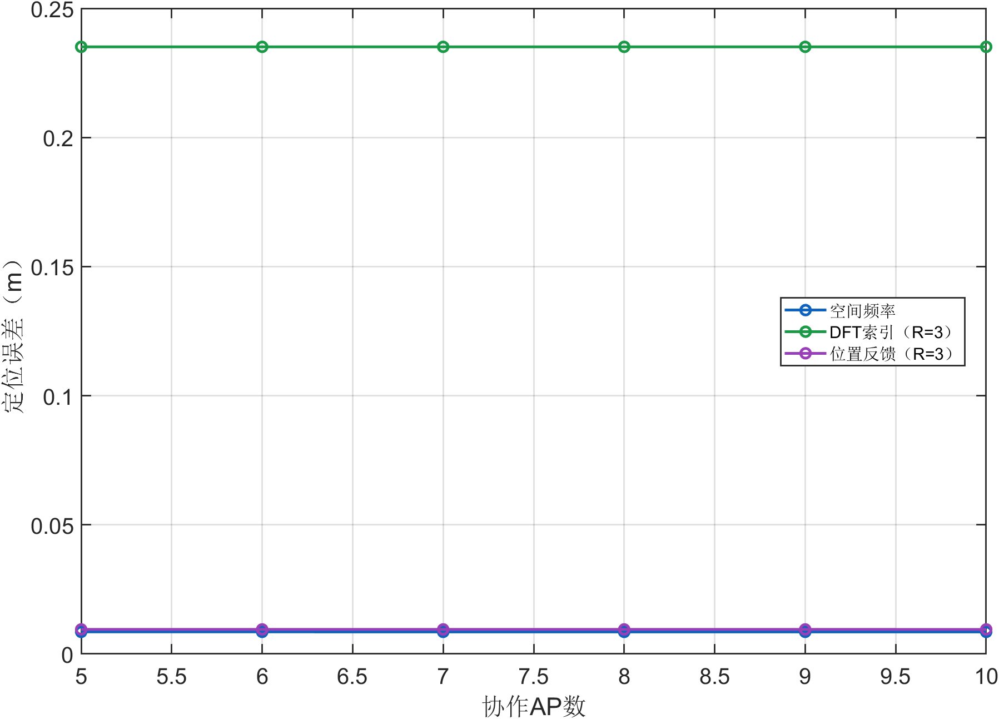

结果：位置反馈在横轴5时平均误差0.009493 m，横轴10时为0.009487 m。该指标比较位置估计，不直接等同于波束成形或速率损失。AP数扫描仍固定三个参考AP，增加协作AP不等于增加定位观测。

### UE观测SNR吞吐量实验

实验设置：只改变横轴的观测SNR，其余采用默认配置；表内为平均吞吐量 Mbps。

| 方法 | 20 | 25 | 30 | 35 | 40 |
|---|---|---|---|---|---|
| SVD参考 | 3543.54 | 3543.54 | 3543.54 | 3543.54 | 3543.54 |
| 全反馈Type-I(UE) | 3298.87 | 3298.74 | 3298.51 | 3298.71 | 3298.88 |
| 全反馈Type-II(UE) | 3323.89 | 3324.07 | 3324.28 | 3324.35 | 3324.28 |
| Docomo | 3347.99 | 3347.89 | 3347.72 | 3347.73 | 3347.76 |
| 空间频率 | 3307.60 | 3307.49 | 3307.27 | 3307.17 | 3307.10 |
| DFT索引 | 3300.46 | 3300.35 | 3300.25 | 3300.13 | 3300.21 |
| 位置反馈 | 3307.59 | 3307.51 | 3307.26 | 3307.17 | 3307.16 |

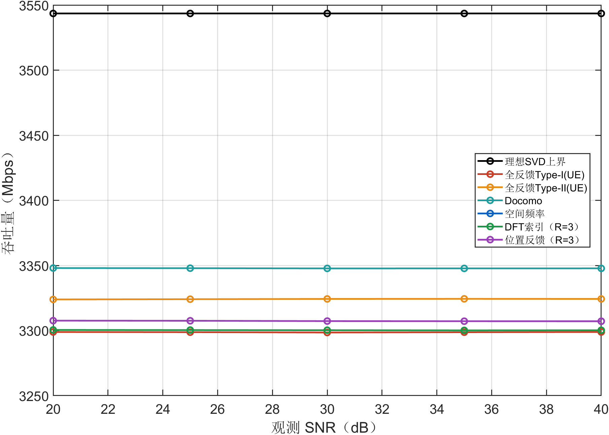

结果：位置反馈从横轴20时的3307.59变为40时的3307.16，单位同表。各方法中间点均保留；观测SNR只影响CSI质量，真实SVD参考随其不变。

### UEUPA阵元数吞吐量实验

实验设置：只改变横轴的UPA阵元数，其余采用默认配置；表内为平均吞吐量 Mbps。

| 方法 | 64 | 256 | 1024 |
|---|---|---|---|
| SVD参考 | 1973.93 | 2750.19 | 3543.54 |
| 全反馈Type-I(UE) | 1782.77 | 2527.51 | 3298.51 |
| 全反馈Type-II(UE) | 1805.79 | 2553.36 | 3324.28 |
| Docomo | 1795.17 | 2563.97 | 3347.72 |
| 空间频率 | 1791.26 | 2537.87 | 3307.27 |
| DFT索引 | 1785.44 | 2530.81 | 3300.25 |
| 位置反馈 | 1791.07 | 2537.78 | 3307.26 |

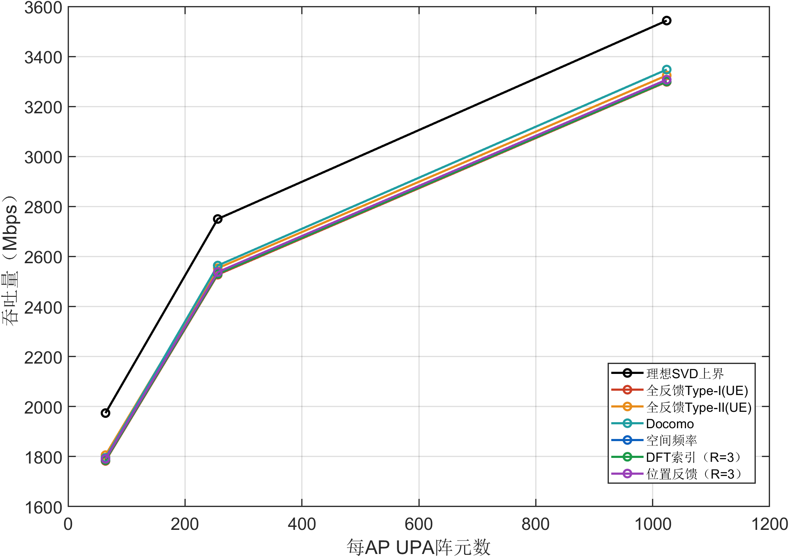

结果：位置反馈从横轴64时的1791.07变为1024时的3307.26，单位同表。阵元数或K改变了真实信道与可用波束，不能把该曲线解释为仅改变CSI观测噪声。

### UE莱斯因子K吞吐量实验

实验设置：只改变横轴的莱斯因子K，其余采用默认配置；表内为平均吞吐量 Mbps。

| 方法 | 0 | 5 | 10 | 15 | 20 |
|---|---|---|---|---|---|
| SVD参考 | 3706.52 | 3597.27 | 3543.54 | 3532.66 | 3531.42 |
| 全反馈Type-I(UE) | 3292.99 | 3263.52 | 3298.51 | 3331.95 | 3348.58 |
| 全反馈Type-II(UE) | 3433.49 | 3345.88 | 3324.28 | 3336.10 | 3348.30 |
| Docomo | 3143.30 | 3252.61 | 3347.72 | 3382.88 | 3394.78 |
| 空间频率 | 2859.10 | 3197.93 | 3307.27 | 3346.03 | 3357.99 |
| DFT索引 | 2950.47 | 3191.72 | 3300.25 | 3338.85 | 3350.96 |
| 位置反馈 | 2664.11 | 3197.80 | 3307.26 | 3346.11 | 3357.97 |

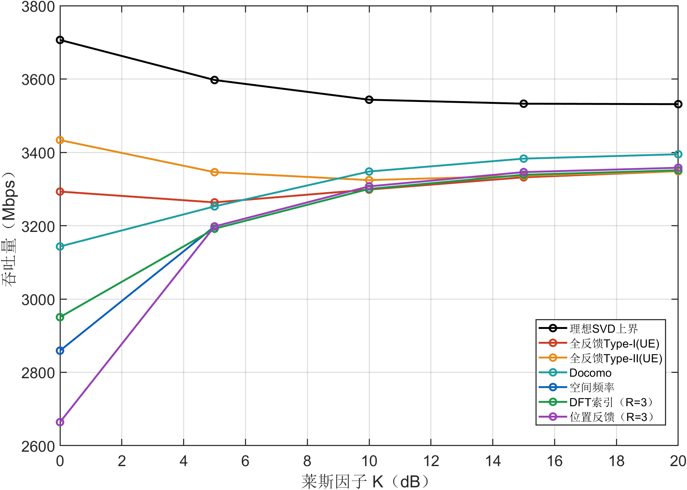

结果：位置反馈从横轴0时的2664.11变为20时的3357.97，单位同表。阵元数或K改变了真实信道与可用波束，不能把该曲线解释为仅改变CSI观测噪声。

### UE协作AP数比特数实验

实验设置：只改变横轴的协作AP数，其余采用默认配置；表内为实际有效载荷 bit。

| 方法 | 5 | 6 | 7 | 8 | 9 | 10 |
|---|---|---|---|---|---|---|
| 全反馈Type-I(UE) | 86 | 104 | 122 | 140 | 158 | 176 |
| 全反馈Type-II(UE) | 181 | 218 | 255 | 292 | 329 | 366 |
| Docomo | 81 | 97 | 113 | 129 | 146 | 162 |
| 空间频率 | 100 | 104 | 108 | 112 | 116 | 120 |
| DFT索引 | 58 | 62 | 66 | 70 | 74 | 78 |
| 位置反馈 | 52 | 56 | 60 | 64 | 68 | 72 |

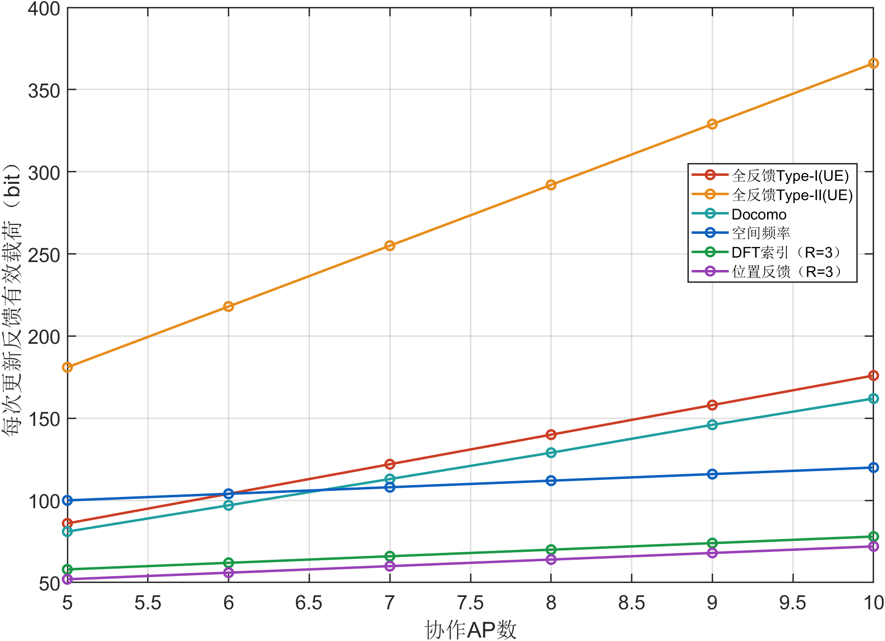

结果：默认32×32下CPU三种几何消息为空间频率84、DFT42、POS36 bit；UE几何方法再增加4(B−1) bit第一相位。UE的Type-I、Type-II、Docomo空间字段随AP数增长，图中展示实际打包长度。理想SVD没有有限反馈值，不将它作为0 bit可实施方法。

### UE观测SNR频谱效率实验

实验设置：只改变横轴的观测SNR，其余采用默认配置；表内为频谱效率 bit/s/Hz。

| 方法 | 20 | 25 | 30 | 35 | 40 |
|---|---|---|---|---|---|
| SVD参考 | 8.8588 | 8.8588 | 8.8588 | 8.8588 | 8.8588 |
| 全反馈Type-I(UE) | 8.2472 | 8.2469 | 8.2463 | 8.2468 | 8.2472 |
| 全反馈Type-II(UE) | 8.3097 | 8.3102 | 8.3107 | 8.3109 | 8.3107 |
| Docomo | 8.3700 | 8.3697 | 8.3693 | 8.3693 | 8.3694 |
| 空间频率 | 8.2690 | 8.2687 | 8.2682 | 8.2679 | 8.2678 |
| DFT索引 | 8.2512 | 8.2509 | 8.2506 | 8.2503 | 8.2505 |
| 位置反馈 | 8.2690 | 8.2688 | 8.2682 | 8.2679 | 8.2679 |

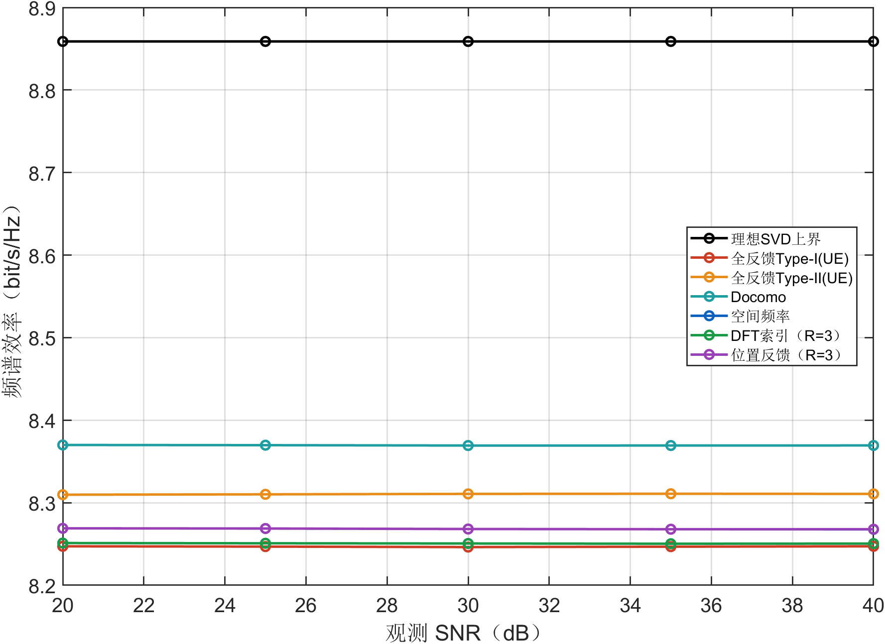

结果：位置反馈从横轴20时的8.2690变为40时的8.2679，单位同表。各方法中间点均保留；观测SNR只影响CSI质量，真实SVD参考随其不变。

### UE位置反馈坐标量化前后实验

| 观测SNR dB | 连续定位误差 m | 解码坐标误差 m |
|---|---|---|
| 20 | 0.008588 | 0.009745 |
| 25 | 0.008332 | 0.009570 |
| 30 | 0.008249 | 0.009490 |
| 35 | 0.008224 | 0.009418 |
| 40 | 0.008219 | 0.009432 |


结果：先以连续空间频率定位，再量化一次坐标。两条曲线衡量同一定位结果在坐标编码前后的误差，不存在先量化频率再定位再量化坐标的处理。坐标量化后的欧氏误差变化不直接决定共相位敏感方向的误差。

### UE位置反馈坐标越界实验

| K dB | 连续误差 m | 解码误差 m | 越界比例 % |
|---|---|---|---|
| 0 | 2.139687 | 1.288964 | 15.00 |
| 5 | 0.014612 | 0.015313 | 0.00 |
| 10 | 0.008249 | 0.009490 | 0.00 |
| 15 | 0.004710 | 0.006290 | 0.00 |
| 20 | 0.002762 | 0.004884 | 0.00 |


结果：K=0 dB时60个位置越界，占15%，其余K点为0。越界坐标截断到公共区域后，平均欧氏误差可能降低，其中包含区域先验；这不证明坐标量化提高定位算法精度。全部位置保留，未剔除越界点。

### UE相位敏感度坐标bit分配检查

| 坐标 | bit | 400个位置是否一致 |
|---|---|---|
| x | 13 | 是 |
| y | 14 | 是 |
| z | 9 | 是 |


结果：三个方向始终分配13/14/9 bit，总计36 bit。规则由公共几何的相对AP相位敏感度预先固定，不依赖未知真实位置在线调整，也没有隐藏的逐位置分配头。图中真实x仅用于横轴展示，不作为分配算法输入。
