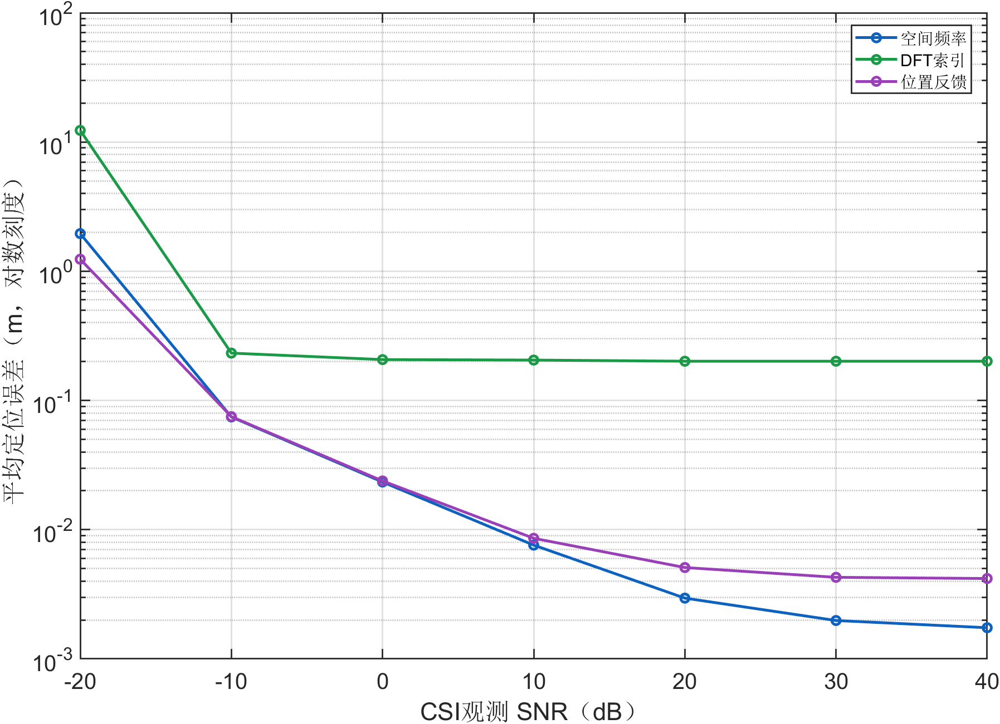
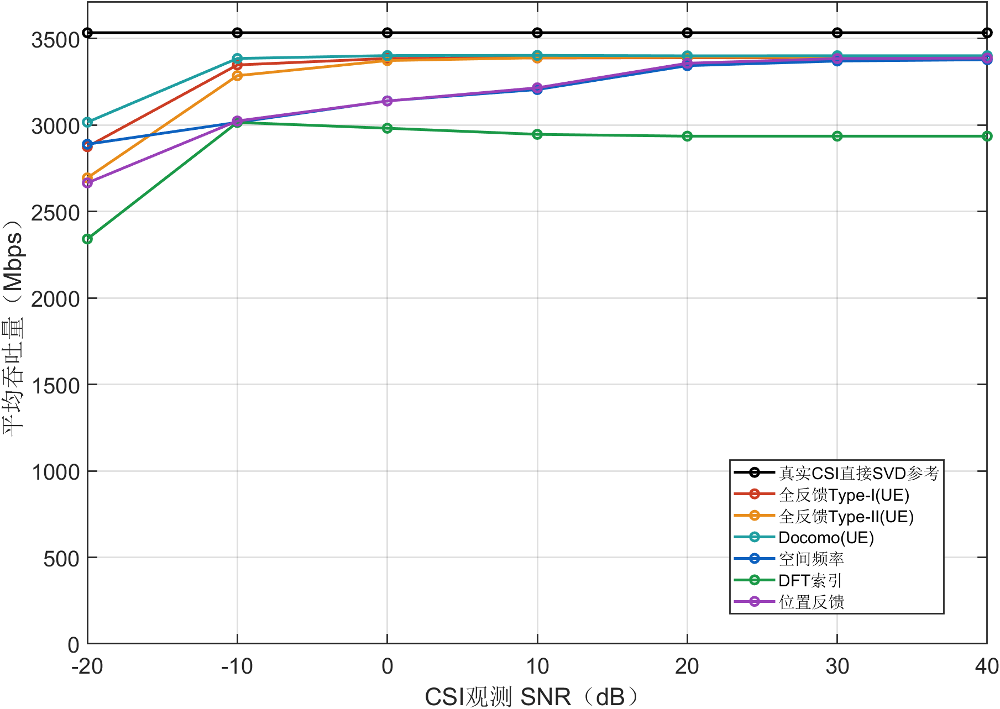
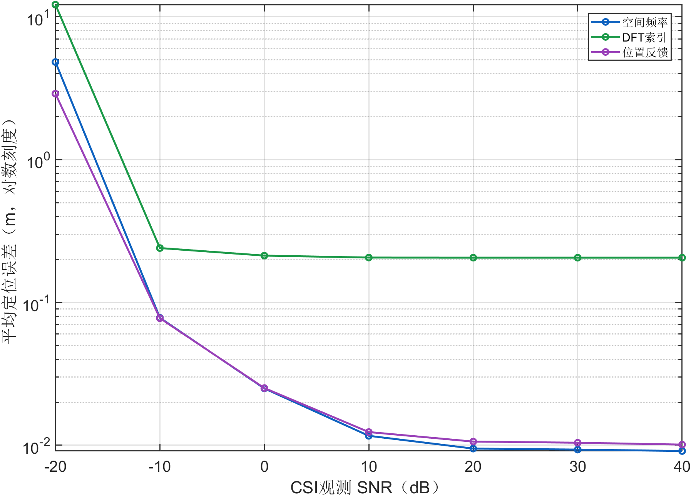
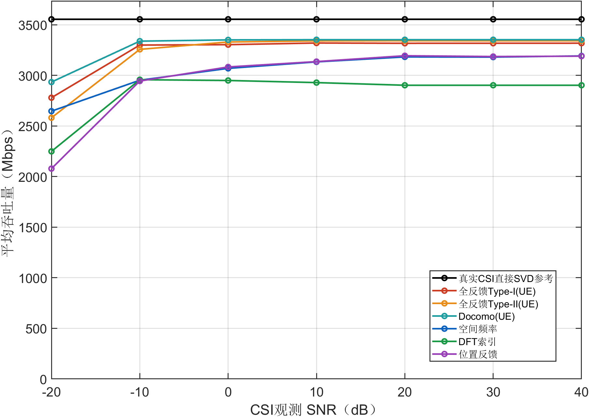
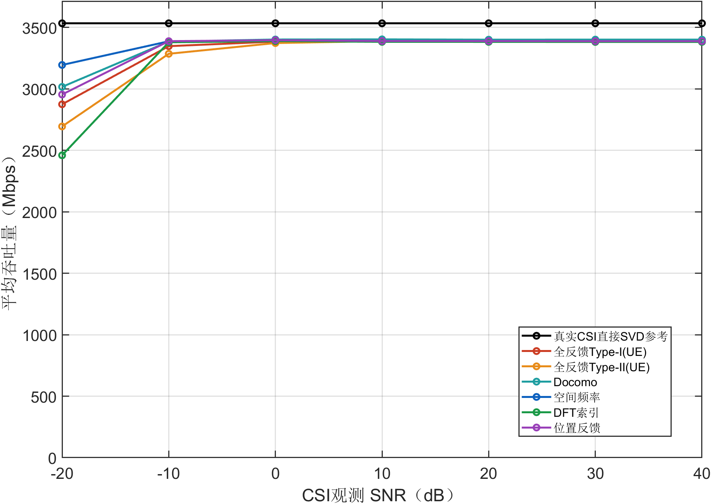
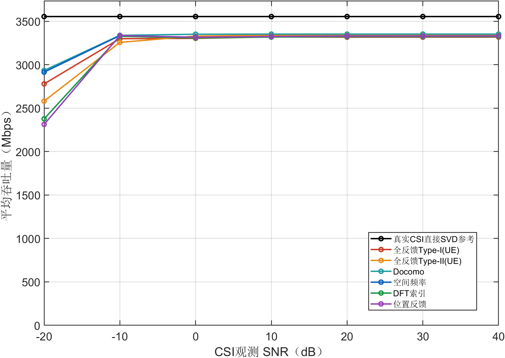
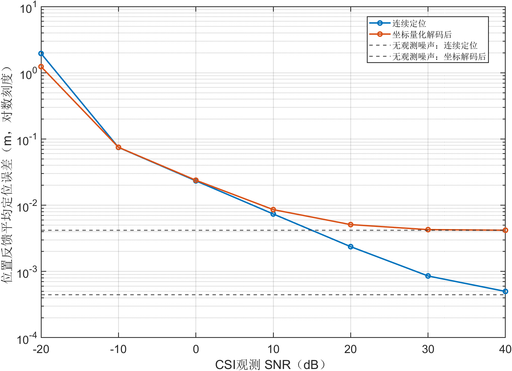
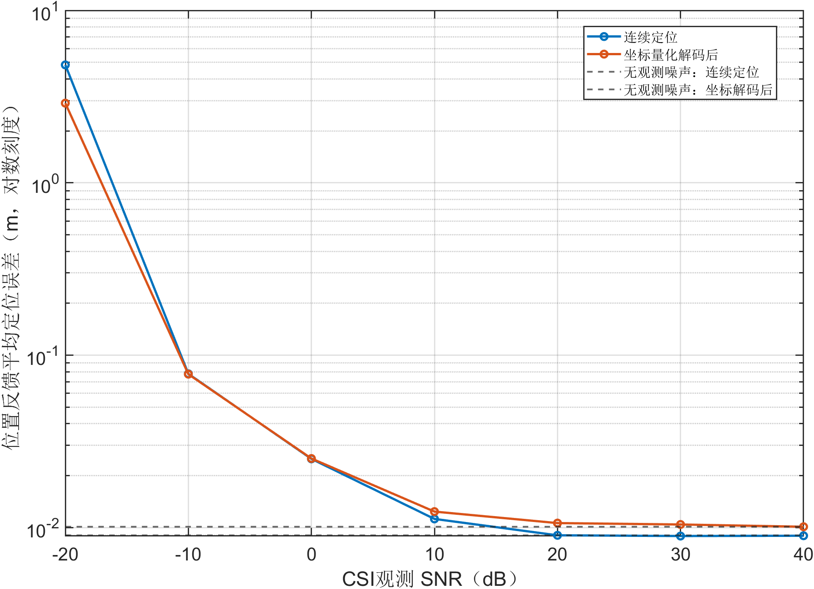

# UPA单流低至高观测SNR预实验报告

2026年10月25日。为解释原20至40 dB曲线为何接近水平，本次将CSI观测SNR扩展至−20、−10、0、10、20、30、40 dB，先使用32个冻结位置，分别测试纯LOS与MIX。数据链路参考SNR仍为10 dB，未随横轴增加。本次是诊断预实验，不替代原400位置正式结果。

## 1 实验设置与实现

| 项目 | 设置 |
|---|---|
| 位置选择 | 从原1至400号位置等间隔取32个，round(linspace(1,400,32))，未按结果挑选 |
| 阵列与协作 | 每AP 32×32单极化UPA，8个协作AP，3个定位参考AP，UE四接收阵元 |
| 横轴 | CSI观测SNR：−20、−10、0、10、20、30、40 dB |
| 信道 | LOS与MIX分开，MIX的K固定10 dB |
| 数据链路 | 沿用冻结参考数据SNR10 dB，rho=39.2994887549；400 MHz直接换算 |
| 反馈与相位 | 原整数协议、13/14/9 bit坐标、4 bit UE相位及现有全部方法保持不变 |
| 无观测噪声对照 | 同算法直接使用Htrue生成消息；CPU只接收该空间消息和公共几何，真实信道仅作评价 |
| 噪声重复 | 每位置、每物理AP使用原冻结噪声矩阵，跨SNR只缩放幅度；每位置一次噪声实现 |

横轴只改变信道估计噪声，不改变真实信道或评价端的数据SNR。SVD参考使用真实信道直接求解，因此应保持水平。同算法无观测噪声对照仍受原码本、量化和相位规则约束，不等同于SVD，也不是有限约束下的全局最优上界。

定位是CPU与UE共用的前端，因此两端定位误差相同；分别列图只为保持报告结构。CPU图中的全反馈Type-I(UE)、全反馈Type-II(UE)和Docomo(UE)仍是UE共享参考。

无观测噪声下的CPU对照由原UE完美观测行中已保存的空间整数消息恢复，清除UE相位字段后，由原CPU解码器重新计算相位；未把完整观测信道传入CPU。

## 2 主要发现

纯LOS：位置反馈的坐标解码后平均定位误差从−20 dB的1.23862 m变为40 dB的0.00418833 m；同算法无观测噪声对照为0.00417755 m。CPU平均吞吐量从2665.24变为3387.16 Mbps，UE从2954.07变为3388.38 Mbps。无观测噪声时，量化前的连续定位误差为0.443 mm，量化解码后为4.178 mm。

混合信道：位置反馈的坐标解码后平均定位误差从−20 dB的2.89727 m变为40 dB的0.0100991 m；同算法无观测噪声对照为0.010069 m。CPU平均吞吐量从2078.64变为3190.33 Mbps，UE从2313.55变为3331.43 Mbps。无观测噪声时，量化前的连续定位误差为8.981 mm，量化解码后为10.069 mm。

本次已看到低SNR退化、过渡与高SNR平台。纯LOS中坐标量化后的平台明显高于连续定位平台；MIX中即使去掉观测噪声，连续定位仍有约毫米级至厘米级残差，提高观测SNR无法消除这些残差。UE吞吐量的饱和早于CPU几何相位方案，不能要求同一条SNR轴上的所有方法持续上升。

低SNR段与高SNR段应分开解读；离散码本、量化和主模式投影不保证逐点或每个样本单调。不能把个别有限SNR结果超过同算法无噪声对照解释为噪声有益。是否存在稳定差异需要增加独立噪声重复。

若继续正式扫描，建议优先在−20至0 dB过渡段按5 dB加密，并保留10、20、30、40 dB观察平台。各方法、CPU与UE使用统一横轴，数据链路SNR仍固定；本次不自动替换原400位置结果。

## 3 CPU端预实验

### CPU纯LOS定位误差随观测SNR变化

定位误差单位为m，图片采用对数纵轴以兼顾低SNR大误差与高SNR毫米级误差。

| 方法 | -20 dB | -10 dB | 0 dB | 10 dB | 20 dB | 30 dB | 40 dB |
|---|---|---|---|---|---|---|---|
| 空间频率 | 1.955 | 0.07451 | 0.02337 | 0.007594 | 0.002953 | 0.001981 | 0.001743 |
| DFT索引 | 12.3 | 0.2324 | 0.2071 | 0.2053 | 0.2012 | 0.2012 | 0.2012 |
| 位置反馈 | 1.239 | 0.07496 | 0.02384 | 0.008576 | 0.005094 | 0.004278 | 0.004188 |



### CPU纯LOS吞吐量随观测SNR变化

吞吐量单位为Mbps，数据链路条件固定；SVD水平线是预期行为。

| 方法 | -20 dB | -10 dB | 0 dB | 10 dB | 20 dB | 30 dB | 40 dB |
|---|---|---|---|---|---|---|---|
| SVD参考 | 3533.54 | 3533.54 | 3533.54 | 3533.54 | 3533.54 | 3533.54 | 3533.54 |
| 全反馈Type-I(UE) | 2874.48 | 3347.44 | 3384.86 | 3387.69 | 3389.06 | 3388.25 | 3388.37 |
| 全反馈Type-II(UE) | 2694.37 | 3285.43 | 3372.72 | 3388.87 | 3393.19 | 3392.09 | 3392.61 |
| Docomo(UE) | 3016.28 | 3384.88 | 3401.55 | 3402.79 | 3400.21 | 3400.63 | 3400.63 |
| 空间频率 | 2889.11 | 3015.47 | 3139.53 | 3205.17 | 3343.27 | 3370.06 | 3377.75 |
| DFT索引 | 2340.95 | 3015.00 | 2981.52 | 2946.07 | 2935.54 | 2935.54 | 2935.54 |
| 位置反馈 | 2665.24 | 3023.36 | 3138.67 | 3215.15 | 3357.23 | 3384.21 | 3387.16 |



### CPU纯LOS同算法无观测噪声对照

| 方法 | 定位误差 m | 吞吐量 Mbps |
|---|---|---|
| SVD参考 | 不适用 | 3533.54 |
| 全反馈Type-I(UE) | 不适用 | 3388.45 |
| 全反馈Type-II(UE) | 不适用 | 3392.60 |
| Docomo(UE) | 不适用 | 3400.63 |
| 空间频率 | 0.00172544 | 3379.95 |
| DFT索引 | 0.201229 | 2935.54 |
| 位置反馈 | 0.00417755 | 3387.71 |

### CPU混合信道定位误差随观测SNR变化

定位误差单位为m，图片采用对数纵轴以兼顾低SNR大误差与高SNR毫米级误差。

| 方法 | -20 dB | -10 dB | 0 dB | 10 dB | 20 dB | 30 dB | 40 dB |
|---|---|---|---|---|---|---|---|
| 空间频率 | 4.83 | 0.07805 | 0.02498 | 0.01164 | 0.009472 | 0.009321 | 0.009107 |
| DFT索引 | 12.19 | 0.2404 | 0.2128 | 0.2062 | 0.2058 | 0.2058 | 0.2058 |
| 位置反馈 | 2.897 | 0.07756 | 0.02513 | 0.01237 | 0.01061 | 0.01041 | 0.0101 |



### CPU混合信道吞吐量随观测SNR变化

吞吐量单位为Mbps，数据链路条件固定；SVD水平线是预期行为。

| 方法 | -20 dB | -10 dB | 0 dB | 10 dB | 20 dB | 30 dB | 40 dB |
|---|---|---|---|---|---|---|---|
| SVD参考 | 3554.95 | 3554.95 | 3554.95 | 3554.95 | 3554.95 | 3554.95 | 3554.95 |
| 全反馈Type-I(UE) | 2779.77 | 3300.15 | 3304.12 | 3320.42 | 3317.69 | 3318.17 | 3318.60 |
| 全反馈Type-II(UE) | 2581.53 | 3257.61 | 3330.49 | 3341.32 | 3343.03 | 3342.36 | 3342.68 |
| Docomo(UE) | 2934.46 | 3338.82 | 3351.29 | 3352.97 | 3352.97 | 3353.07 | 3353.07 |
| 空间频率 | 2646.82 | 2952.56 | 3069.71 | 3133.87 | 3182.99 | 3181.25 | 3192.91 |
| DFT索引 | 2249.21 | 2957.78 | 2950.05 | 2929.10 | 2902.90 | 2902.90 | 2902.90 |
| 位置反馈 | 2078.64 | 2944.68 | 3083.67 | 3136.71 | 3194.61 | 3186.56 | 3190.33 |



### CPU混合信道同算法无观测噪声对照

| 方法 | 定位误差 m | 吞吐量 Mbps |
|---|---|---|
| SVD参考 | 不适用 | 3554.95 |
| 全反馈Type-I(UE) | 不适用 | 3318.65 |
| 全反馈Type-II(UE) | 不适用 | 3342.75 |
| Docomo(UE) | 不适用 | 3353.07 |
| 空间频率 | 0.00958108 | 3188.88 |
| DFT索引 | 0.205844 | 2902.90 |
| 位置反馈 | 0.010069 | 3191.85 |

## 4 UE端预实验

### UE纯LOS定位误差随观测SNR变化

定位误差单位为m，图片采用对数纵轴以兼顾低SNR大误差与高SNR毫米级误差。

| 方法 | -20 dB | -10 dB | 0 dB | 10 dB | 20 dB | 30 dB | 40 dB |
|---|---|---|---|---|---|---|---|
| 空间频率 | 1.955 | 0.07451 | 0.02337 | 0.007594 | 0.002953 | 0.001981 | 0.001743 |
| DFT索引 | 12.3 | 0.2324 | 0.2071 | 0.2053 | 0.2012 | 0.2012 | 0.2012 |
| 位置反馈 | 1.239 | 0.07496 | 0.02384 | 0.008576 | 0.005094 | 0.004278 | 0.004188 |


### UE纯LOS吞吐量随观测SNR变化

吞吐量单位为Mbps，数据链路条件固定；SVD水平线是预期行为。

| 方法 | -20 dB | -10 dB | 0 dB | 10 dB | 20 dB | 30 dB | 40 dB |
|---|---|---|---|---|---|---|---|
| SVD参考 | 3533.54 | 3533.54 | 3533.54 | 3533.54 | 3533.54 | 3533.54 | 3533.54 |
| 全反馈Type-I(UE) | 2874.48 | 3347.44 | 3384.86 | 3387.69 | 3389.06 | 3388.25 | 3388.37 |
| 全反馈Type-II(UE) | 2694.37 | 3285.43 | 3372.72 | 3388.87 | 3393.19 | 3392.09 | 3392.61 |
| Docomo | 3016.28 | 3384.88 | 3401.55 | 3402.79 | 3400.21 | 3400.63 | 3400.63 |
| 空间频率 | 3194.50 | 3386.96 | 3396.03 | 3389.46 | 3389.13 | 3388.25 | 3388.38 |
| DFT索引 | 2459.53 | 3378.93 | 3388.59 | 3382.68 | 3382.42 | 3381.75 | 3381.69 |
| 位置反馈 | 2954.07 | 3388.03 | 3396.11 | 3389.44 | 3389.11 | 3388.25 | 3388.38 |



### UE纯LOS同算法无观测噪声对照

| 方法 | 定位误差 m | 吞吐量 Mbps |
|---|---|---|
| SVD参考 | 不适用 | 3533.54 |
| 全反馈Type-I(UE) | 不适用 | 3388.45 |
| 全反馈Type-II(UE) | 不适用 | 3392.60 |
| Docomo | 不适用 | 3400.63 |
| 空间频率 | 0.00172544 | 3388.45 |
| DFT索引 | 0.201229 | 3381.76 |
| 位置反馈 | 0.00417755 | 3388.45 |

### UE混合信道定位误差随观测SNR变化

定位误差单位为m，图片采用对数纵轴以兼顾低SNR大误差与高SNR毫米级误差。

| 方法 | -20 dB | -10 dB | 0 dB | 10 dB | 20 dB | 30 dB | 40 dB |
|---|---|---|---|---|---|---|---|
| 空间频率 | 4.83 | 0.07805 | 0.02498 | 0.01164 | 0.009472 | 0.009321 | 0.009107 |
| DFT索引 | 12.19 | 0.2404 | 0.2128 | 0.2062 | 0.2058 | 0.2058 | 0.2058 |
| 位置反馈 | 2.897 | 0.07756 | 0.02513 | 0.01237 | 0.01061 | 0.01041 | 0.0101 |


### UE混合信道吞吐量随观测SNR变化

吞吐量单位为Mbps，数据链路条件固定；SVD水平线是预期行为。

| 方法 | -20 dB | -10 dB | 0 dB | 10 dB | 20 dB | 30 dB | 40 dB |
|---|---|---|---|---|---|---|---|
| SVD参考 | 3554.95 | 3554.95 | 3554.95 | 3554.95 | 3554.95 | 3554.95 | 3554.95 |
| 全反馈Type-I(UE) | 2779.77 | 3300.15 | 3304.12 | 3320.42 | 3317.69 | 3318.17 | 3318.60 |
| 全反馈Type-II(UE) | 2581.53 | 3257.61 | 3330.49 | 3341.32 | 3343.03 | 3342.36 | 3342.68 |
| Docomo | 2934.46 | 3338.82 | 3351.29 | 3352.97 | 3352.97 | 3353.07 | 3353.07 |
| 空间频率 | 2914.85 | 3336.05 | 3317.32 | 3325.15 | 3331.20 | 3330.90 | 3331.37 |
| DFT索引 | 2377.40 | 3327.68 | 3308.62 | 3318.80 | 3323.65 | 3324.17 | 3324.64 |
| 位置反馈 | 2313.55 | 3336.28 | 3317.23 | 3324.94 | 3331.07 | 3330.78 | 3331.43 |



### UE混合信道同算法无观测噪声对照

| 方法 | 定位误差 m | 吞吐量 Mbps |
|---|---|---|
| SVD参考 | 不适用 | 3554.95 |
| 全反馈Type-I(UE) | 不适用 | 3318.65 |
| 全反馈Type-II(UE) | 不适用 | 3342.75 |
| Docomo | 不适用 | 3353.07 |
| 空间频率 | 0.00958108 | 3331.37 |
| DFT索引 | 0.205844 | 3324.85 |
| 位置反馈 | 0.010069 | 3331.22 |

## 5 定位平台与低SNR异常的补充诊断

### 纯LOS位置反馈连续估计与坐标量化

| 观测SNR dB | 连续均值 m | 解码均值 m | 解码中位 m | 解码95%分位 m | 越界比例 |
|---|---|---|---|---|---|
| -20 | 1.95545 | 1.23862 | 0.254567 | 6.70172 | 12.50% |
| -10 | 0.0747087 | 0.0749571 | 0.0688495 | 0.153488 | 0.00% |
| 0 | 0.0233376 | 0.0238375 | 0.02288 | 0.047604 | 0.00% |
| 10 | 0.00736795 | 0.00857624 | 0.00772542 | 0.0157455 | 0.00% |
| 20 | 0.00236557 | 0.00509421 | 0.00467483 | 0.00786746 | 0.00% |
| 30 | 0.00085395 | 0.00427841 | 0.0042628 | 0.00646061 | 0.00% |
| 40 | 0.00049896 | 0.00418833 | 0.0042628 | 0.00644038 | 0.00% |



坐标只量化一次。低SNR下若连续估计超出公共编码区域，截断先验可能显著降低解码后的欧氏误差，不能据此认为量化改善了定位估计器。所有32个位置均保留。无观测噪声下仍存在的连续定位误差说明误差并非全部由观测噪声引起；该对照不能进一步单独区分球面波近似、单频点拟合和散射各自的贡献。

### 混合信道位置反馈连续估计与坐标量化

| 观测SNR dB | 连续均值 m | 解码均值 m | 解码中位 m | 解码95%分位 m | 越界比例 |
|---|---|---|---|---|---|
| -20 | 4.83006 | 2.89727 | 0.392146 | 10.5612 | 31.25% |
| -10 | 0.0779094 | 0.0775571 | 0.0677074 | 0.154196 | 0.00% |
| 0 | 0.025014 | 0.0251333 | 0.0235209 | 0.0560473 | 0.00% |
| 10 | 0.0112125 | 0.0123661 | 0.00973566 | 0.0269607 | 0.00% |
| 20 | 0.0090087 | 0.0106052 | 0.0084796 | 0.0253167 | 0.00% |
| 30 | 0.00892126 | 0.0104087 | 0.00781976 | 0.0264289 | 0.00% |
| 40 | 0.00895521 | 0.0100991 | 0.00780493 | 0.0240439 | 0.00% |



坐标只量化一次。低SNR下若连续估计超出公共编码区域，截断先验可能显著降低解码后的欧氏误差，不能据此认为量化改善了定位估计器。所有32个位置均保留。无观测噪声下仍存在的连续定位误差说明误差并非全部由观测噪声引起；该对照不能进一步单独区分球面波近似、单频点拟合和散射各自的贡献。

## 6 核验与复现

独立核验覆盖8,512条主扫描记录和704条对照记录。整数消息、CPU/UE空间消息一致性、反馈长度、位置恢复和汇总均值均已检查；真实信道由独立Python实现重建，速率最大误差5.16e-10 Mbps。

本次MIX中20、30、40 dB与原400位置实验重合的1,248条记录逐一对齐，最大吞吐量差0 Mbps。无噪声同算法对照与SVD参考跨观测SNR保持不变。

这是32位置、每位置一次冻结噪声实现的范围诊断，不能替代400位置正式扫描，也不能据此给出独立重复噪声的置信区间。正式范围应结合低SNR退化、过渡段和平台共同确定。

```matlab
addpath('8.单流');
out=fullfile(pwd,'8.单流','results','new_snr_pilot32');
run_single_snr_pilot('OutputDir',out);
plot_single_snr_pilot(out);
```

```text
python analyze_single_snr_pilot.py results/new_snr_pilot32 --stage audit
python analyze_single_snr_pilot.py results/new_snr_pilot32 --stage report
```

输出目录必须是新目录；原400位置单流、双流结果和原报告均不覆盖。参数、位置编号、原始消息、无噪声对照、数值汇总与10组PNG/FIG一起保存。Word沿用现有文档生成流程，按用户要求不追加Word渲染检查。
