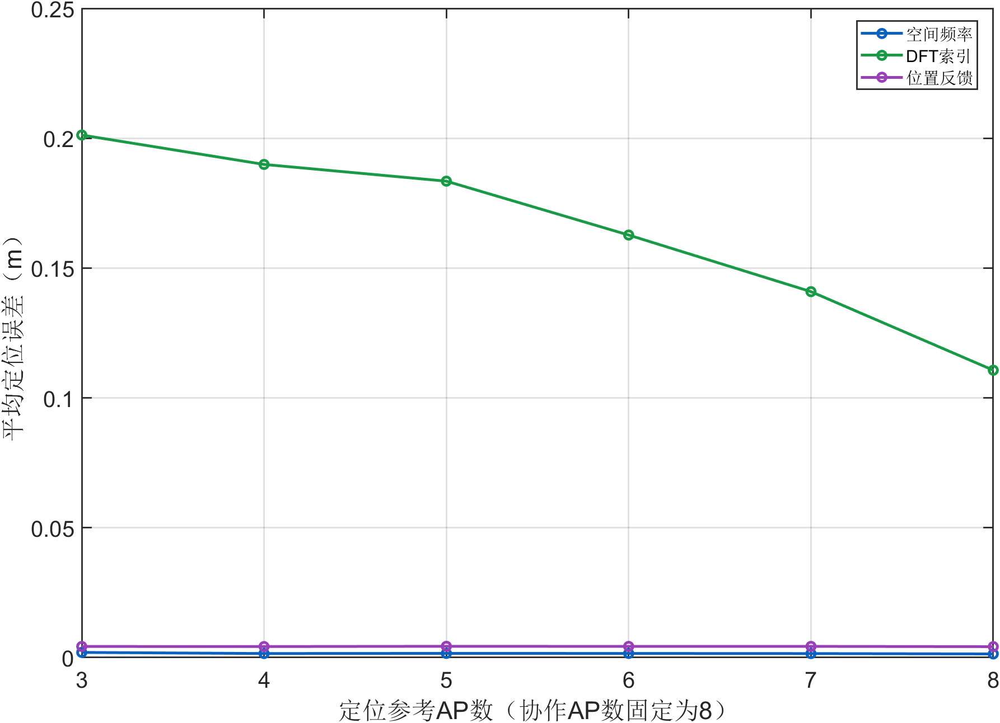
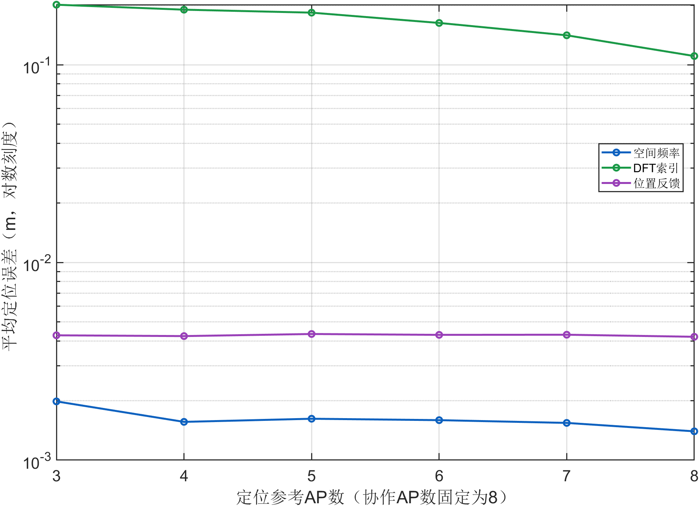
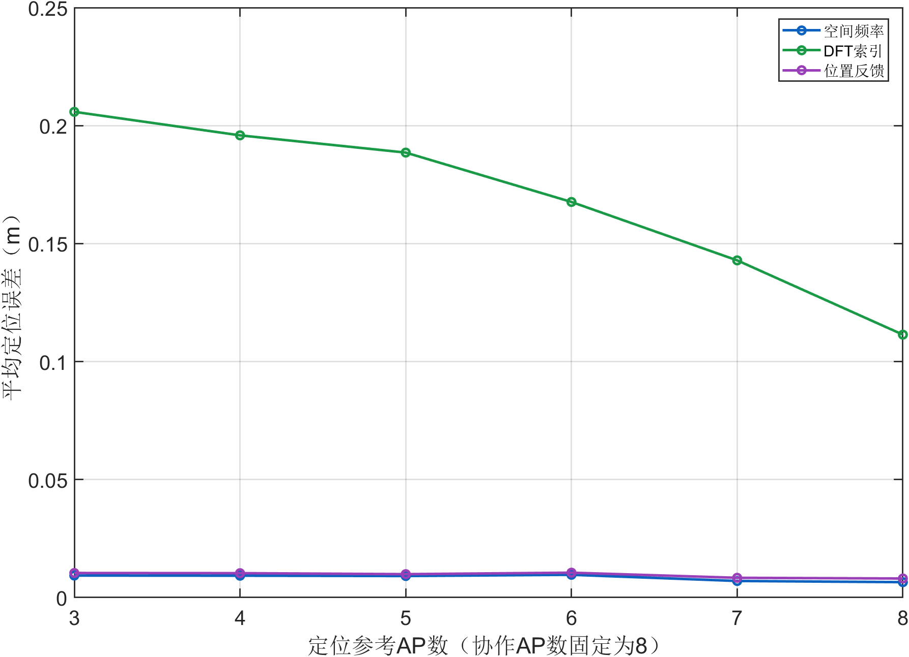
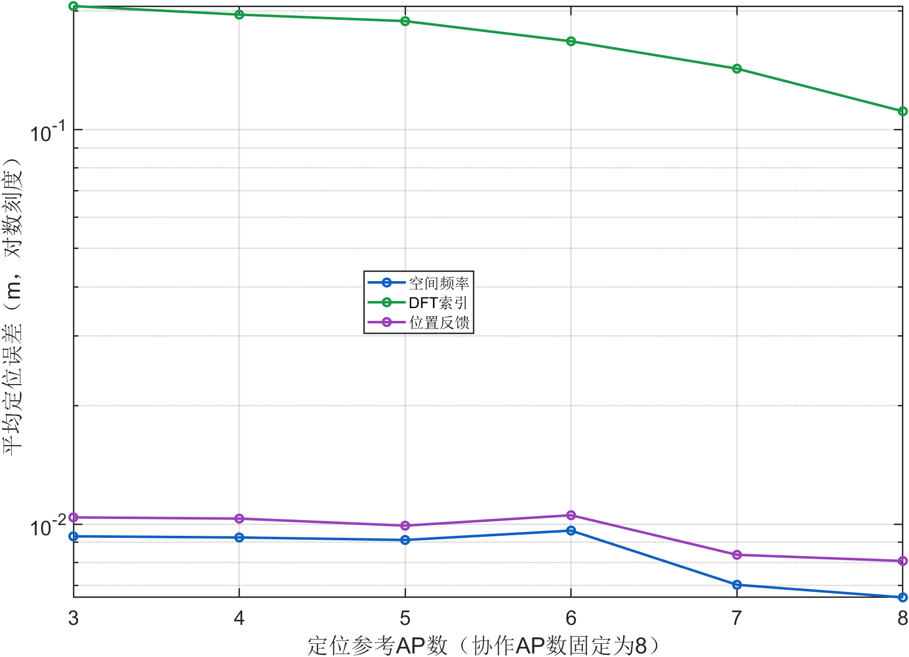
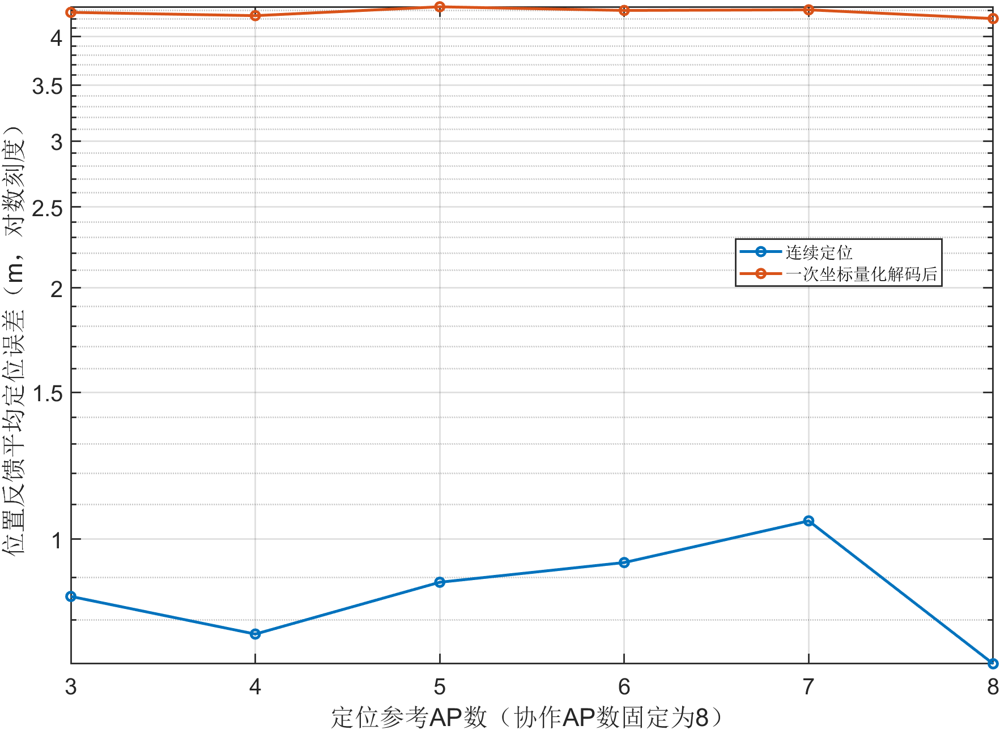
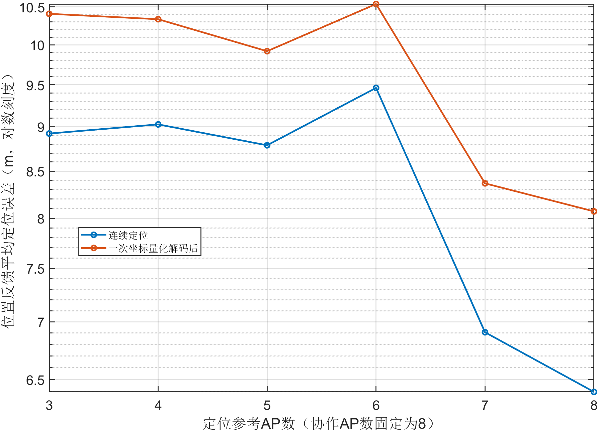

# UPA固定8个协作AP的定位参考数扫描预实验报告

2026年10月25日。本次固定协作AP总数B=8，将参与定位的参考AP数R从3扫到8，检查更多定位观测是否改变原来近似水平的曲线。沿用上次32个等间隔冻结位置，观测SNR30 dB，每AP32×32单极化UPA，LOS与MIX分别运行。本次只研究定位，不重新设计单流或双流预编码，也不替换原400位置报告。

## 1 变量与实现边界

| 项目 | 设置 |
|---|---|
| 协作AP总数B | 始终固定为8 |
| 横轴R | 定位参考AP数3、4、5、6、7、8，整数刻度 |
| 参考AP集合 | 公开活动AP顺序的前R个，逐步嵌套；不是按定位结果挑选AP |
| 位置 | 与低至高SNR预实验相同的32个等间隔位置 |
| 观测 | 每个位置与信道只生成一次8 AP观测，跨R直接复用；SNR固定30 dB |
| 信道 | LOS与MIX分开；MIX的K=10 dB |
| 空间频率 | 每参考AP两个14 bit频率整数，先量化频率再由CPU定位 |
| DFT索引 | 每参考AP两个7 bit方向索引，再由CPU定位 |
| 位置反馈 | UE用R个参考AP的连续频率定位，然后只量化一次坐标；13/14/9 bit固定 |
| CPU与UE | 共享原定位前端；共相位来源不改变本实验的位置估计，因此共用同一份定位结果 |

对空间频率和DFT索引，R表示发送方向消息的AP数；对位置反馈，R表示UE定位使用的参考AP数，不表示反馈R份位置。位置反馈仍只发送一份36 bit坐标消息。方法、R和AP顺序预先共享，不额外计入配置头；本定位实验没有相位反馈字段。

实现调用原空间频率估计器、射线最小二乘定位、方向消息恢复和坐标编码函数。8个AP各估计一次，再取相同观测的前R个子集。为独立恢复位置，本预实验按R实际打包和解码方向整数或坐标整数；该定位消息格式为LOC_REF_SWEEP_V1，未把原仅支持R=3的SSTR_V2完整预编码协议静默扩展到R=8。

参考AP集合如下：

| R | 物理AP编号 |
|---|---|
| 3 | 1,2,3 |
| 4 | 1,2,3,6 |
| 5 | 1,2,3,6,8 |
| 6 | 1,2,3,6,8,4 |
| 7 | 1,2,3,6,8,4,5 |
| 8 | 1,2,3,6,8,4,5,7 |

## 2 主要发现

### 纯LOS的R=3与R=8对照

| 方法 | R=3均值 mm | R=8均值 mm | 均值降幅 | 逐位置改善比例 |
|---|---|---|---|---|
| 空间频率 | 1.981 | 1.398 | 29.43% | 68.75% |
| DFT索引 | 201.229 | 110.661 | 45.01% | 81.25% |
| 位置反馈 | 4.278 | 4.206 | 1.70% | 40.62% |

### 混合信道的R=3与R=8对照

| 方法 | R=3均值 mm | R=8均值 mm | 均值降幅 | 逐位置改善比例 |
|---|---|---|---|---|
| 空间频率 | 9.321 | 6.525 | 30.00% | 53.12% |
| DFT索引 | 205.844 | 111.407 | 45.88% | 81.25% |
| 位置反馈 | 10.409 | 8.071 | 22.46% | 46.88% |

DFT索引的方向量化较粗，增加定位参考AP后，本次两种信道下的均值下降较明显。空间频率和位置反馈的误差较小，收益还受观测偏差与坐标量化影响。

纯LOS下位置反馈的量化后误差约为4 mm量级，增加参考观测后的连续定位改善可能被固定坐标量化掩盖。MIX下R=5到6时，部分方法误差回升，之后R=7和8继续下降；当前无权重射线最小二乘并不保证加入一个AP后误差逐点下降。所有AP和位置均保留。

增加R同时改变了AP集合的空间几何与方向观测，本结论只对应这里预先固定的嵌套集合，不代表任意同样数量的AP子集都有相同收益。

## 3 CPU端定位误差随参考AP数变化

本端位置结果与另一端相同，因为输入空间消息和位置解码规则相同；下表和图复用同一份物理定位记录，不将两端当作两组独立样本。B固定8，横轴是R，不能与此前固定R=3、改变协作AP总数的曲线混为一谈。

### CPU纯LOS定位误差与定位参考AP数

| 方法 | 3 | 4 | 5 | 6 | 7 | 8 |
|---|---|---|---|---|---|---|
| 空间频率 | 0.001981 | 0.001561 | 0.001619 | 0.001593 | 0.001542 | 0.001398 |
| DFT索引 | 0.201229 | 0.189911 | 0.183465 | 0.162717 | 0.140917 | 0.110661 |
| 位置反馈 | 0.004278 | 0.004240 | 0.004345 | 0.004301 | 0.004309 | 0.004206 |





表中单位为m。线性图保留绝对误差差距，对数图补充显示毫米级方法的变化；两图使用相同数值。

### CPU混合信道定位误差与定位参考AP数

| 方法 | 3 | 4 | 5 | 6 | 7 | 8 |
|---|---|---|---|---|---|---|
| 空间频率 | 0.009321 | 0.009257 | 0.009122 | 0.009636 | 0.007023 | 0.006525 |
| DFT索引 | 0.205844 | 0.195874 | 0.188567 | 0.167642 | 0.142888 | 0.111407 |
| 位置反馈 | 0.010409 | 0.010336 | 0.009919 | 0.010541 | 0.008367 | 0.008071 |





表中单位为m。线性图保留绝对误差差距，对数图补充显示毫米级方法的变化；两图使用相同数值。

## 4 UE端定位误差随参考AP数变化

本端位置结果与另一端相同，因为输入空间消息和位置解码规则相同；下表和图复用同一份物理定位记录，不将两端当作两组独立样本。B固定8，横轴是R，不能与此前固定R=3、改变协作AP总数的曲线混为一谈。

### UE纯LOS定位误差与定位参考AP数

| 方法 | 3 | 4 | 5 | 6 | 7 | 8 |
|---|---|---|---|---|---|---|
| 空间频率 | 0.001981 | 0.001561 | 0.001619 | 0.001593 | 0.001542 | 0.001398 |
| DFT索引 | 0.201229 | 0.189911 | 0.183465 | 0.162717 | 0.140917 | 0.110661 |
| 位置反馈 | 0.004278 | 0.004240 | 0.004345 | 0.004301 | 0.004309 | 0.004206 |


表中单位为m。线性图保留绝对误差差距，对数图补充显示毫米级方法的变化；两图使用相同数值。

### UE混合信道定位误差与定位参考AP数

| 方法 | 3 | 4 | 5 | 6 | 7 | 8 |
|---|---|---|---|---|---|---|
| 空间频率 | 0.009321 | 0.009257 | 0.009122 | 0.009636 | 0.007023 | 0.006525 |
| DFT索引 | 0.205844 | 0.195874 | 0.188567 | 0.167642 | 0.142888 | 0.111407 |
| 位置反馈 | 0.010409 | 0.010336 | 0.009919 | 0.010541 | 0.008367 | 0.008071 |


表中单位为m。线性图保留绝对误差差距，对数图补充显示毫米级方法的变化；两图使用相同数值。

## 5 坐标量化与空间反馈量补充

### 纯LOS位置反馈连续定位与坐标解码

| R | 连续定位均值 mm | 坐标解码均值 mm | 解码中位 mm | 解码95%分位 mm |
|---|---|---|---|---|
| 3 | 0.854 | 4.278 | 4.263 | 6.464 |
| 4 | 0.770 | 4.240 | 4.281 | 6.504 |
| 5 | 0.888 | 4.345 | 4.281 | 7.116 |
| 6 | 0.938 | 4.301 | 4.281 | 6.592 |
| 7 | 1.052 | 4.309 | 4.350 | 6.538 |
| 8 | 0.709 | 4.206 | 4.295 | 6.450 |



位置反馈始终由连续频率直接定位后量化一次坐标，没有先量化频率再定位。坐标预算和公共编码区域不随R改变，未使用真实位置调整bit分配。

### 混合信道位置反馈连续定位与坐标解码

| R | 连续定位均值 mm | 坐标解码均值 mm | 解码中位 mm | 解码95%分位 mm |
|---|---|---|---|---|
| 3 | 8.921 | 10.409 | 7.820 | 27.418 |
| 4 | 9.027 | 10.336 | 8.416 | 24.517 |
| 5 | 8.787 | 9.919 | 9.201 | 20.802 |
| 6 | 9.462 | 10.541 | 9.454 | 21.411 |
| 7 | 6.907 | 8.367 | 8.184 | 15.679 |
| 8 | 6.397 | 8.071 | 7.761 | 14.526 |



位置反馈始终由连续频率直接定位后量化一次坐标，没有先量化频率再定位。坐标预算和公共编码区域不随R改变，未使用真实位置调整bit分配。

### 空间消息反馈量

| 方法 | R=3 | R=4 | R=5 | R=6 | R=7 | R=8 |
|---|---|---|---|---|---|---|
| 空间频率 | 84 | 112 | 140 | 168 | 196 | 224 |
| DFT索引 | 42 | 56 | 70 | 84 | 98 | 112 |
| 位置反馈 | 36 | 36 | 36 | 36 | 36 | 36 |

表中单位为bit，仅统计空间消息。空间频率与DFT索引随着R发送更多方向整数；位置反馈只发送一次坐标。UE处理更多参考AP观测的计算及导频资源不计入该bit表，不能据36 bit不变就认定增加参考AP没有其他代价。若恢复原B=8的UE单流通信，相位字段另需28 bit；该通信过程不属于本次定位扫描。

## 6 与原实验的一致性及范围

独立核验恢复了全部1152条定位消息，重算位置、欧氏误差、均值、中位数及95%分位，最大位置差1.14e-13 m；每个方法、信道、R均保留全部32个位置。

R=3时与上次32位置SNR预实验中30 dB的192条记录逐一吻合，最大误差差值0 m。因此R变化没有改动既有R=3基线。

这次32位置均值与原400位置报告的均值可能不同，不能直接把两种样本规模的R=3平均数当作回归差异。此次只有一套冻结噪声实现和一种嵌套AP顺序，后续可再扩大至400位置，或另行考察AP子集选择；本次不自动覆盖正式实验。

```matlab
addpath('8.单流');
out=fullfile(pwd,'8.单流','results','new_reference_ap_pilot');
run_reference_ap_pilot('OutputDir',out);
plot_reference_ap_pilot(out);
```

```text
python analyze_reference_ap_pilot.py results/new_reference_ap_pilot --stage audit
python analyze_reference_ap_pilot.py results/new_reference_ap_pilot --stage report
```

原始逐位置记录、8 AP的估计值、参考集合、实际整数比特串、数值汇总及10组PNG/FIG单独保存。Word沿用现有文档流程生成，按用户要求不追加Word检查。
