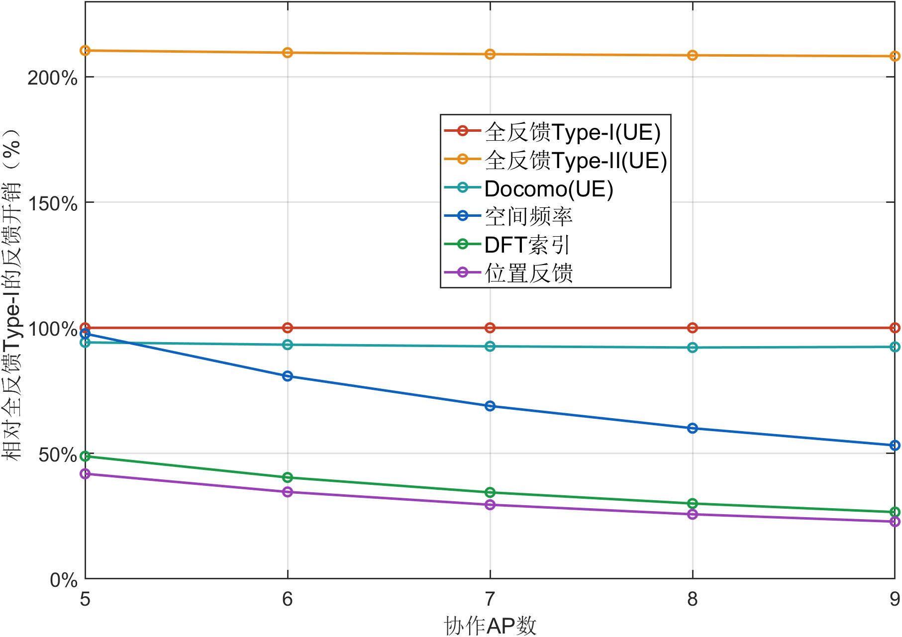
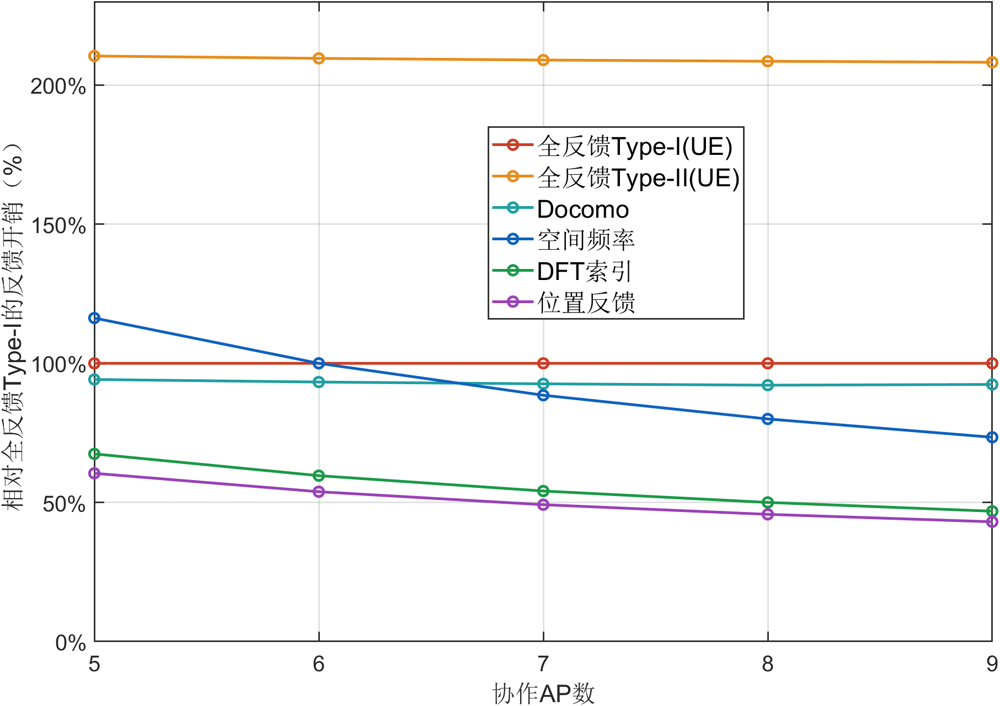
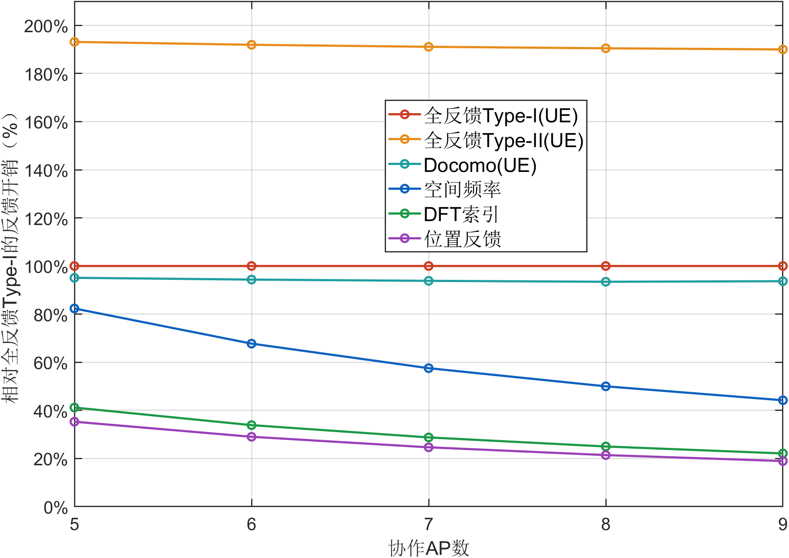
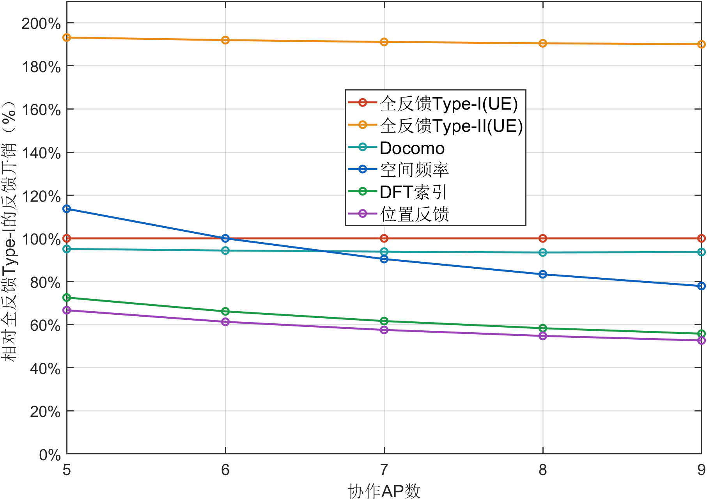

# 四组反馈开销百分比图

2026年10月26日最新图例更新：仅这四张百分比图手动指定图例位置，放在100%基准线与Type-II曲线之间的空白区域。字号仍为18 pt，宽高按文字自动适配；绘图脚本检查图例及其留白与插值后的全部曲线不相交。数值、曲线和坐标轴不变，其他图片保持best现状。最新图片位于各CPU或UE目录的`legend_manual_v4`内，MD引用及Word内嵌图同步，未追加Word检查。此前legend_best_v3和compact_legend_v2保留为历史版本。

2026年10月26日。单流CPU、单流UE、双流CPU、双流UE各新增一张百分比图，在两份正式报告中紧接各自原bit开销图展示。原bit图、数值及其他实验保留。

- [单流最新报告](https://github.com/ttal6688/ZTE_codebokk/blob/feat/upa-single-dual-complete-20261024/8.单流/docs/UPA单流400位置正式实验报告.md) · [Word](https://github.com/ttal6688/ZTE_codebokk/blob/feat/upa-single-dual-complete-20261024/8.单流/docs/UPA单流400位置正式实验报告.docx)
- [双流最新报告](https://github.com/ttal6688/ZTE_codebokk/blob/feat/upa-single-dual-complete-20261024/8.单流/docs/UPA单极化双流400位置完整实验报告.md) · [Word](https://github.com/ttal6688/ZTE_codebokk/blob/feat/upa-single-dual-complete-20261024/8.单流/docs/UPA单极化双流400位置完整实验报告.docx)

纵轴为相对全反馈Type-I的反馈开销，百分比=本方法有效载荷bit÷同AP数、同流数Type-I有效载荷bit×100%。Type-I恒为100%，节省比例为100%减去开销占比。超过100%的结果保留，不截断。四张图各含Type-I、Type-II、Docomo、空间频率、DFT索引、位置反馈六种方法，CPU中的三种全AP方案仍为UE共享参考。

| 8 AP默认点 | Type-I bit | 位置反馈 bit | 位置反馈占比 | 节省比例 |
|---|---|---|---|---|
| 单流CPU | 140 | 36 | 25.71% | 74.29% |
| 单流UE | 140 | 64 | 45.71% | 54.29% |
| 双流CPU | 168 | 36 | 21.43% | 78.57% |
| 双流UE | 168 | 92 | 54.76% | 45.24% |

仅对已审计的400位置AP扫描开销进行归一化，不重新仿真，不引入宽带分频反馈假设。LOS与MIX的消息长度逐项相同，因此统一用MIX记录作图。横轴显示整数5、6、7、8、9，原始数据和报告表保留5至10。

feedback_percentage.csv保存四组实验、六种方法、六个AP点，共144条归一化记录，同时保留原bit、对应Type-I基准、开销占比和节省比例。calculation_audit.json记录源文件SHA256、同信道开销检查及整数消息长度公式核对。figure_audit.json检查四张FIG曲线数据、100%基准、整数AP横轴、18 pt字号及图例不遮挡曲线。

figures/single/CPU、single/UE、dual/CPU、dual/UE中的legend_manual_v4目录各有最新PNG和可编辑FIG，可直接用于PPT；旧版图保留。报告现在分别有单流48处、双流82处插图引用，其中固定8 AP参考数实验的6幅在两份报告共用。Word仅替换四张百分比图，按用户要求不追加检查。

[下载四张手动避让版PNG图片压缩包](反馈开销百分比四图_PPT用_手动避让版.zip)，包内按单流CPU、单流UE、双流CPU、双流UE命名，附计算口径。原压缩包保留为历史版本。









```text
python 8.单流/prepare_feedback_percentage.py
```

```matlab
addpath('8.单流');
plot_feedback_percentage;
```

```text
python 8.单流/build_snr_revision_reports.py
python 8.单流/build_word_reports.py UPA单流400位置正式实验报告.md UPA单极化双流400位置完整实验报告.md
```
