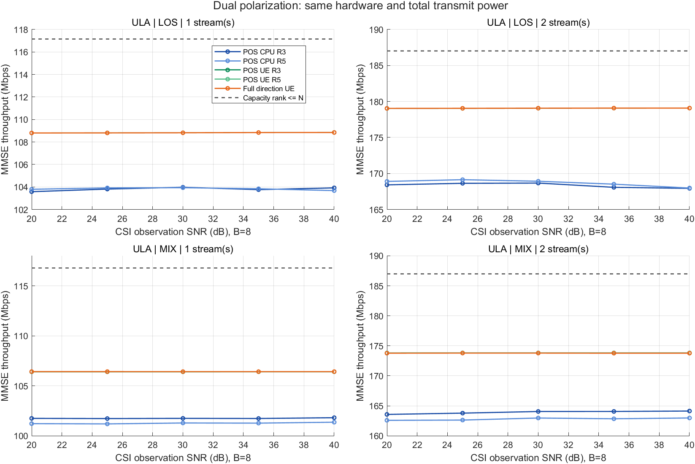
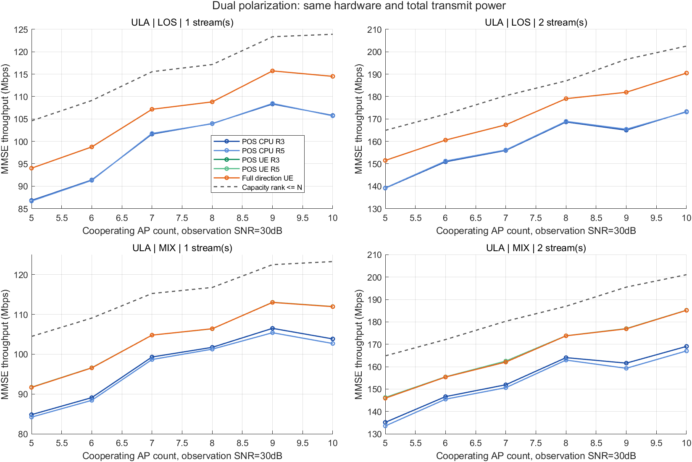
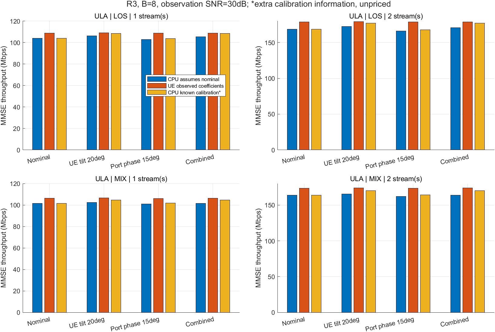
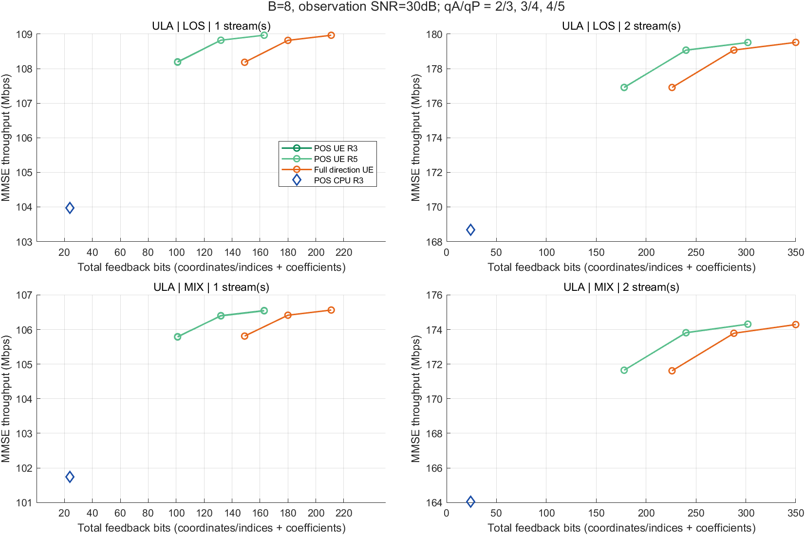
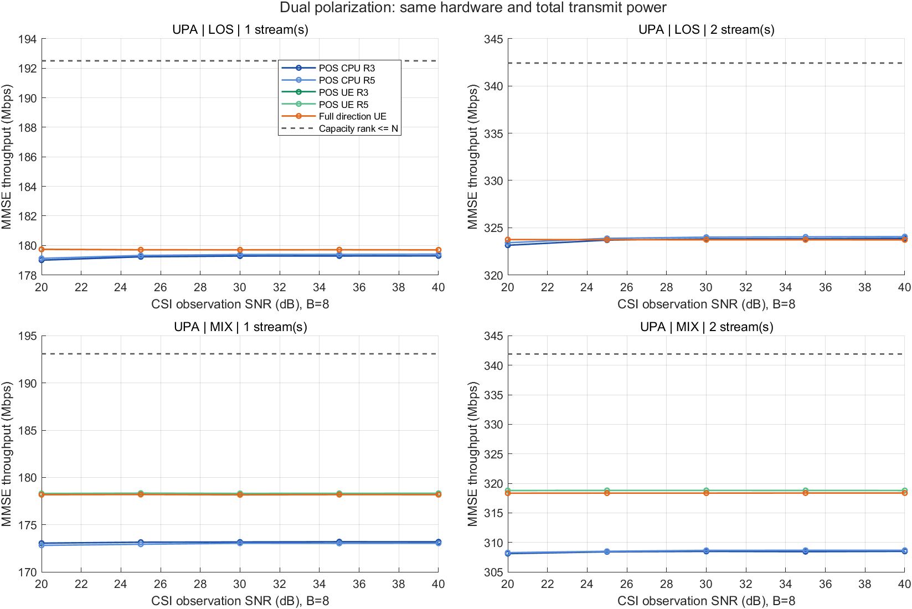
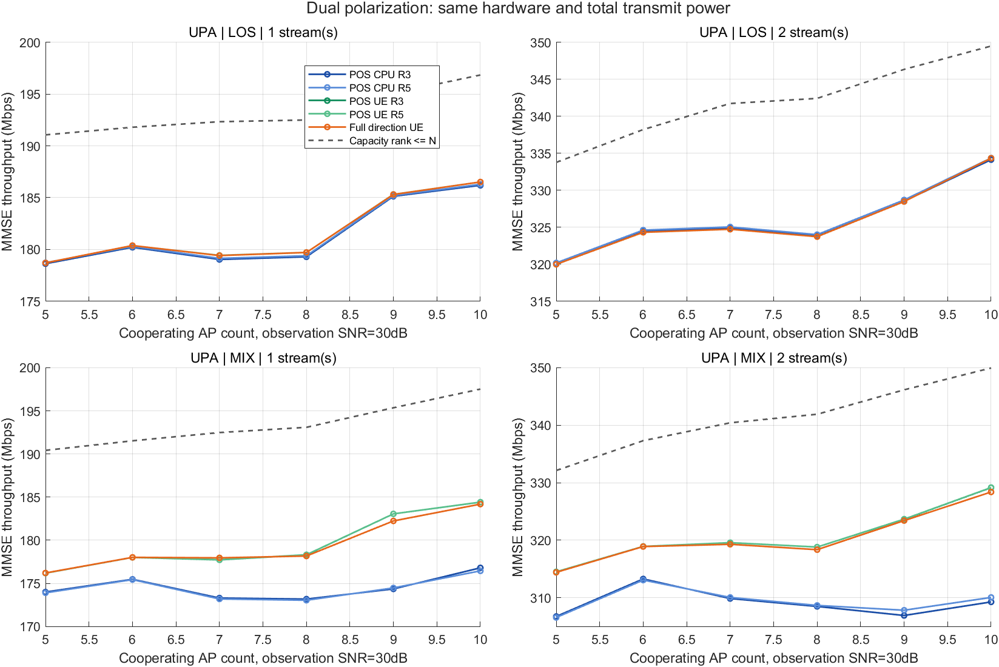
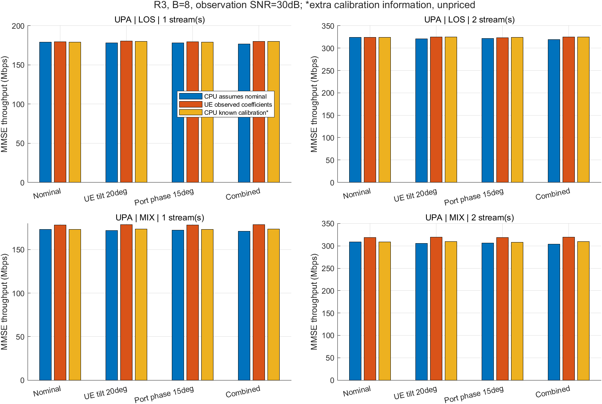
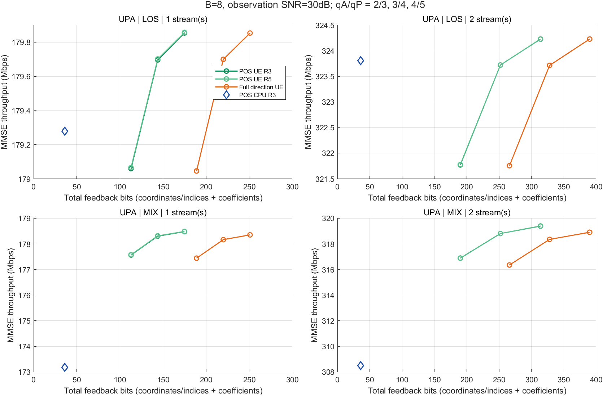

# 双极化与双流位置反馈仿真报告

完成日期：2026-10-22。四步实验均已执行；完整模型与消息协议见[目录说明](../../README.md)。

## 1. 先检查原单极化信道的多流潜力

原4接收空间位置、8协作AP的信道并非整体秩1。下表使用原400位置、原单极化真信道和存档POS解码位置；第二模态比为σ₂²/σ₁²。位置波束子空间的等功率理想双流参考在全部样本上高于单流。该参考允许在波束子空间内自由分配AP功率且不计反馈，不能直接视作可实施双流收益。

|array|channel|R|sigma2_ratio_median|energy_retention|ideal_two_stream_gain_Mbps|
|---|---|---|---|---|---|
|ULA|LOS|3|0.685|0.898|57.572|
|ULA|LOS|5|0.685|0.898|57.572|
|ULA|MIX|3|0.717|0.819|55.136|
|ULA|MIX|5|0.717|0.819|55.140|
|UPA|LOS|3|0.915|0.954|132.704|
|UPA|LOS|5|0.915|0.954|132.704|
|UPA|MIX|3|0.888|0.868|129.957|
|UPA|MIX|5|0.888|0.868|129.959|

## 2. 双极化单流控制与3. UE双流实现

每个原空间阵元改为两个±45°极化端口，UE为4位置×2极化。以下单/双流采用相同硬件、总功率1和每AP功率1/B。位置仍生成所有空间波束；多流系数由2×Ns矩阵承担，不能把旧单个AP共相位简单复制到两个流。

B=8、观测30dB、R3定点表（全方向对照和容量上界为R0）：

|array|channel|R|streams|method|MMSE_Mbps|joint_Mbps|feedback_bits|
|---|---|---|---|---|---|---|---|
|ULA|LOS|0|1|CAP_RANK_LE_N|117.153|117.153|—|
|ULA|LOS|0|1|FULLDIR_UE_Q|108.816|108.816|180.000|
|ULA|LOS|0|2|CAP_RANK_LE_N|187.023|187.023|—|
|ULA|LOS|0|2|FULLDIR_UE_Q|179.070|179.419|288.000|
|ULA|LOS|3|1|POS_CPU|103.975|103.975|24.000|
|ULA|LOS|3|1|POS_UE_Q|108.820|108.820|132.000|
|ULA|LOS|3|2|POS_CPU|168.666|170.496|24.000|
|ULA|LOS|3|2|POS_UE_Q|179.064|179.412|240.000|
|ULA|MIX|0|1|CAP_RANK_LE_N|116.782|116.782|—|
|ULA|MIX|0|1|FULLDIR_UE_Q|106.415|106.415|180.000|
|ULA|MIX|0|2|CAP_RANK_LE_N|186.992|186.992|—|
|ULA|MIX|0|2|FULLDIR_UE_Q|173.786|174.190|288.000|
|ULA|MIX|3|1|POS_CPU|101.743|101.743|24.000|
|ULA|MIX|3|1|POS_UE_Q|106.400|106.400|132.000|
|ULA|MIX|3|2|POS_CPU|164.049|165.881|24.000|
|ULA|MIX|3|2|POS_UE_Q|173.815|174.211|240.000|
|UPA|LOS|0|1|CAP_RANK_LE_N|192.502|192.502|—|
|UPA|LOS|0|1|FULLDIR_UE_Q|179.700|179.700|220.000|
|UPA|LOS|0|2|CAP_RANK_LE_N|342.423|342.423|—|
|UPA|LOS|0|2|FULLDIR_UE_Q|323.714|325.353|328.000|
|UPA|LOS|3|1|POS_CPU|179.278|179.278|36.000|
|UPA|LOS|3|1|POS_UE_Q|179.697|179.697|144.000|
|UPA|LOS|3|2|POS_CPU|323.810|325.379|36.000|
|UPA|LOS|3|2|POS_UE_Q|323.722|325.359|252.000|
|UPA|MIX|0|1|CAP_RANK_LE_N|193.091|193.091|—|
|UPA|MIX|0|1|FULLDIR_UE_Q|178.167|178.167|220.000|
|UPA|MIX|0|2|CAP_RANK_LE_N|341.909|341.909|—|
|UPA|MIX|0|2|FULLDIR_UE_Q|318.353|320.126|328.000|
|UPA|MIX|3|1|POS_CPU|173.172|173.172|36.000|
|UPA|MIX|3|1|POS_UE_Q|178.304|178.304|144.000|
|UPA|MIX|3|2|POS_CPU|308.482|310.591|36.000|
|UPA|MIX|3|2|POS_UE_Q|318.810|320.580|252.000|

双流减单流的逐样本配对结果，单位Mbps；95%区间为配对差值的正态近似均值区间：

|array|channel|method|delta_Mbps|delta_CI95_low|delta_CI95_high|positive_fraction|
|---|---|---|---|---|---|---|
|ULA|LOS|POS_CPU|64.691|63.832|65.550|1.000|
|ULA|LOS|POS_UE_Q|70.243|69.833|70.654|1.000|
|ULA|MIX|POS_CPU|62.306|61.417|63.195|1.000|
|ULA|MIX|POS_UE_Q|67.415|67.039|67.790|1.000|
|UPA|LOS|POS_CPU|144.532|144.112|144.951|1.000|
|UPA|LOS|POS_UE_Q|144.025|143.609|144.441|1.000|
|UPA|MIX|POS_CPU|135.309|134.145|136.474|1.000|
|UPA|MIX|POS_UE_Q|140.506|140.080|140.932|1.000|

双流POS UE R3与全方向UE采用相同系数量化的配对差值：

|array|channel|left_mean_Mbps|right_mean_Mbps|delta_Mbps|delta_CI95_low|delta_CI95_high|percent_of_right|
|---|---|---|---|---|---|---|---|
|ULA|LOS|179.064|179.070|-0.007|-0.013|-0.001|-0.004|
|ULA|MIX|173.815|173.786|0.029|-0.014|0.073|0.017|
|UPA|LOS|323.722|323.714|0.007|-0.005|0.019|0.002|
|UPA|MIX|318.810|318.353|0.457|0.265|0.648|0.143|

系数幅度3bit、相位4bit。B=8双流系数216bit；ULA的POS总反馈240bit、全方向288bit，节省16.67%；UPA为252/328bit，节省23.17%。CPU只反馈24/36bit位置，但其系数依赖公开极化与LOS模型。以上均未扣除导频和反馈资源占用，不是净吞吐量。连续系数没有有限反馈bit；全方向对照为本项目构造，不等同完整NR Type-I。

## 4. CPU已知极化与失配试验

固定B=8、观测30dB，分别将UE绕y轴倾斜20°、加入逐物理AP第二极化端口RMS15°相位偏差、叠加二者。UE通过有噪观测重新设计系数，CPU默认仍使用标称极化。CALIBRATED对照额外知道真实倾角/端口校准值，但共享同一解码位置与波束；未计该额外信息成本，作为诊断。

|array|channel|scenario|method|MMSE_Mbps|
|---|---|---|---|---|
|ULA|LOS|combined|POS_CPU|170.838|
|ULA|LOS|combined|POS_CPU_CALIBRATED|177.261|
|ULA|LOS|combined|POS_UE_Q|179.067|
|ULA|LOS|nominal|POS_CPU|168.666|
|ULA|LOS|nominal|POS_UE_Q|179.064|
|ULA|LOS|phase15|POS_CPU|166.122|
|ULA|LOS|phase15|POS_CPU_CALIBRATED|168.041|
|ULA|LOS|phase15|POS_UE_Q|178.823|
|ULA|LOS|tilt20|POS_CPU|172.712|
|ULA|LOS|tilt20|POS_CPU_CALIBRATED|177.261|
|ULA|LOS|tilt20|POS_UE_Q|179.299|
|ULA|MIX|combined|POS_CPU|163.740|
|ULA|MIX|combined|POS_CPU_CALIBRATED|170.112|
|ULA|MIX|combined|POS_UE_Q|173.923|
|ULA|MIX|nominal|POS_CPU|164.049|
|ULA|MIX|nominal|POS_UE_Q|173.815|
|ULA|MIX|phase15|POS_CPU|162.379|
|ULA|MIX|phase15|POS_CPU_CALIBRATED|164.246|
|ULA|MIX|phase15|POS_UE_Q|173.631|
|ULA|MIX|tilt20|POS_CPU|165.635|
|ULA|MIX|tilt20|POS_CPU_CALIBRATED|170.125|
|ULA|MIX|tilt20|POS_UE_Q|174.083|
|UPA|LOS|combined|POS_CPU|318.873|
|UPA|LOS|combined|POS_CPU_CALIBRATED|325.052|
|UPA|LOS|combined|POS_UE_Q|324.672|
|UPA|LOS|nominal|POS_CPU|323.810|
|UPA|LOS|nominal|POS_UE_Q|323.722|
|UPA|LOS|phase15|POS_CPU|321.518|
|UPA|LOS|phase15|POS_CPU_CALIBRATED|323.811|
|UPA|LOS|phase15|POS_UE_Q|323.487|
|UPA|LOS|tilt20|POS_CPU|321.139|
|UPA|LOS|tilt20|POS_CPU_CALIBRATED|325.051|
|UPA|LOS|tilt20|POS_UE_Q|324.879|
|UPA|MIX|combined|POS_CPU|303.642|
|UPA|MIX|combined|POS_CPU_CALIBRATED|309.447|
|UPA|MIX|combined|POS_UE_Q|319.660|
|UPA|MIX|nominal|POS_CPU|308.482|
|UPA|MIX|nominal|POS_UE_Q|318.810|
|UPA|MIX|phase15|POS_CPU|306.503|
|UPA|MIX|phase15|POS_CPU_CALIBRATED|308.430|
|UPA|MIX|phase15|POS_UE_Q|318.672|
|UPA|MIX|tilt20|POS_CPU|305.481|
|UPA|MIX|tilt20|POS_CPU_CALIBRATED|309.413|
|UPA|MIX|tilt20|POS_UE_Q|319.781|

相位失配是发射端口的列酉变换，本身不改变真实信道容量；若CPU性能下降而UE保持稳定，原因是系数设计没有匹配实际端口相位。倾角失配也可能改变真实信道的可用空间模式，速率不保证随倾角单调下降，不能把其全部变化归因于算法误差。逐样本配对数据见`mismatch_paired.csv`。

### CPU标称极化下残差的追加诊断

ULA在标称LOS下仍出现CPU与UE差距，追加R3定点实验：保持主实验估计位置生成的波束不变，只替换系数设计所用的信息。CPU_estimated_p重算主实验；ORACLE_true_p_same_beams用真实位置但仍是平面LOS模型；ORACLE_true_effective_H_same_beams用真实有效信道。后两项均没有可实施有限反馈预算，也不是一般最优上界。

|array|channel|streams|variant|MMSE_Mbps|
|---|---|---|---|---|
|ULA|LOS|1|CPU_estimated_p|103.975|
|ULA|LOS|1|ORACLE_true_effective_H_same_beams|109.051|
|ULA|LOS|1|ORACLE_true_p_same_beams|108.665|
|ULA|LOS|2|CPU_estimated_p|168.666|
|ULA|LOS|2|ORACLE_true_effective_H_same_beams|179.653|
|ULA|LOS|2|ORACLE_true_p_same_beams|177.624|
|ULA|MIX|1|CPU_estimated_p|101.743|
|ULA|MIX|1|ORACLE_true_effective_H_same_beams|106.612|
|ULA|MIX|1|ORACLE_true_p_same_beams|105.982|
|ULA|MIX|2|CPU_estimated_p|164.049|
|ULA|MIX|2|ORACLE_true_effective_H_same_beams|174.472|
|ULA|MIX|2|ORACLE_true_p_same_beams|172.347|
|UPA|LOS|1|CPU_estimated_p|179.278|
|UPA|LOS|1|ORACLE_true_effective_H_same_beams|179.908|
|UPA|LOS|1|ORACLE_true_p_same_beams|179.513|
|UPA|LOS|2|CPU_estimated_p|323.810|
|UPA|LOS|2|ORACLE_true_effective_H_same_beams|324.354|
|UPA|LOS|2|ORACLE_true_p_same_beams|324.259|
|UPA|MIX|1|CPU_estimated_p|173.172|
|UPA|MIX|1|ORACLE_true_effective_H_same_beams|178.556|
|UPA|MIX|1|ORACLE_true_p_same_beams|176.771|
|UPA|MIX|2|CPU_estimated_p|308.482|
|UPA|MIX|2|ORACLE_true_effective_H_same_beams|319.526|
|UPA|MIX|2|ORACLE_true_p_same_beams|318.816|

## 曲线与量化开销

### ULA

### UPA

## 审计、范围与后续判断

两阵列各148800条正式/补充记录，共297600条；另有原信道秩诊断3200条、独立24位置pilot共9792条及CPU残差诊断9600条。正式实验每配置400位置。54项预检查及全量独立CSV审计通过，整数系数消息逐条解码复核，CPU/UE位置与波束一致，无坐标域溢出。总功率、每AP功率、MMSE≤联合解码≤对应秩容量上界均通过核查。

该结果支持在受控双极化模型下扩展位置反馈到双流；位置承担公共空间波束信息，UE系数承担极化混合、跨AP相干关系与流间干扰控制。CPU方案是否足够，应结合上表在目标极化校准条件下的实际差距判断。继续降低UE双流开销，需要结构化的极化/子空间系数码本；不能沿用旧单流52/64bit来声称同样的压缩率。

统计结论条件于冻结AP部署、6个散射体及一次冻结极化耦合/端口误差实例。这里没有覆盖完整38.901、实测天线方向图、互耦、宽带频率选择性、多用户调度、移动跟踪、独立部署重复和极化误差强度扫描，不能据此给出一般系统性能保证。容量上界放松了每AP功率约束；可实施系数为SVD初始化后逐AP归一的启发式方案。

文件：`legacy_rank_trials.csv`、`ULA/UPA/trials.csv`为逐样本数据；`dual_stream_gain_paired.csv`、`UE_vs_full_direction_paired.csv`、`mismatch_paired.csv`为配对比较；`complete_audit.json`与`source_and_input_SHA256.json`为审计和复现校验。每张PNG附同名MATLAB FIG。
