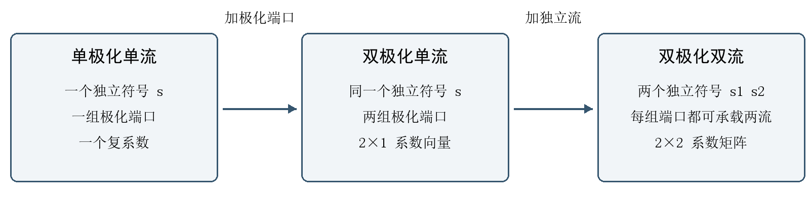

# UPA双极化双流预编码方法扩展说明

扩展原理与分链路最小验证  2026年10月22日

[下载可转发的Word报告](双流双极化全方法最小验证与扩展说明.docx)

本报告以UPA为场景，讲解原单流单极化低反馈预编码怎样改造成双极化双流预编码。先增加极化端口，再增加独立数据流，最后分别说明UE和CPU怎样计算新系数。实验只作为实现依据，UE与CPU的最小验证各自独立呈现。

真正的算法改动集中在系数设计：原来每AP只有一个复数c_b；增加极化后，它先变成2×1向量；发送两条独立流时，再变成2×2矩阵C_b。该矩阵同时规定极化配比、跨AP相对相位和两条流的线性组合。空间频率、方向索引或位置，仍主要负责选择公共空间波束f_b。

**表1 三个阶段究竟改变了什么**

|阶段|每AP发送信号|必须设计的系数|
|---|---|---|
|单极化单流|一组N阵元发送同一符号s|一个复数c_b|
|双极化单流|两组极化端口都承载同一个s|两个复数组成2×1向量|
|双极化双流|两组端口各发送s₁与s₂的线性组合|四个复数组成2×2矩阵C_b|

UPA每个AP仍有32×32个空间阵元，每个位置配置两个±45°极化端口，共2048个发射端口。UE保留4个空间位置，每个位置配置两极化，共8个接收端口。单流和双流都在这套双极化硬件上比较，总功率保持1。

建议按第一至四部分理解结构，再阅读第五至八部分的UE方法，最后单独阅读第九和第十部分的CPU方法。单流表示只发送一个数据符号序列；双极化表示端口的物理属性；两者不能混为同一个概念。

## 一 双极化首先改变的是物理信道

原单极化模型中，第b个AP到UE的信道H₀,b为4×1024矩阵。增加极化后，信道按接收极化分成上下两组行，按发射极化分成左右两组列。每个子块仍为4×1024，完整H_b为8×2048。行列下标的第一个符号表示接收极化，第二个表示发射极化。

$$
\mathbf H_b=\begin{bmatrix}\mathbf H_{++}&\mathbf H_{+-}\\
\mathbf H_{-+}&\mathbf H_{--}\end{bmatrix}
$$

例如H_{+-}表示负极化发射端口到正极化接收端口的耦合。交叉极化子块可以非零，所以两个极化端口不能先验地当作两条互不干扰的信道。它们是否支持两个有效模式，必须结合整个信道判断。

本次LOS实现沿用原逐阵元传播矩阵H₀,b，再为它乘上描述极化方向投影的2×2矩阵J_b。各子块的传播相位形状相同，幅度与附加相位由对应的J元素决定。

$$
\mathbf H_b^{LOS}=\mathbf J_b\otimes\mathbf H_{0,b},\quad \mathbf J_b=\begin{bmatrix}j_{++}&j_{+-}\\
j_{-+}&j_{--}\end{bmatrix}
$$

J_b由AP和UE的极化轴方向及中心射线q计算：先去除电场在传播方向上的纵向分量，再投影到接收极化轴。实现中将J_b的Frobenius范数归一为√2，以固定路径极化功率尺度。

$$
\widetilde{\mathbf J}_b=\mathbf E_r^T(\mathbf I-\mathbf q\mathbf q^T)\mathbf E_{t,b}
$$

六条散射路径各自使用两段传播方向和2×2极化耦合矩阵，设置XPR为10 dB；逐路径形成J与原空间传播矩阵的Kronecker积后叠加，再沿用K为10 dB的Rician功率比例。原空间坐标和球面传播距离保留，极化响应按中心射线近似。这是当前受控模型的实现方式。

**表2 UPA信道与端口的变化**

|量|单极化|双极化|
|---|---|---|
|每AP空间位置数|1024|1024|
|每AP发射端口数|1024|2048|
|UE空间位置数|4|4|
|UE接收端口数|4|8|
|单AP信道维度|4×1024|8×2048|

## 二 先增加极化端口但仍只发送一流

原来第b个AP使用单位范数空间波束f_b，只发送一个数据符号s。AP间复系数c_b调节相干合成关系，发送向量x_b共有1024个分量。

$$
\mathbf x_b=\mathbf f_b c_b s
$$

增加极化后，暂时仍只发同一个s。正、负极化端口可以有不同的复权重c_{b,+}和c_{b,-}，但两组端口承载的是同一条数据流。因此系数从一个复数变成一个2×1向量。

$$
\mathbf x_{b,+}=\mathbf f_b c_{b,+}s,\quad \mathbf x_{b,-}=\mathbf f_b c_{b,-}s
$$

将两组发射端口按行堆叠，可以把公共空间波束和极化系数分开写。F_b的两列作用于不同极化端口，虽然使用同一空间波束形状，仍是两列不同的端口激励。

$$
\mathbf F_b=\begin{bmatrix}\mathbf f_b&0\\
0&\mathbf f_b\end{bmatrix},\quad \mathbf c_b=\begin{bmatrix}c_{b,+}\\
c_{b,-}\end{bmatrix},\quad \mathbf x_b=\mathbf F_b\mathbf c_b s
$$

此时F_b为2048×2，c_b为2×1，最终预编码F_b c_b仍只有一列。接收端看到的是同一符号经过两个极化通道叠加后的一个信号方向。极化端口增加了，数据流数量仍为1。

因此，扩展到双极化时已经需要重新设计两个端口的相对幅度和相位。原来只有一个AP共相位的计算结果，不能完整描述这两个极化端口的组合关系。

## 三 再增加第二条独立数据流

现在把单个符号s改为两个独立符号s₁、s₂，并令其协方差为单位阵。两个符号在所有协作AP中保持相同含义：每个AP都帮助发送同一对数据流。每个AP需要决定每条流在两个极化端口上的复权重，因此c_b扩展成2×2矩阵C_b。

$$
\mathbf s=\begin{bmatrix}s_1\\
s_2\end{bmatrix},\quad \mathbf C_b=\begin{bmatrix}c_{b,+1}&c_{b,+2}\\
c_{b,-1}&c_{b,-2}\end{bmatrix}
$$

第一列专门给第一条流使用，第二列专门给第二条流使用。把乘法展开，便能看到每一组极化端口实际发送什么：

$$
\mathbf x_{b,+}=\mathbf f_b(c_{b,+1}s_1+c_{b,+2}s_2)
$$

$$
\mathbf x_{b,-}=\mathbf f_b(c_{b,-1}s_1+c_{b,-2}s_2)
$$

这意味着一条流可以同时占用两个极化端口，一个极化端口也可以同时承载两条流的线性组合。“每个极化固定对应一条流”只是某些特殊系数矩阵的情况，当前算法不作这个限制。

$$
\mathbf W_b=\mathbf F_b\mathbf C_b\in\mathbb C^{2048\times2},\quad \mathbf y=\sum_{b=1}^{B}\mathbf H_b\mathbf W_b\mathbf s+\mathbf n
$$

若把旧预编码向量复制两遍，W_b的两列相同，两个符号就会以s₁+s₂的形式合在同一个方向上，不能形成两条独立接收模式。真正要设计的是两组不同的列权重，并使联合接收矩阵G保留两列线性独立的有效信号。

$$
\mathbf G=\sum_b\mathbf H_b\mathbf F_b\mathbf C_b,\quad \mathrm{rank}(\mathbf G)=2
$$

共同空间波束f_b只约束每种极化在阵列上的空间形状，并不要求W_b两列相同。两个极化端口加上多个AP和UE多个接收位置，形成联合有效信道中的可用模式。是否存在足够强的第二模式，仍取决于实际信道。

## 四 用一个手算例子看清两条流

本节仅用于解释矩阵乘法，不是仿真测量。取一个AP、每极化两个阵元，并暂取两个有效接收端口。令公共空间波束f为[1,1]ᵀ/√2，有效信道E包含交叉极化耦合。

$$
\mathbf F=\frac1{\sqrt2}\begin{bmatrix}1&0\\
1&0\\
0&1\\
0&1\end{bmatrix},\quad \mathbf E=\begin{bmatrix}1&0.3\\
0.3&1\end{bmatrix}
$$

E的两个右奇异向量分别为[1,1]ᵀ/√2和[1,−1]ᵀ/√2。给两条流各分一半总功率，得到下列C；其中第一条流在两种极化上同相，第二条流在两种极化上反相。

$$
\mathbf C=\frac12\begin{bmatrix}1&1\\
1&-1\end{bmatrix},\quad \mathbf W=\mathbf F\mathbf C=\frac1{2\sqrt2}\begin{bmatrix}1&1\\
1&1\\
1&-1\\
1&-1\end{bmatrix}
$$

所以正极化的两个阵元都发送(s₁+s₂)/(2√2)，负极化的两个阵元都发送(s₁−s₂)/(2√2)。接收端可利用这两种不同的组合区分s₁和s₂，而两个极化端口都参与了两条流。

$$
\mathbf G=\mathbf E\mathbf C=\frac12\begin{bmatrix}1.3&0.7\\
1.3&-0.7\end{bmatrix}
$$

G的两列内积为0、秩为2，总预编码功率‖W‖²_F为1。例子因此同时说明了流的可分离性和功率没有随流数翻倍。反过来，若C取下面这个两列相同的矩阵，即使输入两个符号，接收秩仍只有1：

$$
\mathbf C_{bad}=\frac12\begin{bmatrix}1&1\\
1&1\end{bmatrix}
$$

实际多AP场景不会预先固定这个例子中的同相和反相关系；算法根据全部AP的联合有效信道求出C，再拆成各AP的系数块。

## 五 UE怎样计算整套双流系数

UE链路假定UE能够获得所有参与AP的带噪端口级信道Y_b。这是信道观测，不是已经混合在一起的未知双流数据。当前仿真没有实现获取这些端口观测的导频协议，也未计其额外时频开销。

第一步，UE先生成要反馈的频率、方向索引、位置或基线波束消息，然后在本地执行与CPU相同的解码规则，得到最终F_b。系数必须针对CPU实际恢复的量化空间波束计算。

第二步，把每个AP的观测压缩到两个极化端口的公共空间波束上，再按AP顺序拼接。UPA下Y_b为8×2048，F_b为2048×2；B为8时，联合有效观测E_UE为8×16。

$$
\mathbf E_{UE}=[\mathbf Y_1\mathbf F_1,\ldots,\mathbf Y_B\mathbf F_B]
$$

第三步，对全部AP拼接后的E_UE统一做一次SVD，取前Ns个右奇异向量。Ns为1时取一列；Ns为2时取两列。不能给每个AP独立做SVD后直接拼接，因为不同AP独立选择的“第一流”和“第二流”可能不在同一个联合发送基底中。

$$
\mathbf E_{UE}=\mathbf U\mathbf\Sigma\mathbf V^H,\quad \widetilde{\mathbf C}=\mathbf V(:,1:N_s)
$$

第四步，把16×Ns的联合系数按每AP两行拆成V_b，并逐AP归一。最终每AP系数块的功率为1/B，全部AP、全部流的总功率为1。

$$
\mathbf C_b=\frac{\mathbf V_b}{\sqrt B\|\mathbf V_b\|_F}
$$

第五步，固定每流的一个全局相位锚，再量化各系数的幅度和相位。CPU解码后再次逐AP归一，组装W_b=F_b C_b。第六步，接收端按最终实际有效信号矩阵计算MMSE组合，恢复两条流。逐AP归一和量化可能破坏原SVD的严格列正交性，因此实际接收使用MMSE，不直接假定流间干扰为零。

## 六 HAQSE DFT和位置反馈各改在哪里

这三个方法原来就负责提供几何空间信息，扩展后仍保留该分工。它们需要适配双极化观测和多模式选波束，而两条流的组合权重交给上一部分的C_b设计。

HAQSE的输入变化最具体。把Y_b按两组发射极化分开，各组为8×1024，再使用不共轭转置形成16个空间快拍。每个快拍仍沿同一UPA的1024个空间位置采样：

$$
\mathbf S_b=[\mathbf Y_{b,+}^{T},\mathbf Y_{b,-}^{T}]\in\mathbb C^{1024\times16}
$$

本实现按观测能量选4个快拍，并整理为32×32×4后调用原HAQSE估计器。之所以可沿用原空间频率估计，是因为同位置的两个极化端口共享空间阵元坐标；在中心射线极化近似下，极化主要改变各快拍的复幅度，公共LOS空间相位斜率不变。每个参考AP仍输出两维频率，不为两条数据流分别定位。

**表3 三种几何方法的保留与修改**

|方法|保留的空间消息|新增或修改的处理|
|---|---|---|
|HAQSE R3/R5|参考AP每维14 bit频率 无权射线定位|输入适配为双极化快拍 最终新增2×Ns系数|
|POS R3/R5|UE连续HAQSE定位后反馈36 bit坐标|同样适配观测 全部AP仍由解码位置生成波束 再新增系数|
|DFT R3/R5|参考AP的DFT索引 定位并推断其余AP|由单模式评分改成两模式两极化的合计评分 再新增系数|

HAQSE和DFT保留参考AP的直接频率或索引波束，其余AP由定位结果推断；POS则包括参考AP在内，全部波束都由解码坐标生成。POS坐标仍按相位敏感度给x/y/z分配13/14/9 bit，共36 bit。空间消息同时服务两条流，不需要复制发送两份。

DFT对每个参考AP的本地观测取前两个右奇异模式，并合计它们在两种发射极化上的投影能量。与旧的只看单个右奇异向量相比，新评分避免只围绕第一模式选空间波束。当前单流和双流控制使用同一选波束规则，以隔离流数变化。

## 七 TypeI TypeII与SVD怎样改

Type-I仍为每AP选一个空间DFT波束，但评分输入由原单极化单模式向量，改为联合观测的前两个模式、每模式两种极化的空间分量。下式中v_{b,p,s}为第b个AP、第p种极化、第s个模式的1024维分量。DFT参考AP使用同形式的本地评分；Type-I和Type-II使用联合观测的评分。

$$
\mathrm{score}_b(m)=\sum_{s=1}^{2}\sum_{p=1}^{2}|\mathbf f_m^H\mathbf v_{b,p,s}|^2
$$

Type-I恢复单位范数f_b后，将它配置到两个极化端口，得到F_b=I₂⊗f_b；随后沿用UE联合有效信道的系数设计。这个结构保留了每AP一个空间波束的限制，新增的是2×Ns的极化与多流系数。

Type-II保留原仓库每AP两个正交空间波束复合成一个f_b的形式。原来相对幅相可由单模式的两个复投影直接获得；现在每个候选波束面对两模式、两极化，共四个投影，所以把两个波束的投影写成P_b，再求其2×2协方差主特征向量α。

$$
\mathbf P_b\in\mathbb C^{2\times4},\quad\boldsymbol\alpha=\mathrm{eigmax}(\mathbf P_b\mathbf P_b^H),\quad\beta=\alpha_2/\alpha_1
$$

$$
\mathbf f_b=\mathrm{normalize}(\mathbf f_{b,1}+\widehat\beta\mathbf f_{b,2}),\quad\mathbf W_b=(\mathbf I_2\otimes\mathbf f_b)\mathbf C_b
$$

β的相对幅度仍量化3 bit、相位仍量化2 bit。两个空间波束先复合，再由两种极化承载两流。本次没有把每极化的两波束独立保留为4维有效端口，也没有设计4×2系数；它是原复合波束定义下的最小扩展。退化到单模式且仅一个极化有效时，新Type-I/II恰好复现原空间波束与bit计数。

SVD参考直接对真实完整双极化信道H做SVD，单流取第一右奇异向量，双流取前两个并各分一半功率。它没有公共空间波束或有限反馈限制，也不满足必须每AP等功率的额外要求。Type-I/II为UE观测基线，本报告不把它们重新标成CPU方法。

## 八 UE链路的独立最小验证

本节只讨论UPA下的UE链路。固定8个协作AP、观测SNR为30 dB，使用冻结样本库前32个位置；分别在LOS和K为10 dB的混合信道下比较同一双极化硬件上的单流与双流。空间消息和观测信道均参与系数设计。

每个复系数幅度3 bit、相位4 bit，每流省去一个全局相位。B为8时，双流有32个复系数，幅度96 bit、相位120 bit，共216 bit；再加各方法的空间消息。旧AP共相位已包含在这些相位里，不重复计费。POS双流为36+216=252 bit，Type-I为112+216=328 bit，Type-II为224+40+216=480 bit。

**表4 UE链路单流到双流平均吞吐量 Mbps**

|方法|LOS 单流到双流|混合 单流到双流|双流bit|
|---|---|---|---|
|HAQSE R3|177.93 → 321.77|176.88 → 316.98|300|
|HAQSE R5|177.93 → 321.77|176.90 → 317.01|356|
|DFT R3|177.63 → 320.71|176.51 → 316.48|258|
|DFT R5|177.56 → 320.64|176.53 → 316.68|286|
|POS R3|177.97 → 321.83|176.94 → 317.06|252|
|POS R5|177.97 → 321.83|176.98 → 317.06|252|
|TypeI|177.93 → 321.77|176.71 → 316.01|328|
|TypeII|177.96 → 321.99|177.89 → 316.98|480|

UE部分共有1024条单流及双流记录，其中512条为双流。八种方法配置在两种信道下均为32/32个位置取得双流正增量；双流实际接收矩阵均保留秩2。这里验证的是上述结构能工作，尚不据32个位置给出一般性能排名。

接收速率以真实有效信号矩阵计算MMSE SINR，再按20 MHz换算为Mbps；接收端估计误差和导频资源消耗未另行建模。实际流数预先约定，当前没有自适应RI反馈。

## 九 CPU怎样从空间消息生成双流系数

本节单独讨论CPU链路。UE只发送HAQSE频率、DFT方向索引或POS坐标；CPU先按原规则生成最终空间波束。对HAQSE和DFT，CPU会先从消息定位；对POS，CPU直接解码坐标。UE不发送C_b，CPU也不读取UE观测信道。

原单流算法在CPU重构几何信道后，只需要求每AP一个复系数。扩展后，CPU必须先根据位置和已知极化轴构造J_b，再将几何LOS空间传播与J_b组合，得到8×2048的双极化模型Ĥ_b。仅有坐标不能决定未知极化姿态或端口误差；此处标称极化方向是公共先验。

$$
\widehat{\mathbf H}_b=\mathbf J_b(\widehat{\mathbf p})\otimes\widehat{\mathbf H}_{0,b}(\widehat{\mathbf p})
$$

空间模型采用原来的局部平面波与AP中心距离相位。CPU将模型投影到与实际发送完全相同的F_b上，拼成8×16的联合模型有效信道，然后统一取前Ns个右奇异向量。

$$
\widehat{\mathbf E}_{CPU}=[\widehat{\mathbf H}_1\mathbf F_1,\ldots,\widehat{\mathbf H}_B\mathbf F_B]
$$

随后与UE链路一样，按每AP两行拆成2×Ns系数块，逐AP归一到功率1/B，最后组装W_b=F_b C_b。CPU直接计算并使用这些连续系数，因此反馈量只包含空间消息。

**表5 CPU算法从旧到新的计算任务**

|处理环节|原单流单极化|当前双极化双流|
|---|---|---|
|物理模型|每AP 4×1024空间模型|每AP 8×2048 加入极化耦合J_b|
|有效信道|每AP公共波束对应一列|每AP对应两个极化有效列|
|联合设计|围绕一个主模式求AP间复系数|取两个联合模式 每AP拆成2×2块|
|最终控制量|AP间单个共相位或复系数|两极化各自对两流的四个复权重|
|UE额外反馈|不发送CPU自行计算的系数|同样不发送系数 依赖公开模型精度|

CPU得到的C_b包含几何模型推算的极化混合和AP间相干关系；UE得到的C_b则包含实测有效信道中的相应关系。两条链路的矩阵设计形式相同，信息来源不同。模型无法表示的多径、位置误差或极化校准误差，会影响CPU求出的两个联合模式。

## 十 CPU链路的独立最小验证

本节只讨论UPA下的CPU链路。仍固定B为8、观测SNR为30 dB和同一组32位置，单独列出HAQSE、DFT和POS的R3/R5配置。每条链路均由CPU解码空间消息并自行生成系数。Type-I/II属于UE观测基线，不混入CPU结果表。

**表6 CPU链路单流到双流平均吞吐量 Mbps**

|方法|LOS 单流到双流|混合 单流到双流|空间bit|
|---|---|---|---|
|HAQSE R3|177.53 → 321.11|172.91 → 309.44|84|
|HAQSE R5|177.74 → 321.91|173.88 → 311.64|140|
|DFT R3|161.03 → 268.83|157.72 → 259.91|42|
|DFT R5|163.61 → 275.75|160.86 → 272.17|70|
|POS R3|177.77 → 322.04|172.65 → 308.19|36|
|POS R5|177.86 → 322.23|173.73 → 311.33|36|

CPU部分共有768条单流及双流记录，其中384条为双流。六种配置在两种信道下，本次均为32/32个位置获得双流正增量；384条双流记录均保留两个非零接收模式。该结果支持CPU基于标称几何及极化模型产生双流系数的实现可行性，不意味着在未知极化姿态下仅凭坐标就能重构真实信道。

HAQSE每个参考AP反馈两维频率，每维14 bit，因此R3/R5为84/140 bit；DFT每参考AP反馈14 bit空间索引，因此为42/70 bit；POS反馈同一个36 bit坐标消息，与发送流数无关。CPU输出由一列增加为两列，但输出计算量增加并不等于UE消息也要增加一份。

本节只证明固定模型与工作点下能得到有效双流。不同CPU空间消息的几何精度和模型残差会带来不同实际速率。是否扩大范围研究误差来源、端口校准或自适应流数，应另立实验。

## 十一 改动与代码的对应关系

**表7 实际修改位于哪些处理环节**

|处理任务|代码位置|关键改动|
|---|---|---|
|信道双极化|+dmimo/jones.m  channel.m|四极化子块和逐路径Jones耦合|
|HAQSE输入|+dmimo/frequency.m|N×16端口快拍 选4个输入原估计器|
|DFT参考方向|+min9/directions.m|两模式两极化空间能量评分|
|Type-I/II空间基线|+min9/baseline_messages.m|联合评分及双波束投影协方差|
|多流系数|+dmimo/coefficients.m|联合SVD 取Ns列 拆2×Ns块|
|CPU模型有效信道|+dmimo/cpu_model.m|公开几何与极化模型生成8×2B矩阵|
|UE系数反馈|+dmimo/encode_coeff.m  decode_coeff.m|复系数量化 全局相位锚 逐AP归一|
|双流接收评价|+dmimo/metrics.m|逐流MMSE SINR及联合速率|

本次讲解所依据的UPA数据为32位置、两种信道，UE记录1024条、CPU记录768条，另有256条理想参考记录，总计2048条。所有可实施双流共896条。数据沿用已有最小验证，本轮重写只改变讲解与报告组织，没有重跑或更改计算结果。

原验证的整数消息解码、功率、模式秩和容量关系审计继续适用。报告中的手算例子另外检查了总功率1、正确系数接收秩2、复制列接收秩1及正确接收列内积为0，教学矩阵与仿真数值明确分开。

当前实现共同使用每AP一个公共空间波束形状；Type-II先复合双波束；各流没有独立选一套空间方向。双流系数由联合SVD初始化后逐AP归一，是可复现的启发式方案。模型为窄带单用户、固定部署和标称极化，未单独建模导频开销、接收信道估计误差或移动跟踪，也不声称完整标准码本符合性。

复现代码进入第7目录运行verify_minimal_all_methods，再运行run_minimal_all_methods的smoke和confirm模式。UPA结果可在paired_summary.csv中按array等于UPA，并按branch分别选CPU或UE和UE_shared读取。report_scope_UPA.json记录本报告两条链路的独立范围，teaching_example_audit.json记录手算例子的核查。

后续报告统一采用UPA场景，UE与CPU分别说明计算过程、反馈内容、实验配置和结果，不将两种链路堆入同一结果表。Markdown和Word采用同一组内容生成，Word的核心公式和表格可编辑。
